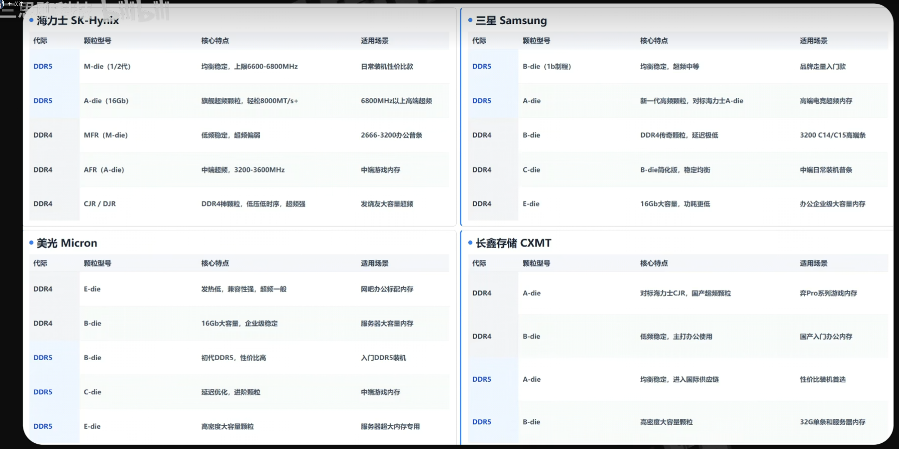

# 硬件笔记

## CPU

电脑主板的晶体发生器（晶振）提供100Mhz的基础频率，CPU为了和其他设备协调工作，需要把外频设置到100Mhz，CPU为了提高它的性能的同时还不影响到其他设备，就在外频的基础上翻倍，翻倍的数值就是倍频。
CPU主频（总频率）=CPU外频*CPU倍频

频率会影响到CPU性能，而频率是Intel或者AMD人为设定的，只要他们不锁定频率，我们就可以人为的修改这个频率，把频率往高了拉，就是超频。

- 超频前提条件：
    - 1.CPU不锁频率
    - 2.主板具备超频功能
    - 3.为超频准备更好的电源和主板

- CPU超频：
    - 1.超倍频（只影响CPU本身，不稳定因素少很多，只需专注调整CPU的参数）
    - 2.超外频（整个电脑系统的外频都要跟着变动，所有设备性能都提升，但是牵连设备多，只要有任何一个设备不能正常工作在新的外频下，电脑就会出现不稳定现象，轻则蓝屏死机，重则直接烧毁）

除了CPU外，内存也有相应的外频和倍频，如内存2400Mhz=100Mhz（外频）*24（倍频）

2133Mhz=133.33Mhz*16

2666Mhz=133.33Mhz*20

这涉及到内存外频异步工作，为了提高电脑性能，工程师研究出一种方法让内存的外频比CPU外频高33.33无穷的频率来运行，即让内存的外频工作在133.33Mhz频率下，为了实现这项功能需要内存的频率和基础频率异步运行，这就是内存频率转化率Ratio，BIOS中叫内存速度比率模式，有100:100（同步运行）、100:133（异步运行）

显卡核心频率、显存频率都跟主板基础频率没有关系，因为显卡是利用主板上的PCIE通道与CPU进行数据交互，PCIE是接在CPU内部的PCIE控制器（北桥）上的，早些年的时候北桥还未从主板上集成到CPU内，那时候可以借助超北桥频率来提高显卡性能，目前北桥已经集成到了CPU内部，显卡的核心频率和外频现在是没有多少关系的，有关系的是PCIE通信部分，所以显卡频率设定任何数值都可以，不必非是外频的整数倍；显存频率同理，和外频也没关系。

## 主板

- 主板：
    - 1.Intel不支持超频的主板：H系列和B系列；支持超频的主板是Z和X系列
    - 2.AMD全系列板子都能给内存超频，A系列板子不能超CPU，B系列和X系列是CPU和内存都可以超频
    - 3.可以查主板的内存支持QVL列表（qualified vendor list），QVL列表是厂家测试的各种型号的各种厂家的内存与这个主板的兼容性，最高可以使用多少频率多少根的内存。

## 内存

- 内存频率：
    - 1.在主板不支持超频的情况下，内存频率上限由CPU默认内存频率决定
    - 2.在主板支持超频的情况下，CPU默认的内存频率会直接被无视掉，此时的内存频率限制因素只有三个：
        - 1.内存体质（由内存颗粒本身决定）
        - 2.IMC（内存控制器，在CPU中，Intel的IMC体质会比较好）性能/体质，内存是由IMC控制的，IMC性能直接决定可以使用多高频率的内存。
        - 3.主板布线与电气性能。

## 硬盘

- 机械硬盘种类：
    - 1.LMR 水平式记录磁盘（最早期）
    - 2.PMR 垂直式记录磁盘（工艺升级后，相同面积单盘容量提升）
        - 1.SMR瓦楞式堆叠磁盘 （可以存更多数据，但是写数据弱鸡的市面标缓存256MB，大于1T的机械硬盘）
        - 2.CMR（PMR传统磁盘）（良心，市面标的缓存一般还是64MB的机械硬盘）

机械硬盘：直接写数据覆盖原来数据

固态硬盘：先擦除再写数据（写数据会慢，TRIM回收指令：为了提高写数据的速度，删除数据后，若磁盘没有数据读写即空闲时，就会擦除之前删除的数据）

TRIM状态查询命令：fsutil behavior query disabledeletenotify

TRIM关闭命令：fsutil behavior set disabledeletenotify 1

TRIM打开命令：fsutil behavior set disabledeletenotify 0

磁盘阵列：多块磁盘如果不组磁盘阵列的话，磁盘与磁盘自己是完全没有任何干系的，除非同时调取所有磁盘数据，否则总有磁盘是空闲的，无形间浪费了一部分磁盘的性能。

raid0：一份完整的数据拆分开分散到N块磁盘里面，读写的时候同时往N块磁盘读写，带宽翻倍，速度翻倍，有多少磁盘翻多少倍性能（连续读写性能，随机的不变甚至由于模块磁盘拖后腿导致木桶短板效应性能降低），最终可以把南桥带宽跑到上限。raid0是所有raid中速度最快也是最不安全的，如果有任意一款磁盘故障，便无法正常读取，导致所有数据全部报废。

raid1：把一份完整的数据复制到其他磁盘里去，N块磁盘都会存入完全一样的数据。raid1是所有raid中最安全的，但是空间利用率和速度最低。为了让所有磁盘物尽其用发挥全部性能，就有了磁盘阵列。在电脑中称为raid。

raid2：利用海明码校验，主要目的是在raid0的基础上增加数据纠错能力，具有和raid0相似的并发性能，但是由于读写还需计算校验码用于纠错，实际上性能开销还是比较大的。使用raid2的人是比较少的。

raid3:与raid0、1、2至少需要2块磁盘不同，raid3至少需要3块磁盘。raid3相对于raid0，容灾能力从零块增加到了1块，由于多了一块校验码磁盘，与raid2那种一下一堆纠错码不同，恢复码的性能还是消耗比较少的，性能非常接近raid0。

raid4：和raid3很像，也是raid0的基础上增加一块恢复码磁盘。区别是raid3 是讲一个数据块拆分分开存，校验码也是针对拆分的部分去进行计算；而raid4是直接按区块进行存储，校验码是针对几个块一起进行计算，容灾能力也是一块磁盘。

raid5：raid4有自己的问题，n块磁盘都是只有一块恢复盘，数据盘越来越多的时候只有一块恢复盘的话，恢复盘的性能可能会制约整个阵列的性能，恢复盘的恢复数据块没有写完，下一次写入是无法进行的。raid5吧原本要存入恢复盘的恢复码直接拆分开，每一块磁盘都分别存储一部分恢复码，写入操作拆分，一方面可以做到raid0相似的性能，还增加了一块磁盘的容灾能力，还解决了raid4恢复码磁盘的瓶颈。目前raid5是民用层面使用最多的一种磁盘raid。

raid6：raid345都只能容灾一块磁盘的故障，还是不安全，于是raid6的恢复码相对于raid5从1组变成了两组，让raid6有了两块磁盘的容灾能力。

raid7：。。。。暂无数据

还可以进行raid嵌套：比如两个磁盘组raid1，在用另外两个磁盘组raid1，再把这两个raid1组成一个raid0，这就是我们所说的raid10；或者每三块磁盘组一个raid5，这三个raid5组建成一个raid0，就是raid50。

## 驱动

驱动程序：一种介于硬件和系统之间的API接口，让系统知道硬件的存在，并能通过这个API接口和硬件交互数据。

操作系统安装包虽然很大有几个G，但其系统本体是很小的，其它相当一部分数据都是兼容驱动，这些驱动可以在刚做好系统补齐专用驱动之前，提供一个最基本的API接口，让部分硬件能临时凑合用一下，方便用户去补齐这些硬件的专有驱动。不然的话，最基本的显卡驱动都没有，显示器是黑屏的，鼠标/键盘都没有反应，用户就无法补驱动。系统自带的兼容性驱动只能维持硬件的基本运行，让他们能够运作起来但并不能发挥全部的性能，所以一定要自己补齐各个硬件的专有驱动！

- 安装驱动有三种方法：
    - 1.windows10系统第一次开机后，系统如果检测到电脑是联网的状态，而且集成的网卡驱动可以正常驱使网卡联网，win10会自动帮用户开始下载安装驱动，用户只需把电脑丢一旁放一段时间就好，系统会自动帮用户把所有驱动全部装好。
        - 缺点是系统只会补齐必备硬件的驱动，其二是系统帮识别的驱动型号不一定有那么准，性能不一定是最大化，并且驱动版本不是最新的。不推荐这种方法。
    - 2.使用第三方软件帮用户安装。
        - 相对于win10自动安装的好处是驱动版本肯定是最新的，但是型号识别依旧不是100%准确，同样也检测不到非核心不见需要安装的驱动。此外这些第三方软件还可能流氓捆绑，而且第三方提供的驱动有没有动过手脚我们也是不知道的。非常不推荐
    - 3.自己手动官网找驱动自己装。强烈推荐用这种方法。

## 装机

- 装机：
    - 1.内存条插槽：左边为CPU ，从左往右数2、4优先插槽，1、3为次要插槽。一个内存插第二槽。不推荐插3跟内存，因为三根内存会导致系统略微的不稳定。
    - 2.显卡务必安插到距离CPU最近的PCIE*16槽当中。

- M.2固态硬盘两种接口：
    - 1.B-Key接口，比较老，速度比较慢，上方6pin，下方5pin，豁口在左边。
    - 2.M-Key接口，比较新，速度比较快，上方5pin，下方4pin，豁口在右边。

- 风扇：CPU散热风扇电源接口要接在CPU Fan1接口。

- 电源线缆接口：
    - 1.CPU供电接口：4pin+4pin
    - 2.主板供电接口：20pin+4pin，最宽最大
    - 3.显卡供电接口：2pin+6pin，显卡供电一般是两个2+6一组
    - 3.sata供电接口：扁扁的，接口形状类似英文字母L，又称扁L sata供电接口，给sata接口的固态硬盘和机械硬盘供电
    - 4.大4pin供电接口：形状和字母d一样，又称大4d接口，几乎所有的外围设备，比如说灯条RGB灯板，风扇等都可以从这个接口取电，并且可以转换成其他类型的供电，又称万能供电接口

## 技嘉B360M POWER刷BIOS

- 去技嘉官网下载BIOS最新的更新包（包含了前面版本的所有更新），如`F17a`

- 解压更新包，得到`B360MPOWER.F17a`文件，将其复制到fat32文件系统的U盘的根目录下

- 重启电脑，进入BIOS，按下`F8`进入Q-Flash（Q‑Flash 是技嘉 BIOS 内置的刷写工具）

- 选择更新BIOS，然后选择U盘的`B360MPOWER.F17a`文件，选择一个更新模式，如fast更新或intact（完整）更新
    - fast更新：跳过部分 BIOS 镜像校验步骤，刷写速度更快，如果 BIOS 文件损坏、U 盘读写不稳定，Fast 模式更容易刷坏
    - intact（完整）更新：会对 BIOS 文件做完整校验，刷写前做更多安全检查，安全，但数度稍慢

- 刷写完成后会自动重启
    - 如果刷写完成后第一次自动重启后，显示一下主板logo后屏幕就只剩下了一个不闪烁的光标，等个十来分钟还是那样，就按电源键重启，然后进入BIOS
    - 如果Boot Option和Boot Overwrite不见了，就再刷一次BIOS更新，这次更新会比第一次更快，然后会自动重启两三次，然后会进到BIOS
    - 然后可以看到Boot Option和Boot Overwrite出现了，但是引导选项丢失了
    - 插上Live CD 启动盘，重写引导选项就可以了，如
        - 进入Live系统后先挂载系统分区然后挂载efi分区
        - 然后arch-chroot进入archlinux系统，执行grub-install安装grub引导，最后grub-mkconfig生成grub配置
        - 退出arch-chroot，卸载分区，最后重启就可以了
        - 进入BIOS，确认引导顺序，就可以重启然后正常进入系统了
