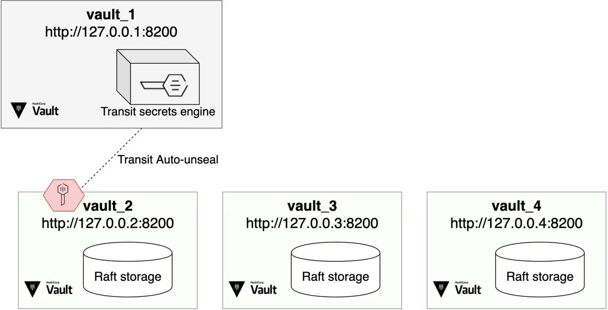

# Spring Cloud Vault

vault官网：<https://github.com/hashicorp/vault>

vault支持hcl和json两种格式的配置文件

## 使用docker版本vault

```sh
docker pull hashicorp/vault:1.19.2
```

- 使用json格式配置的compose.yaml

```yaml
services: 
    vault:
        image: hashicorp/vault:1.19.2
        container_name: vault
        command: server
        ports:
            - "8200:8200"
        cap_add:
            - IPC_LOCK
        environment:
            VAULT_LOCAL_CONFIG: >-
                { 
                    "storage": {
                        "file": {
                            "path": "/vault/file"
                        }
                    }, 
                    "listener": [
                        {
                            "tcp": { 
                                "address": "0.0.0.0:8200",
                                "tls_disable": false,
                                "tls_cert_file": "/vault/config.d/vaultPublicKey.pem",
                                "tls_key_file": "/vault/config.d/vaultPrivateKey.pem"

                            }
                        }
                    ], 
                    "default_lease_ttl": "168h", 
                    "max_lease_ttl": "720h", 
                    "ui": true
                }
        volumes:
            - vaultData:/vault/file
            # 这里使用目录映射，记得将vaultPublicKey.pem和vaultPrivateKey.pem文件复制到/path/to/data/vault/config
            - /path/to/data/vault/config:/vault/config.d
volumes: 
    vaultData:
        name: vaultData
```

- 或者是使用json配置文件的compose.yaml

```yaml
services: 
    vault:
        image: hashicorp/vault:1.19.2
        container_name: vault
        command: server -config=/vault/config.d/vault.json
        ports:
            - "8200:8200"
        cap_add:
            - IPC_LOCK
        environment:
        volumes:
            - vaultData:/vault/file
            # 这里使用目录映射，记得将vaultPublicKey.pem、vaultPrivateKey.pem和vault.json文件复制到/path/to/data/vault/config
            - /path/to/data/vault/config:/vault/config.d
volumes: 
    vaultData:
        name: vaultData
```

- vault.json

```json
{                                
    "storage": { 
        "file": {                
            "path": "/vault/file"
        }           
    },                                    
    "listener": [                         
        {                                                        
            "tcp": {                                             
                "address": "0.0.0.0:8200",                      
                "tls_disable": false,                            
                "tls_cert_file": "/vault/config.d/publicKey.pem",
                "tls_key_file": "/vault/config.d/privateKey.pem"
                                
            }                   
        }                   
    ],
    "default_lease_ttl": "168h",
    "max_lease_ttl": "720h",
    "ui": true
}
```

- 访问：<http://10.0.2.15:8200>
    - Key shares设置为1
    - Key threshold设置为1
    - 点击初始化
    - 点击Download keys，下载保存好root token（相当于登录vault的密码）和Key1（相当于密钥，vault管理的密码是经过加密了的，需要用它解密）
    - Unseal Vault的时候用Key1
    - Sign in to Vault默认是token，这时候用root token就行
    - 登录进去后，看到的Secrets Engines就是存储密钥的仓库
    - 导航栏选择Secrets Engines，点击"Enable new engine +"
    - 选择KV，它以键值对方式加密存储信息，如帐号和密码
    - Path输入框固定输入secret就行
    - Maximum number of versions，这是版本控制，会记录这个数据最近N次的变化，如填个10
    - 点击Enable Engine，启用这个KV加密引擎
    - 点击"Create secret +"，"Path for this secret"填个应用名称就行
    - Secret data中填写要添加的键值对，如key：mysql.username，value：具体mysql用户名，最后点击Save保存

- 如果是进入容器终端环境执行命令

```sh
# 这里的容器shell是/bin/sh或sh，不能是/bin/bash和bash
docker exec -it yourVaultName sh

export VAULT_ADDR=https://127.0.0.1:8200

# 如果提示证书验证失败可以这样
export VAULT_SKIP_VERIFY=true

# 然后就可以输入操作命令了
```

## 使用vault-ui

官网：<https://github.com/djenriquez/vault-ui>，代码已经归档好多年了

vault本身的UI界面是限制了创建新Token的功能的，要通过安装vault-ui软件来操作或者通过进入容器使用命令行创建

除了创建创建新Token的功能外，个人感觉其它功能还是官方的UI好用

vault-ui还有appimage版本的包，这里介绍docker版本的使用

```sh
docker pull djenriquez/vault-ui:2.3.0
```

- compose

```yaml
services: 
    vaultUi:
        image: djenriquez/vault-ui:2.3.0
        container_name: vaultUi
        ports:
            - "8000:8000"
        environment:
            # CUSTOM_CA_CERT: /path/to/vaultPublicKey.pem
            # 如果vault配置了https，需要设置这个环境变量来禁用TLS server side校验，上面的方法也可以，但是没试过，二选一就行了
            NODE_TLS_REJECT_UNAUTHORIZED: 0
```

- 访问：<http://yourip:8000/>

## Spring Cloud 集成Vault

- 依赖

```xml
<!-- 在应用启动的时候自动连接到vault服务器，把需要的数据拉到本地从而注入到环境变量中 -->
<dependency>
    <groupId>org.springframework.cloud</groupId>
    <artifactId>spring-cloud-starter-vault-config</artifactId>
</dependency>

<!-- 在应用启动前完成配置信息的拉取 -->
<dependency>
    <groupId>org.springframework.cloud</groupId>
    <artifactId>spring-cloud-starter-bootstrap</artifactId>
</dependency>
```

- bootstrap.yaml配置文件

```yaml
spring.application.name: spring-cloud-vault-demo
spring.cloud.vault:
    # vualt服务器地址，如果用的是https，那么生成证书的keystore用的是域名这里也必须是域名，否则会报错
    host: www.example.com
    port: 8200
    # 设置https的话后面必须设置ssl
    scheme: https
    # 鉴权方式
    authentication: TOKEN
    # vualt的root token权限太大了，应该生成一个只允许访问特定密钥仓库的令牌填到这里
    token: 你的vault token
    kv:
        # vault定义的Secrets Engines的具体Path
        backend: secret
    # vault定义的具体backend下的特定Path for this secret
    application-name: dubhe
    # 设置ssl
    ssl:
        # 记得将vaultPublicKey.pem复制到resources目录下
        trust-store: classpath:vaultPublicKey.pem
        trust-store-type: PEM
        # 设置启用的SSL/TLS协议列表
        enabled-protocols: TLSv1.2,TLSv1.3
        # 设置启用的SSL/TLS密码套件列表
        enabled-cipher-suites: TLS_AES_128_GCM_SHA256
```

- application.properties配置文件

```properties
# 获取vault中的配置的key的value值，mysql.username是vault中的key
username=${mysql.username}
password=${mysql.password}
```

- controller

```java
@RestController
public class ApplicationController {
    // 使用application.properties中的key
    @Value("${username}")
    private String username;

    // 也可以直接使用vault中的key
    @Value("${mysql.password}")
    private String password;

    @GetMapping("/")
    public String get() {
        return "get from vault: \t" + "username: " + username + "\t password: " + password + "\t timestamp: " + Instant.now().toEpochMilli();
    }
}
```

## 设置访问策略

- 点击导航栏Policies
- 点击Create ACL Policies
- 填写策略

```conf
# 假设只让这个Token增删改secret/myapp下的键值对
# 创建secret engine的时候点击Methods Options可以看到KV版本默认是2
# KV版本是2的引擎读取数据时，路径中需要加上/data/，这个可以在secret engine如secret/app的Overview的API
# 这样写Spring Boot仍然会去默认路径secret/application下找键值对，因为没有权限而报错，但是不影响运行
# 如果觉得别扭可以设置为"secret/*"或"secret/data/*"就不会报错了，但是这样设置使用这个策略的token的权限就更大了，具体情况具体分析吧
path "secret/data/myapp" {
    capabilities = [ "create", "read", "update", "list" ]
}
```

- 点击Create policy

- 创建新Token，将创建的访问策略添加进去就可以了

## Vault集群

教程官网：<https://developer.hashicorp.com/vault/tutorials/raft/raft-storage>

以下教程需要先系统上安装vault，去官网下载压缩包，解压后将vault文件放到/usr/local/bin目录下就可以了

vault集群的配置需要用到cluster.sh脚本，在<https://github.com/hashicorp-education/learn-vault-raft>可以下载，后面会有具体的教程

cluster.sh脚本会配置和启动4个vault服务，如结构下图



脚本初始化并解封vault_1 (<http://127.0.0.1:8200>)，它不加入集群，其root token创建一个自动解封其它vault服务的传输key

脚本初始化并解封vault_2 (<http://127.0.0.2:8200>)，启动后作为集群leader，脚本启用K/V-V2加密引擎作为一个例子

脚本启动vault_3 (<http://127.0.0.3:8200>)，但是需要手动加入集群

脚本启动vault_4 (<http://127.0.0.4:8200>)，但是需要手动加入集群

```sh
# 1.创建并进入目录$HOME/vault-tutorial
mkdir $HOME/vault-tutorial && cd $HOME/vault-tutorial

# 2.复制git项目
git clone https://github.com/hashicorp-education/learn-vault-raft

# 3.进入项目根目录
cd learn-vault-raft/raft-storage/local

# 4.给脚本添加执行权限，笔者下载下来检查发现已经是有执行权限了
chmod +x cluster.sh

# 5.为每个vault创建本地回环地址
# loop back：在计算机里，它指的是数据包发出去后，不会经过物理网卡，而是直接在系统内部“绕一圈”又回到自己这里
./cluster.sh create network

# 6.为每个vault创建配置文件
./cluster.sh create config

# 7.检查当前shell是否存在环境变量，如果已存在则必须执行unset VAULT_TOKEN，才能继续后续步骤
printenv | grep VAULT_TOKEN

# 安装vault_1
# 如果包jq找不到则安装：sudo apt-get install jq
# 然后sudo ./cluster.sh clean，回到第5步重新开始
./cluster.sh setup vault_1

# 安装vault_2
./cluster.sh setup vault_2

# 安装vault_3
./cluster.sh setup vault_3

# 可以看到集群中只有一个leader节点vault_2
export VAULT_ADDR="http://127.0.0.2:8200"
vault operator raft list-peers

# 打开一个新终端并进入指定目录
cd $HOME/vault-tutorial/learn-vault-raft/raft-storage/local

# vault_3加入集群
export VAULT_ADDR="http://127.0.0.3:8200"
vault operator raft join http://127.0.0.2:8200

# 配置vault CLI的请求使用vault_2的root token
export VAULT_TOKEN=$(cat root_token-vault_2)

# 可以看到vault_3作为follower出现在集群节点里面
vault operator raft list-peers

# 查看vault_3日志
cat vault_3.log

# 最后确认可以读取kv/apikey路径的kv
vault kv get kv/apikey
```

接下来，可以像vault_3的步骤一样将vault_4加入集群

但是，如果所有节点的连接明细是事先已经确认的话，可以在配置文件中配置retry_join块来自动加入集群

修改config-vault_4.hcl配置文件，在storage块里面加入retry_join

```conf
storage "raft" {
    path    = "<path_to_local>/raft-vault_4/"
    node_id = "vault_4"
    # 因为vault_2和vault_3的地址是已知的
    # 可以在retry_join块里面预定义可能为集群leader的节点地址
    retry_join {
        leader_api_addr = "http://127.0.0.2:8200"
    }
    retry_join {
        leader_api_addr = "http://127.0.0.3:8200"
    }
}
```

- 启动vault_4

```sh
# 启动vault_4
./cluster.sh start vault_4

# 打开一个新终端并进入指定目录
cd $HOME/vault-tutorial/learn-vault-raft/raft-storage/local

# 配置当前shell的环境变量VAULT_ADDR
export VAULT_ADDR="http://127.0.0.4:8200"

# 可以看到vault_4作为follower出现在集群节点里面
vault operator raft list-peers

# 配置vault CLI的请求使用vault_2的root token
export VAULT_TOKEN=$(cat root_token-vault_2)

# patch路径kv/apikey的键，设置有效期365天
vault kv patch kv/apikey expiration="365 days"

# 回到vault_3的终端，执行如下命令，可以看到多了expiration的信息
vault kv get kv/apikey
```

- vault配置文件的部分说明

```conf
# raft表示使用Integrated Storage
storage "raft" {
    # Vault数据存储的地方
    path    = "/path/to/raft-vault_2/"
    node_id = "vault_2"
}
```

## 数据快照

Integrated Storage提供了一个创建数据快照的接口

这些快照如果后期有需要可以用于数据恢复

社区版是没有自动快照功能的，可以通过定时任务来定时创建快照

回到VAULT_ADDR设置为vault_2的地址(<http://127.0.0.2:8200)的终端>

```sh
# 对当前数据创建快照
# 在当前目录下会创建一个demo.snapshot文件
vault operator raft snapshot save demo.snapshot
```

- 模拟数据丢失

```sh
# 确认kv/apikey有数据
vault kv get kv/apikey

# 删除kv/apikey的数据
vault kv metadata delete kv/apikey

# 确认kv/apikey的数据已删除
vault kv get kv/apikey
```

- 从快照恢复数据

```sh
# 通过恢复demo.snapshot中找到的数据来恢复数据
vault operator raft snapshot restore demo.snapshot

# 查看当前集群节点（vault_2）的末尾的几行日志
grep -B3 'snapshot installed' vault_2.log

# 确认数据已恢复
vault kv get kv/apikey
```

## leader退役（变成follower，其它节点变成leader）

```sh
# 在VAULT_ADDR为http://127.0.0.2:8200（vault_2)的终端执行
vault operator step-down

# 然后在VAULT_ADDR为http://127.0.0.3:8200（vault_3)的终端执行
# 可以看到vault_2变成follower，vault_3晋升变成leader了
vault operator raft list-peers
```

## 移除集群成员

为了维护、升级或保存计算资源，从集群中删除节点可能变得很重要

```sh
# 从集群中移除vault_4节点
vault operator raft remove-peer vault_4

# 在其它节点执行，确认vault_4已经从集群中移除
vault operator raft list-peers
```

## 将vault_4重新添加回集群

```sh
# 在VAULT_ADDR为http://127.0.0.4:8200（vault_4)的终端执行
./cluster.sh stop vault_4

# 删除vault_4的数据目录
rm -rf raft-vault_4

# 重新创建vault_4的数据目录raft-vault_4
# 因为raft的存储目录在启动vault服务前必须已经存在
mkdir raft-vault_4

# 启动vault_4
./cluster.sh start vault_4

# 确认节点已经添加到集群
vault operator raft list-peers
```

## 恢复模式

如果由于存储中的条目损坏而导致Vault服务宕机，操作员可能需要在恢复模式下启动Vault

在恢复模式下，Vault以最小的功能运行，并暴露其子集API

```sh
# 停止集群中的所有存活的节点
./cluster.sh stop vault_2
./cluster.sh stop vault_4
./cluster.sh stop vault_3

# 以恢复模式启动vault_3
VAULT_TOKEN=$(cat root_token-vault_1) VAULT_ADDR=http://127.0.0.3:8200 \
            vault server -recovery -config=config-vault_3.hcl

# 打开一个新终端并进入指定目录
cd $HOME/vault-tutorial/learn-vault-raft/raft-storage/local

# 配置当前shell的环境变量VAULT_ADDR
export VAULT_ADDR="http://127.0.0.3:8200"

# 生成一个一次性密码(OTP)
vault operator generate-root -generate-otp -recovery-token

# 使用上一步得到的一次性密码生成恢复令牌(recovery token)
vault operator generate-root -init \
    -otp=UPeg0ZMO6F16wawH7XFX9jX2jTud -recovery-token

# 查看在安装vault_3期间生成的recovery key（恢复密钥）
# 使用恢复密钥而不是解封密钥，因为此集群配置了传输自动解封（集群默认Transit auto-unseal）
cat recovery_key-vault_2

# 创建一个编码令牌（encoded token），根据交互填入上一步得到的恢复密钥
vault operator generate-root -recovery-token

# 最后使用编码令牌和一次性密码完成恢复令牌的创建
# 比如得到恢复令牌：hvr.oK3gSD81MPQs8o3mzbQgpDEy
vault operator generate-root \
  -decode=PSYXSV8RfihlAgYPOjEmOw53dTVDCAlVGhAwHQ \
  -otp=UPeg0ZMO6F16wawH7XFX7jX2jTud \
  -recovery-token

# 在恢复模式，只能跟原始系统存储进行交互
# 使用恢复令牌解决问题吧
# 例子：列出sys/raw/sys的内容
VAULT_TOKEN=hvr.oK3gSD81MPQs8o3mzbQgpDEy vault list sys/raw/sys

# 解决问题后，继续常规操作
# 在运行恢复模式的终端按Ctrl+C停止恢复模式
# 重新启动所有vault节点
# 因为在恢复模式下启动节点时，它会重置集群成员列表
# 这意味着在恢复常规操作时，每个节点都需要重新加入集群
# 笔者在操作的时候发现vault_2死活加入不了vault_3，不知道出了什么问题
./cluster.sh start vault_3
./cluster.sh start vault_2
```

## 清理cluster.sh生成的数据

```sh
./cluster.sh clean
```

## 不用脚本，手动搭建vault集群

启动vault_node_1后，这里为了简便，用浏览器访问https:vault_node_1_ip:8200，选择"Create a new Raft cluster"

Vault 在初始化时会生成一把能解开所有数据的“总钥匙”（根密钥），但它不会直接把这把钥匙交给你，而是把它拆分成若干份碎片。

Key shares（密钥份额/总份数）：代表 Vault 会把这把“总钥匙”拆分成多少份碎片（Unseal Keys）。

Key threshold（密钥阈值/所需份数）：代表在 Vault 重启或解封时，至少需要凑齐多少份碎片，才能把“总钥匙”重新拼凑出来，从而解开 Vault。

这里都填1就行了，生产环境可以设置根据情况设置，如（Key shares：5，Key threshold：3）

下一步把钥匙下载下来，然后点击继续解封，解封后就可以进入ui了

```sh
vault operator raft list-peers

# 如果报下面的错
# Error reading the raft cluster configuration: Error making API request.
# URL: GET https://127.0.0.1:8200/v1/sys/storage/raft/configuration
# Code: 403. Errors:
# * 2 errors occurred:
#        * permission denied
#        * invalid token
# 先用跟令牌登录
vault login
```

启动vault_node_2后，这里为了简便，用浏览器访问https:vault_node_2_ip:8200，选择"Join an existing Raft cluster"

```sh
export VAULT_ADDR=https://127.0.0.1:8200

# 如果提示证书验证失败可以这样
# tls: failed to verify certificate: x509: cannot validate certificate for 127.0.0.1 because it doesn't contain any IP SANs
export VAULT_SKIP_VERIFY=true
```
