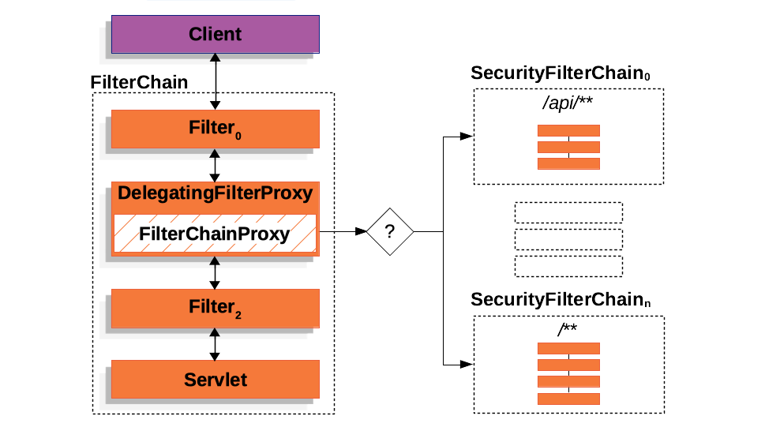
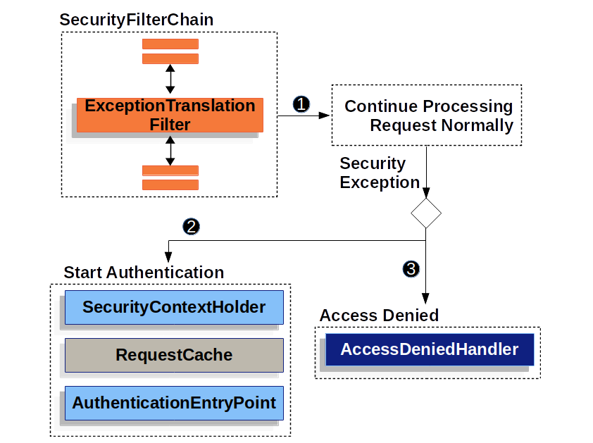
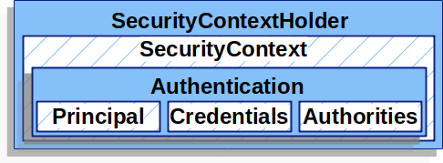
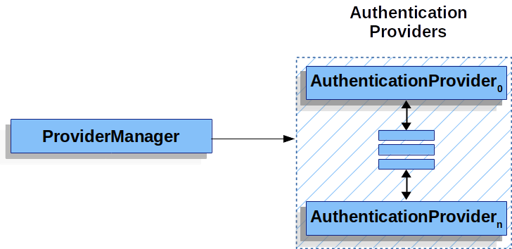
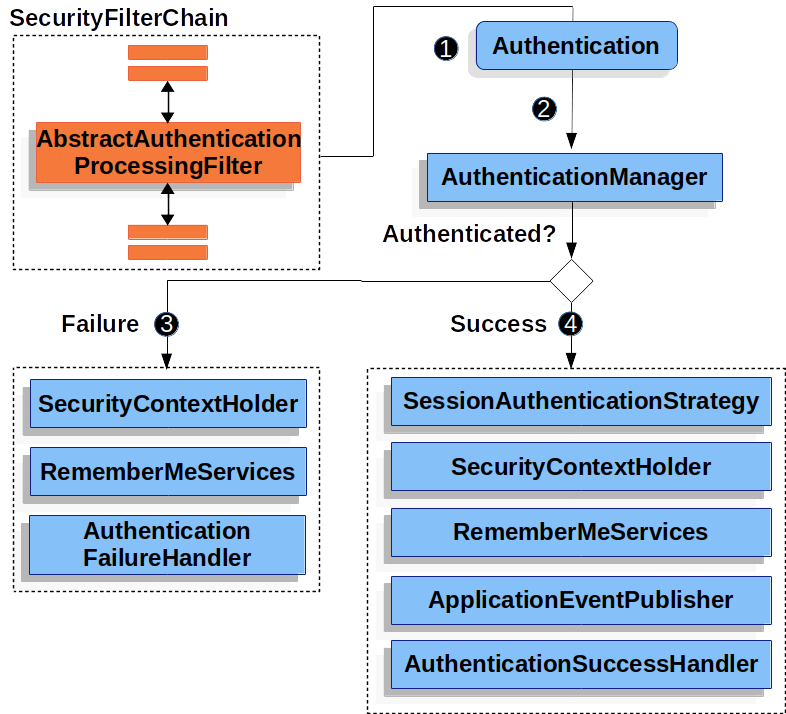

# Spring Security

Spring Security提供3大功能：认证、授权和防御常见攻击

认证 (Authentication)： 是验证用户的身份的凭据（例如用户名/用户ID和密码），通过这个凭据，系统得以知道用户是谁

授权 (Authorization)： 发生在认证之后，授予了什么权限，有权限干什么


模型：用户、[用户组、]角色、[角色组、]权限、资源

用户-角色表、角色-权限表

权限-菜单表、权限-页面表、权限-文件表

权限-操作表

操作类型分为：增、删、查、改

当用户量非常大的时候，考虑使用用户组，加上用户组-用户表和用户组-角色表

除了给单个⽤⼾授权外，还可以给⽤⼾组授权

这样⼀来，通过⼀次授权，就可以同时给多个⽤⼾授予相同的权限

⽽这时⽤⼾的所有权限就是⽤⼾个⼈拥有的权限与该⽤⼾所在组所拥有的权限之和

## 身份验证方案

Session-Cookie + OAuth2

### Session-Cookie方案

1. 用户成功登录系统后，服务器为用户创建一个Session并存储起来（Redis），然后返回给客户端具有SessionID的Cookie

2. 当用户向后端发起请求的时候会把SessionID带上，后端对其和数据库（Redis）中的SessionID进行比对

要确保客户端开启了Cookie，还要注意Session的过期时间

如果客户端禁用了Cookie，可以对SessionID进行一次加密，然后通过放到请求参数或者请求体的方式传给后端

- Cookie无法防止CSRF（跨站请求伪造）攻击，而Token可以
    - 如果点击了非法链接，会拿到Cookie干坏事
    - Token存放在浏览器的localStorage，非法链接拿不到这个Token

- 无论Cookie还是Token都无法避免XSS（Cross Site Scripting，跨站脚本攻击，为了跟层叠样式表（Cascading Style Sheets，CSS）的缩写区别）攻击

### OAuth2（Opaque Token）

OAuth2由3个部分组成：
    - OAuth2 Resource Server（也就是后端业务微服务）
    - OAuth2 Client（前端+后端共同完成获取token，返回前端sessionid的整个登录流程，先这么理解吧）
    - OAuth2 Authorization Server（授权服务器，可以当成一个微服务）

## Spring Session

- 依赖

```xml
<dependency>
    <groupId>org.springframework.boot</groupId>
    <artifactId>spring-boot-starter-security</artifactId>
</dependency>
```

- 配置文件

```properties
# 自定义登录用户和密码
spring.security.user.name=admin
spring.security.user.password=123
```

- 自定义配置类

```java
// 开启SpringSecurity的自定义配置（在SpringBoot项目中可以省略此注解）
//@EnableWebSecurity
@Configuration
public class WebSecurityConfiguration {
    // 用这种方式创建的用户将会覆盖配置文件设置的用户信息
    @Bean
    public UserDetailsService userDetailsService() {
        // 创建基于内存的用户信息管理器
        InMemoryUserDetailsManager manager = new InMemoryUserDetailsManager();
        // 创建UserDetails对象，用于管理用户名、用户密码、用户角色、用户权限等内容
        manager.createUser(User.withDefaultPasswordEncoder().username("user").password("123").roles("USER").build());
        return manager;
    }
}
```

## 基于数据库的认证

- 1.实现UserDetailsService并添加到IOC容器

```java
@Component
public class DatabaseUserDetailsManager implements UserDetailsService {
    @Resource
    private AccountDao accountDao;

    @Override
    public UserDetails loadUserByUsername(String username) throws UsernameNotFoundException {
        LambdaQueryWrapper<AccountPo> queryWrapper = new LambdaQueryWrapper<>();
        queryWrapper.eq(AccountPo::getName, username);
        AccountPo accountPo = accountDao.selectOne(queryWrapper);
        if (Objects.isNull(accountPo)) {
        throw new UsernameNotFoundException(username);
        }
        return new User(accountPo.getName(), accountPo.getPassword(), accountPo.getEnabled(), true,
        true, true, new ArrayList<GrantedAuthority>());
    }
}

```

## 自定义配置

```java
@Configuration
public class WebSecurityConfiguration {
    @Bean
    public SecurityFilterChain securityFilterChain(HttpSecurity httpSecurity) throws Exception {
        // 开启授权保护
        httpSecurity.authorizeHttpRequests(authorize -> 
        // 对所有请求开启授权保护
        authorize.anyRequest()
        // 已认证的请求会自动授权
        .authenticated());

        // 使用表单授权方式
        httpSecurity.formLogin(form -> 
        form.loginPage("/login")
        // 无需授权即可访问
        .permitAll()
        // 自定义登录页面表单的用户名参数名、密码参数名（默认是username、password）
        .usernameParameter("username")
        .passwordParameter("password")
        // 校验失败时跳转的地址
        .failureUrl("login?failure")
        // 认证成功时的处理
        .successHandler(new LoginAuthenticationSuccessHandler())
        // 认证失败时的处理
        .failureHandler(new LoginAuthenticationFailureHandler())
        );
        // 登出成功时的处理
        httpSecurity.logout(logout -> logout.logoutSuccessHandler(new MyLogoutSuccessHandler()));
        // 请求未认证时的处理
        httpSecurity.exceptionHandling(exception -> exception.authenticationEntryPoint(new MyAuthenticationEntryPoint()));

        // 设置一个账号最多允许同时登录的上限，并自定义超时退出
        httpSecurity.sessionManagement(session -> session.maximumSessions(1).expiredSessionStrategy(new MySessionInformationExpiredStrategy()));
        //  httpSecurity.cors()
        return httpSecurity.build();
    }
}
```

### 在handler中获取用户信息

```java
@GetMapping("/userInfo")
@ResponseBody
public void userInfo() {
    SecurityContext context = SecurityContextHolder.getContext();
    Authentication authentication = context.getAuthentication();
    String username = authentication.getName();
    Object principal = authentication.getPrincipal();
    Object credentials = authentication.getCredentials();
    Collection<? extends GrantedAuthority> authorities = authentication.getAuthorities();
}
```

## 身份认证

### PasswordEncoder

- PasswordEncoder接口有三个方法

```java
public interface PasswordEncoder {
    String encode(CharSequence rawPassword);

    boolean matches(CharSequence rawPassword, String encodedPassword);

    default boolean upgradeEncoding(String encodedPassword) {
        return false;
    }
}
```

- 密码保存

```java
// 创建默认的DelegatingPasswordEncoder
PasswordEncoder passwordEncoder =
    PasswordEncoderFactories.createDelegatingPasswordEncoder();

// 自定义DelegatingPasswordEncoder
String idForEncode = "bcrypt";
Map encoders = new HashMap<>();
encoders.put(idForEncode, new BCryptPasswordEncoder());
encoders.put("noop", NoOpPasswordEncoder.getInstance());
encoders.put("pbkdf2", Pbkdf2PasswordEncoder.defaultsForSpringSecurity_v5_5());
encoders.put("pbkdf2@SpringSecurity_v5_8", Pbkdf2PasswordEncoder.defaultsForSpringSecurity_v5_8());
encoders.put("scrypt", SCryptPasswordEncoder.defaultsForSpringSecurity_v4_1());
encoders.put("scrypt@SpringSecurity_v5_8", SCryptPasswordEncoder.defaultsForSpringSecurity_v5_8());
encoders.put("argon2", Argon2PasswordEncoder.defaultsForSpringSecurity_v5_2());
encoders.put("argon2@SpringSecurity_v5_8", Argon2PasswordEncoder.defaultsForSpringSecurity_v5_8());
encoders.put("sha256", new StandardPasswordEncoder());

PasswordEncoder passwordEncoder =
    new DelegatingPasswordEncoder(idForEncode, encoders);

// 设置默认PasswordEncoder
DelegatingPasswordEncoder.setDefaultPasswordEncoderForMatches(PasswordEncoder);

// 编码密码
UserDetails user = User.withDefaultPasswordEncoder()
    .username("user")
    .password("password")
    .roles("user")
    .build();
System.out.println(user.getPassword());
// {bcrypt}$2a$10$dXJ3SW6G7P50lGmMkkmwe.20cQQubK3.HZWzG3YB1tlRy.fqvM/BG

// 复用builder编码多个用户的密码
UserBuilder users = User.withDefaultPasswordEncoder();
UserDetails user = users
    .username("user")
    .password("password")
    .roles("USER")
    .build();
UserDetails admin = users
    .username("admin")
    .password("password")
    .roles("USER","ADMIN")
    .build();

// 上面的编码方式密码还是暴露在内存和字节码里面
// 为此可以 Encode with Spring Boot CLI
spring encodepassword password
{bcrypt}$2a$10$X5wFBtLrL/kHcmrOGGTrGufsBX8CJ0WpQpF3pgeuxBB/H73BK1DW6
```

- 密码校验，需要调整参数让校验时间大约1秒左右

```java
// Create an encoder with strength 16
BCryptPasswordEncoder encoder = new BCryptPasswordEncoder(16);
String result = encoder.encode("myPassword");
assertTrue(encoder.matches("myPassword", result));

// Argon2是the winner of the Password Hashing Competition，它需要消耗大内存
// 依赖BouncyCastle库
// Create an encoder with all the defaults
Argon2PasswordEncoder encoder = Argon2PasswordEncoder.defaultsForSpringSecurity_v5_8();
String result = encoder.encode("myPassword");
assertTrue(encoder.matches("myPassword", result));

// Pbkdf2 is a good choice when FIPS certification is required
// Create an encoder with all the defaults
Pbkdf2PasswordEncoder encoder = Pbkdf2PasswordEncoder.defaultsForSpringSecurity_v5_8();
String result = encoder.encode("myPassword");
assertTrue(encoder.matches("myPassword", result));

// SCrypt也需要消耗大内存
// Create an encoder with all the defaults
SCryptPasswordEncoder encoder = SCryptPasswordEncoder.defaultsForSpringSecurity_v5_8();
String result = encoder.encode("myPassword");
assertTrue(encoder.matches("myPassword", result));

// 以下是Password4j-based Password Encoders
// Spring Security 7.0介绍了可选的基于Password4j库的密码编码器，它们都是线程安全的
// 这些编码器中的流行编码器提供了额外的操作，当你需要指定配置或充分利用Password4j的优化时它们更加有用

// 官方推荐新的应用用Argon2
// 默认配置的Argon2Password4jPasswordEncoder，编码后的密码包含了salt
PasswordEncoder encoder = new Argon2Password4jPasswordEncoder();
String result = encoder.encode("myPassword");
assertThat(encoder.matches("myPassword", result)).isTrue();

// 自定义配置的Argon2Password4jPasswordEncoder，编码后的密码包含了salt
Argon2Function argon2Fn = Argon2Function.getInstance(65536, 3, 4, 32,
    Argon2.ID);
PasswordEncoder encoder = new Argon2Password4jPasswordEncoder(argon2Fn);
String result = encoder.encode("myPassword");
assertThat(encoder.matches("myPassword", result)).isTrue();

// 默认配置的BCryptPasswordEncoder，编码后的密码包含了salt
PasswordEncoder encoder = new BCryptPasswordEncoder();
String result = encoder.encode("myPassword");
assertThat(encoder.matches("myPassword", result)).isTrue();

// 自定义配置的BCryptPasswordEncoder，编码后的密码包含了salt
BcryptFunction bcryptFn = BcryptFunction.getInstance(12);
PasswordEncoder encoder = new BcryptPassword4jPasswordEncoder(bcryptFn);
String result = encoder.encode("myPassword");
assertThat(encoder.matches("myPassword", result)).isTrue();

// ScryptPassword4jPasswordEncoder旨在抵御硬件暴力攻击，编码后的密码包含了salt
// 默认配置的ScryptPassword4jPasswordEncoder
PasswordEncoder encoder = new ScryptPassword4jPasswordEncoder();
String result = encoder.encode("myPassword");
assertThat(encoder.matches("myPassword", result)).isTrue();

// 自定义配置的ScryptPassword4jPasswordEncoder
ScryptFunction scryptFn = ScryptFunction.getInstance(32768, 8, 1, 32);
PasswordEncoder encoder = new ScryptPassword4jPasswordEncoder(scryptFn);
String result = encoder.encode("myPassword");
assertThat(encoder.matches("myPassword", result)).isTrue();

// PBKDF2是一个密钥派生函数，用于抵御字典攻击和暴力破解攻击，使其计算成本很高
// 官网说编码后的密码不包含salt
// 但是又说编码后的格式为{salt}:{hash}， both salt and hash are Base64 encoded
// 等使用的时候再验证一下吧
// 默认配置的Pbkdf2Password4jPasswordEncoder
PasswordEncoder encoder = new Pbkdf2Password4jPasswordEncoder();
String result = encoder.encode("myPassword");
assertThat(encoder.matches("myPassword", result)).isTrue();

// 自定义配置的Pbkdf2Password4jPasswordEncoder
PBKDF2Function pbkdf2Fn = PBKDF2Function.getInstance(Hmac.SHA256, 100000, 256);
PasswordEncoder encoder = new Pbkdf2Password4jPasswordEncoder(pbkdf2Fn);
String result = encoder.encode("myPassword");
assertThat(encoder.matches("myPassword", result)).isTrue();

// BalloonHashingPassword4jPasswordEncoder旨在抵抗时间-内存权衡攻击和侧信道攻击
// 官网说编码后的密码不包含salt
// 但是又说编码后的格式为{salt}:{hash}， both salt and hash are Base64 encoded
// 等使用的时候再验证一下吧
// 默认配置的BalloonHashingPassword4jPasswordEncoder
PasswordEncoder encoder = new BalloonHashingPassword4jPasswordEncoder();
String result = encoder.encode("myPassword");
assertThat(encoder.matches("myPassword", result)).isTrue();

// 自定义配置的BalloonHashingPassword4jPasswordEncoder
BalloonHashingFunction ballooningHashingFn =
 BalloonHashingFunction.getInstance("SHA-256", 1024, 3, 4, 3);
PasswordEncoder encoder = new BalloonHashingPassword4jPasswordEncoder(ballooningHashingFn);
String result = encoder.encode("myPassword");
assertThat(encoder.matches("myPassword", result)).isTrue();
```

- 密码保存格式

```sh
# id：编码password的PasswordEncoder标识
# encodedPassword：原始密码编码后得到的密码
{id}encodedPassword

# 例
{sha256}97cde38028ad898ebc02e690819fa220e88c62e0699403e94fff291cfffaf8410849f27605abcbc0
```

### 密码存储配置

Spring Security 默认使用 DelegatingPasswordEncoder，但是开发者通过Spring bean可以自定义PasswordEncoder

```java
@Bean
public static NoOpPasswordEncoder passwordEncoder() {
    return NoOpPasswordEncoder.getInstance();
}
```

### 密码修改配置

```java
// 导航/.well-known/change-password将重定向到/change-password
http
    .passwordManagement(Customizer.withDefaults())

// 也可以自定义，导航/.well-known/change-password将重定向到/update-password
http
    .passwordManagement((management) -> management
        .changePasswordPage("/update-password")
    )
```

### 密码强度检测

可以使用Spring Security 的DaoAuthenticationProvider

也可以使用Have I Been Pwned API的CompromisedPasswordChecker（需要自己提供一个bean：HaveIBeenPwnedRestApiPasswordChecker）

当用户输入的密码较弱时，可以通过AuthenticationFailureHandler处理CompromisedPasswordException来执行自定义的逻辑，比如重定向到/reset-password

```java
@Bean
public SecurityFilterChain filterChain(HttpSecurity http) throws Exception {
    http
        .authorizeHttpRequests(authorize -> authorize
            .anyRequest().authenticated()
    )
    .formLogin((login) -> login
        .failureHandler(new CompromisedPasswordAuthenticationFailureHandler())
    );
    return http.build();
}

@Bean
public CompromisedPasswordChecker compromisedPasswordChecker() {
    return new HaveIBeenPwnedRestApiPasswordChecker();
}

static class CompromisedPasswordAuthenticationFailureHandler implements AuthenticationFailureHandler {

    private final SimpleUrlAuthenticationFailureHandler defaultFailureHandler = new SimpleUrlAuthenticationFailureHandler(
   "/login?error");

    private final RedirectStrategy redirectStrategy = new DefaultRedirectStrategy();

    @Override
    public void onAuthenticationFailure(HttpServletRequest request, HttpServletResponse response,
        AuthenticationException exception) throws IOException, ServletException {
        if (exception instanceof CompromisedPasswordException) {
            this.redirectStrategy.sendRedirect(request, response, "/reset-password");
            return;
        }
        this.defaultFailureHandler.onAuthenticationFailure(request, response, exception);
    }

}
```

## 授权

Spring Security提供了基于请求的授权和基于方法的授权两种

## 防范漏洞利用

### CSRF

Cross Site Request Forgery，跨站点请求伪造

浏览器有一个机制：只要访问某个域名，浏览器就会自动附带该域名的Cookie（如里面包含了sessionId）

比如你登录了bank.com，但是没有登出

然后浏览恶意页面evil.com，这个页面的表单内容模仿了bank.com的转钱表单的内容（或者它就是一个让你以为是bank.com的钓鱼网站），表单提交将发请求到bank.com，然后引诱你点击

不幸的是你点击了提交（甚至是不用你点击直接js脚本自动完成了），浏览器看到请求目标是bank.com，就自动带上bank.com的Cookie了，然后你账户的钱没了

这就是CSRF，一句话概括就是CSRF让你的浏览器带着你的Cookie去做你没打算做的事

Spring提供了两种机制来防范：Synchronizer Token Pattern和Specifying the SameSite Attribute on your session cookie

这两种机制都要求前提是Safe Methods be Read-only： HTTP GET, HEAD, OPTIONS, and TRACE methods should not change the state of the application

#### Synchronizer Token Pattern

由于浏览器的同源策略（Same-Origin Policy）规定，跨站请求不能读取hidden input和设置自定义Header

因此对于改变应用状态的请求，可以生成一个随机的CSRF Token，放在HTTP parameter或HTTP header中

```html
<!-- hidden input，随表单一起提交 -->
<input type="hidden"
 name="_csrf"
 value="4bfd1575-3ad1-4d21-96c7-4ef2d9f86721"/>

<!-- 设置header，随请求一起提交，推荐 -->
X-CSRF-Token: 4bfd1575-3ad1-4d21-96c7-4ef2d9f86721
```

#### Specifying the SameSite Attribute on your session cookie

Spring Security不直接控制session cookie的创建，也就是不对SameSite attribute提供支持

可以通过Spring Session设置SameSite attribute

- SameSite有两种属性
    - Strict：任何跨站请求都不带Cookie
    - Lax：top-level navigations and the method is read-only除外，其它跨站请求都不带Cookie

```sh
Set-Cookie: JSESSIONID=randomid; Domain=bank.example.com; Secure; HttpOnly; SameSite=Lax
```

### HTTP Headers

#### Default Security HTTP Response Headers

```sh
# Spring Security默认禁止缓存
Cache-Control: no-cache, no-store, max-age=0, must-revalidate
Pragma: no-cache
Expires: 0

# Spring Security默认禁止content type嗅探，这时候需要手动指定content type
X-Content-Type-Options: nosniff

# 将站点标记为HSTS主机的一种方法是将主机预加载到浏览器中
# 另一种方法就是添加Strict-Transport-Security到响应头
# max-age=31536000，命令浏览器一年内都将域名作为HSTS主机对待
# includeSubDomains：也将子域名域名作为HSTS主机对待
# preload：命令浏览器将其作为HSTS主机预加载
Strict-Transport-Security: max-age=31536000 ; includeSubDomains ; preload
# 禁用在iframe内渲染页面
X-Frame-Options: DENY

# 有些浏览器内置了过滤反射XSS攻击的支持
# 该过滤器在主流浏览器中已被弃用，目前OWASP的建议是显式地将报头设置为0
X-XSS-Protection: 0
```

#### Content Security Policy (CSP)

```sh
# 当试图从非script-src声明的地址载脚本时，将会被user-agent阻止
# 如果一个web应用程序违反了声明的安全策略，将指示user-agent向report-uri指定的URL发送违反报告
Content-Security-Policy: script-src https://trustedscripts.example.com; report-uri /csp-report-endpoint/

# 只发送违反报告，不阻止加载脚本，通常在实验或开发场景使用
Content-Security-Policy-Report-Only: script-src 'self' https://trustedscripts.example.com; report-uri /csp-report-endpoint/
```

#### Referrer Policy

```sh
# 指示浏览器让目的地知道用户以前所在的源
Referrer-Policy: same-origin
```

#### Feature Policy

```sh
# Feature Policy是一种允许web开发人员选择性地启用、禁用和修改浏览器中某些api和web特性的行为的机制
Feature-Policy: geolocation 'self'
```

#### Permissions Policy

```sh
# Permissions Policy是一种允许web开发人员选择性地启用、禁用和修改浏览器中某些api和web特性的行为的机制
# 这描述感觉是官方复制粘贴的，具体应该跟Feature Policy有点类似
Permissions-Policy: geolocation=(self)
```

##### Clear Site Data

```sh
# 任何浏览器端数据（cookie，本地存储等）都可以在HTTP响应包含以下header信息时被删除
# 这是在注销时执行的一个很好的清理操作
Clear-Site-Data: "cache", "cookies", "storage", "executionContexts"
```

### HTTP Requests

所有基于http的通信，包括静态资源，都应该使用TLS来保护

作为一个框架，Spring Security不处理HTTP连接，因此不直接提供对HTTPS的支持

但是，它确实提供了许多有助于使用HTTPS的特性

#### Redirect to HTTPS

#### Strict Transport Security

Spring Security默认开启了对Strict Transport Security的支持

#### Proxy Server Configuration

spring boot的开发者可以用server.forward-headers-strategy属性进行配置

## 多线程支持

```java
SecurityContext context = SecurityContextHolder.createEmptyContext();
Authentication authentication =
    UsernamePasswordAuthenticationToken.authenticated("user","doesnotmatter", AuthorityUtils.createAuthorityList("ROLE_USER"));
context.setAuthentication(authentication);

SimpleAsyncTaskExecutor delegateExecutor =
    new SimpleAsyncTaskExecutor();
DelegatingSecurityContextExecutor executor =
    new DelegatingSecurityContextExecutor(delegateExecutor, context);

Runnable originalRunnable = new Runnable() {
    public void run() {
        // invoke secured service
    }
};

executor.execute(originalRunnable);
```

## Jackson 3 support

```java
ClassLoader loader = getClass().getClassLoader();
JsonMapper mapper = JsonMapper.builder()
        .addModules(SecurityJacksonModules.getModules(loader))
        .build();

// ... use JsonMapper as normally ...
SecurityContext context = new SecurityContextImpl();
// ...
String json = mapper.writeValueAsString(context);

```

- 自定义类校验处理

```java
ClassLoader loader = getClass().getClassLoader();
BasicPolymorphicTypeValidator.Builder builder = BasicPolymorphicTypeValidator.builder()
        .allowIfSubType(MyCustomType.class);
JsonMapper mapper = JsonMapper.builder()
        .addModules(SecurityJacksonModules.getModules(loader, builder))
        .build();
```

## Spring Security体系结构



- 如果想要让Spring Security忽略某些请求，可以定义一个没有没有Filter的SecurityFilterChain

- 一般使用HttpSecurity声明过滤器实例

```java
@Configuration
@EnableWebSecurity
public class SecurityConfig {

    @Bean
    public SecurityFilterChain filterChain(HttpSecurity http) throws Exception {
        http
            // CsrfFilter
            .csrf(Customizer.withDefaults())
            // BasicAuthenticationFilter
            .httpBasic(Customizer.withDefaults())
            // UsernamePasswordAuthenticationFilter
            .formLogin(Customizer.withDefaults())
            // AuthorizationFilter
            .authorizeHttpRequests((authorize) -> authorize
                .anyRequest().authenticated()
            );

        return http.build();
    }

}
```

```properties
# 打印请求调用的过滤器
logging.level.org.springframework.security=trace

# 打印DefaultSecurityFilterChain的过滤器
logging.level.o.s.s.web.DefaultSecurityFilterChain=debug
```

### 将过滤器添加到过滤器链中

- HttpSecurity有三个方法可以添加过滤器

```java
// adds your filter before another filter
addFilterBefore(Filter, Class<?>) 

// adds your filter after another filter
addFilterAfter(Filter, Class<?>) 

// replaces another filter with your filter
addFilterAt(Filter, Class<?>) 
```

- 为了确定自定义过滤器在过滤器链中的位置，可以考虑以下几个关键的事件
    - 1.SecurityContext is loaded from the session
    - 2.Request is protected from common exploits; secure headers, CORS, CSRF
    - 3.Request is authenticated
    - 4.Request is authorized
- 参考以下经验

|If your filter is a(n)|Then place it after|As these events have already occurred|
|:-|:-|:-|
|exploit protection filter|SecurityContextHolderFilter|1|
|authentication filter|LogoutFilter|1, 2|
|authorization filter|AnonymousAuthenticationFilter|1, 2, 3|

#### 创建过滤器

除了自己写一个过滤器实现类，还可以扩展OncePerRequestFilter

OncePerRequestFilter是每个请求只调用一次的过滤器的基类

它提供了一个带有HttpServletRequest和HttpServletResponse参数的doFilterInternal方法

##### 普通方式创建过滤器

```java
import java.io.IOException;

import jakarta.servlet.Filter;
import jakarta.servlet.FilterChain;
import jakarta.servlet.ServletException;
import jakarta.servlet.ServletRequest;
import jakarta.servlet.ServletResponse;
import jakarta.servlet.http.HttpServletRequest;
import jakarta.servlet.http.HttpServletResponse;

import org.springframework.security.access.AccessDeniedException;

public class TenantFilter implements Filter {

    @Override
    public void doFilter(ServletRequest servletRequest, ServletResponse servletResponse, FilterChain filterChain) throws IOException, ServletException {
        HttpServletRequest request = (HttpServletRequest) servletRequest;
        HttpServletResponse response = (HttpServletResponse) servletResponse;

        String tenantId = request.getHeader("X-Tenant-Id"); (1)
        boolean hasAccess = isUserAllowed(tenantId); (2)
        if (hasAccess) {
            filterChain.doFilter(request, response); (3)
            return;
        }
        throw new AccessDeniedException("Access denied"); (4)
    }

}
```

##### 以spring bean的方式创建过滤器

当你将过滤器声明为一个spring bean时，spring boot会自动注册它

这将导致这个过滤器会以不同的顺序被调用两次，一次是容器调用，另一次是Spring Security调用

因此，过滤器一般不作为spring bean

如果仍然要将过滤器定义成spring bean，你需要通过声明一个FilterRegistrationBean bean， 并且设置它的enabled属性为false来告诉Spring Boot，不要用容器注册它

```java
@Bean
public FilterRegistrationBean<TenantFilter> tenantFilterRegistration(TenantFilter filter) {
    FilterRegistrationBean<TenantFilter> registration = new FilterRegistrationBean<>(filter);
    registration.setEnabled(false);
    return registration;
}
```

#### 添加到过滤器链（SecurityFilterChain）

AnonymousAuthenticationFilter是过滤器链中，身份认证的最后一个过滤器

```java
@Bean
SecurityFilterChain filterChain(HttpSecurity http) throws Exception {
    http
        // ...
        .addFilterAfter(new TenantFilter(), AnonymousAuthenticationFilter.class);
    return http.build();
}
```

#### 对Spring Security的过滤器进行自定义

```java
@Bean
SecurityFilterChain filterChain(HttpSecurity http) throws Exception {
    BasicAuthenticationFilter basic = new BasicAuthenticationFilter();
    // ... configure

    http
    // 如果过滤器被添加两次，将会抛出异常，比如这里BasicAuthenticationFilter被添加了两次
    .httpBasic(Customizer.withDefaults())
    // ... on no! BasicAuthenticationFilter is added twice!
    .addFilterAt(basic, BasicAuthenticationFilter.class);

    return http.build();
}
```

- 在无法重新配置HttpSecurity以不添加特定过滤器的情况下，通常可以通过调用其DSL的disable方法来禁用Spring Security过滤器

```java
.httpBasic((basic) -> basic.disable())
```

### 处理安全异常



#### ExceptionTranslationFilter

ExceptionTranslationFilter允许转化AccessDeniedException和AuthenticationException 到http响应中

- ExceptionTranslationFilter的逻辑如下

```java
try {
    filterChain.doFilter(request, response);
} catch (AccessDeniedException | AuthenticationException ex) {
    if (!authenticated || ex instanceof AuthenticationException) {
    startAuthentication();
    } else {
    accessDenied();
    }
}
```

如果不抛出AccessDeniedException或AuthenticationException异常, ExceptionTranslationFilter将不做任何事情

#### RequestCache

当一个获取资源的请求需要身份认证，但是还没进行身份认证时，就需要先保存请求信息，等身份认证通过后重新请求

在Spring Security中，通过使用RequestCache的实现来完成这一功能

ExceptionTranslationFilter检测到AuthenticationException后，在将用户重定向到登录端点之前，用RequestCache保存请求信息

身份认证后，RequestCacheAwareFilter使用RequestCache获取请求信息，重新请求

默认使用HttpSessionRequestCache

```java
// 自定义RequestCache，当参数continue存在时，才检测HttpSession来保存请求信息
@Bean
DefaultSecurityFilterChain springSecurity(HttpSecurity http) throws Exception {
    HttpSessionRequestCache requestCache = new HttpSessionRequestCache();
    requestCache.setMatchingRequestParameterName("continue");
    http
    // ...
    .requestCache((cache) -> cache
    .requestCache(requestCache)
    );
    return http.build();
}
```

#### 禁止保存请求

不希望在会话中存储用户未经身份验证的请求的原因有很多

您可能希望将该存储空间卸载到用户的浏览器上，或者将其存储在数据库中

或者您可能希望关闭此功能，因为您总是希望将用户重定向到主页，而不是他们在登录前试图访问的页面

可以通过NullRequestCache实现禁止保存请求

```java
@Bean
SecurityFilterChain springSecurity(HttpSecurity http) throws Exception {
    RequestCache nullRequestCache = new NullRequestCache();
    http
        // ...
        .requestCache((cache) -> cache
            .requestCache(nullRequestCache)
        );
    return http.build();
}
```

### 记录日志

Spring Security在debug和trace日志级别，对所有安全相关的事件提供了全面的日志记录

可以通过添加如下配置来记录所有的安全事件

```properties
logging.level.org.springframework.security=TRACE
```

```xml
<configuration>
    <appender name="STDOUT" class="ch.qos.logback.core.ConsoleAppender">
        <!-- ... -->
    </appender>
    <!-- ... -->
    <logger name="org.springframework.security" level="trace" additivity="false">
        <appender-ref ref="Console" />
    </logger>
</configuration>
```

## 身份认证体系结构

### SecurityContextHolder



SecurityContextHolder是Spring Security存储身份验证详细信息的地方

Spring Security并不关心SecurityContextHolder是如何填充的

如果SecurityContextHolder包含值，则使用该值作为当前认证的用户

- 指示用户已经过身份验证的最简单方法是直接设置SecurityContextHolder

```java
// 为了避免多线程之间的竞争，你应该创建一个新的SecurityContext
// 而不是使用SecurityContextHolder.getContext().setAuthentication(authentication)
SecurityContext context = SecurityContextHolder.createEmptyContext();
// 这里用简单的TestingAuthenticationToken做例子
// 生产场景更加通用的是UsernamePasswordAuthenticationToken(userDetails, password, authorities)
Authentication authentication =
    new TestingAuthenticationToken("username", "password", "ROLE_USER");
context.setAuthentication(authentication);

SecurityContextHolder.setContext(context);
```

- 通过访问SecurityContextHolder获取有关已验证主体的信息

```java
SecurityContext context = SecurityContextHolder.getContext();
Authentication authentication = context.getAuthentication();
String username = authentication.getName();
Object principal = authentication.getPrincipal();
Collection<? extends GrantedAuthority> authorities = authentication.getAuthorities();
```

SecurityContextHolder使用ThreadLocal来存储身份认证信息

你还可以通过配置SecurityContextHolder的策略决定它的存储方式
    - 对于独立应用程序，你可能使用SecurityContextHolder.MODE_GLOBAL
    - 对于其它应用程序，你可能想让子线程拥有同样的身份认证信息，使用SecurityContextHolder.MODE_INHERITABLETHREADLOCAL
    -默认 SecurityContextHolder.MODE_THREADLOCAL
有两种方式设置策略的方法：设置系统属性和使用SecurityContextHolder的静态方法

### SecurityContext

可以从SecurityContextHolder获得SecurityContext，它包含了一个Authentication对象

### Authentication

- 在Spring Security中，Authentication接口有两个主要用途
    - 作为AuthenticationManager的输入，以给出用户提供的身份验证凭据。在此场景中使用时，isAuthenticated（）返回false
    - 表示当前经过身份验证的用户，可以从SecurityContext获得它

- Authentication包含
    - principal：表示用户，当使用username/password进行身份验证时，通常是UserDetails的一个实例
    - credentials：通常是密码，在许多情况下，在用户通过身份验证后清除该属性，以确保它不会泄露
    - authorities：GrantedAuthority实例是授予用户的高级权限，如角色和范围

它还配备了一个AdditionalRequiredFactorsBuilder，允许您修改现有的身份验证实例，并可能将其与另一个实例合并

这在从一个身份验证步骤（如表单登录）获取授权并将其应用于另一个验证步骤（如一次性令牌登录）的场景中非常有用，如下例

```java
Authentication lastestResult = authenticationManager.authenticate(authenticationRequest);
Authentication previousResult = SecurityContextHolder.getContext().getAuthentication();
if (previousResult != null && previousResult.isAuthenticated()) {
    lastestResult = lastestResult.toBuilder()
    .authorities((a) -> a.addAll(previous.getAuthorities()))
    .build();
}
```

### GrantedAuthority

GrantedAuthority实例是授予用户的高级权限，如角色和范围

你可以通过Authentication.getAuthorities()方法获得GrantedAuthority实例

此方法提供了GrantedAuthority对象的集合

毫无疑问，GrantedAuthority是授予主体的权限，这些权限通常是"角色",如ROLE_ADMINISTRATOR或ROLE_HR_SUPERVISOR

这些角色后面为web授权、方法授权和域对象授权配置的

Spring Security的其他部分解释这些权限并期望它们存在

当使用基于用户名/密码的身份验证时，GrantedAuthority实例通常由UserDetailsService加载

通常，GrantedAuthority对象是应用程序范围的权限，它们并不特定于给定的域对象

因此，您不太可能使用GrantedAuthority来表示对Employee对象号54的权限

因为如果有数千个这样的权限，您将很快耗尽内存（或者，至少会导致应用程序花费很长时间来验证用户）

当然，Spring Security是专门为处理这一常见需求而设计的，但是您应该使用项目的域对象安全功能来实现这一目的

### AuthenticationManager

AuthenticationManager是定义Spring Security的过滤器如何执行身份验证的API

Authentication是由调用AuthenticationManager的控制器（即Spring Security的Filters实例）返回，然后设置到SecurityContextHolder的身份验证

如果你没有集成Spring Security的Filters实例，你可以直接设置SecurityContextHolder，而不需要使用AuthenticationManager

虽然AuthenticationManager的实现可以是任何东西，但最常见的实现是ProviderManager

#### Customize the AuthenticationManager

两种自定义方式

##### Configure global AuthenticationManagerBuilder

```java
@Configuration
@EnableWebSecurity
public class SecurityConfig {

    @Bean
    public SecurityFilterChain securityFilterChain(HttpSecurity http) throws Exception {
    // ...
    return http.build();
    }

    @Bean
    public UserDetailsService userDetailsService() {
    // Return a UserDetailsService that caches users
    // ...
    }

    @Autowired
    public void configure(AuthenticationManagerBuilder builder) {
    builder.eraseCredentials(false);
    }

}
```

##### Configure local AuthenticationManager for Spring Security

```java
@Configuration
@EnableWebSecurity
public class SecurityConfig {

    @Bean
    public SecurityFilterChain securityFilterChain(HttpSecurity http) throws Exception {
    http
    .authorizeHttpRequests((authorize) -> authorize
        .anyRequest().authenticated()
    )
    .httpBasic(Customizer.withDefaults())
    .formLogin(Customizer.withDefaults())
    .authenticationManager(authenticationManager());

    return http.build();
    }

    private AuthenticationManager authenticationManager() {
    DaoAuthenticationProvider authenticationProvider = new DaoAuthenticationProvider(userDetailsService());
    authenticationProvider.setPasswordEncoder(passwordEncoder());

    ProviderManager providerManager = new ProviderManager(authenticationProvider);
    providerManager.setEraseCredentialsAfterAuthentication(false);

    return providerManager;
    }

    private UserDetailsService userDetailsService() {
    UserDetails userDetails = User.withDefaultPasswordEncoder()
    .username("user")
    .password("password")
    .roles("USER")
    .build();

    return new InMemoryUserDetailsManager(userDetails);
    }

    private PasswordEncoder passwordEncoder() {
    return PasswordEncoderFactories.createDelegatingPasswordEncoder();
    }

}
```

### ProviderManager



ProviderManager是AuthenticationManager最常用的实现

ProviderManager委托给一系列的AuthenticationProvider实例

每个AuthenticationProvider都有机会表明身份验证应该是成功的、失败的，或者表明它不能做出决定，并允许下游的AuthenticationProvider做出决定

如果配置的AuthenticationProvider实例都不能进行身份验证，则身份验证失败，并产生一个ProviderNotFoundException，这是一个特殊的AuthenticationException，表明ProviderManager没有配置为支持传递给它的Authentication类型

默认情况下，ProviderManager尝试从成功的身份验证请求返回的Authentication对象中清除任何敏感凭据信息

这可以防止信息（如密码）在HttpSession中保留的时间超过所需的时间

你可以复制这些敏感信息对象或禁用ProviderManager的eraseCredentialsAfterAuthentication属性来避免清理带来的影响

没有为UserDetails使用缓存机制的应用程序应该特别考虑实现CredentialsContainer

这种方法有助于降低与在内存中保留敏感信息相关的风险，这些信息可能容易受到内存转储等攻击向量的攻击

但是编写自己的AuthenticationProvider实现的用户应该在那里创建并返回一个适当的Authentication对象，减去任何敏感数据，而不是使用这个接口

```java
public class MyUserDetails implements UserDetails, CredentialsContainer {

    private String username;

    private String password;

    // UserDetails implementation...

    @Override
    public void eraseCredentials() {
        this.password = null; // Securely dereference the password field
    }

}
```

### AuthenticationProvider

您可以将多个AuthenticationProvider实例注入到ProviderManager中

每个AuthenticationProvider执行特定类型的身份验证

例如，DaoAuthenticationProvider支持基于用户名/密码的身份验证，而JwtAuthenticationProvider支持验证JWT令牌

### Request Credentials with AuthenticationEntryPoint

AuthenticationEntryPoint用于发送从客户端请求凭据的HTTP响应

有时，客户机主动包含凭据（如用户名和密码）来请求资源

在这些情况下，Spring Security不需要提供从客户机请求凭据的HTTP响应，因为它们已经包含在内

在其他情况下，客户端向未授权访问的资源发出未经身份验证的请求

在这种情况下，使用AuthenticationEntryPoint的实现从客户端请求凭据

AuthenticationEntryPoint实现可能会执行重定向到登录页面（LoginUrlAuthenticationEntryPoint）、使用WWW-Authenticate响应头（BasicAuthenticationEntryPoint）或采取其他操作

### AbstractAuthenticationProcessingFilter



authenticationprocessingfilter用作验证用户凭据的基本过滤器。在对凭证进行身份验证之前，Spring Security通常通过使用AuthenticationEntryPoint请求凭证

接下来，AbstractAuthenticationProcessingFilter可以对提交给它的任何身份验证请求进行身份验证
