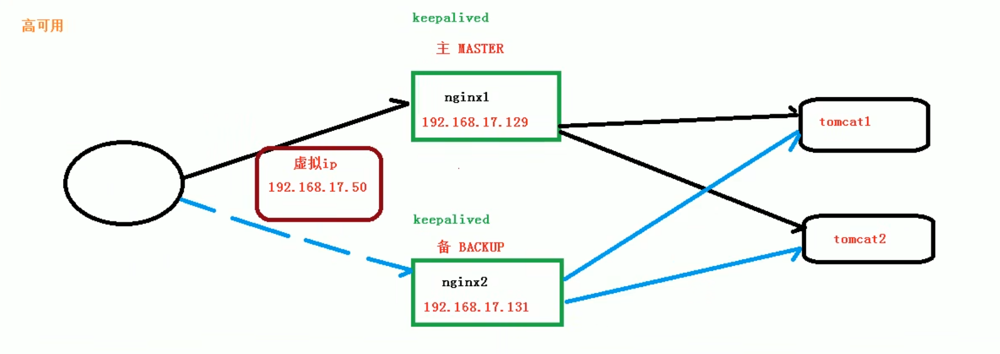

# Nginx

Nginx是一个HTTP web服务器，反向代理，内容缓存，负载均衡器，TCP/UDP代理服务器和邮件代理服务器

- 官网：<http://nginx.org/>

|模块|功能|
|:-|:-|
|rewrite|实现重写功能|
|access|来源控制|
|ssl|安全加密|
|ngx_http_gzip_module|网络传输压缩|
|ngx_http_proxy_module|实现代理|
|ngx_http_upstream_module|实现后端服务器列表定义|
|ngx_cache_purge|实现缓存清除|

## 正向代理

举个例子：国内通过浏览器直接访问谷歌（www.google.com）是访问不了的。需要在浏览器配置代理服务器（www.xxx.com），之后每当访问谷歌的时候，代理服务器就会代理你访问谷歌，将请求结果返回浏览器。这个浏览器配置代理服务器，通过代理服务器访问互联网的过程就是正向代理。

也就是说，正向代理是代理客户端（访问目标地址）

## 反向代理

客户端（如浏览器）将请求发送到反向代理服务器，由反向代理服务器去选择目标服务器，获取数据后返回给客户端。此时反向代理服务器和目标服务器对于客户端来说就是一个服务器（暴露的是代理服务器的地址，隐藏了真实服务器地址），客户端对代理是无感知的，因为客户端无需任何配置就可以访问。

也就是说，反向代理是代理服务器（接收客户端请求），它是所有真实服务器的门户

## 负载均衡

通过反向代理服务器，将客户端请求分发到各个真实服务器上

## 动静分离

通过反向代理服务器，把动态资源请求和静态资源请求分给不同的服务器处理，加快解析速度，降低单个服务器的压力

- 实现
    - 1.把静态文件（html、css、js、image）放在独立的服务器上，独立成一个域名，这是目前主流推崇的方案
    - 2.动态跟静态文件混合一起发布，通过nginx分开

## 安装nginx

- Red Hat系列Linux

```sh
# 解压
tar zxvf nginx-1.21.6.tar.gz

# 进入解压后的目录
cd nginx-1.21.6

# 设置安装路径
./configure --prefix=/usr/local/bin/nginx
# 如果提示C编译器没有安装，则安装gcc
yum install -y gcc

# 如果提示pcre模块没安装，则安装pcre
yum install -y pcre pcre-devel

# 如果提示安装zlib则安装zlib
yum install -y zlib zlib-devel

# 如果提示安装openssl则安装
yum install -y openssl openssl-devel

# make
make

# make install
make install
```

## 启动nginx

```sh
# 要先进入nginx的sbin目录
cd /usr/local/bin/nginx/sbin

# 启动nginx
./nginx

# 查看nginx是否启动成功
# 也可以查看nginx的配置文件（/usr/local/nginx/conf/nginx.conf）
# 开放端口后通过浏览器访问nginx的home页面确认
ps -ef | grep nginx

# 快速停止
./nginx -s stop

# 优雅关闭，nginx在退出前完成已经接收的连接请求
./nginx -s quit

# 重新加载配置
./nginx -s reload

# 查看nginx版本号
./nginx -v
```

## nginx的配置文件

- 位置：`/usr/local/nginx/conf/nginx.conf`

- 由三部分构成全局块、events块、http块

### 全局块

从配置文件开始到events块直接的内容，主要涉及一些影响nginx服务器整体运行的配置指令

包括配置运行nginx服务器的用户（组）、允许生成的worker process数、进程id存放路径、日志存放路径和类型、配置文件的引入等

```conf
# nginx服务器并发处理服务的关键配置
# worker_processes值越大，可以支持的并发处理量也越多，但受硬件、软件等设备的制约
worker_processes 1;
```

### events块

涉及的指令主要影响nginx服务器与用户的网络连接

包括是否开启对多worker process下的网络连接进行序列化，是否允许同时接收多个网络连接，选取哪种事件驱动模型来处理连接请求，每个worker process可以同时支持的最大连接数等

这部分的设置堆nginx的性能影响较大，在实际中应该灵活配置

```conf
# 每个worker process可以同时支持的最大连接数
events {
    worker_connections 1024;
}
```

### http块

nginx服务器配置中最频繁的部分，代理、缓存和日志自定义和第三方模块的配置等都在这里设置

http块包括http全局块、server块

#### http全局块

包括文件引入、MIME-TYPE定义、日志自定义、连接超时时间、但链接请求数上限等

```conf
http {
    include mime.types;
    default_type application/octet-stream;

    sendfile on;

    keepalive_timeout 65;
}
```

#### server块

和虚拟主机有密切关系，从用户角度看，虚拟主机和一台独立的硬件主机是完全一样的，该技术的产生是为了节省互联网服务器的硬件成本

每个http块可以包含多个server块，而每个server块就相当于一个虚拟主机

每个server块分为全局server块、location块

#### 全局server块

最常见的配置是本虚拟主机的监听配置和本虚拟主机的名称和IP配置

```conf
server {
    # nginx监听的端口号
    listen 80;
    # 主机名称
    server_name localhost;
}
```

#### location块

主要作用是基于nginx服务器接收到的请求字符串（如server_name/uri-string），对虚拟主机名称/IP之外的字符串（如/uri-string）进行匹配，对特定的请求进行处理

地址定向、数据缓存和应答控制等功能，还有许多第三方模块的配置也在这里设置

一个server块可以包含多个location块

```conf
server {
    # 当请求路径有/，做跳转
    location / {
        root html;
        index index.html index.htm;
    }

    error_page 500 502 503 504 /50x.html;
    location = /50x.html {
        root html;
    }
}
```

- location指令

```conf
# =：用于不含正则表达式的uri前，要求请求字符串与uri严格匹配，如果匹配成功，就停止继续向下搜索并立即处理该请求
# ~：表示uri包含正则表达式，并且区分大小写
# ~*：表示uri包含正则表达式，并且不区分大小写
# ^~：用于不含正则表达式的uri前，要求nginx服务器找到标识uri和请求字符串匹配度最高的location后，立即使用此location处理请求，而不再使用location块中的正则uri和请求字符串做匹配
location [=|~|~*|^~] uri {}
```

## 配置反向代理

- 目的1：当访问`http://10.0.2.15:80`的时候，nginx将会转发请求给<http://127.0.0.1:8080>处理

```conf
server {
    # nginx监听的端口号，记得开放80端口
    listen 80;
    # 主机名称：可以是主机名或IP地址（这里的例子，可以将这个主机名称理解为启动nginx服务的主机的IP地址）
    server_name 10.0.2.15;

    # 当请求路径有/，做跳转
    location / {
        root html;
        # 记得开放8080端口
        proxy_pass http://127.0.0.1:8080;
        index index.html index.htm;
    }
}
```

- 目的2：
    - 当访问`http://10.0.2.15:8001/handle/`的时候，nginx将会转发请求给<http://127.0.0.1:8081>处理
    - 当访问`http://10.0.2.15:8001/jack/`的时候，nginx将会转发请求给<http://127.0.0.1:8082>处理

```conf
server {
    # nginx监听的端口号，记得开放端口
    listen 8001;
    # 主机名称：可以是主机名或IP地址（这里的例子，可以将这个主机名称理解为启动nginx服务的主机的IP地址）
    server_name 10.0.2.15;

    # 当请求路径有handle，做跳转
    location ~ /handle/ {
        # 记得开放端口
        proxy_pass http://127.0.0.1:8081;
    }
    
    # 当请求路径有jack，做跳转
    location ~ /jack/ {
        # 记得开放端口
        proxy_pass http://127.0.0.1:8082;
    }
}
```

## 配置负载均衡

- nginx提供了几种负载均衡策略
    - 1.轮询（默认）：每个请求按时间顺序逐一分配到不同的后端服务器，如果某个后端服务器宕机，能自动剔除
    - 2.weight：默认权重为1,权重越高被分配的客户端越多，用于后端服务器性能不均的情况
    - 3.ip_hash：每个请求按访客ip的hash结果分配，这样每个访客固定访问一个后端服务器，可以解决session的问题
    - 4.fair（第三方）：按后端服务器的响应时间来分配请求，响应时间短的优先分配

```conf
# 轮询
upstream myserver {
    server 10.0.2.15:8080;
    server 10.0.2.15:8081;
}

# weight
upstream myserver {
    server 10.0.2.15:8080 weight=1;
    server 10.0.2.15:8081 weight=3;
}

# ip_hash
upstream myserver {
    ip_hash;
    server 10.0.2.15:8080;
    server 10.0.2.15:8081;
}

# fair
upstream myserver {
    server 10.0.2.15:8080;
    server 10.0.2.15:8081;
    fair;
}
```

```conf
http {
    # 负载均衡服务器命名为myserver，配置负载均衡服务器列表
    upstream myserver {
        server 10.0.2.15:8080;
        server 10.0.2.15:8081;
    }
    server {
        # nginx监听的端口号，记得开放端口
        listen 8001;
        # 主机名称：可以是主机名或IP地址（这里的例子，可以将这个主机名称理解为启动nginx服务的主机的IP地址）
        server_name 10.0.2.15;

        location / {
            # myserver对应前面负载均衡服务器的名字
            proxy_pass http://myserver;
            proxy_connect_timeout 10;
            # ...
        }
    }
}
```

## 配置动静分离

- 目的
    - 1.访问<http://10.0.2.15:8001/html/hello.html>的时候，返回/data/html/hello.html
    - 2.访问<http://10.0.2.15:8001/image/hello.png>的时候，返回/data/image/hello.png
    - 3.访问<http://10.0.2.15:8001/image>的时候，返回/data/image的子目录/文件列表

```conf
server {
        # nginx监听的端口号，记得开放端口
        listen 8001;
        # 主机名称：可以是主机名或IP地址（这里的例子，可以将这个主机名称理解为启动nginx服务的主机的IP地址）
        server_name 10.0.2.15;

        # 请求路径
        location /html/ {
            # 系统目录
            root /data/;
            # ...
        }
        
        # 请求路径
        location /image/ {
            # 系统目录
            root /data/;

            # 列出目录的内容，如访问http://10.0.2.15:8001/image的时候会列出/data/image目录里面的子目录/文件
            autoindex on;
        }
    }
```

## 配置Nginx高可用集群



keepalived官网：<https://www.keepalived.org/index.html>

```sh
# 启动keepalived
sudo systemctl start keepalived.service

# 设置keepalived开机启动
sudo systemctl enable keepalived.service
```

- 两台服务器分别安装nginx和keepalived（可以通过包管理器安装）

- 配置keepalived，/etc/keepalived/keepalived.conf，未完善...

```conf
# 全局配置
global_defs {
    notification_email {
        acassen@firewall.loc
        failover@firewall.loc
        sysadmin@firewall.loc
    }
    notification_email_from Alexandre.Cassen@firewall.loc
    smtp_server 192.168.200.1
    smtp_connect_timeout 30
    router_id LVS_DEVEL
    vrrp_skip_check_adv_addr
    vrrp_strict
    vrrp_garp_interval 0
    vrrp_gna_interval 0

    # 视频教程里面有这个配置，但是新版本没看到，先保留着
    # /etc/hosts文件中设置的：127.0.0.1 MY_HOST_NAME
    # router_id MY_HOST_NAME
}

# 视频教程里面有检测脚本这个配置，但是新版本没看到，先保留着
vrrp_script chk_http_port {
    script "/usr/local/src/nginx_check.sh"
    # 检测脚本执行的间隔
    interval 2
    # 当脚本成立的时候，设置当前服务器的权重
    weight 2
}

vrrp_instance VI_1 {
    # 主服务器为MASTER，从服务器为BACKUP
    state MASTER
    # 使用哪个网卡就填哪个网卡名
    interface eth0
    # 主、从必须相同
    virtual_router_id 51
    # 主、从设置不同的优先级，主服务器设置较大值，从服务器设置较小值
    priority 100
    # 每隔多少秒发送心跳
    advert_int 1
    authentication {
        # 鉴权方式
        auth_type PASS
        # 密码
        auth_pass 1111
    }
    virtual_ipaddress {
        # 虚拟ip，如果按照图中的布置应该填192.168.17.50
        192.168.200.16
        192.168.200.17
        192.168.200.18
    }

    # Allow packets addressed to the VIPs above to be received
    accept
}

virtual_server 192.168.200.100 443 {
    delay_loop 6
    lb_algo rr
    lb_kind NAT
    persistence_timeout 50
    protocol TCP

    real_server 192.168.201.100 443 {
        weight 1
        SSL_GET {
            url {
              path /
              digest ff20ad2481f97b1754ef3e12ecd3a9cc
            }
            url {
              path /mrtg/
              digest 9b3a0c85a887a256d6939da88aabd8cd
            }
            connect_timeout 3
            retry 3
            delay_before_retry 3
        }
    }
}

virtual_server 10.10.10.2 1358 {
    delay_loop 6
    lb_algo rr
    lb_kind NAT
    persistence_timeout 50
    protocol TCP

    sorry_server 192.168.200.200 1358

    real_server 192.168.200.2 1358 {
        weight 1
        HTTP_GET {
            url {
              path /testurl/test.jsp
              digest 640205b7b0fc66c1ea91c463fac6334d
            }
            url {
              path /testurl2/test.jsp
              digest 640205b7b0fc66c1ea91c463fac6334d
            }
            url {
              path /testurl3/test.jsp
              digest 640205b7b0fc66c1ea91c463fac6334d
            }
            connect_timeout 3
            retry 3
            delay_before_retry 3
        }
    }

    real_server 192.168.200.3 1358 {
        weight 1
        HTTP_GET {
            url {
              path /testurl/test.jsp
              digest 640205b7b0fc66c1ea91c463fac6334c
            }
            url {
              path /testurl2/test.jsp
              digest 640205b7b0fc66c1ea91c463fac6334c
            }
            connect_timeout 3
            retry 3
            delay_before_retry 3
        }
    }
}

virtual_server 10.10.10.3 1358 {
    delay_loop 3
    lb_algo rr
    lb_kind NAT
    persistence_timeout 50
    protocol TCP

    real_server 192.168.200.4 1358 {
        weight 1
        HTTP_GET {
            url {
              path /testurl/test.jsp
              digest 640205b7b0fc66c1ea91c463fac6334d
            }
            url {
              path /testurl2/test.jsp
              digest 640205b7b0fc66c1ea91c463fac6334d
            }
            url {
              path /testurl3/test.jsp
              digest 640205b7b0fc66c1ea91c463fac6334d
            }
            connect_timeout 3
            retry 3
            delay_before_retry 3
        }
    }

    real_server 192.168.200.5 1358 {
        weight 1
        HTTP_GET {
            url {
              path /testurl/test.jsp
              digest 640205b7b0fc66c1ea91c463fac6334d
            }
            url {
              path /testurl2/test.jsp
              digest 640205b7b0fc66c1ea91c463fac6334d
            }
            url {
              path /testurl3/test.jsp
              digest 640205b7b0fc66c1ea91c463fac6334d
            }
            connect_timeout 3
            retry 3
            delay_before_retry 3
        }
    }
}

```

- 脚本

```sh
#!/bin/bash
A=`ps -C nginx --no-header | wc -l`
if [$A -eq 0];then
    /usr/local/nginx/sbin/nginx
    sleep 2
    if [`ps -C nginx --no-header | wc -l` -eq 0];then
        killall keepalived
    fi
fi
```

## Nginx原理

- Nginx有两个进程：master和（多个）worker，master管理worker，多个worker通过争抢的方式处理请求

- 设置worker的数量和cpu的核数相等最为适宜

- 连接数（worker_connection）
    - 客户端发送一个请求，占用2个（一来一回，client<=>worker）或4（client<=>worker<=>tomcat）个worker的连接数
    - nginx的静态资源访问最大并发数：连接数*worker数量/2
    - nginx的动态资源访问（如反向代理）最大并发数：连接数*worker数量/4

## 创建脚本启动nginx服务

```sh
# 创建脚本，脚本内容
vim /usr/lib/systemd/system/nginx.service

# 重新加载系统服务
systemctl daemon-reload

# 启动nginx服务
systemctl start nginx.service

# 查看nginx服务启动状态
systemctl status nginx.service

# 设置nginx服务为开机启动
systemctl enable nginx.service

# 取消nginx服务开机启动
systemctl disable nginx.service
```

- 脚本内容

```service
[Unit]
Description=nginx - web server
After=network.target remote-fs.target nss-lookup.target

[Service]
Type=forking
PIDFile=/usr/local/bin/nginx/logs/nginx.pid
ExecStartPre=/usr/local/bin/nginx/sbin/nginx -t -c
/usr/local/bin/nginx/conf/nginx.conf
ExecStart=/usr/local/bin/nginx/sbin/nginx -c /usr/local/bin/nginx/conf/nginx.conf
ExecReload=/usr/local/bin/nginx/sbin/nginx -s reload
ExecStop=/usr/local/bin/nginx/sbin/nginx -s stop
ExecQuit=/usr/local/bin/nginx/sbin/nginx -s quit
PrivateTmp=true

[Install]
WantedBy=multi-user.target
```

## 开放端口

```sh
# 查看开放的端口，观察ports关键字列出的端口，默认是空的
firewall-cmd --list-all

# 放行端口
firewall-cmd --zone=public --add-port=80/tcp --permanent

# 重启防火墙
firewall-cmd --reload
```
