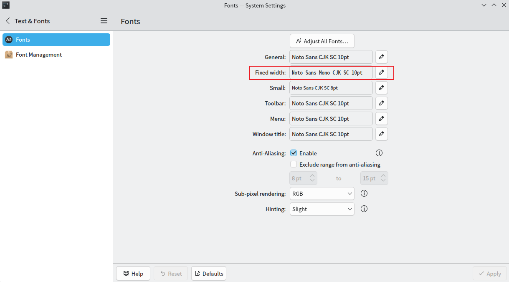
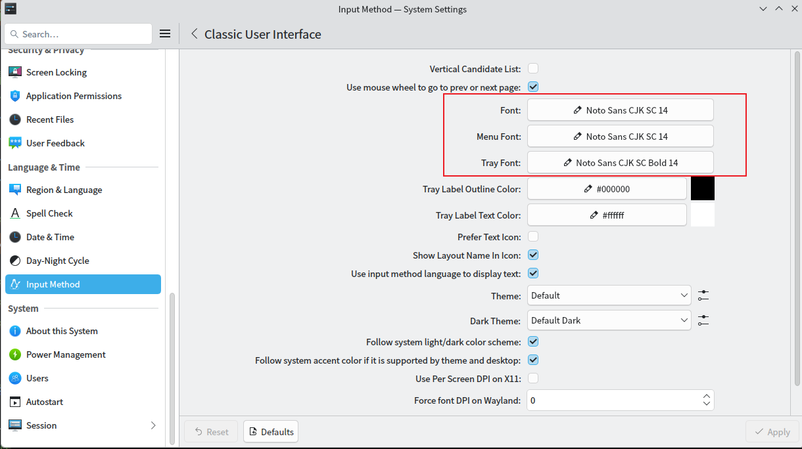

# Arch Linux

官网：<https://archlinux.org/>

## pacman包管理器

- 经常使用的软件，建议通过包管理器安装

- 不经常使用的软件建议使用免安装版本
    - 如果没有免安装版本，则考虑appimage，对于较大的appimage文件，建议将其解压，节省启动时间

```sh
# -S：同步
# y： 从服务器下载最新的软件包数据库（相当于更新索引）
# u： 升级所有已安装的软件包到最新版本
# 安装软件前先执行这一命令
sudo pacman -Syu

# 从远程仓库拉取软件安装
# --disable-download-timeout：use relaxed timeouts for download
# --noconfirm：静默安装，不询问
# --needed：do not reinstall up to date packages
sudo pacman -S [--disable-download-timeout] [--noconfirm] [--needed] 包名 [包名2 包名3 ...] 

# 安装本地.pkg.tar.zst安装包或.pacman安装包
sudo pacman -U /path/to/pkg.tar.zst安装包或.pacman安装包

# 卸载软件
# R：删除指定包
# s：删除不需要的依赖（仅限于没有其他包需要的依赖）
# n：删除配置文件
sudo pacman -Rns package_name

# 搜索远程仓库的某个软件
sudo pacman -Ss 软件关键字

# 搜索已安装的某个软件
sudo pacman -Qs 软件关键字

# 查看已安装的所有软件
sudo pacman -Q

# 列出该包安装的所有文件及其路径
sudo pacman -Q 包名

# 列出未安装包的文件列表
sudo pacman -Ql -p 包名.pkg.tar.zst

# 查询文件属于哪个软件包
sudo pacman -Qo 文件名

# 列出包组的所有应用
sudo pacman -Sg kde-applications

# 选择安装包组里面的应用，默认全部安装，可以根据交互选择应用对应的数字，如果安装多个用空格隔开，来自定义安装
sudo pacman -S kde-applications

# 查看包组中还没安装的软件
sudo pacman -Sg plasma | grep -v " $(sudo pacman -Qg)"

# pactree命令工具包，根据需要安装
sudo pacman -S pacman-contrib

# 显示包的依赖树，只显示直接依赖
pactree -d1 pinta
```

### makepkg

makepkg是一个自动构建软件包的脚本，由pacman包提供

使用该脚本的要求是具有构建能力的Unix平台和PKGBUILD

- 配置文件：`/etc/makepkg.conf`、`~/.makepkg.conf`，一般改动后者就行了

```sh
#-- Make Flags: change this for DistCC/SMP systems
#MAKEFLAGS="-j2"
# 尽可能并行编译，最大并行数量是cpu核数
# MAKEFLAGS="--jobs=$(nproc)"
# 尽可能并行编译，最大并行数量是cpu核数-2
MAKEFLAGS="--jobs=$(( $(nproc) - 2 ))"

#
# Makepkg defaults:
# OPTIONS=(!strip docs libtool staticlibs emptydirs !zipman !purge !debug !lto !autodeps)
#  A negated option will do the opposite of the comments below.
#
#-- strip:      Strip symbols from binaries/libraries
#-- docs:       Save doc directories specified by DOC_DIRS
#-- libtool:    Leave libtool (.la) files in packages
#-- staticlibs: Leave static library (.a) files in packages
#-- emptydirs:  Leave empty directories in packages
#-- zipman:     Compress manual (man and info) pages in MAN_DIRS with gzip
#-- purge:      Remove files specified by PURGE_TARGETS
#-- debug:      Add debugging flags as specified in DEBUG_* variables
#-- lto:        Add compile flags for building with link time optimization
#-- autodeps:   Automatically add depends/provides
#
# LTO‌ 是 ‌Link Time Optimization‌（链接时优化）的缩写
# 传统编译过程中，编译器每次只处理一个源文件（编译单元），无法看到其他文件中的代码
# 因此，它很难进行跨文件的优化（例如：判断某个函数是否在其他地方被调用，从而决定是否内联或删除）
# LTO 将优化阶段推迟到了“链接”阶段
# 链接器可以看到整个程序的所有代码
# 它可以执行跨模块的内联（Inline）、删除未使用的死代码（Dead Code Elimination）、重新排列函数以提高缓存命中率等
# 通常能生成‌运行速度更快‌、‌体积更小‌的可执行文件
# 缺点：LTO 需要消耗大量的 CPU 时间和内存来进行全局分析。对于大型软件，开启 LTO 可能导致编译时间翻倍甚至更多
# 链接阶段需要将所有中间代码加载到内存中，如果内存不足，可能导致编译失败（OOM）
# 某些软件的构建脚本或代码可能不完全兼容 LTO，导致编译错误或运行时崩溃
# LTO 优化后的代码结构与源代码差异较大，使得调试（Debugging）变得更加困难
# 这里只改两样
# 不生成debug包，不做链接时优化
OPTIONS=(strip docs !libtool !staticlibs emptydirs zipman purge !debug !lto)

#
# 默认压缩格式
# PKGEXT='.pkg.tar.zst'
# 不压缩
# PKGEXT='.pkg.tar'
# 快速压缩
PKGEXT='.pkg.tar.lz4'
```

## .AppImage软件包

下载.AppImage格式的软件包后，先赋予该软件包执行权限，第一次先通过终端启动

```sh
sudo chmod +x /path/to/file.AppImage
```

如果运行异常，根据终端提示安装相应的依赖就可以了

```sh
# 比如有些AppImage软件包是需要fuse2的
sudo pacman -S fuse2
```

- 对于大型软件，如gimp，启动速度可能会很慢，可以解压appimage来提升启动速度
    - 最终那 1~2 秒的 FUSE 挂载和镜像解压时间可以节省下来
    - 对于theia-ide，appimage启动要32秒，解压后启动30秒，感觉还是软件本身的优化更重要

```sh
# 执行后，当前目录下会生成一个名为 squashfs-root 的文件夹，里面包含了该软件运行所需的所有文件和依赖
# 进入该目录，会看到一个名为 AppRun 的文件，这就是该软件的启动入口。直接运行它即可
/path/to/file.AppImage --appimage-extract
```

- 复制软件包里面的图标文件

```sh
# 需要先赋予appimage文件执行权限
# 执行这个命令后会输出一个挂载路径，如：/tmp/.mount_xxxxx
/path/to/file.AppImage --appimage-mount

# 然后新开一个终端并进入这个路径
cd /tmp/.mount_xxxxx

# 找到图标文件，比如可能在：/tmp/.mount_xxxxx/usr/share/icons/hicolor/512x512/apps/file.png
# 然后复制到一个可以找得到的路径下
# 最后关闭这个终端，以及在最开始的那个终端Ctrl+C，结束挂载
```

## .run软件包

.run软件包的卸载不好说，根据具体软件具体分析，下面的例子使用的是virtualbox

十分不推荐自己安装.run的软件包

```sh
# 给.run软件包执行权限
chmod +x /path/to/软件包

# 执行安装，可能需要root权限
sudo /path/to/软件包

# 卸载
sudo /path/to/软件包 uninstall
```

## 从git源码编译安装

每一套源码一般要安装各种语言和依赖

可能语言和依赖下载下来都好几G了，但是编译出来的软件包可能才几M到几百M

这是针对没有官方编译版本的情况的无奈操作，平时自己别这么搞，完全费力不讨好

- 安装构建 Arch Linux 包的基础工具

```sh
sudo pacman -Syu

# 先安装base-devel 和 git
sudo pacman -S --needed base-devel git
```

- 以从源码安装yay为例，步骤如下

```sh
# 以下用指令非root用户执行
# 先进入某个目录下，这个目录会存放yay项目源码
cd yourPath
git clone https://aur.archlinux.org/yay.git
cd yay

# 有可能因为网络原因导致安装失败，因此先修改PKGBUILD文件
vim PKGBUILD
# 找到 build() 函数，在多条 export 语句后追加保存退出
export GO111MODULE=on
export GOPROXY=https://goproxy.cn

# makepkg 使用当前目录下的 PKGBUILD 构建一个 Arch 包
# -s 自动安装构建所需的依赖（resolve dependencies）
# -i 构建完成后自动安装生成的 .pkg.tar.zst 包
makepkg -si

# 测试 yay 是否安装成功
yay --version
```

- 或者直接安装构建版，不用自己编译节省时间

```sh
sudo pacman -S --needed git base-devel
git clone https://aur.archlinux.org/yay-bin.git
cd yay-bin
makepkg -si
```

## 安装系统教程

可参考官方教程：<https://wiki.archlinux.org/title/Installation_guide>

- 下载Arch Linux系统镜像文件并校验：<https://archlinux.org/download/>

### 制作U盘启动

- 如果是在windows系统制作，下载Rufus（Portable版本，免安装）：<https://rufus.ie>
- 如果是在Linux系统制作，命令行，步骤如下：

```sh
# 列出系统中的磁盘分区表信息，找到U盘的设备名称，如：/dev/sdx
sudo fdisk -l

# 用dd命令把Arch Linux的ISO镜像写入到USB设备
# dd：一个底层复制工具，可以按块复制文件或设备
# bs=4M：设置块大小为4MB。这样每次读写4MB数据，比默认的512字节快很多
# if：输入文件（input file），填Arch Linux的ISO镜像
# of：输出文件（output file），填目标U盘的设备名称，如：/dev/sdx
# conv=fsync：在写完数据后调用 fsync()，确保数据真正写入磁盘，而不是停留在缓存里。避免写入未完成就拔掉设备
# oflag=direct：使用直接 I/O，绕过内核缓存，把数据直接写到设备。这样可以减少缓存污染，但速度可能略慢
# status=progress：在执行过程中显示进度信息（已写入字节数），否则 dd 默认是静默的
sudo dd bs=4M if=/path/to/archlinux-version-x86_64.iso of=/dev/disk/by-id/usb-My_flash_drive conv=fsync oflag=direct status=progress

# 如果没有安装dd，可以直接用cp命令，但是不能设置每次的读写大小
sudo cp /path/to/archlinux-version-x86_64.iso /dev/disk/by-id/usb-My_flash_drive
```

- 使用Ventoy，Windows和Linux都有安装包（推荐）

#### Ventoy

官网：<https://github.com/ventoy/Ventoy>

Ventoy可制作同时支持Windows、Linux等多操作系统的U盘启动，并且多余的U盘空间还可以存放其它任意文件，实乃上上之选

- 下载ventoy-version-linux.tar.gz，并校验哈希码，然后解压

- 确保系统安装了dosfstools

- 进入ventoy根目录

```sh
# 命令行启动
Ventoy2Disk.sh

# GUI启动，推荐
VentoyGUI.x86_64

# 网页版启动
WebUI/index.html
```

- 关于Secure Boot Support，保持默认勾选就行
    - 勾选了Secure Boot Support，如果主板的Secure Boot是开启的，那么第一次U盘启动，需要注册密钥，根据提示操作就行
    - 无论勾选不勾选Secure Boot Support，只要把主板Secure Boot关掉，U盘启动都一定能正常启动

- U盘启动制作完成后，会看到Ventoy创建了两个分区，默认名字为Ventoy和VTOYEFI
    - 把系统镜像（iso文件）复制到Ventoy里面就行（里面任意目录下都可以），当然也可以存放其它你想存到U盘的任何文件
    - VTOYEFI分区里放的是Ventoy的引导程序，不要动它

- 如果提示安全引导违规，关闭BIOS的安全启动模式，保存重启，不要按ESC，因为会弹出一个确认是否真的要关闭安全引导的交互，选确认

- 启动的时候，手动选择UEFIxxx的引导选项，默认自动进来的话不是以UEFI模式启动的

### 设置终端键盘布局和字体（可选）

```sh
# 列出可选的键盘布局
localectl list-keymaps

# 设置键盘布局为美式键盘（默认）
loadkeys us

# 设置当前终端的字体，立马见效，觉得当前终端字体不合适可以自行修改
# 分辨率为1080p的屏幕，建议选择 ter-122b
# 分辨率更高的屏幕，可以在 ter-124b，ter-128b，ter-132b 中选择一个, 默认lat9w-16
setfont ter-122b
```

### 检查是否为UEFI启动

```sh
# Arch Linux只支持UEFI模式启动，输出为64就行了
cat /sys/firmware/efi/fw_platform_size
```

### 连接网络，这里连接wifi为例

```sh
# 确认是否启用了网络接口
ip link

# 执行iwctl命令，进入wifi连接交互式命令行
iwctl

# 查看帮助
help

# 列出网卡设备，无限网卡一般为wlan0，后面以它为例
device list

# 让网卡扫描wifi设备
station wlan0 scan

# 列出可连接的wifi
station wlan0 get-networks

# 连接wifi，然后根据提示输入wifi密码
station wlan0 connect 上一步获取的某个wifi名称

# 退出wifi连接交互式命令iwctl
exit

# 测试网络是否连接成功
ping www.baidu.com 
```

### 更新系统时钟

```sh
# 更新系统时钟是有必要的，因为下载软件是服务器会验证系统时间，如果时间不正确，可能出现下载失败的情况
# 将系统时间与网络时间进行同步
timedatectl set-ntp true 
# 查看系统时间状态，检查是否成功 看到（System clock synchronized :yes）这一句就是成功了
timedatectl status   
```

### 磁盘分区

除非考虑兼容老设备，不然首选GPT分区

|分区表|结构|支持的最大磁盘容量|支持分区数量|启动方式|可靠性与安全性|分区表占用空间|
|:-|:-|:-|:-|:-|:-|:-|
|MBR|1983 年的老设计，限制较多|2TB|最多4 个主分区（或3主分区 + 1扩展分区）|BIOS 启动|没有备份，损坏后难恢复|~1MB|
|GPT|UEFI 时代的新标准，功能更强|理论支持9.4ZB（几乎无限）|默认支持 128 个分区（Windows 下）|UEFI 启动（Windows 11 必须）|有备份分区表 + CRC校验|~2–4MB|

#### 1. 创建分区

只有EFI分区和`/`分区是必须的

如果内存有16或者32G（已经足够大了），可以不创建swap分区

```sh
# 列出设备和分区信息，记住要安装arc linux系统的设备，一般通过容量判断比较直观
fdisk -l

# 选择要分区的设备
fdisk /dev/the_disk_to_be_partitioned

# 首先输入g创建GPT分区表
g 

# 随后输入n创建新的分区
n

# 然后根据终端提示，输入分区编号，然后enter
# 然后根据终端提示，输入第一扇区，这一步保持默认，直接enter
# 然后根据终端提示，指定分区大小，+512M表示创建512M的分区
# 然后输入t改变分区类型，根据提示输入类型名称或者代码
t

# 依次创建efi分区（512M），类型为EFI System
# swap分区（和内存同样的大小），类型为linux swap
# /分区（设备容量剩余多少就设置多少），类型为linux filesystem

# 查看分区
p

# 保存并退出分区
w
```

#### 2. 格式化分区

```sh
# 格式化efi系统分区为fat32
# -n，标签
mkfs.fat -F 32 [-n boot] /dev/efi_system_partition

# 格式化swap分区
# -L，标签
mkswap [-L swap] /dev/swap_partition

# 格式化/分区为ext4
# -L，标签
mkfs.ext4 [-L archlinux] /dev/root_partition
```

#### 3. 挂载分区

```sh
# 要先挂载根分区
mount /dev/root_partition /mnt

# 挂载efi系统分区，使用--mkdir创建/mnt/boot目录，并将efi分区挂载在/mnt/boot目录下
# --mkdir是可以生成多级目录的
mount --mkdir /dev/efi_system_partition /mnt/boot

# 挂载swap分区，挂载后，swap对live系统也是有用的，而不仅仅是给新系统用的噢
swapon /dev/swap_partition

# 如果给swap分区设置了label，也可以通过label挂载
swapon /dev/disk/by-label/swapLabelName

# 如果有其它硬盘想要永久挂载，也可以这时候挂载
# 后面执行genfstab -U /mnt >> /mnt/etc/fstab时就会一起写到fstab了
mount --mkdir /dev/other_disk_partition /mnt/mount_point
```

### 安装基础系统包

#### 配置pacman镜像源(可选)

非常建议配置，不然安装会很慢

```sh
# 用vim或nano编辑文件/etc/pacman.d/mirrorlist
vim /etc/pacman.d/mirrorlist

# 在文件中查询国内镜像源，并复制该行，粘贴到文件其他源的最前面
Server = https://mirrors.tuna.tsinghua.edu.cn/archlinux/$repo/os/$arch
```

#### 用pacstrap安装基础系统包

pacstrap是Arch Linux安装环境提供的一个脚本，用来在目标挂载点（通常是新系统的根目录，比如 /mnt）安装基础系统包

pacstrap通常只用来安装基础系统包，安装完之后，可以用genfstab和arch-chroot进入新系统对其进行配置

#### 物理机安装

```sh
# base，linux，linux-firmware分别是基础包组，linux内核和驱动程序
# Arch Linux官方提供了linux，linux-lts，linux-zen，linux-hardened内核包，但是对于初学者，只推荐使用linux内核
# linux：主线稳定版，更新快，更新出问题有可能回归更新，整体性能优秀
# linux-lts：长期支持版，稳定性最好
# linux-zen：桌面优化版，游戏表现最好，能有更丝滑的交互体验，但是游戏表现没提升多少，特别是吃显卡的游戏，总体比linux包好一丢丢
# linux-hardened：安全强化版，安全性最高
# 注意：如果后期要安装headers包，需要根据安装的内核包选择对应的headers包进行安装
# 如linux包选择linux-headers，linux-lts包选择linux-lts-headers
# 如果前期只安装了一种内核包，后期想再安装另一种内核包，安装完后需要执行"sudo grub-mkconfig -o /boot/grub/grub.cfg"
# 这样grub菜单选项才会包含该内核
pacstrap -K /mnt base linux linux-firmware
```

#### 虚拟机安装

```sh
# qemu虚拟机先安装base，如果安装失败提示先执行"pacman-key --init"命令就先执行它
pacstrap -K /mnt base

# 然后安装内核包
# linux-firmware可以不安装
# 如果安装linux包的时候提示找不到/etc/vconsole.conf，直接创建一个就行了
pacstrap -K /mnt linux
```

### 配置系统

#### Fstab

为了在启动时挂载所需的文件系统（如用于引导目录/boot的文件系统），需要生成一个fstab文件

```sh
# -U：是以UUID的描述方式生成 fstab，>>：是将输出结果追加在后面的文件末尾
genfstab -U /mnt >> /mnt/etc/fstab
```

#### Chroot

为了在接下来的步骤中，直接跟新系统的环境、工具和配置交互，就像真的进入了新系统一样，需要通过arch-chroot切换到新系统

```sh
# 使用arch-chroot工具切换到新安装的系统，之后的操作就可以在新系统中完成了
# 比如用pacman安装的软件都将是安装到新系统中
# 执行完成终端用户目录的~会变成/
arch-chroot /mnt
```

#### 时间/时区设置

```sh
# 时区 /usr/share/zoneinfo/Region/City，可输入/usr/share/zoneinfo后按tab键查看可选时区
ln -sf /usr/share/zoneinfo/Asia/Shanghai /etc/localtime

# 同步硬件时钟（当前系统时间写入硬件时钟，即主板上的独立时钟芯片）
# 系统启动时，内核会从硬件时钟读取初始时间
# 系统运行后，时间由内核维护（通常更精确，可以通过 NTP 校准）
# 执行hwclock --systohc后，系统会把当前内核时间写回硬件时钟，保证下次启动时不会“跑偏”
# 会创建并写入到/etc/adjtime文件中
hwclock --systohc
```

#### 本地化

```sh
# 需要先安装vim和terminus-font
# terminus-font是终端字体，后面设置FONT=ter-122b需要依赖这个字体
pacman -S vim terminus-font

# 编辑/etc/locale.gen
# 删除#en_US.UTF-8 UTF-8行和#zh_CN.UTF-8 UTF-8行的注释#并保存
vim /etc/locale.gen

# 生成locale
# 根据/etc/locale.gen的配置生成对应的locale数据文件
# 比如/usr/lib/locale/en_US.UTF-8和/usr/lib/locale/zh_CN.UTF-8
locale-gen

# 创建并编辑/etc/locale.conf
# 如果想显示英文就输入LANG=en_US.UTF-8并保存
# 如果想显示中文就输入LANG=zh_CN.UTF-8并保存
# 只要在/etc/locale.conf的环境变量使用到某个locale，就必须先用locale-gen生成，否则不会生效
vim /etc/locale.conf

# 创建并编辑/etc/vconsole.conf
# 设置KEYMAP=us,FONT=ter-122b，这样新系统启动时终端字体（大小）就变成设置的了
vim /etc/vconsole.conf
```

#### 网络配置

```sh
# 设置主机名
vim /etc/hostname

# 安装网络管理器（不安装则需要手动配置网络）
pacman -S networkmanager

# 设置网络管理器开机启动
systemctl enable NetworkManager

# 安装防火墙
sudo pacman -S firewalld

# 设置防火墙开机自启动
sudo systemctl enable firewalld

# 启动防火墙
sudo systemctl start firewalld
```

#### Initramfs（了解）

- 前面用pacstrap安装基础系统包的时候安装了linux包，这一步不用再配置了

- Initramfs（Initial RAM Filesystem）是一个在系统启动时加载到内存里的临时根文件系统。

- 它包含了一些必要的工具和驱动，用来帮助内核完成启动过程，直到真正的根文件系统（比如你磁盘上的 / 分区）可以挂载。

- 启动流程中的角色
    - 1.BIOS/UEFI → 加载引导程序（GRUB）。
    - 2.GRUB → 加载 Linux 内核和 Initramfs 到内存。
    - 3.内核启动 → 挂载 Initramfs 作为临时根文件系统。
    - 4.Initramfs 脚本运行 → 加载驱动、解密磁盘、挂载真正的根文件系统。
    - 5.切换根目录 → 从 Initramfs 切换到真正的 /，继续启动用户空间程序（systemd 等）。

- 在Arch Linux里，initramfs是由mkinitcpio生成的

```sh
# 根据配置文件里的所有preset来生成initramfs
mkinitcpio -P
```

#### 设置root用户的密码

```sh
# 设置root用户的密码，根据提示输入密码
passwd
```

#### 安装微码更新（可选，强烈建议安装）

它是内核在启动时加载的一段数据，用来修复CPU的硬件bug和安全漏洞

```sh
# 查看cpu型号
cat /proc/cpuinfo | grep "model name"

# 如果是intel的cpu，安装 intel-ucode
pacman -S intel-ucode

# 如果是amd的cpu，安装 amd-ucode
pacman -S amd-ucode

# 如果卸载了微码更新，需要更新GRUB配置
sudo grub-mkconfig -o /boot/grub/grub.cfg
```

#### 安装引导程序（GRUB）

GRUB：<https://wiki.archlinux.org/title/GRUB>

ESP = EFI System Partition（EFI 系统分区）

NVRAM（非易失性随机访问存储器）：是一种断电后仍能保持数据的非易失性RAM，用于存储系统设置和配置数据，包括BIOS设置、启动选项和硬件信息。

这些信息在系统开机时会自动加载到RAM中，可以被操作系统读取和修改

```sh
# 安装grub
# GRUB是引导加载程序
pacman -S grub

# 安装efibootmgr
# GRUB安装脚本使用efibootmgr将引导项写入NVRAM
pacman -S efibootmgr

# 安装grub到计算机
# --efi-directory：挂载的EFI系统分区（用实际的路径表示，而不是用挂载的路径）
# 前面根分区挂载到了/mnt，EFI系统分区挂载到了/mnt/boot，因而这里填/boot就行了

# --bootloader-id：引导加载器的标识符，这里命名为GRUB
# 将会在esp/EFI/中创建该标识符的目录，用来存储EFI二进制文件，并且该标识符将会出现在UEFI启动菜单中，以标识GRUB启动项

# 前面检查是否为UEFI模式启动时，输出为64（表示64位模式的UEFI，不要混淆噢不是指64位的CPU指令集，如果是32位请看官网教程），因此安装grubx64.efi
# 安装GRUB EFI应用程序grubx64.efi到esp/EFI/GRUB/，并且将其模块安装到/boot/grub/x86_64-efi/
# grub-install命令尝试在固件引导管理器创建一个引导选项（这里命名为GRUB了）
# 如果引导选项满了或者系统阻止操作引导顺序，将会失败
# 比如Thinkpad的BIOSs有一个设置项为"Boot Order Lock"，需要禁用它才能让efibootmgr进行添加或删除引导选项的操作
# 可以用efibootmgr删除不需要的引导选项
grub-install --target=x86_64-efi --efi-directory=/boot --bootloader-id=GRUB

# 打开文件
sudo vim /etc/default/grub

# 找到并设置如下两个属性，就可以默认快速开机不用等待了，需要的时候按ESC弹出菜单选项
GRUB_TIMEOUT=0
GRUB_TIMEOUT_STYLE=hidden

# 设置图形终端的分辨率
# 可以在GRUB环境中使用"videoinfo"命令查看图形卡支持的模式有哪些
# auto作为保留，当前面的模式都不能用的时候就会fallback，自动选择可用的模式
GRUB_GFXMODE=1920x1080,1600x900,1280x720,auto

# 让内核使用的分辨率和grub的一样
GRUB_GFXPAYLOAD_LINUX=keep

# 生成grub主配置文件/boot/grub/grub.cfg
# 默认情况下，生成脚本自动将所有已安装的Arch Linux内核的菜单项，添加到生成的grub主配置文件中
# 只要改动了/etc/default/grub或/etc/grub.d/，或者添加/删除了内核，都需要再次执行此命令重新生成grub主配置文件
grub-mkconfig -o /boot/grub/grub.cfg
```

#### 重启

```sh
# 退出chroot环境，执行完成终端用户目录的/会变成~
exit

# 取消挂载/mnt
umount -R /mnt

# 重启
reboot
```

### 连接网络

```sh
# 如果安装了NetworkManager，先连接网络，这里以wifi为例
# 查看可用 Wi-Fi 网络
nmcli device wifi list

# 连接到指定 Wi-Fi 网络
nmcli device wifi connect "上面列出的Wifi的SSID" password "wifi连接密码"

# 查看连接状态
nmcli connection show --active

# 设置开机自动连接
nmcli connection modify "上面列出的Wifi的SSID" connection.autoconnect yes
```

#### 安装usb_modeswitch

如果用usb网卡，遇到了插拔后usb网卡无法识别

或者关机然后断电，再通电开机，进入桌面后发现usb网卡无法识别的情况

笔者安装usb_modeswitch后usb网卡就能正常自动识别了

```sh
sudo pacman -S usb_modeswitch
```

如果不能识别，可以手动执行（可能每次开机都要执行）

```sh
# 查看usb网卡的信息如:obda:1a2b.....
lsusb

# -M 是厂商对指定型号的usb网卡从CD-ROM模式转为网卡模式的命令
sudo usb_modeswitch -v 0bda -p 1a2b -M "5553424312345678000000000000061b000000020000000000000000000000" -W
```

另一种办法是手动切换为网卡模式，参考：<https://wiki.archlinux.org/title/ZTE_MF110/MF190#Switch_from_CD_mode_to_modem_mode_on_the_device>

### 安装中文字体

Proportional Fonts：比例字体，也就是非等宽字体，每个字符宽度不同，比如：i比m窄

Monospace：等宽，一个汉字=两个ASCII字母的宽度，全宽字符：宽度等于一个汉字的宽度，半宽字符：宽度等于半个汉字的宽度

Serif：有衬线，笔画末端有小装饰线，如宋体

Sans-serif：无衬线，笔画末端没有装饰，线条简洁


#### 安装思源字体和ttf-hanazono

至于为什么不安装adobe版的思源黑体（adobe-source-han-sans-cn-fonts）和思源宋体（adobe-source-han-serif-cn-fonts）呢？

- 目前的主要原因：
    - 第一是adobe版的是分开一个一个包的，不像谷歌版的只要安装一个包就可以了，单单下载中文字体还好才三个包，要是想兼容其它语言要安装的包就多了
    - 等宽字体（adobe-source-han-mono-cn-fonts）目前不在archlinux官方包仓库，只能从aur仓库下载

```sh
# 选择一：谷歌版的思源黑体（包含了等比例/等宽字体），覆盖简体、繁体、日文、韩文（cjk分别是中日韩的英文首字母）
# 不安装中文会乱码，装一个够了，不够用再找别的字体
sudo pacman -S noto-fonts-cjk

# 选择二：adobe版的思源字体，安装中文三件套（等比例的有衬线和无衬线，等宽）就行了，占用的磁盘空间会更小
yay -S adobe-source-han-sans-cn-fonts adobe-source-han-serif-cn-fonts adobe-source-han-mono-cn-fonts

# 包含更多的汉字特别是生僻字和繁体字（据说是unicode包含的全部汉字），根据需要安装
# 笔者建议安装，因为fcitx5的候选字就有很多是生僻字的，不安装的话会显示为相应的unicode码
# 它只有衬线字体，没有无衬线和等宽字体
sudo pacman -S ttf-hanazono

# 了解即可，建议还是重启
# 然后用来刷新和重建系统的字体缓存（只能刷新部分字体缓存，如fcitx5的候选字就不会马上生效，需要重启才行）
# fc-cache：Fontconfig
# -f (force)：强制刷新，即使缓存已经存在也会重新生成
# -v (verbose)：详细模式，会在终端输出扫描过程和结果，方便确认哪些字体被识别
fc-cache -fv
```

#### noto-fonts-cjk需额外配置字体优先级

因为noto-fonts-cjk默认是日文优先，有些汉字显示为日文很别扭，需要进行额外的配置

创建文件`~/.config/fontconfig/conf.d/99-fonts-priority.conf`

- 文件名前缀`00- ~ 99-`，系统会按照00到99的顺序读取这些文件，后读取的文件配置可能会覆盖先读取的文件配置，输入文件内容如下

- 方法1（推荐）：只修改非未指定语言或非日文下时的优先级，不会覆盖noto-fonts-cjk的其它默认配置

```xml
<?xml version='1.0'?>
<!DOCTYPE fontconfig SYSTEM 'urn:fontconfig:fonts.dtd'>
<fontconfig>
    <!-- 当语言属性未指定或非日文时，优先使用简体中文字体，最后HanaMinA和HanaMinB做兜底 -->
    <!-- 为无衬线字体(sans-serif)设置默认优先级 -->
    <match target="pattern">
        <test name="family">
            <string>sans-serif</string>
        </test>
        <test name="lang" compare="not_contains">
            <string>ja</string>
        </test>
        <edit name="family" mode="prepend" binding="strong">
            <string>Noto Sans CJK SC</string>
            <string>HanaMinA</string>
            <string>HanaMinB</string>
        </edit>
    </match>

    <!-- 为有衬线字体(serif)设置默认优先级 -->
    <match target="pattern">
        <test name="family">
            <string>serif</string>
        </test>
        <test name="lang" compare="not_contains">
            <string>ja</string>
        </test>
        <edit name="family" mode="prepend" binding="strong">
            <string>Noto Serif CJK SC</string>
            <string>HanaMinA</string>
            <string>HanaMinB</string>
        </edit>
    </match>

    <!-- 为等宽字体(monospace)设置默认优先级 -->
    <match target="pattern">
        <test name="family">
            <string>monospace</string>
        </test>
        <test name="lang" compare="not_contains">
            <string>ja</string>
        </test>
        <edit name="family" mode="prepend" binding="strong">
            <string>Noto Sans Mono CJK SC</string>
            <string>HanaMinA</string>
            <string>HanaMinB</string>
        </edit>
    </match>
</fontconfig>
```

- 方法2：会覆盖noto-fonts-cjk的默认全局配置，简单粗暴，但是不推荐

```xml
<?xml version='1.0'?>
<!DOCTYPE fontconfig SYSTEM 'urn:fontconfig:fonts.dtd'>
<fontconfig>
    <!-- 设置无衬线字体（大部分UI界面）的优先级 -->
    <alias>
        <family>sans-serif</family>
        <prefer>
            <family>Noto Sans CJK SC</family>
            <family>Noto Sans CJK TC</family>
            <family>HanaMinA</family>
            <family>HanaMinB</family>
        </prefer>
    </alias>

    <!-- 设置有衬线字体的优先级 -->
    <alias>
        <family>serif</family>
        <prefer>
            <family>Noto Serif CJK SC</family>
            <family>Noto Serif CJK TC</family>
            <family>HanaMinA</family>
            <family>HanaMinB</family>
        </prefer>
    </alias>

    <!-- 设置等宽字体（终端、代码编辑器）的优先级 -->
    <alias>
        <family>monospace</family>
        <prefer>
            <family>Noto Sans Mono CJK SC</family>
            <family>Noto Sans Mono CJK TC</family>
            <family>HanaMinA</family>
            <family>HanaMinB</family>
        </prefer>
    </alias>
</fontconfig>
```

- 方法3

```sh
# 再安装一个adobe版的思源黑体中文，然后在系统设置里面设置它为默认字体就行了，甚至不用设置都会优先用它显示中文了
# 简单但是浪费存储空间
sudo pacman -S adobe-source-han-sans-cn-fonts
```

#### 系统字体设置

字体大小跟系统默认一样，除了Fixed width设置为"Noto Sans Mono CJK SC"，其它都用"Noto Sans CJK SC"，

特别是General那里，一定要设置，不然有些中字会显示半宽，特别别扭



### 安装桌面环境（KDE）

KDE：<https://wiki.archlinux.org/title/KDE>

KDE由桌面环境Plasma、KDE Frameworks、KDE Applications三部分组成

但是安装时只用安装Plasma和KDE Applications，会自动安装依赖库KDE Frameworks

#### 安装plasma和kde-applications

建议完整安装plasma，而kde-applications则是根据需要安装就行了

- 安装plasma和kde-applications的全部应用

```sh
# 最好不要这么做，其实可以安装完整的plasma，而kde-applications可以指定安装某一些就行了
sudo pacman -S plasma kde-applications
```

- 只安装plasma的部分应用

```sh
# plasma-desktop，桌面壳，包含面板、菜单、任务栏等基本界面，它是最小的plasma安装
# plasma-workspace，会话管理器、启动器、设置中心，安装plasma-desktop会将其作为依赖自动安装
# 会提示jack2和pipeware-jack选一个安装，选前者
# 会提示qt6-multimedia-ffmpeg和qt6-multimedia-gstreamer选一个安装，选前者
sudo pacman -S plasma-desktop

# kde-gtk-config，官方的描述是同步KDE设置到GTK应用，人话就是让GTK应用（如Firefox）在KDE（基于QT）下的外观和行为更接近QT应用
# 必须安装kde-gtk-config，否则火狐浏览器的最大化和最小化按钮是不显示的
# breeze-gtk，用于GTK 2和GTK 3的Breeze小部件主题，如果不安装的话，会导致有些gtk应用（如meld）的最小化、最大化、关闭按钮有问题
sudo pacman -S kde-gtk-config breeze-gtk

# plasma-nm，管理网络连接，并且在任务栏显示网络托盘图标，可作为NetworkManager的GUI
# plasma-pa，音量控制器，并且在任务栏显示托盘小喇叭
# kscreen，显示设置，如设置分辨率、缩放等，不安装的话系统设置里面Display & Monitor选项置灰
# plasma-firewall，防火墙控制面板
sudo pacman -S plasma-nm plasma-pa kscreen plasma-firewall
```

- 只安装kde-applications的部分应用

```sh
# konsole，终端模拟器，支持标签、透明、快捷键
# dolphin，文件管理器，支持标签、网络挂载、批处理等
sudo pacman -S konsole dolphin 
```

#### 安装SDDM（图形登录和会话管理器）

SDDM：Simple Desktop Display Manager

完整的plasma只包含了sddm-kcm（sddm的kde桌面配置工具），还需要自行安装SDDM

不用单独安装xorg，安装sddm的时候会将其作为依赖自动安装

```sh
sudo pacman -S sddm

# 可选安装，可以在系统设置选择登录界面的样式
sudo pacman -S sddm-kcm

# 启用SDDM开机启动
sudo systemctl enable sddm
```

- 设置锁屏界面显示的时间为24小时制

```sh
# 查看C.UTF-8是否已经内置有了，如果没有需要先生成
locale -a | grep C

# 添加：LC_TIME=C.UTF-8，然后重启
vim /etc/locale.conf
```

#### 创建非root用户

sddm登录界面只默认显示一个非root用户给你输入密码，然后登录进入桌面，因此这里要先创建一个非root用户

```sh
# 创建非root用户和家目录，这里以handle为例
useradd -m handle

# 指定handle的登录密码
passwd handle

# 用户加入 wheel 组，然后重启，新的组权限才会生效，这里以上面创建的handle为例
# usermod 修改用户账户的命令
# -a append，追加组（不移除已有组）
# -G wheel 指定要加入的组是 wheel
usermod -aG wheel handle
```

#### （root用户）安装sudo

sudo + 命令：以系统管理者的身份执行指令，也就是说，经由 sudo 所执行的指令就好像是 root 亲自执行

sudo在整个系统的使用过程中，使用频率是非常高的，不装只能通过`su - root`切换超级用户进行操作，非常麻烦

```sh
# 安装 sudo
pacman -S sudo
```

- 配置 sudo 权限，让wheel组的用户（普通用户）都能用sudo

```sh
# 如果直接用 vim /etc/sudoers，一旦写错，可能导致系统无法使用 sudo，必须进 root 修复
# 因此这里临时指定使用 vim 编辑器来打开并编辑 sudoers 文件
# visudo 会在保存前检查语法，防止你把 sudo 配坏
# 找到这行： # %wheel ALL=(ALL:ALL) ALL然后取消注释，保存退出
EDITOR=vim visudo

# 或者这样（还没试过）
# -i，直接修改文件（in-place edit）
# s/旧内容/新内容/，找到旧内容，替换为新内容
# 如果旧内容有正则符号要用\转义
# 如果旧内容或新内容有/要对/转义或者写成s|旧内容|新内容|,也可以将|换成其它分隔符
# ^，匹配行首
sed -i 's/^# %wheel ALL=(ALL:ALL) ALL/%wheel ALL=(ALL:ALL) ALL/' /etc/sudoers
```

#### 安装yay

AUR（Arch User Repository）是Arch Linux社区维护的一个用户贡献的包脚本仓库

AUR本身只提供PKGBUILD脚本，不提供二进制包

用户需要用makepkg手动下载源码、编译、打包，再用pacman安装

AUR助手（比如 yay、paru、pamac）就是帮你自动化这一整套流程的工具

yay (Yet Another Yogurt)是AUR助手之一，Yogurt：是一个早期的AUR助手

官网：<https://github.com/Jguer/yay>

- 1.下载官方编译版本.tar.gz,解压

- 2.`~/.bashrc`文件中设置环境变量

```sh
export YAY_HOME=/path/to/yay_x86_64
export PATH=$PATH:${YAY_HOME}
```

- 3.测试yay是否安装成功

```sh
yay --version
```

- 4.安装base-devel和git

```sh
# base-devel是使用yay -S 包名 构建AUR包时用到的依赖
# 它包含了常见的编译工具和脚本，如make、gcc等
sudo pacman -S --needed base-devel

# 还要安装git
# yay → 用 git clone 从AUR下载 PKGBUILD → 编译 → 安装
sudo pacman -S git
```

- 当用yay安装AUR包很慢时
    - 用梯子
    - 用梯子还是很慢时
        - 进入构建缓存目录（存放PKGBUILD及临时构建文件）`~/.cache/yay/包名`
        - 方法1
            - 打开PKGBUILD文件，修改卡住的文件的下载地址（如果有其他的下载地址）
            - 查看修改后的下载地址对应的文件的哈希码跟PKGBUILD文件里面的哈希码是否一致，如果不一致将其替换为前者的哈希码
        - 方法2
            - 通过浏览器或其他工具下载卡住的文件，然后放到这个目录下
            - 打开PKGBUILD文件，查看手动下载好文件的哈希码跟PKGBUILD文件里面的哈希码是否一致，如果不一致将其替换为前者的哈希码
        - 重新执行安装，程序会自动跳过已下载的文件，继续构建流程

#### paru

官网：<https://github.com/Morganamilo/paru>

官方的发布版本笔者在自己电脑上安装有问题，因此选择了如下两种的一种方法安装

paru据说比yay交互更友好，下载和安装更快

- 如果安装了yay

```sh
yay -S paru
```

- 如果没安装yay

```sh
sudo pacman -S --needed base-devel git
git clone https://aur.archlinux.org/paru.git
cd paru
makepkg -si
```

如果pacman和aur的软件都不够可以考虑安装flatpak和spark-store了

#### flatpak

flatpak可以简单地看作一个应用商店

对于某些应用，还是会有兼容问题，更推荐用aur助手安装

```sh
# flatpak：安装完flatpak后需要重启系统，默认添加了Flathub仓库
# discover：flatpak的前端，plasma的组成部分
# flatpak-kcm：Flatpak Permissions Management KCM — KDE Configuration Module 
yay -S flatpak discover flatpak-kcm

# 设置国内镜像
sudo flatpak remote-modify flathub --url=https://mirror.sjtu.edu.cn/flathub

# 恢复默认
sudo flatpak remote-modify flathub --url=https://dl.flathub.org/repo
```

常用命令

```sh
# 添加仓库
flatpak remote-add 仓库名 仓库地址

# 删除仓库
flatpak remote-delete 仓库名

# 列出所有的仓库
flatpak remotes

# 查询软件包
flatpak search 包名

# 安装软件包
flatpak install 仓库名 包名

# 从文件安装软件包
flatpak install /path/to/file.flatpak

# 列出所有已安装的软件包
flatpak list

# 运行软件
flatpak run 包名

# 查看可更新的软件包
flatpak remote-ls --updates

# 更新指定软件包
flatpak update 包名

# 更新所有软件包
flatpak update

# 卸载软件包
# --delete-data：删除软件包数据，可选
flatpak uninstall [--delete-data] 包名

# 卸载孤儿软件包
flatpak uninstall --unused

# 查看软件包权限
flatpak info --show-permissions name
```

#### spark-store

国内的火星应用商店，目前才700多个软件

这玩意是有UI的，因此不做命令行的笔记了，目前基本不用这个应用商店

```sh
yay -S spark-store
```

#### 安装火狐浏览器

motrix下载器无法接管火狐浏览器下载，可能是因为桌面放大的原因，设置好分辨率，保持原来的比例不要设置缩放

```sh
sudo pacman -S firefox

# 启动火狐浏览器
# 进入浏览器设置，搜索font，将字体设置为"Noto Sans CJK SC"（可选）
firefox

# 解决下载莫名其妙自动暂停，点击恢复下载，立马下载失败的问题
# 地址栏输入about:config
# 搜索browser.safebrowsing.downloads.enabled，然后设置为false，立即生效
```

#### librewolf浏览器

以安全和隐私为目标的firefox的fork版本，社区维护

以目前的使用情况来看，比firefox要占用更多内存

```sh
sudo pacman -S librewolf
```

#### zen浏览器

官网：<https://zen-browser.app/>

zen也是firefox的fork版本，不过对UI做了很前卫的设计

目前个人使用的时候觉得工具栏显示书签的时候很丑

另外，侧边栏设置为紧凑的时候，刚打开浏览器（设置为空白页）的时候

侧边栏感觉是置顶了，鼠标不在侧边栏也一直显示侧边栏，书签栏会被侧边栏覆盖掉一部分

目前还是试验性的产品，可以等等，这就是目前使用的心得

#### 安装Watt Tookit

证书配置向导页面：<https://steampp.net/liunxSetupCer>

```sh
# 去官网的github地址下载.tgz版本的软件包
# 解压软件包（同tar.gz)
# 打开软件，找到Settings-General，找到AppData data并跳转到该目录
# 找到该目录的子目录下的文件Plugins/Accelerator/SteamTools.Certificate.cer，一般该位置在~/.local/share/Steam++/Plugins/Accelerator/SteamTools.Certificate.cer
# 将这个cer文件复制到一个另一个目录，不然文件选择弹窗可能找不到上面的默认的位置

# 1.将证书导入到系统
sudo trust anchor --store 上面复制的SteamTools.Certificate.cer的具体路径

# 2.将证书导入到火狐浏览器
# 打开火狐浏览器，进入设置 - 隐私与安全 - 安全 - 证书 - 查看证书 ，选择 证书颁发机构( Authorities )，然后导入上面位置的证书
# 只勾选 信任由此证书颁发机构来标识网站，然后确定导入


# 3.将证书导入到Steam，这个暂时用不到，先不做笔记了
# steam依赖chrome内核的证书，笔者用的是火狐，懒得装其它浏览器了，直接放弃设置
# 最后导入完成后这个复制的cer文件可以删除掉
```

#### 安装输入法fcitx5

简体/繁体切换快捷键："Ctrl+`"

#### 1.安装输入法框架

```sh
# fcitx5-im是一个元包，包含了fcitx5 fcitx5-gtk fcitx5-qt fcitx5-configtool
# fcitx5，主程序
# fcitx5-gtk fcitx5-qt，UI开发工具包的输入法模块，如果装有vscode，则必须安装，否则输入法会抽风
# fcitx5-configtool，GUI配置程序
sudo pacman -S fcitx5-im
```

#### 2.安装输入法（引擎）

- 安装拼音输入法（推荐新手使用，候选词汇更多）

```sh
sudo pacman -S fcitx5-chinese-addons

# 安装适用于拼音输入法的词库，会自动加载，不用配置
sudo pacman -S fcitx5-pinyin-zhwiki
```

- 安装rime输入法

```sh
# fcitx5-rime,一种可自定义的输入法引擎，但默认情况下其默认配置为拼音
sudo pacman -S fcitx5-rime

# 安装适用于rime输入法的词库，不会自动加载，需要手动配置
# 安装后得到文件：/usr/share/rime-data/zhwiki.dict.yaml
sudo pacman -S rime-pinyin-zhwiki
```

#### 3.配置输入法

- 通用配置

```sh
# 配置环境变量
# v2rayN和微信输入法需要设置GTK_IM_MODULE、QT_IM_MODULE和SDL_IM_MODULE，虽然官方和电脑提示不需要设置，不要听
# 在~/.bashrc文件中添加如下内容
export GTK_IM_MODULE=fcitx
export QT_IM_MODULE=fcitx
export SDL_IM_MODULE=fcitx
export XMODIFIERS=@im=fcitx

# 然后运行输入法配置GUI，也可以通过系统设置的"Input Method"进入
fcitx5-configtool

# 然后在系统设置的"Input Method"->"Add Input Method"
# 如果安装的是拼音输入法，添加：Pinyin
# 如果安装的是rime输入法，添加：Rime
# 然后在"Input Method"，下方的"Configure addons"，选择"Classic User Interface"，然后配置字体大小，然后应用直接见效，不然候选字真的太小了
# 然后在"Input Method"，下方的"Configure addons"，选择Unicode，然后将"Type unicode in Hex number"的快捷键删除或改成别的，不然会跟idea的冲突
# 然后在系统设置KeyBoard，找到virtual keyboard，选择Fcitx 5，然后应用就可以了
```

- rime输入法需要手动配置词库

```yaml
# 进入`~/.local/share/fcitx5/rime`目录
# 在该目录下新建final.dict.yaml文件，输入如下内容
---
name: final
version: "2025.12.18"
sort: by_weight
# 是否启用默认的“八股文”词库及词频系统，如需启用请设为true 
use_preset_vocabulary: true
import_tables:
    # 这里的缩进必须用空格
    # 添加默认词库
    - luna_pinyin
    # 添加安装的rime-pinyin-zhwiki词库
    - zhwiki
...

# 继续在该目录下新建luna_pinyin.custom.yaml文件，输入如下内容
# 让指定的词库文件生效
patch:
    # final对应final.dict.yaml文件
    "translator/dictionary": final

# 然后重新部署输入法就可以了
```

#### 4.字体设置（可选）

都设置为"Noto Sans CJK SC"，字号、是否加粗用默认



#### 5.创建自定义词库（可选）

因为自定义词库文件分两部分：头部是yaml格式的，用空格缩进

尾部（自定义词条）是要用到真正的制表符分隔每个词条的词汇、拼音、权重的

当用文本编辑器重新打开这个文件，可能文件头部和尾部的空格和制表符直接统一格式化为空格了，导致自定义词条不生效

因此笔者创建两个文件，一个放头部信息，一个放尾部的自定义词条

当然如果重新打开放自定义词条信息的文件还是要检查制表符有没有被编辑器替换掉，根据情况设置回制表符再保存

- 1.进入`~/.local/share/fcitx5/rime`目录(fcitx5-android目录是: Android/data/org.fcitx.fcitx5.android/files/data/rime)

- 2.在该目录下创建自定义词库文件extension.dict.yaml，存放自定义词条

```yaml
# 自定义词库
# 记得用UTF-8编码并保存
---
# extension对应extension.dict.yaml文件
name: extension
version: "2025.12.18"
sort: by_weight
...

# 以下开始为自定义词条
# 词汇、拼音、权重间用8长度的制表符，千万不要用空格，重新打开此文件也要注意检查和设置
# 权重可以不写
# \t表示制表符，例子：㘃\tre\t99%，权重99%是可以不写的
㘃        re        99%
```

- 3.在该目录下创建词库文件luna_pinyin.custom.dict.yaml
    - 也可以是"自定义名称.dict.yaml"，但是这样定义部署后会生成"自定义名称.userdb"文件夹，多余
    - 个人建议还是用"方案名称.custom.dict.yaml"

```yaml
---
name: luna_pinyin.custom
version: "2025.12.18"
sort: by_weight
# 是否启用默认的“八股文”词库及词频系统，如需启用请设为true 
use_preset_vocabulary: true
# 导入已有词库
import_tables:
    # 这里的缩进必须用空格
    # 添加默认词库
    - luna_pinyin
    # 添加安装的rime-pinyin-zhwiki词库
    - zhwiki
    # 添加自定义的扩展词库，对应自定义的extension.dict.yaml文件
    - extension
...
```

- 4.在该目录下创建luna_pinyin.custom.yaml文件（luna_pinyin为输入方案名称，根据使用的输入方案的不同要作相应变更）

```yaml
patch:
    # 让指定的词库文件生效
    # luna_pinyin.custom对应luna_pinyin.custom.dict.yaml文件
    "translator/dictionary": luna_pinyin.custom
```

- 5.然后重新部署输入法

#### 安装输入法ibus-rime,(在vscode下会抽风，所以建议换成fcitx5)

```sh
# 安装
pacman -S ibus-rime

# 然后配置输入法
ibus-setup

# 然后在input method添加：Chinese-Rime
# 然后在系统设置KeyBoard，找到virtual keyboard，选择IBus Wayland，然后应用就可以了
```

#### KWallet

- kwallet-pam

```sh
# kwallet-pam：让KWallet在登录时自动解锁( 只针对Blowfish模式，gpg不可以)
# 可以管理vscode里面的的账号密码，vscode启动的时候就会提示了
# 安装完成后打开系统设置启动钱包服务，设置Blowfish密码和开机密码一样
# gpg模式还没有官方的登录解锁工具，开机每次都要输入一次密码，麻烦就先不用了
sudo pacman -S kwallet-pam

# 然后查看文件
cat /etc/pam.d/sddm

# 看看有没有登录解锁，一般kde+sddm都自动配置了
# 这样下次登录时，Blowfish 钱包会随登录密码自动解锁，不再弹窗
-auth       optional    pam_kwallet5.so
-session    optional    pam_kwallet5.so         auto_start
```

- kwalletmanager

```sh
# kwalletmanager：管理工具，如果不安装则在系统设置没有kwallet的管理项，根据需要决定是否安装
sudo pacman -S kwalletmanager
```

#### 安装声音驱动

ALSA(Advanced Linux Sound Architecture)驱动作为linux内核的一部分，已经作为依赖安装了

台式机无需再安装高级的声音驱动

笔记本电脑如果没有声音，参考官网进行安装：<https://wiki.archlinux.org/title/General_recommendations#Sound_system>

#### 安装显卡驱动

- 先启用 multilib 仓库，它是Arch官方提供的32位兼容库仓库，Steam、Wine、某些游戏需要它,Steam的软件包也在这个仓库里面

```sh
# 编辑/etc/pacman.conf配置文件
sudo vim /etc/pacman.conf

# 找到这两行，取消注释，保存退出
#[multilib]
#Include = /etc/pacman.d/mirrorlist
```

#### 安装AMD显卡驱动

Linux系统的AMD显卡驱动是开源的，教程官网：<https://wiki.archlinux.org/title/Graphics_processing_unit#Installation>

```sh
# 先查看显卡信息
# ::03表示"Display controller PCI device class"
# xx 表示 "any subclass of the class"
lspci -vnnd ::03xx

# 然后根据显卡的家族，到教程官网查看表格，选择对应的驱动包进行安装
# 为了支持32位应用，先开启multilib
# mesa和lib32-mesa提供DRI驱动（应该就是OpenGL）和VA-API/VDPAU驱动，分别用于3D加速和图像/视频编解码加速
# 这两个包一般内核自带了，安装时可以先确认是否已经存在，不存在再安装
# 硬件特定的 Device Dependent X (DDX) 驱动已经过时
# xorg-server中有更通用modesetting DDX 驱动，它使用kernel mode setting并能在现代硬件上运行很好 
# modesetting DDX 驱动使用Glamor来进行2D 加速，这需要OpenGL 
# 因此很多情况下（比如说在安装了xorg环境或Wayland环境的时候）是不用安装DDX驱动的，也就是不用安装xf86-video-amdgpu 
# 通常必须安装的只有vulkan-radeon和lib32-vulkan-radeon，它们提供vulkan支持
sudo pacman -S [mesa lib32-mesa] [xf86-video-amdgpu] vulkan-radeon  lib32-vulkan-radeon 
```

#### 安装视频加速（Video acceleration），可选

mesa和lib32-mesa提供的是开源的VA-API用于视频编解码加速

此外还可以安装AMD闭源的AMF用于视频编解码加速，只需要安装amf包就行了

```sh
# 如果想要使用AMD闭源的AMF用于视频编解码加速，需要另外安装
# 否则执行：ffmpeg -i input.mp4 -c:a copy -c:v av1_amf -quality balanced -b:v 6500k  output.mp4
# 会报DLL libamfrt64.so.1 failed to open
# [av1_amf @ 0x55d384932e80] Failed to create  hardware device context (AMF) : Unknown error occurred
# 使用ffmpeg，同参数下，如
# ffmpeg -vaapi_device /dev/dri/renderD128 -i input.mp4 -vf 'format=nv12,hwupload' -c:a copy -c:v av1_vaapi -b:v 6500k output.mp4
# ffmpeg -i input.mp4 -c:a copy -c:v av1_amf -quality balanced -b:v 6500k output.mp4
# 虽然VA-API的命令更长，但是VA-API比AMF输出视频的速度更快，视频文件更小
# Fiji up to RDNA 2显卡，安装amf-amdgpu-pro
# RDNA 3和新显卡，安装amf-amdgpu
yay -S amf-amdgpu

# libva-utils包的vainfo命令可以查看VA-API信息，如下面的AV1格式的信息
# VAProfileAV1Profile0            : VAEntrypointVLD
# VAProfileAV1Profile0            : VAEntrypointEncSlice
# VAEntrypointVLD 意味着显卡支持该格式的解码
# VAEntrypointEncSlice 意味着显卡支持该格式的编码 
sudo pacman -S libva-utils

# 安装vulkan-tools（kinfocenter和lact包都依赖它），
# 用"vulkaninfo | grep VK_KHR_video_"命令确认视频处理扩展可用，如
# VK_KHR_video_decode_av1                       : extension revision 1
sudo pacman -S vulkan-tools
```

#### 安装ROCm（可选）

如果在本地部署AI模型，还可以安装ROCm来充分使用GPU性能

```sh
# rocm-hip-sdk：Develop applications using HIP and libraries for AMD platforms
# rocm-opencl-sdk还不太懂，先装着
# 如果使用ollama，需要安装ollama-rocm才能使用GPU加速
# 像python-pytorch-opt-rocm应该在具体的环境中安装
sudo pacman -S rocm-hip-sdk rocm-opencl-sdk ollama-rocm
```

#### 安装英伟达显卡驱动

```sh
# 这一步可能还要摸索，笔者装了英特尔和英伟达的后，重启黑屏了，然后切换tty又装了optimus-manager，然后重启又正常了

# 安装 GPU 驱动（根据显卡选择，虚拟机可以不用执行）

# 根据执行结果去网站找到对应的显卡代码：https://nouveau.freedesktop.org/CodeNames.html
# 到安装教程官网，根据显卡代码安装对应的显卡驱动：https://wiki.archlinux.org/title/NVIDIA
lspci -k -d ::03xx

# Nouveau（NVIDIA开源驱动），目前英伟达没有完全开源，性能不如英伟达闭源驱动的一半，不建议安装
# linux内核包已经包含了nouveau开源驱动（即mesa和lib32-mesa不用手动安装了，provides the DRI driver for 3D acceleration）
# Mesa NVK Vulkan Driver
sudo pacman -S vulkan-nouveau lib32-vulkan-nouveau

# NVIDIA（闭源）
# 新版显卡的驱动已经从nvidia改成nvidia-open了
# nvidia-open：NVIDIA内核模块
# nvidia-utils：NVIDIA驱动工具，安装nvidia-open时会将nvidia-utils作为依赖进行安装
# lib32-nvidia-utils：NVIDIA驱动工具（32位）（可选）,Steam需要用到，笔者建议安装具体的软件的时候再根据交互提示选择安装
# nvidia-settings：NVIDIA图形驱动程序配置工具（可选）
sudo pacman -S nvidia-open lib32-nvidia-utils nvidia-settings

# 对于使用Wayland的情况，如Plasma(Wayland)，还需要进行DRM (Direct Rendering Manager) 内核模式设置
# 从nvidia-utils 560.35.03-5起,默认已经启用DRM
# 对于老版本的驱动，设置modeset=1
# 可以执行如下命令确认，输出应该为Y
sudo cat /sys/module/nvidia_drm/parameters/modeset
```

#### 安装GTX 1060显卡驱动

GTX 1060显卡驱动已经被老黄归为Legacy, supported，需要自己编译安装了，安装完重启即可

```sh
# 安装headers
# 如果是linux包就安装linux-headers
# 如果是linux-lts包安装linux-lts-headers（每个内核包都有不同的headers包名）
sudo pacman -S linux-headers

# 安装显卡驱动，如果内核有更新了，header也会更新，这时候显卡驱动也得更新了
yay -S nvidia-580xx-dkms

# 使dkms命令生效
# source /usr/share/bash-completion/completions/dkms

# 将可以看到刚刚安装的显卡驱动
# dkms status

# 对于使用Wayland的情况，如Plasma(Wayland)，还需要进行DRM (Direct Rendering Manager) 内核模式设置
# 从nvidia-utils 560.35.03-5起,默认已经启用DRM
# 对于老版本的驱动，设置modeset=1
# 先确认，输出应该为Y
# sudo cat /sys/module/nvidia_drm/parameters/modeset
```

#### 安装RTX 3050显卡驱动

RTX 3050 可以安装两种驱动：nvidia-open或者nvidia-580xx-dkms，推荐后者

因为arch维基说前者在某些情况下会崩溃

- 方法一

```sh
# linux内核安装
yay -S nvidia-open

# linux-lts内核安装
# 笔者安装linux-lts和linux-lts-headers后，
# 首次启动没问题，重启后电脑会卡在loading linux linux-lts...界面
# linux和linux-headers不会有这种情况，但是也不推荐使用
yay -S nvidia-open-lts
```

- 方法二：推荐

```sh
yay -S nvidia-580xx-dkms
```

#### 笔记本有独显和集显的还要额外安装工具指定使用哪个显卡

- 方法一：安装nvidia-prime，它依赖nvidia-utils，因此安装nvidia-open驱动的显卡才支持

```sh
# 安装nvidia-prime
yay -S nvidia-prime

# 用独显启动指定程序
prime-run 程序名
```

- 方法二：通用方式（推荐）

```sh
yay -S optimus-manager-git

# 设置开机启动
systemctl enable optimus-manager

# 启动
systemctl start optimus-manager

# 设置显卡模式：nvidia，integrated，hybrid（相当于windows系统那种集显独显根据应用来确定的模式）
optimus-manager --switch hybrid
```

#### 安装英特尔显卡驱动

Linux系统的Intel显卡驱动是开源的，教程官网：<https://wiki.archlinux.org/title/Intel_graphics>

```sh
# mesa和lib32-mesa提供OpenGL支持
# 这两个包一般内核自带了，安装时可以先确认是否已经存在，不存在再安装
# libva-intel-driver 视频加速（VA-API）
# vulkan-intel Vulkan 支持（如游戏、图形加速）
sudo pacman -S [mesa lib32-mesa] libva-intel-driver vulkan-intel
```

#### 安装Linux显卡配置工具

lact：Linux显卡配置工具，英伟达显卡、amd显卡、英特尔显卡都可以配置

官网：<https://github.com/ilya-zlobintsev/LACT>

```sh
# 安装lact
sudo pacman -S lact

# 设置lactd服务开机启动并立刻启动
sudo systemctl enable --now lactd
```

#### vscodium

官网：<https://github.com/VSCodium/vscodium>

- 安装依赖

```sh
# 安装jq
sudo pacman -S jq

# 安装rustup
sudo pacman -S rustup

# 安装最新稳定版的rust工具链
rustup default stable
```

- 执行构建(构建过程中会出现各种问题，费力不讨好)

```sh
# 首先用uv工具指定python版本，并激活

# -s不从vscode代码仓拉取代码
./dev/build.sh
```

#### 安装其它常用软件

```sh
# 压缩/解压软件ark
sudo pacman -S ark

# ark不支持7z和zip解压，还需要安装7zip才能用ark解压
# 首次安装无需配置ark
# 对于右键菜单ark不支持的格式，需要7zip命令进行压缩/解压
sudo pacman -S 7zip

# ark不支持rar解压，还需要安装unrar才能用ark解压
# 首次安装无需配置ark
sudo pacman -S unrar

# 图片查看器 
sudo pacman -S gwenview

# 草莓音乐播放器
# gst-libav：默认不支持ape格式的音乐播放，装了这个就可以了
sudo pacman -S strawberry gst-libav

# haruna视频播放器：相当于给mpv加了皮肤，可以自定义设置和快捷键等
sudo pacman -S haruna

# vlc视频播放器
# vlc-plugin-ffmpeg：ffempeg插件，装了就可以播放大多数格式的视频了（只装vlc播放H.264的mp4格式视频是没有画面的，会提示相关错误）
sudo pacman -S vlc vlc-plugin-ffmpeg

# 画图软件
sudo pacman -S kolourpaint

# 图像处理软件
sudo pacman -S gimp

# 文本比对软件
sudo pacman -S meld

# 系统安全扫描审计工具
sudo pacman -S lynis

# 恶意软件扫描，clamav的GUI
sudo pacman -S clamtk

# 应用沙盒
sudo pacman -S firejail

# archlinux版的任务管理器，依赖nvtop，用来监控CPU、GPU、内存、网络等
# 但是mission-center无法获取到部分的进程id，但是不妨碍它可以停止应用的运行
# plasma-systemmonitor无法监测英伟达显卡的GPU使用情况，该列信息为空白，mission-center完全可以替换之
sudo pacman -S mission-center

# 安装后可以在系统设置->"About this System"查看电脑系统概要/详细信息
sudo pacman -S kinfocenter

# archlinux版的cpu-z，也可以查看系统和电脑硬件信息
sudo pacman -S cpu-x

# zed，压缩包解压的版本运行后任务栏不显示正确的zed图标，先用包管理器的版本吧
sudo pacman -S zed

# 社区版vscode
sudo pacman -S code

# 社区版idea，会安装java，不建议这种方式安装
sudo pacman -S intellij-idea-community-edition
```

#### mpv

官网：<https://mpv.io/>

文档：<https://mpv.io/manual/stable/>，对于哪些配置放置到哪个文件，文档有详细说明

与vlc不同的是，mpv不用另外安装解码插件，开箱即用（底层依赖ffmpeg），界面简洁，修改对应配置文件即可变成自己熟悉的播放器

- 安装

```sh
sudo pacman -S mpv
```

- 配置
    - 参考`/usr/share/doc/mpv/input.conf`修改快捷键，然后放置到`~/.config/mpv/input.conf`
    - 参考`/usr/share/doc/mpv/mpv.conf`修改应用配置，然后放置到`~/.config/mpv/mpv.conf`
    - 对于额外配置，如`ON SCREEN CONTROLLER`，创建文件：`~/.config/mpv/script-opts/osc.conf`，然后添加具体配置项
- input.conf

```conf
RIGHT seek  3                          
LEFT  seek -3

UP    add volume 5
DOWN  add volume -5
WHEEL_UP      add volume 1
WHEEL_DOWN    add volume -1

ENTER set fullscreen yes
```

- mpv.conf

```conf
# 自动硬件解码
hwdec=auto

# 默认音量
volume=60

# 不显示osd条，设置后增大/减小音量时，就不再显示osd条
osd-bar=no

# 快进/退时显示osd的方式：no,bar,msg,msg-bar
osd-on-seek=msg

# 初始屏幕大小
geometry=1920x1080
```

- osc.conf

```conf
# ON SCREEN CONTROLLER的设置

# 显示视频总时长而不是剩余时长
timetotal=yes
```

#### 安装OBS-Studio

OBS：Open Broadcaster Software

官网教程：<https://wiki.archlinux.org/title/Open_Broadcaster_Software>

obs-vkcapture官网：<https://github.com/nowrep/obs-vkcapture>

如果需要游戏录屏，推荐安装obs-vkcapture和lib32-obs-vkcapture

尤其在游戏是窗口化的时候，如果用自带的屏幕捕获选择游戏进程，会连标题栏也一并捕获，这不符合游戏录屏的需求

```sh
# 本体
sudo pacman -S obs-studio

# obs插件（可选）
# obs-vkcapture和lib32-obs-vkcapture，让obs-studio有能力捕获 Vulkan 或 OpenGL程序的画面
yay -S obs-vkcapture lib32-obs-vkcapture

# 对于wayland，obs失去焦点的情况下是无法使用快捷键的，可以安装obs-wayland-hotkeys-git插件解决
# 安装完后首次打开obs即可进行快捷键设置，往后如果想要改快捷键可以到系统设置的快捷键设置那里进行设置
yay -S obs-wayland-hotkeys-git

# obs-studio-plugin-browser，可以让你在 OBS 的直播或录制画面里，直接“嵌入”一个网页
sudo pacman obs-studio-plugin-browser

# obs-gstreamer，将 GStreamer 多媒体框架的强大功能无缝集成到 OBS Studio 中
yay -S obs-gstreamer
```

- 游戏录屏
    - 在obs-studio，添加 `Game Capture` 源到 OBS scene
    - 在Steam游戏-管理-属性-运行选项，下面两个运行选项任选其一
        - 添加`obs-gamecapture %command%`，启用 Vulkan 和 OpenGL 游戏捕获
        - 添加`env OBS_VKCAPTURE=1 %command%`，启用只通过 Vulkan 游戏捕获，推荐

#### yt-dlp

官网：<https://github.com/yt-dlp/yt-dlp>

yt-dlp 是一个功能丰富的命令行音/视频下载器，支持很多视频网站，另外这个工具是无许可的

- 安装

```sh
sudo pacman -S yt-dlp
```

- 也可以自己下载二进制文件
    - 校验
    - 改名为yt-dlp
    - 放到`$HOME/.local/bin/yt-dlp`(懒得设置PATH了）
    - 赋予执行权限

```sh
# 列出可用的格式列表
# -F, --list-formats 
yt-dlp -F "视频链接"

# 下载完整视频
yt-dlp "视频链接"

# 只下载音频
# -x, --extract-audio
yt-dlp -x "视频链接"

# 更新，会下载新的二进制文件然后将当前的旧版本替换
yt-dlp -U
```

#### 安装kdenlive

```sh
sudo pacman -S kdenlive
```

#### 导出视频

鉴于笔者的前置经验：ffmpeg转格式时vulkan比vaapi快，并且文件也比vaapi的小

想着kdenlive导出也用av1_vulkan编码器，但是得到的视频会有个别画面有点花屏

用av1_vaapi不会有花屏现象，因此kdenlive还是用vaapi吧

#### 安装steam

steam游戏存档位置：`~/.local/share/Steam/userdata/[SteamID]/[AppID]/remote/`

其中SteamID是你的steam帐号，AppID可以在游戏库里点商店，然后在URL地址找到

```sh
# 需要启用multilib仓库
# 安装过程中会提示让你选择为lib32-vulkan-driver选择依赖
# nvidia-open选择lib32-nvidia-utils
# nvidia-580xx-dkms选择lib32-vulkan-swrast（不要选lib32-vulkan-nouveau，性能比lib32-vulkan-swrast还差，游戏游戏甚至启动不了）
# 对于amd显卡，安装驱动的时候安装了lib32-vulkan-radeon，因此不会弹出选择依赖选项
sudo pacman -S steam

# 安装完后首次用命令启动，不然可能弹不出界面，都不知道什么问题
steam
```

- 为了避免重复安装wine，建议直接使用steam的Proton - Experimental作为本地的wine，在.bashrc添加如下内容即可

- steam的Proton - Experimental除了没有自带winecfg工具，其它方面和独立安装的wine是一样的

- 但是有些应用独立安装的wine可以运行，Proton - Experimental反而运行不了，这种情况下还是有必要独立安装wine的

- 笔者的系统之前用独立安装的wine启动修改器是没问题的，换成steam的wine启动就出问题

- 连续升级系统后，现在用独立安装的wine运行修改器也同样出问题了，也不知道是系统升级出了兼容问题还是后者本身就不支持

```sh
export WINE_PATH="/path/to/SteamLibrary/steamapps/common/Proton - Experimental/files/bin"
export PATH=$PATH:${WINE_PATH}
```

#### 安装decky-loader

官网：<https://github.com/SteamDeckHomebrew/decky-loader>

目前貌似只支持steamos，在archlinux上始终没有开发者模式，并没有造成功

- 安装和卸载

```sh
sudo pacman -S jq
curl -L https://github.com/SteamDeckHomebrew/decky-installer/releases/latest/download/install_release.sh | sh
curl -L https://github.com/SteamDeckHomebrew/decky-installer/releases/latest/download/uninstall.sh | sh
```

### 安装wine

- 1.安装

```sh
# 需要启用multilib仓库来兼容32位的软件运行
# 安装wine-mono时会安装wine，无须单独指定安装wine
# 安装Wine的.NET替代运行环境，用于运行依赖.NET 的Windows程序（推荐）
# 如果不安装，首次启动wine时也会提示安装，但是这种安装下载速度可能很慢，容易失败，且不受系统包管理器管理（不推荐）
# wine-mono ：为依赖.NET的应用程序提供支持
# wine-gecko：为依赖Internet Explorer的应用程序提供支持
sudo pacman -S wine-mono wine-gecko

# 通过winetricks安装windows的运行环境，可选
# kdialog：安装完后执行winetricks会弹出gui
yay -S winetricks kdialog
```

- 2.配置wine字体
    - 2.1复制Windows系统的字体到`/home/具体用户名/.wine/drive_c/windows/Fonts`
        - 2.1.1 直接复制Windows系统`C:/Windows/Fonts`文件夹
        - 2.1.2 wine安装7z解压工具，然后用7z打开从微软官方下载的ISO系统镜像文件，复制`\..\Windows.iso\sources\install.wim\1\Windows\Fonts`文件夹
            - install.wim里面有1-n个数字文件夹，选其中一个就行了
    - 2.2~~配置wine字体映射，这样Wine请求Windows字体时，就会自动用Arch系统的字体替代~~（此方法已废，有个软件更新后还是乱码了，手动映射不过来的）

```sh
# 打开wine注册表
wine regedit

# 进入HKEY_LOCAL_MACHINE\Software\Microsoft\Windows NT\CurrentVersion\FontSubstitutes
# 添加字符串值（String Value）
# 笔者前面只安装了noto-fonts-cjk字体，所以都映射为"Noto Sans CJK SC","SC"是简体中文的意思
# "Noto Sans CJK SC"的得来请看后面的笔记
# 笔者目前只设置了"SimSun"="Noto Sans CJK SC"就没有乱码了，后面两个先列出来备用吧，哪天乱码了再编辑注册表补上
"SimSun"="Noto Sans CJK SC"
"MS YaHei"="Noto Sans CJK SC"
"KaiTi"="Noto Sans CJK SC"

# 如果想确认Wine替换后会用到哪个字体，如：
# fc-match SimSun，输出NotoSerif-Regular.ttf: "Noto Serif" "Regular"
# 则字符串值可以设置为"SimSun"="Noto Serif"
# 但是，"Noto Sans"是西文字体，中文覆盖不完整，中文可能显示方框或fallback到其它字体，还是推荐用"Noto Sans CJK SC"
# 所以总结得到：fc-match命令没卵用
fc-match SimSun

# 当然也可以设置为系统其它的字体的家族名
# 列出系统所有字体的家族名
# 如输出的其中一行为：Noto Serif CJK KR,Noto Serif CJK KR ExtraLight
# 表示这个字体文件既可以被识别为 “Noto Serif CJK KR”，也可以被识别为 “Noto Serif CJK KR ExtraLight”
# 在Wine注册表替换时，你通常只需要用主家族名（第一个名字）
# 第二个名字（ExtraLight）是具体的字重/样式别名，一般不用于注册表替换
fc-list : family
```

- 3.使用wine运行/卸载windows应用

```sh
# 安装/运行exe
wine /path/to/exe文件

# 卸载windows程序
wine uninstaller

# wine配置
winecfg
```

### 安装protonhax

protonhax是一个运行游戏修改器的工具，作用于steam的proton兼容层下运行的游戏

官网：<https://github.com/jcnils/protonhax>

#### 安装方式1

protonhax是一个bash脚本，可以直接下载这个文件

然后添加到$PATH，如`$HOME/.local/bin/protonhax`

最后赋予执行权限`chmod 755 protonhax`就可以使用了

#### 安装方式2

```sh
yay -S protonhax
```

#### 使用

- 在steam游戏属性，运行选项里面添加`protonhax init %COMMAND%`，然后运行游戏

- 打开终端，执行`protonhax ls`查看游戏id

- 启动修改器`protonhax run 游戏id /path/to/修改器.exe`

#### 卸载

如果`修改器.exe`是一个安装包，`protonhax run 游戏id /path/to/修改器.exe`执行了安装步骤

不需要这个修改器了可以通过下面的命令卸载该修改器

```sh
# 使用指定版本的Proton自带的wine，打开指定的虚拟Windows系统的“添加/删除程序”卸载器
WINEPREFIX="/path/to/SteamLibrary/steamapps/compatdata/游戏id/pfx" "/path/to/SteamLibrary/steamapps/common/Proton - Experimental/files/bin/wine" uninstaller
```

### waydroid

教程：<https://wiki.archlinux.org/title/Waydroid>

- 安装

```sh
sudo pacman -S waydroid 

# 这一步会自动下载waydroid-image
# -s GAPPS: To init with GApps support
sudo waydroid init [-s GAPPS]

sudo systemctl start waydroid-container.service
```

- 网络设置：在运行waydroid session start前配置好

```sh
firewall-cmd --zone=trusted --add-port=67/udp

firewall-cmd --zone=trusted --add-port=53/udp

firewall-cmd --zone=trusted --add-forward

firewall-cmd --zone=trusted --add-interface=waydroid0
```

- 常用命令

```sh
# 启动后别关闭终端
waydroid session start

waydroid show-full-ui

waydroid app install /path/to/apk

waydroid app list

waydroid app launch com.package.name
```

- 兼容arm应用（非所有应用百分百兼容）

```sh
yay -S waydroid-script-git

# intel安装libhoudini
# amd安装libndk
sudo waydroid-extras install libhoudini|libndk 

sudo systemctl restart waydroid-container.service

waydroid app install /path/to/armapk
```

### 安装qemu和virt-manager

教程：<https://wiki.archlinux.org/title/QEMU>

qemu还能运行virtualbox的vdi文件，但是长期来看用qemu-img转成raw或qcow2再运行性能更好

```sh
# qemu-base：命令行版本
# qemu-desktop：只有x86_64架构
# qemu-full：完全版，还包含其它架构
sudo pacman -S qemu-desktop

# libvirt通过命令行管理KVM/QEMU（虚拟机）
# virt-manager是通过libvirt管理KVM/QEMU（虚拟机）的GUI
# virt-manager->libvirt-glib->libvirt
# 安装了virt-manager不用单独安装libvirt
sudo pacman -S virt-manager

# win11要求TPM2.0，需要安装swtpm进行模拟
sudo pacman -S swtpm

# 轻量级，易于配置DNS转发器和DHCP服务器的一个工具
# 作为默认的NAT/DHCP，不安装启动NAT网络的时候会报错
sudo pacman -S dnsmasq

# openbsd-netcat是一个极简但强大的网络调试与数据转发工具，
# 能建立 TCP/UDP 连接、监听端口、做端口转发、做管道式数据传输，是 SSH 的辅助工具
# 但是笔者目前没用到...
sudo pacman -S openbsd-netcat 

# 设置身份验证
# 如果Arch Linux用户已经加入到wheel用户组了就可以跳过，会在启动virt-manager的时候提示输入密码
# 如果没有加入wheel用户组，则将用户加入wheel组或libvirt组就行了
# 如果加入libvirt组了，在启动virt-manager的时候可以不用输入密码，还是推荐加入吧
usermod -aG libvirt 用户名
sudo usermod -aG libvirt $USER && newgrp libvirt

# 设置开机自启动，然后重启
sudo systemctl enable libvirtd
```

#### virt-manager设置

- Edit->Preferences
    - General
        - 勾选“Enable XML editing”
        - 勾选“Enable libguestfs VM introspection”

    - New VM->x86 Firmware->如果你新建虚拟机想要用UEFI就设置为UEFI，不设置会根据系统镜像默认

```sh
# 勾选“Enable libguestfs VM introspection”，提示安装libguestfs就照做，然后重启virt-manager
sudo pacman -S libguestfs
```

#### 配置共享剪切板

- Arch Linux

```sh
# 在虚拟系统里面安装(archlinux)
sudo pacman -S spice-vdagent

# 设置开机自启动，然后重启
sudo systemctl enable spice-vdagentd
```

#### 配置共享目录

- 选中虚拟机->Edit->Virtual Machine Details
    - Memory->勾选Enable shared memory
    - Add Hardware->Filesystem->配置

#### 复制虚拟机

原虚拟机先关机，复制后可以在virt-manager直接看到新虚拟机，无需通过添加虚拟机步骤添加了，挺方便的

复制后，如果原虚拟机和新虚拟机要同时启动，记得修改新虚拟机的hostname

```sh
# --file：指定新虚拟机文件的位置，所在目录需要先创建，如果不指定，将在原虚拟机文件的目录新建一个newDomain.qcow2
# --check disk_size=off：不检测存放新虚拟机文件的磁盘的大小，如果不加这个参数，当磁盘文件小于原虚拟机文件预定义大小时会终止复制
sudo virt-clone --original oldDomainName --name newDomainName --file /path/to/newDomain.qcow2 --auto-clone --check disk_size=off
```

#### 复制虚拟机文件

- 不能使用gui的常规复制粘贴，不然它会按预定义大小来执行复制

- 目前没有快照的情况下用rsync命令复制ubuntu，然后启动是没有问题的

- 目前没有快照的情况下用qemu-img命令复制ubuntu，然后启动也是没有问题的

- 更推荐qemu-img，它复制后的文件用文件管理器查看占用的空间变成了实际占用空间而不是预定义空间大小

- 目前有外部快照用rsync命令复制后，新增虚拟机，快照丢失了，这种情况，要考虑复制的话继续用virtualbox比较好
    - ubuntu复制启动没有问题，但是系统状态为创建快照那时候的系统
    - archlinux启动引导丢失，修复后，系统状态为创建第一个快照那时候的系统

```sh
# archlinux安装rsync 
sudo pacman -S rsync

# rsync适合复制有外部快照文件的虚拟机，没有外部快照文件的情况更推荐用qemu-img转换命令
# rsync只能复制，不能整理qcow2碎片
# -a：归档
# -h：人类可读
# --sparse：保留稀疏文件结构，不会把qcow2/raw膨胀成预定义大小，对于普通文件如果加了这个参数rsync不会做任何额外处理
# --info=progress2：复制总体进度
# 要先创建目的目录，最后原目录记得加/后缀，表示复制目录内容
sudo mkdir -p /path/to/target
sudo rsync -ah --sparse --info=progress2 /path/to/vmdirectory/ /path/to/target

# qemu-img适合转换没有外部快照文件的虚拟机
# 如果有外部快照，则效果是相当于将虚拟机文件合并，最后只有一个虚拟机文件并且不会有backing file了
# qemu-img在转换完成后生成的目标文件大小将不再是转换前原文件那样显示的是预定义大小
# 而是显示为实际占用空间的大小，预定义大小不变
# -p：显示进度
# -O：目标格式，默认raw
sudo qemu-img convert -p -O qcow2 /path/to/active.qcow2 /path/to/target.qcow2

# 如果有外部快照，假设虚拟机文件的生成顺序是：domain.qcow2 -> domain.snapshotname1 -> domain.snapshotname2
# 转换后的目标文件内容为：domain.qcow2
# 用这个命令可以将domain.qcow2文件转成显示为实际大小而不是预定义大小的目标文件
# 此外如果domain.snapshotname1和domain.snapshotname2还是用rsync复制的话，跟rsync复制整个虚拟机文件夹的效果是差不多的
sudo qemu-img convert -p -O qcow2 /path/to/domain.qcow2 /path/to/target.qcow2

# 转换后的目标文件内容为：domain.qcow2 + domain.snapshotname1
sudo qemu-img convert -p -O qcow2 /path/to/domain.snapshotname1 /path/to/target.qcow2

# 转换后的目标文件内容为：domain.qcow2 + domain.snapshotname1 + domain.snapshotname2
sudo qemu-img convert -p -O qcow2 /path/to/domain.snapshotname2 /path/to/target.qcow2

# 查看qcow2文件预定义大小和实际占用空间大小
sudo qemu-img info ubuntuserver.qcow2

# 必须复制原虚拟机的，然后在新建虚拟机前
# 将其复制到/var/lib/libvirt/qemu/nvram/新虚拟机名称_VARS.fd
# 不然新建虚拟机时，virt-manager生成的是一个错误的，导致启动引导失败（想骂人！）
# failed to load Boot0002 "UEFI Misc Device" from t...: Not found
sudo cp /var/lib/libvirt/qemu/nvram/虚拟机名称_VARS.fd /path/to/target

# 如果有快照，还要复制快照文件
# 如果是ArchLinux，提示必须用新虚拟机的uuid，就将<domain>...</domain>里面的name和uuid改成：
# <name>新虚拟机名称</name>和<uuid>新虚拟机uuid</uuid>，然后就可以导入了
# 如果是Ubuntu，导入提示必须用原来虚拟机的uuid，就删除所有快照文件里的<domain>...</domain>整段
# （想骂人！）
sudo cp -r /var/lib/libvirt/qemu/snapshot/虚拟机名称 /path/to/target

# 如果虚拟机使用了TMP，没试过先保留
#cp -r /var/lib/libvirt/swtpm/虚拟机名称 /path/to/target
```

#### 从虚拟机文件创建新虚拟机并恢复快照

目前archlinux系统才会有引导问题，可以不用管那些引导文件的步骤，执行步骤2实例的命令修复引导就行了

#### 新建虚拟机

- 1.将"原虚拟机名称_VARS.fd"复制到"/var/lib/libvirt/qemu/nvram/新虚拟机名称_VARS.fd"

```sh
sudo cp /path/to/原虚拟机名称_VARS.fd /var/lib/libvirt/qemu/nvram/新虚拟机名称_VARS.fd
```

- 2.新建虚拟机
    - 如果"原虚拟机名称_VARS.fd"丢失了，新建虚拟机时，virt-manager将自己生成一个"/var/lib/libvirt/qemu/nvram/新虚拟机名称_VARS.fd"
    - 这很可能导致导致启动引导失败（archlinux，ubuntu目前试了没问题）
    - 如果新建虚拟机启动EFI引导失败，这时候也可以手动修复引导
        - 首先需要先删除该虚拟机，然后再次新建虚拟机
        - 在新建虚拟机最后一步勾选"Customize configuration before install"，然后点下一步
        - 在Overview->Hypervisor Details->Firmware，选择具体EFI，根据需要选是否带secureboot的，archlinux不需要带secureboot的
        - 然后开始安装，将看到启动报错：failed to load Boot0002 "UEFI Misc Device" from t...: Not found
        - 按下任意键，然后选择 EFI Internal Shell（如果上面没有选择具体EFI是没有这个选项的）
        - 然后

```sh
# 进入EFI系统分区（ESP）
FS0:

# 查看目录，能看到EFI目录
ls

# 进入EFI目录
cd EFI

# 查看目录，能看到GRUB
ls

# 进入GRUB目录
cd GRUB

# 查看目录，能看到grubx64.efi
ls

# 永久修复启动项，也可以直接执行这条指令，通过tab键补全确认是否有FS0:\EFI\GRUB\grubx64.efi
bcfg boot add 0 FS0:\EFI\GRUB\grubx64.efi "GRUB"

# 然后重启系统
reset
```

#### 恢复backing file（如果有外部快照文件）

- 恢复backing file

```sh
# 对于有外部快照的虚拟机文件
# 由于backing file的路径是写死在虚拟机文件里面的，因此复制后要重新rebase
# 假设虚拟机文件顺序为domain.qcow2 -> domain.snapname1 -> domain.snapname2
# 先进入虚拟机文件所在目录，如果不进入虚拟机文件所在目录则要写全路径
# 然后依次执行
# 这样执行完后，就恢复了
# 如果不执行rebase，则domain.snapname1和domain.snapname2根本不能使用
sudo qemu-img rebase -u -F qcow2 -b domain.qcow2 domain.snapname1
sudo qemu-img rebase -u -F qcow2 -b domain.snapname1 domain.snapname2
```

- 指定虚拟机文件

```sh
# 创建新虚拟机后，如果有正确的backing file的外部快照文件
# 可以指定快照文件名来设置虚拟机的系统状态，相当于恢复到指定快照的系统状态
# 这对于还没有恢复快照的情况下是很有用的
# 通过virt-manager的查看虚拟机详情-概览，切到xml，找到<source file="/path/to/虚拟机名称.suffix"/>
<source file="/path/to/你要指定的虚拟机文件名"/>
```

#### 恢复外部快照（恢复后在virt-manager的快照列表可以看到）

- 如果有快照名.xml文件
    - 将快照名.xml文件`<domain>...</domain>`块的内容替换为新虚拟机的
    - 直接复制新虚拟机的xml（virt-manager的虚拟机详情-概览的xml就是）

- 如果没有备份快照名.xml文件，也可以手动生成

```xml
<domainsnapshot>
  <!-- 填写快照名称 -->
  <name>domain.shapshotname</name>
  <state>shutoff</state>
  <!-- 假设虚拟文件生成顺序为：domain.qcow2 -> domain.shapshotname1 -> domain.shapshotname2 -->
  <!-- 则如果当前定义的快照文件是shapshotname1.xml，则不用写parent块，shapshotname2开始要写parent块 -->
  <!-- shapshotname2的parent块里的name填shapshotname1，以此类推 -->
  <parent>
    <name>finished-system-setup</name>
  </parent>
  <!-- 暂时保留，不知道是不是必须写 -->
  <creationTime>1767704084</creationTime>
  <memory snapshot='no'/>
  <disks>
    <disk name='vda' snapshot='external' type='file'>
      <driver type='qcow2'/>
      <!-- 根据快照文件的实际路径填写 -->
      <source file='/path/to/domain.snapshotname'/>
    </disk>
  </disks>
  <domain>
    <!-- 这里的内容直接复制新虚拟机的xml，virt-manager的虚拟机详情-概览的xml就是 -->
  </domain>
</domainsnapshot>
```

- 导入快照(创建新虚拟机并且虚拟系统首次关机后)

```sh
# 假设快照文件顺序为：快照1->快照2
virsh snapshot-create [--redefine] [--current] --domain 虚拟机名称 快照1.xml
virsh snapshot-create [--redefine] [--current] --domain 虚拟机名称 快照2.xml
```

#### 扩容

raw和qcow2都支持扩容

```sh
# 如果有外部快照，需要按顺序扩容
qemu-img resize base.qcow2 256G
qemu-img resize snap1.qcow2 256G
qemu-img resize snap2.qcow2 256G
qemu-img resize active.qcow2 256G
```

#### Libvirt

Libvirt 是提供了一种便捷方式来管理虚拟机和虚拟化功能的软件集合，例如存储和网络接口管理

它包括一个长期稳定的C API、一个守护线程（libvirtd）和一个命令行工具（virsh）

而我们安装的virt-manager就相当于Libvirt的GUI

使用virsh命令需要root权限

#### 存储池（Storage pools）

可以简单理解为存放虚拟机镜像的一个目录

- 操作存储池

```sh
# 创建存储池
sudo virsh pool-define-as poolname dir

# 启动存储池
sudo virsh pool-start     poolname
sudo virsh pool-autostart poolname

# 删除存储池
sudo virsh pool-undefine  poolname

# 列出所有存储池
sudo virsh pool-list --all
```

- 操作卷（虚拟机镜像）

```sh
# 创建指定格式和大小的卷
sudo virsh vol-create-as poolname volumename 128GiB --format aw|bochs|raw|qcow|qcow2|vmdk

# 把volumepath指向的文件内容写入volumename卷中，覆盖卷的内容
sudo virsh vol-upload  --pool poolname volumename volumepath

# 调整卷大小
sudo virsh vol-resize  --pool poolname volumename 12GiB

# 删除卷
sudo virsh vol-delete  --pool poolname volumename

# 列出存储池里面的卷
sudo virsh vol-list poolname

# 查看卷的详细信息
sudo virsh vol-dumpxml --pool poolname volumename
```

#### 域（Domains）

域即虚拟机

```sh
# 新建虚拟机
# --vcpus=2,maxvcpus=4：虚拟机启动时使用2个vCPU，允许未来热插拔扩展到最多4个
# --cpu host：把宿主机CPU的全部特性暴露给虚拟机，让虚拟机使用宿主机的真实CPU指令集
# --network user：使用qemu user-mode NAT
# --network network=mynetName,model=virtio：使用自己创建的网络，并且用virtio模型（性能最好）
# --virt-type kvm：使用KVM加速
sudo virt-install  \
  --name 虚拟机名称 \
  --memory 8192             \
  --vcpus=2,maxvcpus=4      \
  --cpu host                \
  --cdrom /path/to/arch-linux_install.iso \
  --disk pool=存储池名称,size=128,format=qcow2  \
  --network user            \
  --virt-type kvm

# 导入已存在的卷
sudo virt-install  \
  --name 虚拟机名称  \
  --memory 8192 \
  --disk /path/to/mydisk.qcow2 \
  --import

# [只]显示虚拟机名称
sudo virsh list --all [--name]
```

- 虚拟机操作

```sh
# 启动虚拟机
sudo virsh start domain

# 强制关机
sudo virsh destroy  domain

# 编辑虚拟机定义文件(XML)
sudo virsh edit domain

# 创建快照
# --disk-only：只对磁盘做快照，不保存内存状态
# --atomic：要么所有磁盘快照都成功，要么全部失败
sudo virsh snapshot-create-as domain snapshotName --disk-only --atomic
```

#### 快照操作

```sh
# 将 domain.snapshot1的数据合并到上一层（domain.qcow2)
# 然后就可以删除domain.snapshot1和snapshot1.xml了
sudo virsh blockpull --domain domain --path /vms/domain.snapshot1

# 列出虚拟机的所有快照
sudo virsh snapshot-list domain

# 查看快照链
sudo qemu-img info --backing-chain 虚拟机名称.快照名称 [| grep "backing file:"]
```

#### libvirt网络

libvirt的NAT网络不需要像virtualbox那样设置端口映射才能访问，默认就能访问

```sh
# 列出网络
sudo virsh -c qemu:///system net-list --all

# dump网络信息，只查看
sudo virsh -c qemu:///system net-dumpxml 网络名
```

- 给虚拟机设置静态IP

```sh
# 编辑网络（要先关停网络）
# "virsh net-edit 网络名"默认用vi打开，这里强制使用vim
sudo EDITOR=vim  virsh net-edit 网络名

# 在dhcp块中设置静态ip
<dhcp>
    # ...，在<range />后面写就行了
    <host mac="虚拟机mac" ip="你要定义的静态ip"/>
    # 路由是192.168.122.1，因此ip从192.168.122.2开始
    # 当定义192.168.122.2-192.168.122.100为静态ip时，直接指定就行了
    # start不需要设置为192.168.122.100
    <range start="192.168.122.2" end="192.168.122.254"/>
</dhcp>
```

#### 其它操作

```sh
# 列出system模式的虚拟机
sudo virsh --connect qemu:///system list --all

# 用virt-manager通过ssh连接远程虚拟机（系统模式），打开虚拟机的图形界面
sudo virt-manager --connect qemu+ssh://username@host/system domain
```

#### KVM

官网：<https://wiki.archlinux.org/title/KVM>

KVM：Kernel-based Virtual Machine，包含在linux内核里面

```sh
# 检查处理器是否支持KVM，如英特尔处理器会打印：VT-x
LC_ALL=C.UTF-8 lscpu | grep Virtualization

# Arch Linux内核提供了用于支持KVM的内核模块，输出应该是：y或m
zgrep CONFIG_KVM= /proc/config.gz

# 检查kvm内核模块是否自动加载
lsmod | grep kvm

# Virtio API半虚拟化
# 在虚拟机中输入命令检查是否支持，以及是否自动加载内核模块了
zgrep VIRTIO /proc/config.gz
lsmod | grep virtio

# 检查是否开启了嵌套虚拟化
# 如果使用virt-manager，还要到虚拟机详情里面的CPU设置那里设置host-passthrough
cat /sys/module/kvm_intel/parameters/nested
```

### 安装VirtualBox

十分不推荐自己安装.run的软件包

```sh
# 然后根据提示选择
# 如果用的是linux包，就选择virtualbox-host-modules-arch
# 这个包是专门为Arch官方的默认内核linux编译好的VirtualBox内核模块
# 安装它后无需自己编译，也不需要额外安装linux-headers
# 如果用的是非linux包（如linux-lts），就选择virtualbox-guest-dkms
# 并且还要安装linux-lts-headers（每个内核包都有不同的headers包名）
# 安装完后如果运行虚拟系统出问题先重启看看
sudo pacman -S virtualbox

# 如果还需要虚拟机增强功能（共享剪贴板、共享文件夹等）
# 可以在虚拟机系统里面安装（archlinux）
sudo pacman -S virtualbox-guest-utils

# 然后启动服务
sudo systemctl start vboxservice

# 设置开机自启动
sudo systemctl enable vboxservice
```

#### 安装win11

勾选efi，首次启动提示按任意键选择CD/DVD的时候随便按一个键就行，千万不要再弹窗的时候重新选择系统镜像，会陷入循环的

### 安装debtap

对于pacman仓库没有的软件，可以找yay有没有

如果yay也没有，那就去官网看看有没有

如果官网只有.deb格式的包，那么就只能用debtap来转成.pkg.tar.zst包再进行安装了

```sh
# 安装
yay -S debtap

# 更新
sudo debtap -u

# 进行转换，根据提示进行交互
sudo debtap /path/to/file.deb

# 安装转换后的包
sudo pacman -U /path/to/file.pkg.tar.zst
```

### 安装f3

f3：Fight Flash Fraud, or Fight Fake Flash，是一个U盘真实容量检测工具

官网：<https://github.com/AltraMayor/f3>

#### 安装命令行版本的f3

```sh
yay -S f3
```

- 检测/修复
    - 方法1：f3write/f3read，
        - 只能告诉你“能写多少”，不能告诉你“真实容量边界”，无法用于修复，并且速度慢
        - 一般用于文件系统层面的压力测试，看看平均读写速度
    - 方法2：f3probe，能给出真实容量的精确扇区号last-sec，用于修复

```sh
# 1.向U盘写入大量测试文件，用来填满整个盘
f3write /path/to/你的U盘挂载点

# 2.读取刚才写入的文件，检查是否有损坏或循环覆盖
f3read /path/to/你的U盘挂载点

# 先查看U盘的设备名称
sudo fdisk -l

# 快速测试，要先卸载U盘
# 如果是缩水U盘，将会打印类似：
# f3fix --last-sec=8034287 /dev/sdc
# *Usable* size: 3.83 GB (8034288 blocks)
# 表示这个U盘可用的扇区大小为8034288（0-8034287，最后一个扇区是8034287）
# 每个扇区512字节，可用容量：8034288*512/1024/1024/1024=3.83GB
sudo f3probe --destructive --time-ops /dev/sdX

# 将U盘改回真实容量
# f3fix命令会创建MBR分区表、创建一个FAT32分区和格式化分区
# 也可以用其他分区工具进行设置
# 要先卸载U盘
# 需要注意的是，如果用缩水U盘制作系统启动盘，那么U盘原有的分区表/分区是会被覆盖掉的
# 制作完启动盘后，系统显示该U盘的容量依然会变回假容量
# 除非重新刷U盘控制器固件，前提是必须知道控制器型号（VID/PID）、找到对应的量产工具、找到正确的固件配置
# 假U盘通常用山寨控制器，资料极少，刷错一次U盘直接变砖
# 因此笔者建议还是用工具分区为可用大小的方式
# 谨慎将缩水U盘制作为启动盘，至少要考虑到启动盘需要的空间和缩水的U盘的可用空间这一点再作下一步决定
f3fix --last-sec=16477878 /dev/sdX
```

#### 安装GUI版本的f3

```sh
# 安装f3-qt将自动安装作为依赖的f3
yay -S f3-qt
```

## 挂载其它硬盘

### 使用partitionmanager进行分区和挂载

如果改硬盘已经在/etc/fstab中了要先删掉，不然会重复生成

```sh
# 安装分区工具
sudo pacman -Syu partitionmanager

# 如果是挂载ntfs格式的硬盘，还要安装ntfs-3g，否则只能读
sudo pacman -S ntfs-3g

# 如果想要完整支持exFAT，比如U盘（exFAT支持超过4GB的单文件，适合U盘跨平台使用），还要安装exfatprogs
sudo pacman -S exfatprogs

# 如果想要完整支持fat32，还要安装dosfstools
sudo pacman -S dosfstools
```

### 使用命令行

```sh
# 先创建一个目录作为挂载点
sudo mkdir /mnt/data

# 将硬盘挂载到该目录
sudo mount /dev/sdb1 /mnt/data

# 生成该挂载点的fstab条目，追加到/etc/fstab文件中
sudo genfstab -U /mnt/data >> /etc/fstab

# 确认是否正确挂载了
cat /etc/fstab
```

### 修改挂载点的权限

```sh
# 修改目录的所有者和所在组
sudo chown -R 当前用户:当前用户 /mnt/data

# 修改目录的读写权限
sudo chmod u=rwx,g=rx,o=rx /mnt/data
```

## 创建菜单/桌面快捷方式

- 如果只想创建桌面快捷方式，则在`~/Desktop`目录下创建`应用名.desktop`文件

- 如果想要在菜单也显示该应用，则在`~/.local/share/applications`目录下创建`应用名.desktop`文件，然后在菜单找到对应的应用名称，鼠标右键-添加到桌面

- 以微信为例，内容如下:

```content
[Desktop Entry]
Type=Application
# 指定桌面快捷方式图标下方显示的默认名称
Name=WeChat
Exec=/path/to/WeChat.AppImage
Icon=/path/to/WeChat.png
Terminal=false
Categories=Development;
# 这个应用是否支持启动通知：应用启动时显示“正在启动”的动画，在任务栏显示一个“启动中”的高亮，等应用真正启动后再恢复正常
# 如果应用支持这个机制，桌面环境就能知道它什么时候启动完成。
StartupNotify=true
```

- 如果是wine，则Exec键值对需要做变动

```sh
Exec=wine /path/to/App.exe
```

## 获取下载文件的哈希码

```sh
# 根据官方给的哈希码执行对应的命令
sha256sum /path/to/file

sha512sum /path/to/file
```

## 系统启动美化

需要在系统设置plymouth-kcm那里另外下载主题，默认的主题显示不出来

试了一下就关机/重启的时候看起来比较有感觉

但是开机的时候，显示两行初始化的日志文本，到显示开机动画期间，会看到花屏，要么就是根本没显示开机动画，体验感很差，不建议安装

- 安装plymouth和GUI

```sh
# plymouth
sudo pacman -S plymouth

# plymouth主题选择的GUI
sudo pacman -S plymouth-kcm
```

- 编辑grub配置模板并生成配置文件

```sh
# GRUB_CMDLINE_LINUX_DEFAULT="loglevel=3 quiet splash"
sudo vim /etc/default/grub

sudo grub-mkconfig -o /boot/grub/grub.cfg
```

- 修改 initramfs HOOKS

```sh
# HOOKS=(...systemd...plymouth...encrypt sd-encrypt...)
# 如果用的是systemd，则plymouth要放在其后面
# 如果系统用dm-crypt加密，则plymouth要放在encrypt or sd-encrypt之前
sudo vim /etc/mkinitcpio.conf

# 重新生成 initramfs
sudo mkinitcpio -P
```

## 目录/文件备份

整个系统的备份笔者认为是没有必要的，下面列出几个重要的目录/文件，当系统挂掉可以通过LiveCD进入系统复制出来

```sh
# （AppImage、tar.gz等免安装）应用放这里了，方便复制
~/Applications

# 应用配置
~/.config

# 桌面快捷方式文件
~/.local/share/applications

# 桌面快捷方式文件或链接文件
~/Desktop

# 环境变量
~/.bash_profile
~/.bashrc
```

## 其它可能用到的命令

- 加载/卸载内核模块

```sh
# kmod工具包用于管理内核模块，它作为内核依赖已经安装
# 手动加载内核模块
modprobe module_name

# 也可以使用以下任一命令，通过指定文件名加载没有安装到/usr/lib/modules/kernel_release/里面的模块
insmod file_name module_options
modprobe file_name

# 使用以下任一命令卸载/删除一个模块
rmmod module_name
modprobe -r module_name
modprobe --remove module_name
```

- 确认网卡驱动是否已加载

```sh
# pci网卡
lspci -k 

# usb网卡，但是笔者试了没有打印相关的驱动信息，这个命令废了
# 还不如直接用lsusb，输出更简洁
sudo lsusb -v

# usb网卡，可以看到类似：usbcore: registered new interface driver rtl8187
sudo dmesg | grep usbcore
```

- 确认网络接口设备是否已创建

```sh
# 列出可用的网络接口设备
ip link

# 启用网络接口设备，以网络接口设备名称：wlp2s0，为例
ip link set wlp2s0 up
```

- 创建分区表/分区

```sh
# 列出设备和分区信息
fdisk -l

# 选择要分区的设备
fdisk /dev/the_disk_to_be_partitioned

# 或用cfdisk（如果有），图形化的fdisk 
cfdisk /dev/the_disk_to_be_partitioned

# 首先输入g创建GPT分区表
g 

# 随后输入n创建新的分区
n

# 然后根据终端提示，输入分区编号，然后enter
# 然后根据终端提示，输入第一扇区，这一步保持默认，直接enter
# 然后根据终端提示，指定分区大小，+512M表示创建512M的分区
# 然后输入t改变分区类型，根据提示输入类型名称或者代码
t

# 查看分区
p

# 保存并退出分区
w
```

- 创建（格式化）文件系统（分区）

```sh
# 列出设备和分区信息
fdisk -l

# 创建一个新的文件系统（即格式化为指定的文件系统），前提是该分区必须已经卸载
# 不同文件系统对应不同的命令，以分区/dev/sda1为例
# -L，标签
mkfs.ext4 -L os /dev/sda1
mkfs.exfat /dev/sda1
mkfs.fat -F 32 /dev/sda1
```

- 挂载/卸载文件系统（分区）

```sh
# 挂载一个文件系统，以分区/dev/sda1，挂载点/mnt/data为例
# 这种挂载方式重启后挂载会失效，要重新挂载
# 想要永久挂载需要修改/etc/fstab，修改完后执行"mount -a"挂载立即生效
# --mkdir：当还没创建/mnt/data目录时，自动创建该目录
mount --mkdir /dev/sda1 /mnt/data

# 如果给分区设置了label
# 在/dev/disk/by-label目录下就会出现一个和labelName同名的符号链接
# 可以用下面的命令进行挂载
mount --mkdir /dev/disk/by-label/labelName /mnt/data


# 卸载一个文件系统，以分区/dev/sda1，挂载点/mnt/data为例
# 方法1：通过指定分区名称卸载
umount /dev/sda1

# 方法2：通过指定挂载点卸载
umount /mnt/data

# 方法3：通过分区label卸载
umount /dev/disk/by-label/labelName

# 列出所有已挂载的文件系统，可以加上分区名进行筛选，不然内容太多了
findmnt [/dev/sda1]

# 列出系统已经存在的存储设备（文件系统），包括已挂载和未挂载的
lsblk -f
```

- 查看硬盘是否4k对齐

```sh
# 只列出设备/分区名，对齐情况两列
# 如果是0→已对齐
lsblk -o NAME,ALIGNMENT

# 或者手动计算分区的起始扇区是否能被8整除，如果是，说明4k对齐
sudo fdisk -l
```

- 给分区设置label，不会导致数据被格式化

```sh
# 对于ext4的分区，下面两个命令都可以
e2label /dev/partition_name labelName
tune2fs -L labelName /dev/partition_name
```
