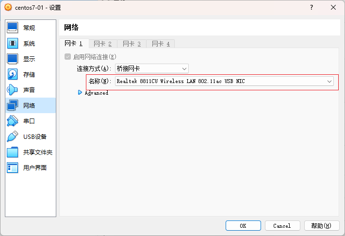
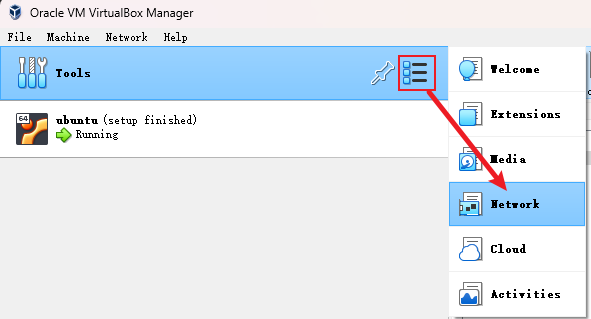
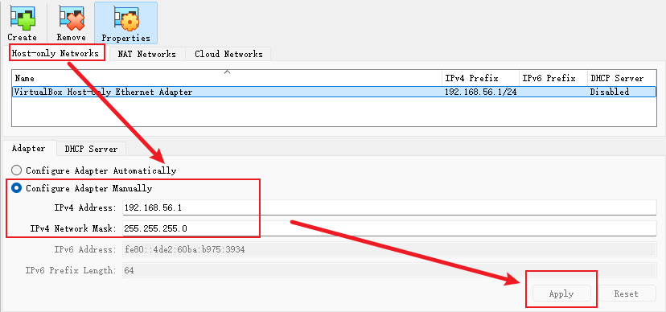

# VirtualBox

## 网络

### 桥接

需要根据电脑当前实际使用的网络进行选择，当前是用网线的就选网线网络对应的网卡；当前是用WIFI的就选WIFI网络对应的网卡



### nat

功能：固定IP + 内外连通 + 外网访问

- 配置虚拟机系统网络适配器


- 配置宿主机和虚拟机的映射（不用重启虚拟机系统）


- 配置虚拟机系统的网络

```sh
vi /etc/sysconfig/network-scripts/ifcfg-enp0s3
```

```txt
TYPE=Ethernet
PROXY_METHOD=none
BROWSER_ONLY=no
BOOTPROTO=none
DEFROUTE=yes
IPV4_FAILURE_FATAL=no
IPV6INIT=yes
IPV6_AUTOCONF=yes
IPV6_DEFROUTE=yes
IPV6_FAILURE_FATAL=no
IPV6_ADDR_GEN_MODE=stable-privacy
NAME=enp0s3
UUID=5208bd48-a7df-43f5-8824-090a1d5ba7f5
DEVICE=enp0s3
ONBOOT=yes
IPADDR=10.0.2.15
PREFIX=24
GATEWAY=10.0.2.2
IPV6_PRIVACY=no
DNS1=223.5.5.5
```

- 用127.0.0.1:2222连接虚拟机操作系统

### nat network

功能：固定IP + 内外连通 + 外网访问 + 虚拟机互通

- 新建nat network，用宿主机的2222端口映射虚拟机操作系统的22端口


- 配置虚拟机操作系统的网络，`Promiscuous mode选Allow all`


- 配置虚拟机操作系统静态ip

```sh
vi /etc/sysconfig/network-scripts/ifcfg-enp0s3

# 配置完成重启网络
service network restart
```

```txt
TYPE="Ethernet"
PROXY_·ETHOD="none"
BROWSER_ONLY="no"
BOOTPROTO="static"
DEFROUTE="yes"
IPV4_FAILURE_FATAL="no"
IPV6INIT="yes"
IPV6_AUTOCONF="yes"
IPV6_DEFROUTE="yes"
IPV6_FAILURE_FATAL="no"
IPV6_ADDR_GEN_MODE="stable-privacy"
NAME="enp0s3"
UUID="829eb1b0-1a34-45af-9fd5-36a3d3b12e76"
DEVICE="enp0s3"
ONBOOT="yes"
# 自定义虚拟机静态ip
IPADDR=10.0.2.3
# 宿主机子网掩码
NETMASK=255.255.255.0
# 宿主机网关
GATEWAY=192.168.1.1
DNS1=114.114.114.114
```

- 用127.0.0.1:2222连接虚拟机操作系统

### host-only宿主机静态IP

当docker容器要映射主机的IP时，由于主机的公网IP是动态的，每次启动都要更新这个IP，很不方便

因此可以通过创建一个虚拟网卡，设置静态IP，当虚拟机要用到主机IP时，就用这个IP来进行通讯

- 创建虚拟网卡



- 配置静态IP


