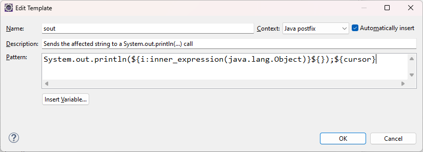
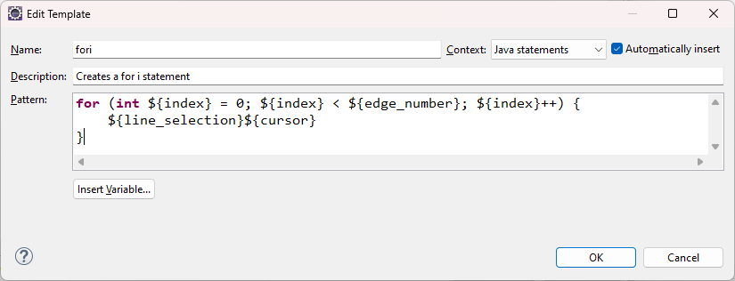

# IDE

## Eclipse

### 基本设置

- 打开`Window->Preferences`
    - General
        - `Startup and Shutdown` -> `Plug-ins activated on startup`里面的选项都取消勾选
        - `Apperance` -> `Colors and Fonts`
            - `Basic` -> `Text Font`，点击`Edit`进行代码编辑区的字体和字号设置
            - `View and Editor Folders` -> `Tree and Table font for views` -> 点击`Edit`进行侧边栏的字体和字号设置
            - 至于标题栏、菜单栏和工具栏的字体和字号是继承操作系统的字体和字号的，可以通过后者进行设置
        - `Content Types`
            - Text，在`Default encoding` 输入`UTF-8`，然后点击`Update`
                - `Java Properties File`，在`Default encoding` 输入`UTF-8`，然后点击`Update`
                - `Spring Properties File`，在`Default encoding` 输入`UTF-8`，然后点击`Update`
        - Editors
            - Autosave，勾选`Enable autosave for editors with unsaved changes`
            - `File Associations`,点击`pom.xml`，然后点击`XML Editor`,然后点击`default`，然后应用，这一项设置保留，后面有必要再设置
            - Text Editors
                - 勾上`Insert spaces for tabs`，设置Tab键插入空格
                - 勾上`Show line numbers`，显示行号
        - Keys
            - 搜索`Toggle Comment`，将`TM4E Language`那行的快捷键改成`Ctrl+/`，这样就可以在pom.xml里面使用该快捷键了
        - Workspace，勾上`Refresh using native hooks or polling`，自动刷新文件夹改动
            - `Text file encoding`，设置源文件编码为UTF-8
            - `New text file line delimiter`，设置为Unix换行符
            - Build
                - 勾上`Save automatically before manual build`，手动构建前自动保存

#### Java设置

- Java -> Compiler，`Compiler compliance level`设置为自己的Java版本作为编译器语法版本
    - `Errors/Warnings` -> `Generic types` -> `Redundant type arguments(1.7 or higher)`设置为Warnings
        - 这样泛型补全`List<String> list = new ArrayList<String>();`后，就会显示警告信息，然后就可以通过提示进行处理，目前只想到了这个解决办法

- 设置代码补全，Java->Editor->Content Assist，
    - 取消只有按回车才触发代码补全提示，取消勾选`Disable insertion trigger except 'Enter'`
    - 不使用静态导入，取消勾选`Use static imports`
    - 设置代码补全触发器，`Auto activation triggers for Java`覆盖填入`.qwertyuiopasdfghjklzxcvbnm`
    - 启动Java后缀模板提示，Advance，勾上`Java Postfix Template Proposals`

- 自定义模板，Java->Editor->Templates
    - `.sout` 自动补全

    

    - `fori` 自动补全

    

- 设置JRE，Java->Installed JREs，点`Add`添加自己的Java版本

#### Maven设置

- 设置Maven，Maven->Installations，点`Add`添加自己的Maven版本

- 设置Maven配置文件，Maven->User Settings，设置为自己的..\settings.xml

#### XML配置

- 设置缩进，XML->XML Files->Editor，选择`Indent using spaces`，`Indentation size`设置为4
    - 如果是Eclipse IDE for Java Developers版本，需要下载插件`Eclipse XML Editors and Tools`

- 设置xml文件头部约束资源下载，XML(Wild Web Developer)，勾选`Download external resources like referenced DTD,XSD`

#### Mybatis代码提示设置

```xml
<?xml version="1.0" encoding="UTF-8" ?>
<!DOCTYPE mapper
  PUBLIC "-//mybatis.org//DTD Mapper 3.0//EN"
  "https://mybatis.org/dtd/mybatis-3-mapper.dtd">
<mapper namespace="com.handle.application.pojo.AccountDo">

</mapper>
```

- 1. 复制mapper.xml中的`https://mybatis.org/dtd/mybatis-3-mapper.dtd`，粘贴到浏览器地址栏下载，下载完成放到某一个目录中

- 2.XML->XML Catalog，点`Add`

- 3.点`File System`，选中刚刚下载的dtd文件

- `Key type`填`URI`

- `Key`填mapper.xml中的`-//mybatis.org//DTD Mapper 3.0//EN`

### 安装Lombok插件

- 1.下载Lombok，运行如下命令

```sh
java -jar lombok.jar
```

- 2.在弹出的界面选择eclipse.exe的所在位置，然后重启Eclipse

### 安装其它插件

- 可以在eclipse插件市场在线安装插件
    - 建议先配置插件的国内镜像源（如清华镜像源）
        - Preference -> `Install/Update` -> `Available Software Sites`，然后更改为国内源

- 建议安装以下插件
    - Kantan Properties Editor
    - Mybatipse
    - Spring Tools

### 快捷键

|快捷键|功能|
|:-|:-|
|Tab|向右缩进|
|Shift + Tab|向左缩进|
|Ctrl + /|注释/取消注释|
|Ctrl + Shift + C|全局注释/取消注释|
|Alt + Shift + A|进入/退出多行编辑|
|Alt + Shift + R|统一修改变量名|
|Ctrl + Shift + X|转大写|
|Ctrl + Shift + Y|转小写|
|Ctrl + Shift + O|优化导入语句|

### eclipse使用心得

下载插件特别慢，需要翻墙，下多几次还会被服务器的反爬虫机制阻挡了，下都下不了，很恶心

还有就是配置导出乱七八糟的，没法像idea那样简单，玩不好估计有些配置会漏掉导致没法恢复所有配置

properties文件的中文显示问题，虽然有插件可以正常显示了，但是那个颜色特别刺眼，看久了对视力不好，建议eclipse还是用yaml吧

还有就是代码提示补全，感觉没有idea那么完善

spring-tools-for-eclipse = eclipse-jee + Spring Tools Suite 插件，

虽然eclipse-java也可以通过安装插件变成eclipse-jee或spring-tools-for-eclipse

由于eclipse的插件下载很慢，强烈建议直接使用spring-tools-for-eclipse

## IDEA

官网：<https://www.jetbrains.com/idea/>

社区版：<https://github.com/JetBrains/intellij-community>

- 配置

- File -> Settings
    - Editor
        - General
            - `Auto Import`
                - Java
                    - 勾选`Add unambiguous imports on the fly`
                    - 不要勾选`Optimize imports on the fly`，否则执行会触发导入语句优化的撤销操作时会抽风跟你二人转，设置保存时优化导入就行了
    - Tools
        - `Actions on Save`
            - Action
                - 勾选`Reformat code`，如果使用了版本控制，建议在提交代码的时候再执行代码格式化
                - 勾选`Optimize imports`

|快捷键|功能|
|:-|:-|
|Ctrl + /|注释/取消注释|
|Ctrl + E|最近更改的文件|
|Ctrl + O|重写⽅法|
|Ctrl + I|实现⽅法|
|Ctrl + Z|撤销|
|Ctrl + Shift + Z|取消撤销|
|Alt+Insert|生成代码（如getter），跟鼠标右键->Generate功能一样|
|Tab|向右缩进|
|Shift + Tab|向左缩进|
|Shift+Enter|另起⼀⾏|
|Shift + F6|重命名，要注意可能跟输入法按键冲突|
|按两下Shift|类搜索|
|Ctrl + Shift + F|全局搜索|
|Ctrl + Shift + R|全局替换|
|Ctrl + Shift + U|大小写转换|
|Ctrl+Shift+J|整合两⾏为⼀⾏|
|Ctrl + Alt + L|代码格式化|
|Ctrl + Alt + O|优化导入语句|
|Ctrl + Alt + N|内联|
|Ctrl + Alt + M|提取代码为作为方法|
|Ctrl + Alt + C|修改变量作用域|
|Ctrl + Alt + left/right|前后导航编辑过的地⽅|

### idea使用心得

idea目前是社区版和旗舰版合并为一个软件了，如果从官网下载的话，只有一个idea可以下载

官方版idea本会比社区版大一倍，里面塞了很多插件，并且提供了一些社区版没有的一些基础功能，比如CSS、JavaScript、TypeScript、Node.js、npm

看取舍了，如果不打算使用订阅功能并且不介意官方版的更多的基础功能的话建议下载社区版就可以了

更新jdk时，ide无法识别新jdk，显示还是旧的jdk，这时需要在project struct里面删除原来的jdk，然后再添加一次，也可以不用这么麻烦重启电脑就行了

另外不得不提一下maven和mavend了，在日常开发过程中，运行和调试都是idea内置的执行器在工作，跟maven和mavend没有半毛钱关系

除非你在idea设置中委托给maven，但是这会导致调试无法进入断点，一般不会勾选委托给maven

只有执行maven生命周期的任务，如：clean、compile、package、install等时，maven和mavend才有出场的机会

而Sync Project、Sync All Maven Projects和Reload All Maven Projects也是idea在干活的哟

## zed

```sh
# zed，压缩包解压的版本运行后任务栏不显示正确的zed图标，archlinux先用包管理器的版本吧
sudo pacman -S zed
```

安装完后到扩展页面搜索java，下载扩展，只要操作系统层面已经配置好java和maven，在zed完全开箱即用

### 调试设置

在zed右下角状态栏点击调试图标，然后点击编辑debug.json，编辑内容如下，其中主类要根据具体项目更改

```json
[
  {
    "adapter": "Java",
    "request": "launch",
    "label": "Launch Debugger",
    // if your project has multiple entry points, specify the one to use:
    "mainClass": "具体全限定主类名",
    //
    // this effectively sets a breakpoint at your program entry:
    "stopOnEntry": true,
    // the working directory for the debug process
    "cwd": "$ZED_WORKTREE_ROOT"
  }
]
```

在zed右下角状态栏点击调试图标，添加新会话，选择刚刚编辑的调试名称，然后就能开始调试了

### zed使用心得

- markdown还不支持转pdf，没有相关的插件
- 内存占用多，显存占用也多，还有点卡
- 特别是markdown预览的时候，很明显的卡顿，并且预览同步延迟也很大
- 更新到12.1后，调试没反应了，作为一个新兴的编辑器，还是先别用吧

## theia-ide

协议友好，但是启动很慢，将来有可能替代vscode，拒绝微软强行喂的无用功能
