# Java Note

## Java基础

- 文件夹名称一律用小驼峰，并且单个单词的文件夹名称一律用单数形式
    - 项目名用英文单词小写加`-`连接符定义，和maven的项目坐标名保持风格一致
- 变量命名：变量名+变量类型，这样可以快速知道变量属于什么类型，并且不用输入那么多字母就弹出来代码补全了，省的都是时间啊
- 用来存储对象的变量称为引用变量
- 方法名有final修饰，表示此方法是终结方法，不能被子类重写
- 可变长参数在一个方法中最多只能有一个，并且必须放在最后
- Java编译器自动引入java.lang
- `方法的签名`（signature）: 要完整地描述一个方法，需要指出`方法名`以及`参数类型`
    - 返回类型不是方法签名的一部分。也就是说， 不能有两个名字相同、参数顺序和类型也相同，但是返回不同类型值的方法
- VO（View Object）：视图对象，前端和控制层之间的数据传输对象
- DTO（Data Transfer Object）：数据传输对象，控制层与服务层之间的数据传输对象
- DO（Domain Object）：领域对象，就是从现实世界中抽象出来的有形或无形的业务实体
- PO（Persistent Object）：持久化对象，它跟持久层（通常是关系型数据库）的数据结构形成一一对应的映射关系
    - 如果持久层是关系型数据库，那么，数据表中的每个字段（或若干个）就对应PO的一个（或若干个）属性
- 不用public、protected、private修饰的字段和方法就是包作用域。位于同一个包的类，可以访问包作用域的字段和方法

- 定义数据字典/下拉选项/枚举时，0不要作为all，而是用具体的表的字段值，让前端来增加下拉all，当用户选择all时，传null给后端就行了

### JDK

- `JRE` 是 Java 运行时环境（Java Runtime Environment）
    - 它是运行已编译 Java 程序所需的所有内容的集合，包括 Java 虚拟机（JVM），Java 类库，java 命令和其他的一些基础构件
    - 但是，它不能用于创建新程序
- `JDK` 是 Java Development Kit 缩写，它是功能齐全的 Java SDK
    - 它拥有 JRE 所拥有的一切
    - 还有编译器（javac）和工具（如 javadoc 和 jdb）
    - 它能够创建和编译程序

#### 安装JDK

Oracle JDK的协议：jdk17+都是NFTC协议：免费使用 + 更新3年，3年后如果想要获得更新就要付费订阅了，当然可以选择不更新嘿嘿

GraalVM Community Edition（CE）：GPLv2 + Classpath Exception协议，开源免费
    - 虽然没有内置javafx，但是通过maven依赖引入javafx后，进行编译可以通过
    - 带有javafx的web和media相关的功能也是不能编译为本地二进制文件的

Oracle GraalVM：GFTC（GraalVM Free Terms and Conditions）协议，免费使用 + 更短更新周期（与Oracle JDK 的NFTC类似）

- Liberica Native Image Kit：LibericaJDK + GraalVM CE
    - 对spring框架做了优化，如果需要编译javafx应用，需要下载完全版，标准版编译会报错的，跟GraalVM CE有点区别
    - 官方明确说了不支持javafx的web和media相关的功能编译为本地二进制文件
    - 25.0.4.1版本，笔者使用的时候，用普通类作为入口执行javafx程序运行报错
    - 这个错误是跟javafx的webview相关的，这么推断要是用了media相关的控件或功能也会导致运行不起来
    - 经过权衡觉得GraalVM CE可能更合适

##### 1.windows安装jdk

- 1.下载jdk压缩包xxx.zip，解压到指定目录（解压后bin文件夹所在目录为jdk根目录，假设为`D:\jdk\xxx`）
- 2.新增环境变量`JAVA_HOME：D:\jdk\xxx`
- 3.`Path`中添加：`%JAVA_HOME%\bin`

##### 2.linux安装jdk

- 1.下载jdk压缩包xxx.tar.gz，解压到指定目录

```sh
# 新建目录
mkdir -p 指定目录

tar -zxvf xxx.tar.gz -C 指定目录
```

- 2.设置环境变量（解压后bin文件夹所在目录为jdk根目录，假设为`/opt/jdk/xxx`）

```sh
# /etc/profile 是系统级的shell启动配置文件，它作用于所有用户的登录shell
# 启动一个交互式非登录shell（比如打开一个新的终端窗口），这时会读取 ~/.bashrc，目前笔者用的是这个
# 当通过SSH登录远程服务器，或在图形界面登录后启动一个shell，会读取~/.bash_profile
# 增加/删除环境变量并重新加载配置文件后，打开一个新的终端窗口
# 如果环境变量是定义在~/.bashrc，则该环境变量是生效的
# 如果环境变量是定义在~/.bash_profile，则该环境变量不会生效，直到重启才会生效
# 下面以/etc/profile为例，其它两个文件类似

# 1.先备份/etc/profile（或~/.bashrc或~/.bash_profile）
cp /etc/profile /etc/profile.bk

# 2.编辑profile文件
vi /etc/profile

# 3.在profile文件末尾添加
export JAVA_HOME=/opt/jdk/xxx
export PATH=$PATH:${JAVA_HOME}/bin
```

- 3.重新加载配置文件

```sh
source /etc/profile
```

- 4.测试

```sh
java -version
```

### Java源文件

- 若将多个类的声明放在一个文档中，只能有一个类声明为公有类

```java
public class A {}

class B {}
```

- Java源文件名必须与文档中公有类名一致（区分大小写）

```java
// 文件名必须为 A.java
public class A {}

class B {}
```

### 构造方法

- 调用构造方法的具体处理步骤：
    - 1.如果构造方法的第一行调用了另一个构造方法，则基于所提供的参数执行后者
    - 2.否则，
        - a）所有字段初始化为默认值（0、false或null）
        - b）按照在类声明中出现的顺序，执行字段初始化和初始化块
    - 3.执行构造方法主体代码

- java25开始，构造方法中，super(...) 或 this(...) 调用不是必须作为第一条语句出现了，可以在此之前做一些字段校验、初始化了

```java
public class Employee {
    // 1. 执行字段声明的初始化
    private Long id = 1L;

    {
        // 2. 执行初始化块的初始化
        id = 2L;
    }

    public Employee() {
        // 3. 执行构造方法的初始化
        id = 3L;
    }
}

@Test
public void test5() {
    // 3
    System.out.println(new Employee().getId());
}
```

### 静态工厂方法（static factory method）

对于类而言，为了让客户端获取它自身的一个实例，最传统的方法就是提供一个公有的构造方法

此外，还可以提供一个公有的静态工厂方法，它只是一个返回类的实例的静态方法

注意，静态工厂方法并不直接对应于设计模式（Design Pattern）中的工厂方法

例如：

```java
public static Boolean valueOf(boolean b) {
    return (b ? TRUE : FALSE);
}
```

- 相比于构造方法
    - 静态工厂方法顾名思义
    - 不必在每次调用它们的时候都创建一个新对象
    - 可以返回原返回类型的任何子类型的对象
    - 所返回的对象的类可以随着每次调用而发生变化，这取决于静态工厂方法的参数值
    - 方法返回的对象所属的类，在编写包含该静态工厂方法的类时可以不存在，例如JDBC API
    - 缺点：类如果只有静态工厂方法，而不含公有的或者受保护的构造方法，就不能被子类化

- 一些常见的静态工厂方法的名称
    - from，类型转换方法，它只有单个参数，返回该类型的一个相对应的实例
    - of，聚合方法，带有多个参数，返回该类型的一个实例，把它们合并起来
    - valueOf，比 from 和 of 更烦琐的一种替代方法
    - instance或getInstance，返回的实例是通过方法的参数（如果有）来描述的，但是不能说与参数具有同样的值
    - create或newInstance，像instance或getInstance，但能够确保每次调用都返回一个新的实例
    - getType，Type表示静态工厂方法所返回的对象类型，像getInstance一样，但是在静态工厂方法处于不同的类中的时候使用
    - newType，Type表示静态工厂方法所返回的对象类型，像newInstance一样，但是在静态工厂方法处于不同的类中的时候使用
    - type，getType 和 newType的简版，如：`Collections.list(...)`

### 构建器（Builder）

构造方法和静态工厂方法有个共同的局限性：它们都不能很好地扩展到大量的可选参数

- 这种场景，虽然可以用重叠构造器（telescoping constructor）
    - 第一个构造方法只有必要的参数
    - 第二个构造方法有一个可选参数
    - 第三个构造方法有两个可选参数
    - 依此类推，最后一个构造方法包含所有可选的参数

```java
public class Pet {
    // 必要字段
    private final String name;

    // 可选字段
    private final Integer age;
    private final BigDecimal weight;

    private Pet(String name) {
        this(name, 1);
    }

    private Pet(String name, Integer age) {
        this(name, age, new BigDecimal("1.0"));
    }
    private Pet(String name, Integer age, BigDecimal weight) {
        this.name = name;
        this.age = age;
        this.weight = weight;
    }
}
```

重叠构造器可行，但是当有许多参数的时候，代码会很难编写，并且仍然较难以阅读

一长串类型相同的参数可能还会导致一些微妙的错误，如不小心颠倒了参数顺序

- 为此，还有第二种代替办法，即JavaBeans模式
    - 先调用一个无参构造器来创建对象
    - 然后再调用 setter方法来设置每个必要的参数，以及每个相关的可选参数

```java
@Setter
public class Pet {
    // 必要字段
    private String name;

    // 可选字段
    private Integer age;
    private BigDecimal weight;
}
```

- Java Beans模式不足之处
    - 在构造过程中Java Bean可能处于不一致的状态，使用处于不一致状态的对象导致的问题，调试定位十分困难
    - 使得把类做成不可变的可能性不复存在，需要付出额外的努力来确保它的线程安全

综上，有了第三种替代方法，它既能保证像重叠构造器模式那样的安全性，也能保证像JavaBeans模式那么好的可读性

- 那就是使用构建器，它是构建器设计模式的一种形式
    - 定义
        - 首先，创建一个静态内部类Builder，Builder的字段跟外部类一致
        - 然后，根据外部类的必要字段定义Builder的构造方法
        - 然后，根据外部类的可选字段定义字段设置方法
        - 然后，定义一个build方法，通关外部类的私有构造方法，创建外部类的实例并返回
        - 最后，在外部类定义一个私有构造方法，参数是Builder实例，根据Builder实例的字段初始化所有外部类的同名字段
    - 使用
        - 先使用必要参数创建一个Builder实例
        - 再使用Builder实例，调用字段设置方法，设置可选参数
        - 最后调用build方法生成外部类的实例（通常是不可变的实例）

```java
public class Pet {
    // 必要字段
    private final String name;

    // 可选字段
    private final Integer age;
    private final BigDecimal weight;

    public static class Builder {
        // 必要字段
        private final String name;

        // 可选字段
        private Integer age;
        private BigDecimal weight;

        // Builder构造方法，初始化必要字段
        public Builder(String name) {
            this.name = name;
        }

        // 可选字段通过设值方法设置，返回builder本身
        // 这样可以把调用链接起来，得到一个流式API
        public Builder age(Integer age) {
            this.age = age;
            return this;
        }

        public Builder weight(BigDecimal weight) {
            this.weight = weight;
            return this;
        }

        // 内部类Builder的build方法创建一个外部类实例并返回
        public Pet build() {
            return new Pet(this);
        }
    }

    // 外部类的私有构造方法，传一个Builder实例作为参数
    private Pet(Builder builder) {
        this.name = builder.name;
        this.age = builder.age;
        this.weight = builder.weight;
    }

    // 静态工厂方法，可在工厂方法中扩展逻辑
    // 封装性和灵活性比用Builder的构造方法更好
    // 链式调用更自然：Pet.builder(...).age(...).weight(...).build();
    public static Builder builder(String name) {
        return new Builder(name);
    }
}

// 使用
Pet pet = new Pet.Builder("dog")
                 .age(1)
                 .weight(new BigDecimal("15.2"))
                 .build();
```

构建器也适用于类层次结构，抽象类有抽象类的构建器，具体类有具体类的构建器

总之类的构造方法和静态工厂方法中具有多个参数，设计这种类时，构建器就是一种不错的选择，特别是当大多数参数都是可选或者类型相同的时候

### 修饰符的顺序

- 根据《Java 语言规范》的推荐，修饰符应当按照以下标准顺序进行排列：
    - Annotations
    - 访问权限修饰符：public / protected / private
    - abstract
    - static
    - final
    - transient
    - volatile
    - synchronized
    - native
    - default
    - strictfp

### 类路径

- 类路径就是JVM在运行时用来查找类文件(.class)和资源文件（*.properties、*.xml等）的一组目录或jar文件列表
- 类路径是一组路径的集合，它包括
    - 当前目录（.）
    - 某个自定义目录，里面包含了各种类文件或资源文件或jar文件
    - jar文件
        - `/path/to/file.jar`
        - `/path/to/archives/*`，会被展开，将`/path/to/archives`里面的jar/zip文件加入到类路径

- 根目录：类路径中，类型为目录的都是根目录
- 执行`java -jar file.jar`时，JVM会忽略-cp，并且类路径只来自：
    - file.jar 本身
    - file.jar 的MANIFEST里的Class-Path字段（如果有）
    - Spring Boot Launcher构造的虚拟classpath（如果是fat jar）
        - BOOT-INF/classes + BOOT-INF/lib/*.jar

#### 执行Java程序

##### 通过指定类路径和主类执行Java程序

如果我们要执行一个jar包，就可以把jar包放到类路径中，这样JVM会自动在xxx.jar文件里去搜索主类执行Java程序

```sh
# .表示当前路径，假设主类路径为：./com/handle/HelloWorld.class
java -classpath . com.handle.HelloWorld

# ./HelloWorld.jar 表示当前目录下的HelloWorld.jar文件，假设其包含主类：com.handle.HelloWorld.class
java -classpath ./HelloWorld.jar com.handle.HelloWorld
```

##### 通过`java -jar file.jar`执行Java程序

```sh
java -jar file.jar
```

### ClassName.class.getResource

常用于加载与当前类同包的资源、加载classpath根下的资源（以`/`开头）

```java
ClassName.class.getResource(resourceName)
```

- ClassName.class.getResource的相对路径是以"/"结尾的

- 如果resourceName是以`/`开头
    - 如果类路径中`有`类型为目录的路径，则相对路径为类路径中的第一个类型为目录的路径（classpath根）
    - 如果类路径中`无`类型为目录的路径，
        - 如执行`java -cp file.jar MainClass`或`java -jar file.jar`，则相对路径为jar文件内部的虚拟根目录，用url表示为：`jar:file:/path/to/file.jar!/`

        - 如果是执行`java -jar file.jar`，并且file.jar是Spring Boot的可执行jar文件，则用url表示相对路径为：`jar:file:/path/to/file.jar!/BOOT-INF/classes/`

- 如果resourceName非以`/`开头，则相对路径为ClassName类所在包的目录
    - 如果ClassName.class在一个目录中，则用url表示相对路径为：`file:/path/to/directory/`
    - 如果ClassName.class在一个jar文件中，则用url表示相对路径为：`jar:file:/path/to/file.jar!/path/to/directory/`

### ClassName.class.getClassLoader().getResource

常用于加载classpath根下的资源

和ClassName.class.getResource("/" + resourceName)功能一样

```java
// resourceName不能以`/`开头
ClassName.class.getClassLoader().getResource(resourceName)
```

### 二进制知识

#### 原码、反码、补码

- 原码：正数，它的绝对值转换成的二进制数；负数，它的绝对值转换成的二进制数，然后最高位置1

- 反码：正数的反码与原码相同；负数的反码为其原码`除符号位`外`按位取反`

- 补码：正数的补码与原码相同；负数的补码为其反码加1

- 正数的二进制数为其原码，负数的二进制数为其补码

```java
// 原码 10000000 00000000 00000000 00000010
// 反码 11111111 11111111 11111111 11111101
// 补码 11111111 11111111 11111111 11111110
String b = Integer.toBinaryString(-2); 
```

#### 进制转换

- 一个字节8位，存放二进制范围0B00000000～0B11111111

- 一个字节8位，分成2组，每组4位，得到2位的16进制数，范围0X00~0XFF

- Java中，byte、short、int、long分别占1、2、4、8个字节，char占2个字节

##### 二进制转十进制

```java
// 分别计算二进制每一位的值，然后求和就得到10进制的数值了
// 从右往左数位数，每一位的值为2^(位数-1)次方 * 该位的二进制值
// 0B0000 1010
// 2^(8-1) * 0 + 2^(7-1) * 0 + 2^(6-1) * 0+ 2^(5-1) * 0 + 2^(4-1) * 1 +2^(3-1) * 0 + 2^(2-1) * 1 + 2^(1-1) * 0
// 0 + 0 + 0 + 0 + 8 + 0 + 2 + 0 = 10
int a = 0B00001010;
// 10
System.out.println(a);
```

##### 二进制转16进制

```java
// 二进制数每4位为一组，分别计算每一组的值，然后组合起来就是16机制的值了
// 从右往左数位数，每一位的值为2^(位数-1)次方 * 该位的二进制值
// 0B0000 1010
// 0000为一组：2^(4-1) * 0 +2^(3-1) * 0 + 2^(2-1) * 0 + 2^(1-1) * 0 = 0 + 0 + 0 + 0 = 0
// 1010为一组：2^(4-1) * 1 +2^(3-1) * 0 + 2^(2-1) * 1 + 2^(1-1) * 0 = 8 + 0 + 2 + 0 = 10
// 组合起来得到16进制：0X0A
int a = 0B00001010;
// 0000000a
System.out.println(HexFormat.of().toHexDigits(a));
```

#### 十进制转其它进制

```java
int a = 10;
// 二进制   1010
System.out.println(Integer.toBinaryString(a)); 
// 八进制   12
System.out.println(Integer.toOctalString(a));  
// 十六进制 a
System.out.println(Integer.toHexString(a));    
```

#### byte[] 和十六进制字符串互转

- Java 8及以前版本，String用char数组存储，每个char元素2字节，转换的实质为一个1字节的byte元素，转换为一个2字节的char元素
- Java 9之后，String用byte数组存储，转换的实质为一个1字节的byte元素，转换为一个1字节的byte元素

##### 用Java自带方法转换

```java
// byte[]转换为16进制字符串
byte[] datas = {15, 15};
// 00001111 00001111，（0x0f0f) 结果为f0f（byte数组首个元素高4位为0，被去掉了) 
String hexString = new BigInteger(1, datas).toString(16);

// 推荐
// 0f0f
String hexString2 = HexFormat.of().formatHex(datas);

// byte[]转换为16进制字符串
String s = "hello world";
String hex = HexFormat.of().formatHex(s.getBytes(StandardCharsets.UTF_8));
// 68656c6c6f20776f726c64
System.out.println(hex);

// 16进制字符串转换为byte[]
byte[] bytes = HexFormat.of().parseHex(hex);
// hello world
System.out.println(new String(bytes, StandardCharsets.UTF_8));
```

##### 引入第三方库转换

```groovy
implementation 'commons-codec:commons-codec:1.17.1'
```

```java
byte[] datas = {15, 15};
// byte[] 转 16进制字符串
// 0f0f，当byte数组首个元素高4位为0时也会保留
String hexString = Hex.encodeHexString(datas);

// 16进制字符串 转 byte[]
byte[] datas = Hex.decodeHex(hexString);
```

- Hex.encodeHexString 底层代码剖析

```java
public String encodeHexString(final byte[] data) {
    char[] DIGITS_UPPER = {'0', '1', '2', '3', '4', '5', '6', '7', '8', '9', 'A', 'B', 'C', 'D', 'E', 'F'};
    final int outlength = data.length;
    // 一个字节用两位16进制表示，out长度为data长度乘以2
    final char[] out = new char[outlength << 1];
    for (int i = 0, j = 0; i < outlength; i++) {
    // 取高4位，无符号右移四位，得到16进制高位
    // 0x41 = 0100 0001
    // 0xF0 = 1111 0000
    // 0x40 = 0100 0000
    // 0x04 = 0000 0100
    // 相当于 out[j++] = DIGITS_UPPER[data[i] / 16];
    out[j++] = DIGITS_UPPER[(0xF0 & data[i]) >>> 4];
    // 直接取低4位，得到16进制低位
    // 0x41 = 0100 0001
    // 0x0F = 0000 1111
    // 0x01 = 0000 0001 = 1
    // 相当于 out[j++] = DIGITS_UPPER[data[i] % 16];
    out[j++] = DIGITS_UPPER[0x0F & data[i]];
    }
    return new String(out);
}
```

#### 移位运算

对byte和short类型进行移位时，会首先转换为int再进行位移

如果移位位数大于等于该数据类型的位数（如对int类型的数据移位32位）

会先计算`该数据类型的位数 % 移位位数`，得到真正的移位位数，再进行移位操作

- 左移`<<`， 低位补0，十进制数m左移n位相当于m乘以2的n次方

```java
int m = 1;       // 00000000 00000000 00000000 00000001 = 1
int r = m << 1;  // 00000000 00000000 00000000 00000010 = 2
```

- 右移`>>`，高位补符号位，十进制数m右移n位相当于m除以2的n次方

```java
int m = 2;       // 00000000 00000000 00000000 00000010 = 2
int r = m >> 1;  // 00000000 00000000 00000000 00000001 = 1
```

- 无符号右移`>>>`，高位补0，注意，`没有无符号左移`！

```java
int m = -2;        // 11111111 11111111 11111111 11111110 = -2
int r = m >>> 1;   // 01111111 11111111 11111111 11111111 = 2147483647
```

#### 位运算

位运算是按位进行与（&）、或（|）、非（!）和异或（~，异或运算的规则是，如果两个数不同，结果为1，否则为0）的运算

### 运算优先级

在Java的计算表达式中，运算优先级从高到低依次是：

- `()`
- `! ~ ++ --`
- `* / %`
- `+ -`
- `<< >> >>>`
- `&`
- `|`
- `+= -= *= /=`

### `==`比较运算符

- 基本数据类型，`==`比较的是`值`

```java
Assertions.assertTrue(3 == 3);
```

- 复合数据类型，`==`比较的是`地址`

```java
String a = new String("handle");
String b = new String("handle");
Assertions.assertFalse(a == b);
```

- 复合数据类型，`equals`在没有覆写的情况下，比较的也是`地址`

```java
@Getter
@Setter
@ToString
@AllArgsConstructor
public class User {
  private String name;
}

User a = new User("handle");
User b = new User("handle");
Assertions.assertFalse(a == b);
```

### 继承

- 继承写法：
    - 子类名 extends 父类名
    - 子类名 implements 父接口名
    - 子接口名 extends 父接口名

- 子类拥有父类所有的字段和方法（包括私有字段和私有方法）

- 父类中的私有字段和方法子类是无法访问，只是拥有，严禁定义与父类重名的字段

- 子类不能继承父类的静态属性，但可以对父类静态属性操作

- 任何class的构造方法，第一行语句必须是调用父类的构造方法。如果没有明确地调用父类的构造方法，编译器会帮我们自动加一句super();

- 从Java 15开始，允许使用sealed修饰class，并通过permits明确写出能够从该class继承的子类名称

- 如果一个父类的方法本身不需要实现任何功能，仅仅是为了定义方法签名，目的是让子类去覆写它，那么，可以把父类的方法声明为抽象方法；
    - 因为这个抽象方法本身是无法执行的，所以，父类也无法被实例化，因而这个父类也必须申明为抽象类

- 如果一个抽象类没有字段，所有方法全部都是抽象方法，就可以把该抽象类改写为接口

- 接口主要用于对类的行为进行约束，实现了某个接口就具有了对应的行为

- 抽象类主要用于代码复用，强调的是所属关系

#### 接口

```java
public interface InterfaceName {
    // 接口中的字段只能是public static final类型的，不能被修改且必须有初始值
    // 可以不写public static final
    type fieldName = value;

    // 接口中的抽象方法默认是public abstract，可以不写public abstract
    returnType abstractName(...);

    // Java 8引入的default方法用于提供接口方法的默认实现，可以在实现类中被覆盖
    default void defaultMethodName() {
        // todo
    }

    // Java 8引入的static方法无法在实现类中被覆盖，只能通过接口名.staticMethodName(...)直接调用，类似于类中的静态方法
    // static方法通常用于定义一些通用的、与接口相关的工具方法，一般很少用
    static void staticMethodName() {
        // todo
    }

    // Java 9引入的private方法可以用于在接口内部共享代码，不对外暴露
    // 私有静态方法，可以被static和default方法调用
    private static void methodName() {
        // todo
    }

    // 私有实例方法，只能被default方法调用
    private void methodName() {
        // todo
    }
}
```

#### 继承关系判断

```java
// 判断实例是否为某个类型：（子）实例 instanceof （父）类型
Assertions.assertTrue("handle" instanceof Object);

  // 判断能子类型能否向上转型：父类型类实例.isAssignableFrom(子类型类实例);
Assertions.assertTrue(Object.class.isAssignableFrom(Integer.class));
```

##### instanceof模式匹配

- 从Java16开始，判断instanceof后，可以直接转型为指定变量，避免再次强制转型。

```java
 Object object = "hello";
if (object instanceof String s) {
    // 可以直接使用变量s:
    System.out.println(s.toUpperCase());
}
```

### 定义常量

```java
public class C() {
    // 定义类常量
    private final double PI =3.14;

    // 定义局部常量
    public void fun() {
        final double PI =3.14;
    }
}
```

### 静态方法中获取所在类实例

```java
Class clazz = MethodHandles.lookup().lookupClass();
```

### 打印对象内存地址

```java
Object object = new Object();
// 方法1，推荐
String hexAddress1 = Integer.toHexString(System.identityHashCode(object));

// 方法2，前提是没有重写toString()
String hexAddress2 = object.toString().substring(object.toString().indexOf("@") + 1);
```

### 拷贝

- 引用拷贝：两个不同的引用指向同一个对象

- 浅拷贝：
    - 浅拷贝会在堆上创建一个新的对象（区别于引用拷贝的一点）
    - 如果原对象内部的字段是引用类型的话，直接复制内部对象的引用地址

- 深拷贝：完全复制整个对象，包括这个对象所包含的内部对象

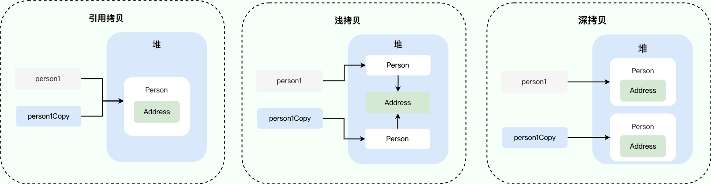

### hashCode()

hashCode() 的作用是获取哈希码，这个哈希码的作用是确定该对象在哈希表中的索引位置

### 操作文件

#### File

- 新建文件

```java
// 新建文件
File file = new File("/path/to/newfile.suffix");
if (file.createNewFile()) {
    // 删除文件
    if (file.delete()) {
        System.out.println("new file had been deleted!");
    }
}

// 新建临时文件，指定文件名、后缀和文件路径
File file = File.createTempFile("temp", ".txt", new File("/path/to/directory"));
// 在JVM退出时自动删除该文件
file.deleteOnExit();
```

- 新建目录

```java
File directory = new File("/path/to/directory");
if (!directory.exists()) {
    // 创建当前File对象表示的目录，父目录必须存在
    // directory.mkdir();
    // 创建当前File对象表示的目录，并在必要时将不存在的父目录也创建出来
    directory.mkdirs();
    
    File subdirectory = new File("/path/to/directory/subdirectory");
    // 先删除子目录，子目录不为空时无法删除父目录
    subdirectory.delete();

    // 删除父目录
    directory.delete();
}
```

- 遍历目录

```java
File file = new File("/path/to/directory");

// 列出所有文件和子目录,但不包括子目录下的文件和目录
// 遍历文件名
String[] list = file.list();
for (String item : list) {
    System.out.println("filename: " + item);
}

// 遍历文件
File[] files = file.listFiles();
for (File item : files) {
    System.out.println("file: " + item);
}

// 过滤文件
File[] filterFiles = file.listFiles(new FilenameFilter() {
    @Override
    public boolean accept(File dir, String name) {
        // 返回true表示接受该文件
        return name.endsWith(".yaml");
    }
});

// 遍历过滤出来的文件
for (File item : filterFiles) {
    System.out.println("filter: " + item);
}
```

- 获取文件路径

```java
// 表示JVM的当前工作目录，和System.getProperty("user.dir")一样
// idea：项目根目录
// java -jar file.jar：执行这条命令时所在的目录
String path = new File("").getCanonicalPath();

// 路径分隔符，不同系统平台有不同的值，Windows是"\"，Linux是"/"
System.out.println(File.separator);

File file = new File("..");

// getPath()，返回构造方法传入的路径，不会解析"."、".."，不会解析符号链接，不做任何规范化
// 输出：..
System.out.println(file.getPath());

// getAbsolutePath()，返回绝对路径，不会解析"."、".."，不会解析符号链接，不做任何规范化
// 输出：/path/to/userDir/..
System.out.println(file.getAbsolutePath());

// getCanonicalPath()，它和绝对路径类似，但是返回的是规范路径,就是解析"."、".."和符号链接，得到标准的绝对路径
// 输出：/path/to
System.out.println(file.getCanonicalPath());
```

#### 读取文件

- 读取resources目录下的文件

```java
// 通过class.getResourceAsStream，要加前缀/
InputStream input = Xxx.class.getResourceAsStream("/fileName");

// 通过classLoader.getResourceAsStream，不需要加前缀
InputStream input = Xxx.class.getClassLoader().getResourceAsStream("fileName");

// 通过classLoader.getResource，不需要加前缀
URL url = Xxx.class.getClassLoader().getResource("fileName");
```

- 复制文件

```java
try (InputStream inputStream = Application.class.getClassLoader().getResourceAsStream(fileName);
    BufferedInputStream in = new BufferedInputStream(inputStream);
    BufferedOutputStream out = new BufferedOutputStream(new FileOutputStream(outputFileName));) {
    int length = 0;
    byte[] buffer = new byte[1024];
    while (-1 != (length = in.read(buffer))) {
        out.write(buffer, 0, length);
    }
}
```

### Java数据类型

#### 基本数据类型和对应的包装类型

|基本数据类型|占字节数|对应的包装类型|
|:-|:-|:-|
|byte|1|Byte|
|short|2|Short|
|int|4|Integer|
|long|8|Long|
|float|4|Float|
|double|8|Double|
|boolean|Java语言规范中没有定义，由具体的JVM决定|Boolean|
|char|2|Character|

Byte,Short,Integer,Long这4种包装类默认创建了相应类型的[-128，127]的缓存数据

Character创建了[0,127]的缓存数据

Boolean创建了Boolean.TRUE、Boolean.FALSE

对于Integer，可以通过JVM参数`-XX:AutoBoxCacheMax=<size>`修改缓存上限，但不能修改下限-128

```java
// 除了Boolean，可以通过"包装类型名称.SIZE" 获得该基本数据类型占用的位数
// 除了Boolean，可以通过"包装类型名称.BYTES"获得该基本数据类型占用的字节数
Assertions.assertEquals(16, Character.SIZE);
Assertions.assertEquals(2, Character.BYTES);
```

装箱过程是通过调用包装器的 `valueOf` 方法实现的，而拆箱过程是通过调用包装器的 `xxxValue` 方法实现的

#### String

##### 文本块

java15开始，可以使用String的文本块写法

```java
// \ : 表示行尾不引入换行符
// \s：表示单个空格

// 输出：
// line 1: hello world
// line 2
String string = """
            line 1: he\
            llo\sworld
            line 2\
            """;
```

##### intern方法

- jdk1.7起，方法的功能是：尝试将这个字符串对象放入字符串常量池
    - 如果字符串常量池中已经有了，则不会再放入，返回已有的字符串常量池中的对象的地址
    - 如果字符串常量池中没有，则会把对象的引用地址复制一份（jdk1.6是复制对象），放入字符串常量池，并返回字符串常量池中的引用地址

```java
// 在堆中创建"hello"对象，s1指向堆中它
// new String("hello")的参数"hello"作为字面量，被加入到字符串常量池（字符串常量池创建对象"hello"）
String s1 = new String("hello");
// 字符串常量池已经有"hello"了，intern()不会再把它加入池中
s1.intern();
// s2指向字符串常量池中的"hello"
String s2 = "hello";
// 由于s1指向堆中的对象，s2指向字符串常量池中的对象，所以它们不相等，结果是false
System.out.println(s1 == s2);

// 1. 在堆中创建StringBuilder对象
// 2. 在堆中创建"a"对象
// 3. 字符串常量池中创建对象"a"
// 4. 在堆中创建"b"对象
// 5. 字符串常量池中创建对象"b"
// 6. 在堆中创建"ab"对象（StringBuilder的toString()方法，会调用new String()，但是由于new String()的参数不是字面量，所以字符串常量池不会创建"ab"对象）
// 7. s3指向堆中的"ab"对象
String s3 = new String("a") + new String("b");
// 检查常量池是否已有 "helloworld"对象，发现没有，于是把s3的引用加入到字符串常量池中
s3.intern();
// s4指向字符串常量池中的"ab"对象
String s4 = "ab";
// 由于s3指向堆中的对象，和s4指向字符串常量池中的对象，它们指向的是同一个地址，所以结果是true
System.out.println(s3 == s4);
```

#### BigDecimal

使用`new BigDecimal(String val)`构造方法来创建对象，精度不会丢失

使用`BigDecimal.valueOf(double val)`静态方法创建对象，当数值有效位数很多的时候，还是会丢失精度
    - 因为此方法内部其实执行了Double.toString，按double的实际能表达的精度对尾数进行了截断

- 等值比较应该用compareTo()方法，而不是equals()方法；因为equals()方法会比较值和精度，而compareTo()方法比较的时候会忽略精度

```java
BigDecimal bigDecimal = new BigDecimal("1234567890.1234567890");
// 精确输出：1234567890.1234567890
System.out.println(bigDecimal);

BigDecimal bigDecimal2 = BigDecimal.valueOf(1234567890.1234567890);
// 精度丢失：1234567890.1234567
System.out.println(bigDecimal2);
```

- RoundingMode.HALF_UP，四舍五入，在大量运算时，结果偏向大数，使得误差产生积累进而产生系统误差

- RoundingMode.HALF_EVEN，四舍六入五成双，在大量运算时，它使舍入后的结果误差的均值趋于零
    - 小于等于4时舍去（1.1->1，-1.1->-1）
    - 大于等于6时进1（1.6->2，-1.6->-2）
    - 等于5时
        - 如果5后面还有数
            - 并且为0，舍去（2.50->2，-2.50->-2）
            - 并且不为0，进1（2.51->3，-2.51->-3）
        - 如果5后面没有数
            - 5前面为奇数，进1（5.5->6，-5.5->-6）
            - 5前面为偶数，舍去（2.5->2，-2.5->-2）

- 除法计算要指定结果精度

```java
BigDecimal b1 = new BigDecimal("2.0");
BigDecimal b2 = new BigDecimal("0.3");
// 结果四舍五入，保留3位小数
BigDecimal result = b1.divide(b2, 3, RoundingMode.HALF_UP);
Assertions.assertEquals("6.667", result.toString());
```

#### 枚举

- 枚举:所有的枚举类型都是`Enum`类的子类。在比较两个枚举类型的值时， 永远不需要调用equals, 而直接使用`==`。
- 如果需要的话， 可以在枚举类型中添加一些构造器、方法和域
- 构造器默认是`private`，只在构造枚举常量的时候被调用

```java
@Getter
public enum ColorEnum {
    RED("red"), GREEN("green"), BLUE("blue");

    private String value;

    private ColorEnum(String value) {
        this.value = value;
    }
}
```

#### 泛型

泛型一般有三种使用方式：泛型接口、泛型类、泛型方法

##### 泛型接口

- 定义泛型接口

```java
public interface InterfaceName<T> {
    T methodName(T t);
}
```

- 实现泛型接口

```java
// 实现类不指定类型
public class ClassName<T> implements InterfaceName<T> {
    @Override
    public T methodName(T t) {
        return t;
    }
}

// 实现类指定类型
public class ClassName implements InterfaceName<String> {
    @Override
    public String methodName(String s) {
        return s;
    }
}
```

##### 泛型类

- 定义泛型类

```java
public class ClassName<T> {
    private T fieldName;

    public ClassName(T fieldName) {
        this.fieldName = fieldName;
    }

    public T getFieldName() {
        return fieldName;
    }
}
```

- 创建泛型类的对象
  
```java
泛型类名<具体类型> objectName = new 泛型类名<>();
```

##### 泛型方法

- 定义泛型方法

```java
public class ClassName {
    // 静态泛型方法
    public static <T> void staticMethodName(T t) {
        System.out.println(t);
    }

    // 实例泛型方法
    public <T> T methodName(T t) {
        return t;
    }
}
```

- 使用泛型方法

```java
ClassName.staticMethodName("static");
System.out.println(new ClassName().methodName("instance"));
```

##### 通配符类型(wildcard type)

- 在Java库中， 使用变量E表示集合的元素类型
- K和V分别表示表的关键字与值的类型
- T(需要时还可以用临近的字母U和S)表示“任意类型”

##### 类型变量的限定（子类型限定）

- `<T extends SupperType>`，表示T应该是绑定类型的子类型，T和绑定类型可以是类，也可以是接口

- 一个类型变量或通配符可以有多个限定，限定类型用`&`分隔，而逗号用来分隔类型变量。例如：`T extends Comparable & Serializable`

- 在Java的继承中，可以根据需要拥有多个接口超类型，但限定中至多有一个类
- 如果用一个类作为限定，它必须是限定列表中的第一个
- 为了提高效率，应该将标签接口（即没有方法的接口）放在边界列表的末尾

##### 通配符的超类型限定

- `<? super BoundingType>`，表示这个通配符限制为绑定类型的所有超类型。

- 直观地讲，带有超类型限定的通配符可以向泛型对象写入，带有子类型限定的通配符可以从泛型对象读取。

##### 无限定通配符<?>

#### 数组

##### Arrays.toString()

- 不用for循环快速打印一维数组

```java
Integer[] array = new Integer[]{1, 2, 3};
// [1, 2, 3]
System.out.println(Arrays.toString(array));
```

##### Arrays.deepToString()

- 不用for循环快速打印多维数组

```java
Integer[][] array = new Integer[][]{{1, 2, 3}, {4, 5, 6}};
// [[1, 2, 3], [4, 5, 6]]
System.out.println(Arrays.deepToString(array));
```

##### Arrays.sort()

- 数组排序

```java
Integer[] array = new Integer[]{1, 3, 2};
Arrays.sort(array);
// [1, 2, 3]
System.out.println(Arrays.toString(array));
```

#### List

- 定义集合类型的变量时，应该尽可能地使用接口类型，而不要使用具体的实现类型。

```java
List<Integer> list = ArrayList<>();
```

- 以集合作为参数的任何方法，参数应该尽可能地使用接口类型，而不要使用具体的实现类型。

```java
// 推荐
public void function(List<Integer> list) {}

// 不推荐
public void function(ArrayList<Integer> list) {}
```

- 生成List

```java
// List.of生成
List<Integer> list = List.of(1, 2, 3);

// Stream.of生成
List<Integer> list = Stream.of(1, 2, 3).toList();

// IntStream.rangeClosed生成
List<Integer> list = IntStream.rangeClosed(1, 3).boxed().toList();

// Stream.iterate：依次生成一系列值
List<Integer> list = Stream.iterate(0, n -> n + 1)
    .limit(3)
    .collect(Collectors.toList());
```

- 删除列表元素

```java
List<Integer> list = IntStream.of(1, 2, 3).boxed().collect(Collectors.toList());

// 方法1
Iterator<Integer> iterator = list.iterator();
while (iterator.hasNext()) {
    if (Objects.equals(iterator.next(), 2)) {
        iterator.remove();
    }
}

// 方法2
list.removeIf(item -> Objects.equals(item, 2));

System.out.println(list);
```

#### 队列

- 队列的方法

|操作|throw Exception|返回false或null|
|:-|:-|:-|
|添加元素到队尾|add(E e)|boolean offer(E e)|
|取队首元素并删除|E remove()|E poll()|
|取队首元素但不删除|E element()|E peek()|

注意：不要把null添加到队列中，否则poll()方法返回null时，很难确定是取到了null元素还是队列为空

- LinkedList

LinkedList即实现了List接口，又实现了Queue接口，但是，在使用的时候，如果我们把它当作List，就获取List的引用，如果我们把它当作Queue，就获取Queue的引用

```java
// 这是一个List:
List<String> list = new LinkedList<>();
// 这是一个Queue:
Queue<String> queue = new LinkedList<>();
```

#### 双端队列

|操作|Queue|Deque|
|:-|:-|:-|
|添加元素到队尾|add(E e) / offer(E e)|addLast(E e) / offerLast(E e)|
|取队首元素并删除|E remove() / E poll()|E removeFirst() / E pollFirst()|
|取队首元素但不删除|E element() / E peek()|E getFirst() / E peekFirst()|
|添加元素到队首|无|addFirst(E e) / offerFirst(E e)|
|取队尾元素并删除|无|E removeLast() / E pollLast()|
|取队尾元素但不删除|无|E getLast() / E peekLast()|

注意：Deque接口实际上扩展自Queue，因此，Queue提供的add()/offer()方法在Deque中也可以使用，但是，使用Deque，推荐总是明确调用offerLast()/offerFirst()或者pollFirst()/pollLast()方法，这样更加顾名思义。

Deque是一个接口，它的实现类有ArrayDeque和LinkedList。

```java
// 推荐用ArrayDeque
Deque<Integer> deque = new ArrayDeque<>();
Deque<String> deque = new LinkedList<>();
```

#### 栈

用Deque可以实现栈的功能，注意只调用push()/pop()/peek()方法，避免调用Deque的其他方法

|操作|Deque|
|:-|:-|
|入栈|push(E)/addFirst(E)|
|出栈|pop()/removeFirst()|
|取栈顶元素但不弹出|peek()/peekFirst()|

#### Map

Stream的Collectors.toMap当value为null时会抛异常，解决办法：使用collect，直接调用map中的put()方法

```java
List<String> list = Arrays.asList("张三", "李四", "王五", null);
Map<String, String> hashMap = list.stream().collect(HashMap::new, (map, item) -> map.put(item, item), HashMap::putAll);
// {null=null, 李四=李四, 张三=张三, 王五=王五}
System.out.println(hashMap);
```

#### HashMap

HashMap的结构简单理解为数组+链表/红黑树

数组中的每一个元素就是一个桶（bucket）

每个桶刚开始是一个链表，后面随着链表变长可能会转为红黑树

链表/红黑树里面存的是键值对：Node<K,V>

当把键值对加入到HashMap时，HashMap

```java
public class HashMap<K,V> extends AbstractMap<K,V>
    implements Map<K,V>, Cloneable, Serializable {
    // AbstractMap和Map接口先不管它

    //  初始化容量，必须是2的n次方，默认16
    static final int DEFAULT_INITIAL_CAPACITY = 1 << 4; // aka 16

    // 最大容量不能超过2³⁰
    static final int MAXIMUM_CAPACITY = 1 << 30;

    // 当元素数量达到容量的75%时触发扩容
    static final float DEFAULT_LOAD_FACTOR = 0.75f;

    // 默认当某个桶里的链表长度 ≥ 8 时，HashMap会尝试把链表转成红黑树
    static final int TREEIFY_THRESHOLD = 8;

    // 默认当树节点数量减少到 ≤ 6 时，红黑树会退化回普通链表
    static final int UNTREEIFY_THRESHOLD = 6;

    // 默认只有当HashMap的整体容量 ≥ 64 时，桶内链表才允许树化
    // 也就是说当HashMap的整体容量 ≥ 64 时，并且桶内链表长度 ≥ 8 时，才会将该链表转化为红黑树 
    static final int MIN_TREEIFY_CAPACITY = 64;

    // Node内部类，简单把Node当成存放键值对的链表就行了，Map.Entry是一个接口，先不管它
    static class Node<K,V> implements Map.Entry<K,V> {
        final int hash;
        final K key;
        V value;
        Node<K,V> next;
        // 省略一些方法
    }

    // 红黑树
    // TreeNode<K,V> 继承了 LinkedHashMap.Entry<K,V>
    // LinkedHashMap.Entry <K,V>继承了 HashMap.Node<K,V>
    // TreeNode其实是Node的子类
    static final class TreeNode<K,V> extends LinkedHashMap.Entry<K,V> {
        TreeNode<K,V> parent;  // red-black tree links
        TreeNode<K,V> left;
        TreeNode<K,V> right;
        TreeNode<K,V> prev;    // needed to unlink next upon deletion
        boolean red;

        final TreeNode<K,V> putTreeVal(HashMap<K,V> map, Node<K,V>[] tab, int h, K k, V v)；
    }

    // LinkedHashMap.Entry<K,V>继承了HashMap.Node<K,V>
    static class Entry<K,V> extends HashMap.Node<K,V> {
        Entry<K,V> before, after;
        Entry(int hash, K key, V value, Node<K,V> next) {
            super(hash, key, value, next);
        }
    }

    // HashMap数组，每个元素是一个Node<K,V>，代表链表或红黑树
    transient Node<K,V>[] table;

    // entrySet字段用来存储entrySet()方法返回的视图对象
    // 为了避免每次调用entrySet()方法都new一个新的视图对象
    // HashMap在第一次调用时创建一个EntrySet对象，缓存在entrySet字段里，后续调用直接返回entrySet
    transient Set<Map.Entry<K,V>> entrySet;

    // HashMap当前存储的键值对数量
    transient int size;

    // HashMap的“结构性修改计数器”
    // 每当HashMap的结构发生变化（增加、删除、扩容），modCount就会+1
    // 它的主要作用是让迭代器在遍历过程中检测到HashMap是否被外部修改，从而触发fail‑fast
    transient int modCount;

    // HashMap的扩容阈值，HashMap在put新元素之后，发现size超过threshold才扩容
    // 值为：capacity * loadFactor
    int threshold;

    // HashMap 的“负载因子”，用于决定扩容阈值（threshold）
    final float loadFactor;

    public V put(K key, V value) {
        return putVal(hash(key), key, value, false, true);
    }

    // 待分析
    // 先调用对象的hashCode()方法，得到一个“哈希值”，并通过内部散列函数对这个哈希值再做一次简单的转换（比如取余），决定这条数据应该放进数组的哪一个桶
    // 如果该桶当前是空的，就直接将键值对添加到这个桶的Node<K,V>对象中
    // 如果该桶中已经有其他元素，HashMap会在这个桶的Node<K,V>对象（链表或红黑树）中逐个比较
    // 如果key的哈希值Node<K,V>对象中当前元素的key的哈希值不同，继续比对Node<K,V>对象中的下一个元素
    // 如果key的哈希值Node<K,V>对象中当前元素的key的哈希值相同，则会进一步调用equals()方法来检查这两个对象是否“相等”
    // 如果equals()返回true，说明HashMap中已存在与当前key相同的Node<K,V>对象的元素，HashMap将其value更新
    // 如果equals()返回false，说明HashMap中还没有该键值对，会将该键值对加入到Node<K,V>对象（链表或红黑树）中

    final V putVal(int hash, K key, V value, boolean onlyIfAbsent, boolean evict) {
        // n存放HashMap数组长度
        Node<K,V>[] tab; Node<K,V> p; int n, i;
        if ((tab = table) == null || (n = tab.length) == 0)
            // 如果HashMap数组为null或长度为0，初始化HashMap数组
            n = (tab = resize()).length;
        // 计算索引，将HashMap数组的元素（也就是链表/红黑树头节点）赋给p
        // 由于长度n为2的幂，(n - 1) & hash 和 hash % n等价，但是前者更快
        // & 是按位与，用来取低位
        if ((p = tab[i = (n - 1) & hash]) == null)
            // 如果HashMap数组对应索引位置的元素为null
            // 新建链表
            tab[i] = newNode(hash, key, value, null);
        else {
            // 如果HashMap数组对应索引位置的元素不为null
            Node<K,V> e; K k;
            if (p.hash == hash &&
                ((k = p.key) == key || (key != null && key.equals(k))))
                // 如果p的哈希值和put的参数key的哈希值相同
                // 并且p.key和key相等
                // 将p赋给e
                e = p;
            else if (p instanceof TreeNode)
                // 如果p是红黑树，走TreeNode.putTreeVal方法
                e = ((TreeNode<K,V>)p).putTreeVal(this, tab, hash, key, value);
            else {
                // 如果以上二者都不是
                for (int binCount = 0; ; ++binCount) {
                    if ((e = p.next) == null) {
                        // 如果p的下一节点为null，则创建节点并将其赋给p.next
                        p.next = newNode(hash, key, value, null);
                        if (binCount >= TREEIFY_THRESHOLD - 1) // -1 for 1st
                            // 如果链表符合条件，转成红黑树
                            // 当前链表索引binCount，因为上一步创建了新节点了所以当前节点不是最后一个节点，TREEIFY_THRESHOLD - 1
                            treeifyBin(tab, hash);
                        break;
                    }
                    if (e.hash == hash &&
                        ((k = e.key) == key || (key != null && key.equals(k))))
                        break;
                    p = e;
                }
            }
            if (e != null) { // existing mapping for key
                V oldValue = e.value;
                if (!onlyIfAbsent || oldValue == null)
                    e.value = value;
                afterNodeAccess(e);
                return oldValue;
            }
        }
        ++modCount;
        if (++size > threshold)
            resize();
        afterNodeInsertion(evict);
        return null;
    }

    // 将符合条件的链表转成红黑树
    final void treeifyBin(Node<K,V>[] tab, int hash) {
        int n, index; Node<K,V> e;
        if (tab == null || (n = tab.length) < MIN_TREEIFY_CAPACITY)
            resize();
        else if ((e = tab[index = (n - 1) & hash]) != null) {
            TreeNode<K,V> hd = null, tl = null;
            do {
                TreeNode<K,V> p = replacementTreeNode(e, null);
                if (tl == null)
                    hd = p;
                else {
                    p.prev = tl;
                    tl.next = p;
                }
                tl = p;
            } while ((e = e.next) != null);
            if ((tab[index] = hd) != null)
                hd.treeify(tab);
        }
    }
}
```

#### TreeMap

TreeMap以Key的顺序来进行排序，TreeMap的Key必须实现Comparable接口，如果作为Key的class没有实现Comparable接口，那么，必须在创建TreeMap时同时指定一个自定义排序算法

```java
Map<Integer, String> map = new TreeMap<>();
map.put(6, "赵六");
map.put(3, "张三");
map.put(5, "王五");
map.put(4, "李四");
List<String> sortNames = new ArrayList<>(map.values());
// [张三, 李四, 王五, 赵六]
System.out.println(sortNames);
```

#### HashSet

下面简单分析一下HashSet源码中的关键字段和方法

```java
// 声明了一个HashMap类型的字段
transient HashMap<E,Object> map;

// 声明了一个Object类型的常量字段
static final Object PRESENT = new Object();

// Set<Type> set = new HashSet<>()实际上是new了一个HashMap并赋给map字段
public HashSet() {
    map = new HashMap<>();
}

// add方法实际上是调用HashMap类型的map字段的put方法，key是要添加的元素，value是PRESENT
public boolean add(E e) {
    return map.put(e, PRESENT)==null;
}
```

#### Concurrent 集合

| interface | non-thread-safe         | thread-safe                              |
|:--------- |:----------------------- |:---------------------------------------- |
| List      | ArrayList               | CopyOnWriteArrayList                     |
| Map       | HashMap                 | ConcurrentHashMap                        |
| Set       | HashSet / TreeSet       | CopyOnWriteArraySet                      |
| Queue     | ArrayDeque / LinkedList | ArrayBlockingQueue / LinkedBlockingQueue |
| Deque     | ArrayDeque / LinkedList | LinkedBlockingDeque                      |

使用这些并发集合与使用非线程安全的集合类完全相同。以`ConcurrentHashMap`为例：

```java
Map<String, String> map = new ConcurrentHashMap<>();
// 在不同的线程读写:
map.put("A", "1");
map.put("B", "2");
String a = map.get("A");
```

`java.util.Collections`工具类还提供了一个旧的线程安全集合转换器，可以这么用：

```java
Map unsafeMap = new HashMap();
Map safeMap = Collections.synchronizedMap(unsafeMap);
```

但是它实际上是用一个包装类包装了非线程安全的`Map`，然后对所有读写方法都用`synchronized`加锁，这样获得的线程安全集合的性能比`java.util.concurrent`集合要低很多，所以不推荐使用。

#### Comparable接口和Comparator接口

Comparable接口出自java.lang包，它有一个 compareTo(Object obj)方法

Comparator接口出自java.util包，它有一个compare(Object obj1, Object obj2)方法

#### 日期/时间

##### Date/Calendar

```java
// 获取当前时间1
Date date1 = new Date();
SimpleDateFormat simpleDateFormat = new SimpleDateFormat("yyyy-MM-dd HH:mm:ss");
System.out.println(simpleDateFormat.format(date1));

// 获取当前时间2
Calendar calendar = Calendar.getInstance();
Date date2 = calendar.getTime();
System.out.println(simpleDateFormat.format(date2));
```

##### TimeZone

```java
// 列出系统支持的所有时区ID
String[] availableIDs = TimeZone.getAvailableIDs();
System.out.println(Arrays.toString(availableIDs));

// 当前时区
TimeZone timeZone = TimeZone.getDefault();
System.out.println(timeZone);

// GMT+08:00、Asia/Shanghai都是有效的时区ID
TimeZone timeZone1 = TimeZone.getTimeZone("GMT+08:00");
TimeZone timeZone2 = TimeZone.getTimeZone("Asia/Shanghai");
```

##### Timestamp

- 创建Timestamp

```java
Timestamp timestamp = Timestamp.from(Instant.now());

// 获取时间戳
long timestamp1 = new Date().getTime();
long timestamp2 = System.currentTimeMillis();
long timestamp3 = Instant.now().toEpochMilli();
```

##### Instant

```java
// 获取当前时刻
Instant instant1 = Instant.now();
Instant instant2 = new Date().toInstant();
Instant instant3 = Calendar.getInstance().toInstant();
Instant instant4 = OffsetDateTime.now().toInstant();
Instant instant5 = ZonedDateTime.now().toInstant();
```

##### OffsetDateTime

- 某一时刻的值，具有不变性，用来做持久化和网络传输

- 简单理解为OffsetDateTime = LocalDateTime + ZoneOffset

- ZoneOffset可以看作偏移量，正负18

- 创建OffsetDateTime

```java
OffsetDateTime offsetDateTime = OffsetDateTime.now();

OffsetDateTime offsetDateTime = ZonedDateTime.now().toOffsetDateTime();
```

##### ZonedDateTime

- 用来做显示

- 简单理解为ZonedDateTime = LocalDateTime + ZoneId

- ZoneId确定了偏移量如何改变的规则（比如由于夏令时的存在，同一个地点（ZoneOffset），同一个时间，在不同日期的显示的结果是不一样的，用OffsetDateTime来显示是不对的）

- 创建ZonedDateTime

```java
ZonedDateTime zonedDateTime = ZonedDateTime.now();

ZonedDateTime zonedDateTime = OffsetDateTime.now().toZonedDateTime();

// 显示为中国北京时间
zonedDateTime = zonedDateTime.withZoneSameInstant(ZoneId.of("Asia/Shanghai"));
```

##### 互转工具类

```java
@NoArgsConstructor(access = AccessLevel.PRIVATE)
public final class DateTimeUtil {
    public static long ZonedDateTimeToTimestamp(ZonedDateTime zonedDateTime) {
        // zonedDateTime.toEpochSecond() * 1000会丢失毫秒值，不建议使用
        return zonedDateTime.toInstant().toEpochMilli();
    }

    public static Date ZonedDateTimeToDate(ZonedDateTime zonedDateTime) {
        long timestamp = ZonedDateTimeToTimeStamp(zonedDateTime);
        return new Date(timestamp);
    }

    public static Calendar ZonedDateTimeToCalendar(ZonedDateTime zonedDateTime) {
        long timestamp = ZonedDateTimeToTimeStamp(zonedDateTime);
        Calendar calendar = Calendar.getInstance();
        calendar.clear();
        calendar.setTimeZone(TimeZone.getTimeZone(zonedDateTime.getZone().getId()));
        calendar.setTimeInMillis(timestamp);
        return calendar;
    }

    public static ZonedDateTime CalendarToZonedDateTime(Calendar calendar) {
        Instant instant = calendar.toInstant();
        return instant.atZone(calendar.getTimeZone().toZoneId());
    }
}
```

#### Record类型

java16开始，可以使用Record类型

- record 声明的类
    - 是一个final类
    - 不能继承其它类，但是可以实现一个或多个接口
    - 所有字段是`private final`的
    - 自带：
        - 所有字段的构造器
        - 各个字段的访问器（`实例.字段名()`）
        - equals() 方法
        - hashCode() 方法
        - toString() 方法

```java
public record Pet(
        // 在此声明字段
        String name,
        int age
) {
    // 可选的静态字段
    public static final Pet DEFAULT_PET = new Pet("dog", 1);

    // 可选的紧凑构造器 (Compact Constructor)，无需写参数列表和赋值语句（编译器会自动处理）
    // 可以写一些参数校验逻辑
    public Pet {
        if (Objects.isNull(name) || name.isBlank()) {
            throw new IllegalArgumentException("Name cannot be empty");
        } else {
            name = name.trim();
        }
        if (age < 0 || age > 50) {
            throw new IllegalArgumentException("Age cannot be negative or greater than 50");
        }
    }

    // 可选的实例方法
    public boolean isAdultPet() {
        return age > 1;
    }

    // 可选的静态方法
    public static Pet getDefaultPet() {
        return DEFAULT_PET;
    }
}
```

### try-with-resource的新写法

java9开始，在 try-with-resources 语句中可以使用 effectively-final 变量（在初始化后从未更改的变量）

但是像下面的例子，传统的写法更合适，因为FileInputStream和FileOutputStream的受检异常FileNotFoundException反而要另外处理了

```java
@Test
public void test() throws FileNotFoundException {
    BufferedInputStream bufferedInputStream = new BufferedInputStream(new FileInputStream("demo.txt"));
    BufferedOutputStream bufferedOutputStream = new BufferedOutputStream(new FileOutputStream("demo.txt"));
    try (bufferedInputStream; bufferedOutputStream) {

    } catch (IOException exception) {
        throw new RuntimeException(exception.getLocalizedMessage());
    }
}
```

### var关键字

java10开始，定义局部变量时可以用var关键字

```java
var string = "hello world";
var list = Stream.iterate(0, n -> n + 1).limit(3).collect(Collectors.toList());
```

### switch语句

java14开始，switch的新写法

switch 表达式中就多了一个关键字`yield`，用于跳出 switch 块，主要用于返回一个值

在使用 yield 时，需要有 default 条件

```java
String weather = "sunny";
switch (weather) {
    case "sunny" -> System.out.println("晴天");
    case "raining" -> System.out.println("雨天");
}
```

#### switch模式匹配

java21开始，switch-case可以使用模式匹配

```java
static String patternMatchingWithSwitch(Object object) {
    // switch-case 使用类型模式来进行匹配
    return switch (object) {
        case Long number    -> "Long Object of " + number;
        case String string  -> "String Object of " + string;
        default             -> "Unknown Object of " + object;
    };
}
```

### 进程API

java9开始，可以使用ProcessHandle进程API获取进程信息

```java
// 获取当前正在运行的 JVM 的进程
ProcessHandle currentProcess = ProcessHandle.current();
// 输出进程的 id
System.out.println(currentProcess.pid());
// 输出进程的信息
System.out.println(currentProcess.info());
```

### 多线程

#### synchronized

synchronized 同步语句块的实现使用的是 monitorenter 和 monitorexit 指令

其中 monitorenter 指令指向同步代码块的开始位置，monitorexit 指令则指明同步代码块的结束位置

如果有第二个monitorexit 指令，这是为了保证锁在同步代码块代码出现异常的情况下锁能被正确释放

synchronized 修饰的方法并没有 monitorenter 指令和 monitorexit 指令，取而代之的是 ACC_SYNCHRONIZED 标识，该标识指明了该方法是一个同步方法

不过，两者的本质都是对对象监视器 monitor 的获取

- 修饰实例方法，锁当前对象实例

```java
public synchronized void method() {
    // todo
}
```

- 修饰静态方法，锁当前类的class实例

```java
public synchronized static void method() {
    // todo
}
```

- 修饰代码块（锁指定对象/类的class实例）

```java
// 尽量不要使用 synchronized(String a) 因为 JVM 中，字符串常量池具有缓存功能
synchronized(object/clazz) {
    // todo
}
```

- 加锁二次判断

```java
private static volatile ObjectMapper objectMapper;

// 要二次判断，加锁前判断一次，加锁后判断一次
public static void methodName() {
    if (Objects.isNull(objectMapper)) {
        synchronized (ClassName.class) {
            if (Objects.isNull(objectMapper)) {
                objectMapper = applicationContext.getBean(ObjectMapper.class);
            }
        }
    }
}
```

#### ReentrantLock

ReentrantLock 实现了 Lock 接口，是一个可重入且独占式的锁，和 synchronized 关键字类似

不过，ReentrantLock 更灵活、更强大，增加了轮询、超时、中断、公平锁和非公平锁等高级功能

synchronized 依赖于 JVM 而 ReentrantLock 依赖于 API

synchronized和ReentrantLock都是不可中断锁，但是ReentrantLock的lockInterruptibly()和tryLock(long time, TimeUnit unit) 是可中断的

公平锁 : 锁被释放之后，先申请的线程先得到锁。性能较差一些，因为公平锁为了保证时间上的绝对顺序，上下文切换更频繁。

非公平锁：锁被释放之后，后申请的线程可能会先获取到锁，是随机或者按照其他优先级排序的。性能更好，但可能会导致某些线程永远无法获取到锁。

notifyAll()方法，会通知所有处于等待状态的线程

signalAll()方法，只会唤醒注册在该Condition实例中的所有等待线程

#### ReentrantReadWriteLock

适合读多写少的场景

#### StampedLock

适合读多写少的场景，但它是不可重入锁，性能比ReentrantReadWriteLock好

#### CountDownLatch

一个同步辅助类，在完成一组正在其它线程中执行的操作之前，它允许一个或多个线程一直等待

适用于需要等待一组任务完成后再继续执行的场景，比如主线程等待多个子线程执行完毕

计数器达到零后，它不能再被重用

```java
/**
 * 模拟场景：所有学生离开教室后，班长才能锁门
 */
@Test
public void test() {
    int counter = 5;

    // 1.创建CountDownLatch，设置计数值
    CountDownLatch countDownLatch = new CountDownLatch(counter);

    for (int i = 0; i < counter; i++) {
        new Thread(() -> {
            System.out.println(Thread.currentThread().getName() + " 号学生离开教室");
            // 2.CountDownLatch计数值减一
            countDownLatch.countDown();
        }, String.valueOf(i)).start();
    }

    try {
        // 3.等待直到CountDownLatch计数值为0
        countDownLatch.await();
    } catch (InterruptedException e) {
        e.printStackTrace();
    }
    System.out.println(Thread.currentThread().getName() + " 所有学生离开教室，班长锁门");
}
```

#### CyclicBarrier

一个同步辅助类，它允许一组线程互相等待，直到到达某个公共屏障点

主要应用场景和 CountDownLatch 类似，但是功能比 CountDownLatch 更加复杂和强大

适用于多个线程需要在某个点进行协调，然后一起继续执行的场景，比如并行任务之间的阶段性同步

所有线程都到达屏障点并继续执行后，屏障会重置以供下一次使用

```java
/**
 * 模拟场景：收集七颗龙珠才能召唤神龙
 */
@Test
public void test() {
    int counter = 7;
    // 创建CyclicBarrier，指定目标障碍数，并且指定目标障碍数达到后做什么
    CyclicBarrier cyclicBarrier = new CyclicBarrier(counter, () -> {
        System.out.println("集齐七颗龙珠，召唤神龙");
    });

    for (int i = 0; i < counter; i++) {
        new Thread(() -> {
            System.out.println(Thread.currentThread().getName() + " 星龙珠已收集");
            try {
                // 等待
                cyclicBarrier.await();
            } catch (InterruptedException | BrokenBarrierException e) {
                e.printStackTrace();
            }
        }, String.valueOf(i)).start();
    }
}
```

#### Semaphore

一个计数信号量，用来控制同时访问特定资源的线程数量

通常用于那些资源有明确访问数量限制的场景比如限流（仅限于单机模式，实际项目中推荐使用 Redis +Lua 来做限流）

```java
/**
 * 模拟场景：6辆车，停3个车位
 */
@Test
public void test() {
    int counter = 3;
    // 1.创建Semaphore，指定许可数
    Semaphore semaphore = new Semaphore(counter);

    for (int i = 0; i < 6; i++) {
        new Thread(() -> {
            try {
                // 2.获取许可（抢占车位）
                semaphore.acquire();
                System.out.println(Thread.currentThread().getName() + " 车抢到车位");
                
                // 设置随机停车时间
                TimeUnit.MILLISECONDS.sleep((long) Math.random()* 100);
                
                System.out.println(Thread.currentThread().getName() + " --车离开车位--");
            } catch (InterruptedException e) {
                e.printStackTrace();
            } finally {
                // 3.释放许可
                semaphore.release();
            }
        }, String.valueOf(i)).start();
    }
}
```

#### FutureTask

```java
// Thread构造方法只能传Runnable，Runnable的run()方法无返回值
// 因为FutureTask实现了RunnableFuture（RunnableFuture扩展了Runnable）
// 并且FutureTask的构造方法可以传Callable，Callable的call()方法有返回值
// 因此可以用Thread的构造方法传FutureTask，FutureTask的构造方法传Callable，调用FutureTask的get()方法实现结果返回
FutureTask<String> futureTask = new FutureTask<String>(() -> "hello world");
new Thread(futureTask).start();
try {
    System.out.println(futureTask.get());
} catch (InterruptedException | ExecutionException e) {
    e.printStackTrace();
}
```

#### CompletableFuture

- `xxx()`：表示该方法将继续在已有的线程中执行；
- `xxxAsync()`：表示将异步在线程池中执行。
- `xxx()`有对应的异步方法`xxxAsync()`
- 通常而言，名称中不带Async 的方法和它的前一个任务一样，在同一个线程中运行
- CompletableFuture的静态工厂方法

- CompletableFuture的静态方法

|方法名|描述|
|:-|:-|
|runAsync(Runnable runnable)|使用ForkJoinPool.commonPool()作为它的线程池执行异步代码，无返回值|
|runAsync(Runnable runnable, Executor executor)|使用指定的thread pool执行异步代码，无返回值|
|supplyAsync(`Supplier<U>` supplier)|使用ForkJoinPool.commonPool()作为它的线程池执行异步代码，有返回值|
|supplyAsync(`Supplier<U>` supplier, Executor executor)|使用指定的thread pool执行异步代码，有返回值|

- CompletableFuture的实例方法

|方法名|描述|
|:-|:-|
|exceptionally|执行异步代码发生异常时执行，如果有返回值，可以指定一个异常发生时的返回值，另外需要注意exceptionally方法会返回一个新的CompletableFuture，更推荐链式调用的方式定义exceptionally方法|
|whenComplete|future完成或异常时执行|
|handle|可以处理正常的返回结果和异常，并返回一个新的结果，如果在链式调用的时候抛出异常，则可以在最后使用handle来接收|
|thenRun|无返回值的future执行成功后执行|
|thenAccept|有返回值的future执行成功后执行|
|runAfterBoth|等待两个无返回值的future完成，然后执行|
|thenAcceptBoth|等待两个有返回值的future完成，然后执行|
|thenCompose|step1.thenCompose() 将 step1 的结果作为输入，对两个异步操作进行流水线，返回新的CompletableFuture，阻塞|
|thenApply|step1.thenApply() 将 step1 的结果作为输入，同一个CompletableFuture，不阻塞|
|thenCombine|两个有返回值的future完成，然后合并其结果|
|join|获取future返回结果，阻塞|
|acceptEither|两个future任意一个执行完毕，无返回值|
|applyToEither|两个future任意一个执行完毕，有返回值|
|runAfterEither|两个future任意一个执行完毕，无返回值|
|allOf|等待所有future都执行完毕，无返回值|
|anyOf|任意个future只要一个成功，返回值类型为Object|
|complete(T t)|完成异步执行，并返回future的结果|
|completeExceptionally(Throwable ex)|抛出future执行异常|

```java
// 需要定义exceptionally或whenComplete打印异常日志，不然如果不调用future.get()异常将会丢失
// exceptionally和whenComplete定义其一就好了
CompletableFuture<String> future = CompletableFuture.supplyAsync(() -> {
    System.out.println(Thread.currentThread().getName() + " 线程执行了");
    int a = 1 / 0;
    return "success";
}, executor).exceptionally((exception) -> {
    // exceptionally方法会返回一个新的CompletableFuture，更建议用链式调用
    log.error("error", exception);
    // 更建议在exceptionally中打印异常日志
    // 然后可以抛出异常或者指定一个return返回值
    // 当抛出异常时，在whenComplete中，异常可以被拿到
    // 当指定一个返回值时，在whenComplete中，异常将丢失
    // throw new RuntimeException(exception);
    return "executed error";
}).whenComplete((result, exception) -> {
    if (Objects.nonNull(exception)) {
        log.error("error", exception);
    }
});
// System.out.println(future.get());
```

#### ForkJoin

```java
class AaccumulateTask extends RecursiveTask<Integer> {
    // 设置拆分阈值，只要大于阈值，就继续拆分
    private static final int THRESHOLD = 10;

    // 拆分开始值
    private int beginValue;

    // 拆分结束值
    private int endValue;

    // 计算结果
    private int result;

    public AaccumulateTask(int beginValue, int endValue) {
        this.beginValue = beginValue;
        this.endValue = endValue;
    }

    @Override
    protected Integer compute() {
        if ((endValue - beginValue) <= THRESHOLD) {
            for (int i = beginValue; i <= endValue; i++) {
            result += i;
            }
        } else {
            int middleValue = (beginValue + endValue) / 2;
            // 拆分左边
            AaccumulateTask leftTask = new AaccumulateTask(beginValue, middleValue);
            // 拆分右边
            AaccumulateTask rightTask = new AaccumulateTask(middleValue + 1, endValue);

            leftTask.fork();
            rightTask.fork();

            // 合并结果
            result = leftTask.join() + rightTask.join();
        }
        return result;
    }
 
}
public class ForiJoinDemoTest {
    /**
     * 计算从0加到100的和 
     */
    @Test
    public void test() {
        try(ForkJoinPool forkJoinPool = new ForkJoinPool()) {
            ForkJoinTask<Integer> forkJoinTask = forkJoinPool.submit(new AaccumulateTask(0, 100));;
            Integer result = forkJoinTask.get();
            System.out.println(result);
        } catch (InterruptedException | ExecutionException e) {
            e.printStackTrace();
        }
    }
}
```

#### 线程池

- 处理器核的数目：cpuNumbers = Runtime.getRuntime().availableProcessors();
- CPU利用率：cpuUsage = `(0, 1]`，通常设置为0.8 ~ 0.9
    - 如果设为 1.0，意味着 CPU 将全速运转，没有任何空闲周期来处理操作系统中断、后台进程或其他突发的高优先级任务，这会导致系统响应变慢甚至假死
    - 设置为0.8 ~ 0.9，既能保证 CPU 资源被充分利用（不浪费钱），又能保留 10%-20% 的缓冲空间，防止因瞬间流量洪峰导致 CPU 飙升到 100% 从而引发系统雪崩
- 线程等待时间：waitTime = 线程运行总时间 - 线程计算时间
- 线程计算时间：computeTime
- 建议线程池大小：`threadSize = cpuNumbers * cpuUsage * (1 + waitTime / computeTime)`
    - 可以通过VisualVM 来查看 waitTime / computeTime 比例
    - CPU 密集型任务，几乎没有等待，waitTime约等于0，CPU利用率又期望达到100%，公式就变成了threadSize = cpuNumbers + 1
        - 加1是因为即使是 CPU 密集型任务，线程偶尔也会因为以下原因暂停
            - 缺页中断 (Page Fault)： 需要从内存加载数据
            - 上下文切换： 操作系统调度
            - 如果线程数严格等于核心数，一旦某个线程因为缺页中断暂停了，CPU 就会空闲下来
            - 多加的那“1”个线程，就是为了在这个空隙中填补上来，确保 CPU 始终有事可做
    - I/O 密集型任务，会有大量等待，waitTime / computeTime就会很大，CPU利用率需要留缓冲，就完全套用上面的公式了
        - 一个简单并且适用面比较广的公式就是：threadSize = 2 * cpuNumbers
- 建议设置线程大小上限：maxThreadSize = 100，不知道这个说法是参考哪里的了，还是套用上面的公式来计算吧

##### 自定义线程池

```java
// 1.常驻线程数量
int corePoolSize = Runtime.getRuntime().availableProcessors();
// 2.最大线程数量
int maximumPoolSize = 100;
// 3.非常驻线程空闲时存活时间
long keepAliveTime = 15;
// 4.时间单位
TimeUnit unit = TimeUnit.SECONDS;
// 5.阻塞队列
// 常驻线程都在执行任务了，这时候再添加的任务，就会放到阻塞队列等待执行；
// 如果阻塞队列也满了，这时候再添加的任务，就会创建新的线程去处理任务；
// 如果这时候达到了最大线程数，就会走拒绝策略了
BlockingQueue<Runnable> workQueue = new ArrayBlockingQueue<>(corePoolSize);
// 6.线程工厂,一般用默认即可
ThreadFactory threadFactory = Executors.defaultThreadFactory();
// 7.拒绝策略，正在执行的线程数量达到了最大线程数，并且阻塞队列也满了，这时候再添加任务，就会走拒绝策略了
// 四种拒绝策略：AbortPolicy 抛异常拒绝处理新任务（默认策略）；CallerRunsPolicy哪个线程提交的任务由哪个线程处理，如果该线程已经结束则丢弃该任务；
// DiscardPolicy 不做处理，丢弃新任务；DiscardOldestPolicy丢弃阻塞队列里面等待时间最长的任务
RejectedExecutionHandler handler = new ThreadPoolExecutor.AbortPolicy();

try (
// 创建自定义线程池
ThreadPoolExecutor executorService = 
    new ThreadPoolExecutor(corePoolSize, maximumPoolSize, keepAliveTime, unit, workQueue, threadFactory, handler)) {
    
for (int i = 0; i < 20; i++) {
    int count = i;
    // 任务提交到线程池执行
    executorService.submit(() -> {
        System.out.println(Thread.currentThread().getName() + " 执行了任务" + count);
    });
    }
}
```

##### 优雅关闭线程池

```java
void shutdownAndAwaitTermination(ExecutorService pool) {
    // Disable new tasks from being submitted
    pool.shutdown();
    try {
        // Wait a while for existing tasks to terminate
        if (!pool.awaitTermination(60, TimeUnit.SECONDS)) {
            // Cancel currently executing tasks
            pool.shutdownNow();
            // Wait a while for tasks to respond to being cancelled
            if (!pool.awaitTermination(60, TimeUnit.SECONDS)) {
                log.warn("Pool did not terminate");
            }
        }
    } catch (InterruptedException ex) {
        // (Re-)Cancel if current thread also interrupted
        pool.shutdownNow();
        // Preserve interrupt status
        Thread.currentThread().interrupt();
    }
}
```

##### 线程池处理异常

- executorService.execute默认不会吞掉异常

- executorService.submit默认会吞掉异常，如果发生了异常，调用future.get时会抛出异常

- 因此可以在创建线程池的时候重写afterExecute方法，手动调用future.get来达到executorService无论调用哪个方法执行线程，都默认抛出异常的效果

```java
ThreadPoolExecutor executorService =
    new ThreadPoolExecutor(12, 24, 30, TimeUnit.SECONDS, new ArrayBlockingQueue<>(12), Executors.defaultThreadFactory(),
    new ThreadPoolExecutor.AbortPolicy()) {
    // 这个方法只对executor.submit和executor.execute方法的异常处理有效
    // 如果是用CompletableFuture执行，还是需要定义它的exceptionally或whenComplete打印异常日志
    // 不然如果不调用future.get()异常还是会丢失
    @Override
    public void afterExecute(Runnable runnable, Throwable throwable) {
        super.afterExecute(runnable, throwable);
        if (Objects.isNull(throwable) && runnable instanceof Future<?> future && future.isDone()) {
            try {
                // 如果发生了异常，调用future.get时会抛出异常
                future.get();
            } catch (CancellationException cancellationException) {
                throwable = cancellationException;
            } catch (ExecutionException executionException) {
                throwable = executionException.getCause();
            } catch (InterruptedException interruptedException) {
                Thread.currentThread().interrupt();
            }
        }
        if (throwable != null) {
            log.error(Thread.currentThread().getName() + " execute error", throwable);
        }
    }
};
```

##### 虚拟线程池

虚拟线程（Virtual Thread）是 JDK 而不是 OS 实现的轻量级线程(Lightweight Process，LWP），由 JVM 调度。

许多虚拟线程共享同一个操作系统线程，虚拟线程的数量可以远大于操作系统线程的数量

虚拟线程适用于 I/O 密集型任务，但不适用于计算密集型任务，因为密集型计算始终需要 CPU 资源作为支持

虚拟线程属于非常轻量级的资源，因此，用时创建，用完就扔，可以不用池化虚拟线程

```java
@Test
public void test() {
    ExecutorService executor = Executors.newVirtualThreadPerTaskExecutor();
    executor.execute(() -> System.out.println("hello virtual thread"));
    executor.execute(() -> System.out.println(Thread.currentThread().isVirtual()));
    executor.close();
}
```

###### Spring Boot配置虚拟线程

- 配置文件

```yaml
spring:
    threads:
        virtual:
            # 对@Async、@Scheduled注解的方法使用虚拟线程，自定义的ThreadPoolTaskExecutor是不会生效的
            enabled: true
    main:
        # This ensures that the JVM is kept alive, even if all threads are virtual threads
        keep-alive: true
```

- 自定义一个AsyncTaskExecutor，以便在Spring MVC中使用

```java
@Slf4j
@Setter
@ConfigurationProperties("thread.pool.task.executor")
@Configuration
public class ThreadPoolConfiguration {
    private int maxPoolSize;

    @Bean("applicationTaskExecutor")
    public SimpleAsyncTaskExecutor applicationTaskExecutor() {
        // 不能像ThreadPoolTaskExecutor那样自定义异常处理，只可以设置最大线程数、线程名称前缀
        SimpleAsyncTaskExecutor simpleAsyncTaskExecutor = new SimpleAsyncTaskExecutor("application-");
        simpleAsyncTaskExecutor.setVirtualThreads(true);
        simpleAsyncTaskExecutor.setConcurrencyLimit(maxPoolSize);
        return simpleAsyncTaskExecutor;
    }
}
```

- 使用虚拟线程

```java
// 使用的是自定义的虚拟线程，线程名称前缀是自定义的前缀：pplication-
@Resource(name = "applicationTaskExecutor")
private SimpleAsyncTaskExecutor simpleAsyncTaskExecutor;

@Test
public void test() {
    simpleAsyncTaskExecutor.execute(() -> System.out.println("hello virtual thread"));
    simpleAsyncTaskExecutor.execute(() -> System.out.println(Thread.currentThread().isVirtual()));
}

// 使用的是spring.threads.virtual.enabled=true配置的虚拟线程
// 线程名称前缀是：tomcat-handler-
@Async
public void asyncMethod() {
    // todo
}
```

##### Spring的线程池

- 自带优雅关闭线程池的骚操作

###### ThreadPoolTaskExecutor

- 自定义线程池配置

```yaml
thread:
    pool:
        task:
            executor:
                corePoolSize: 6
                maxPoolSize: 12
                queueCapacity: 18
```

- 读取配置并注入ThreadPoolTaskExecutor

```java
@Slf4j
@Setter
@ConfigurationProperties("thread.pool.task.executor")
@Configuration
public class ThreadPoolConfiguration {
    private int corePoolSize;

    private int maxPoolSize;

    private int queueCapacity;

    @Bean
    public ThreadPoolTaskExecutor threadPoolTaskExecutor() {
        ThreadPoolTaskExecutor threadPoolTaskExecutor = new ThreadPoolTaskExecutor() {
            // 这个方法只对executor.submit和executor.execute方法的异常处理有效
            // 如果是用CompletableFuture执行，还是需要定义它的exceptionally或whenComplete打印异常日志
            // 不然如果不调用future.get()异常还是会丢失
            @Override
            public void afterExecute(Runnable runnable, Throwable throwable) {
                super.afterExecute(runnable, throwable);
                if (Objects.isNull(throwable) && runnable instanceof Future<?> future && future.isDone()) {
                    try {
                        // 如果发生了异常，调用future.get时会抛出异常
                        future.get();
                    } catch (CancellationException cancellationException) {
                        throwable = cancellationException;
                    } catch (ExecutionException executionException) {
                        throwable = executionException.getCause();
                    } catch (InterruptedException interruptedException) {
                        Thread.currentThread().interrupt();
                    }
                }
                if (throwable != null) {
                    log.error(Thread.currentThread().getName() + " execute error", throwable);
                }
            }
        };
        threadPoolTaskExecutor.setCorePoolSize(corePoolSize);
        threadPoolTaskExecutor.setMaxPoolSize(maxPoolSize);
        threadPoolTaskExecutor.setQueueCapacity(queueCapacity);
        return threadPoolTaskExecutor;
    }
}
```

- 使用demo

```java
@Slf4j
@SpringBootTest
public class ApplicationTest {
    @Resource
    private ThreadPoolTaskExecutor executor;

    @Test
    public void test() {
        // CompletableFuture需要定义exceptionally或whenComplete打印异常日志，不然如果不调用future.get()异常还是会丢失
        CompletableFuture<String> future = CompletableFuture.supplyAsync(() -> {
            System.out.println(Thread.currentThread().getName() + " 线程执行了");
            int a = 1/0;
            return "hello ThreadPoolTaskExecutor";
        }, executor);
        // future = future.exceptionally((exception) -> {
        //     log.error("error", exception); 
        //     // throw new RuntimeException(exception);
        // 经测试如果不抛异常而是设置一个返回值，future.get()不会抛出异常
        //     return "333";
        // });
        future.whenComplete((result, exception) -> {
            if (Objects.nonNull(exception)) {
                log.error("error", exception);
            }
        });
        // future.get();

        executor.submit(() -> {
            int i = 1/0;
        });
        executor.execute(() -> {
            int i = 1/0;
        });
    }
}
```

#### ThreadLocal

- ThreadLocal在本线程中定义、更新、删除，缺点：数据不共享

```java
ThreadLocal<Integer> threadLocal = ThreadLocal.withInitial(() -> 0);
try {
    // 业务逻辑
    threadLocal.set(threadLocal.get() + 1);
} finally {
    threadLocal.remove();
}
```

- InheritableThreadLocal，在父线程中定义，子线程可以获取到，缺点：使用线程池会有问题，父线程更新值后，子线程获取不到更新值

```java
InheritableThreadLocal<Integer> inheritableThreadLocal = new InheritableThreadLocal<>();
// threadLocal.set(1);

// 创建线程池
ExecutorService threadPool = Executors.newSingleThreadExecutor();

// 使用
// 第一次设置inheritableThreadLocal
inheritableThreadLocal.set(1);

threadPool.execute(() -> {
    System.out.println("第一次获取inheritableThreadLocal：" + inheritableThreadLocal.get());
});

TimeUnit.SECONDS.sleep(1);

// 第二次设置inheritableThreadLocal
inheritableThreadLocal.set(inheritableThreadLocal.get() + 1);

threadPool.execute(() -> {
    System.out.println("第二次获取inheritableThreadLocal：" + inheritableThreadLocal.get());
});
```

- TransmittableThreadLocal，InheritableThreadLocal的增强版，使用线程池：父线程更新值后，子线程也可以获取到更新值

- TransmittableThreadLocal需要添加依赖

```xml
<dependency>
    <groupId>com.alibaba</groupId>
    <artifactId>transmittable-thread-local</artifactId>
    <version>2.14.5</version>
</dependency>
```

- 使用

```Java
@Test
public void testTransmittableThreadLocal() throws InterruptedException {
    // 创建TransmittableThreadLocal
    TransmittableThreadLocal<String> transmittableThreadLocal = new TransmittableThreadLocal<>();
    // 创建线程池
    ExecutorService threadPool = Executors.newSingleThreadExecutor();
    // 线程池用TtlExecutors.getTtlExecutorService包装一下
    threadPool = TtlExecutors.getTtlExecutorService(threadPool);

    // 使用
    // 第一次设置transmittableThreadLocal
    transmittableThreadLocal.set(Thread.currentThread().getName() + " first");

    threadPool.execute(() -> {
        System.out.println("第一次获取transmittableThreadLocal：" + transmittableThreadLocal.get());
    });

    TimeUnit.SECONDS.sleep(1);

    // 第二次设置transmittableThreadLocal
    transmittableThreadLocal.set(Thread.currentThread().getName() + " second");

    threadPool.execute(() -> {
        System.out.println("第二次获取transmittableThreadLocal：" + transmittableThreadLocal.get());
    });
}
```

#### CAS

CAS 即比较并替换（Compare And Swap）是实现并发算法时常用到的一种技术

CAS 操作包含三个操作数——内存位置、预期原值及新值

执行 CAS 操作的时候，将内存位置的值与预期原值比较，如果相匹配，那么处理器会自动将该位置值更新为新值，否则，处理器不做任何操作

ABA 问题： CAS 操作本身存在 ABA 问题（一个值从 A 变为 B，再变回 A，CAS 检查时会认为值没有变过）

在某些场景下，如果值的变化历史很重要，可能需要使用 AtomicStampedReference 来解决

自旋逻辑： compareAndSwapInt 方法本身只执行一次比较和交换操作，并立即返回结果。

因此，为了确保操作最终成功（在值符合预期的情况下），我们需要在代码中显式地实现自旋逻辑（如 while(true) 循环），不断尝试直到 CAS 操作成功

CPU 消耗： 长时间的自旋会消耗 CPU 资源

在竞争激烈或条件长时间不满足的情况下，可以考虑加入更复杂的退避策略（如 Thread.sleep() 或 LockSupport.parkNanos()）来优化

#### AQS （AbstractQueuedSynchronizer ，抽象队列同步器）

AQS 是一个抽象类，定义了资源获取和释放的通用流程，而具体的资源获取逻辑则由具体同步器通过重写模板方法来实现

AQS 核心思想是，如果被请求的共享资源空闲，则将当前请求资源的线程设置为有效的工作线程，并且将共享资源设置为锁定状态。

如果被请求的共享资源被占用，那么就需要一套线程阻塞等待以及被唤醒时锁分配的机制，这个机制 AQS 是基于 CLH 锁 （Craig, Landin, and Hagersten locks） 进一步优化实现的。

CLH 锁 对自旋锁进行了改进，是基于单链表的自旋锁。

在多线程场景下，会将请求获取锁的线程组织成一个单向队列，每个等待的线程会通过自旋访问前一个线程节点的状态，前一个节点释放锁之后，当前节点才可以获取锁

- AQS 中使用的 等待队列 是 CLH 锁队列的变体，是一个双向队列，会暂时获取不到锁的线程将被加入到该队列中，CLH 变体队列和原本的 CLH 锁队列的区别主要有两点

    - 由 自旋 优化为 自旋 + 阻塞
        - 自旋操作的性能很高，但大量的自旋操作比较占用 CPU 资源，因此在 CLH 变体队列中会先通过自旋尝试获取锁，如果失败再进行阻塞等待

    - 由 单向队列 优化为 双向队列
        - 在 CLH 变体队列中，会对等待的线程进行阻塞操作，当队列前边的线程释放锁之后，需要对后边的线程进行唤醒，因此增加了 next 指针，成为了双向队列

### jdbc

#### jdbc连接数据库

```java
final String url="jdbc:oracle:thin:@//127.0.0.1/handle";
final String userName="root";
final String password="root";
Connection connection=null;
Statement statement=null;
try {
    // 1.装载驱动器
    Class.forName("oracle.jdbc.OracleDriver");
} catch(ClassNotFoundException e) {
    log.error("", e);
}
try {
    // 2.创建连接
    connection=DriverManager.getConnection(url,userName,password);
    // 3.创建Statement对象用来操作数据库
    statement=connection.createStatement();
    // 4.执行sql语句
    ResultSet resultSet=statement.executeQuery("select * from user");
    // 5.处理执行结果
    while(resultSet.next()) { 

    }
    resultSet.close();
} catch(SQLException e) {
    log.error("", e);
}
try {
    // 6.关闭资源
    if (statement!=null) { 
        statement.close();
    }
    if(connection!=null) {
        connection.close();
    }
} catch(SQLException e) {
    log.error("", e);
}
```

#### ResultSet获取行列数

- 获取列数

```java
ResultSet resultSet=statement.executeQuery("select id, name from user");
int columnNumbers = resultSet.getMetaData().getColumnCount();
```

- 获取行数

```java
ResultSet resultSet=statement.executeQuery("select id, name from user");
int rowNumbers = resultSet.getInt(1);
```

### 判null和判空语句

- 判断对象是否为null

```java
if (null == object) {}
if (null != object) {}
if (Objects.isNull(object)) {}
if (Objects.nonNull(object)) {}
```

- 判断字符串对象s是否为空串

```java
if (Objects.isNull(s) || "".equals(s)) {}
if (Objects.isNull(s) || s.isEmpty()) {}
if (Objects.nonNull(s) && !"".equals(s)) {}
if (Objects.nonNull(s) && !s.isEmpty()) {}
```

- 集合判空

```java
if (Objects.isNull(list) || list.isEmpty()) {}
if (Objects.nonNull(list) && !list.isEmpty()) {}
```

### excel转pdf

```java
public void  els2pdf(String els,String pdf) throws Throwable{ 
    File dFile = new File(pdf);
    if (dFile.exists()) {
        dFile.delete();
    }
    ComThread.InitSTA();
    ActiveXComponent excelApp = new ActiveXComponent("Excel.Application"); //构建ActiveX组件实例
    try { 
    excelApp.setProperty("Visible",false);//设置excelApp不可见
    Dispatch workbooks = excelApp.getProperty("Workbooks").toDispatch();

    Dispatch workbook = Dispatch.invoke(
    workbooks,//要执行操作的对象
    "Open", //要执行的操作名称
    Dispatch.Method,//Dispatch.Method、Dispatch.Put、Dispatch.Get三种，指定让此方法可以执行put、set、call操作
    new Object[]{//对象数组，Method时为三个参数，Get时没有参数，Put时为两个参数
    els,
    new Variant(false),
    new Variant(false)
    },
    new int[3]//一般为new int[1]
    ).toDispatch(); 
    Dispatch.invoke(workbook, "SaveAs", Dispatch.Method, new Object[] { 
        pdf, 
        new Variant(57), 
        new Variant(false), 
        new Variant(57), 
        new Variant(57), 
        new Variant(false),
        new Variant(true), 
        new Variant(57),
        new Variant(true),
        new Variant(true), 
        new Variant(true)
        },
        new int[1]); 
        Dispatch.call(workbook, "Close",new Variant(false));
     } 
   catch (Exception e) 
   {
       System.out.println("========Error:Operation fail:" + e.getMessage()); 
   } finally {
       if (excelApp != null) {
           excelApp.invoke("Quit", new Variant[] {});
       }
   }
   ComThread.Release(); 
} 
```

### 类型转换

#### List与数组互转

- List转数组

```java
List<Integer> list = List.of(1, 2, 3);

// 如果传入的数组不够大，那么List内部会创建一个新的刚好够大的数组，填充后返回
// 如果传入的数组大小比list大小还要大，那么填充完list的元素后，位于数组后面的没被填充到的元素一律填充null
Integer[] array = list.toArray(new Integer[0]);

// 推荐更简洁的写法
Integer[] array = list.toArray(Integer[]::new);
```

- 数组转List

```java
Integer[] array = {1, 2, 3};

// 不支持修改数组
List<Integer> list0 = Arrays.asList(array);

// 不支持修改数组
List<Integer> list1 = List.of(array);

// 支持修改数组，数据量不大时适用
List<Integer> list2 = new ArrayList<>(Arrays.asList(array));

// 支持修改数组，数据量大时推荐使用
List<Integer> list3 = new ArrayList<>(array.length);
Collections.addAll(list3, array);

// 支持修改数组
List<Integer> list4 = Arrays.stream(array).collect(Collectors.toList());

// 如果是基本数据类型数组，则的到的list只有一个元素，即array2
int[] array2 = {1, 2, 3};
List list5 = Arrays.asList(array2);
```

#### String与byte[]互转

‌Java18‌正式将标准Java API的默认字符集更改为UTF-8，如String.getBytes() 和 new String(byte[])可以不用指定编码了，但是还是强烈建议显式指定字符编码

```java
// 可以通过java -Dfile.encoding=UTF-8 MyApp设置默认编码

// 可以通过以下两种方法获取默认编码
String defaultEncoding = System.getProperty("file.encoding");
System.out.println("当前默认编码: " + defaultEncoding);

// 推荐
Charset defaultCharset = Charset.defaultCharset();
System.out.println("默认编码名称: " + defaultCharset.name());
```

- String 转 byte[]

```java
byte[] input ="handle".getBytes(StandardCharsets.UTF_8);
```

- byte[] 转 String

```java
byte[] input = { -24, -128, -127, -27, -123, -83 };
String s = new String(input, StandardCharsets.UTF_8);
```

### foreach遍历顺序

1. 对于数组，foreach按顺序从数组的第一个元素遍历到最后一个元素；
2. 对于Iterable容器，则依照迭代器的遍历顺序

### 默认域初始化

- 如果在构造器中没有显式地给域赋予初值，那么就会被自动地赋为默认值： 数值为0、布尔值为false、对象引用为null。

- 如果在编写一个类时没有编写构造器，那么系统就会提供一个无参数构造器。这个构造器将所有的实例域设置为默认值。

- 仅当类没有提供任何构造器的时候，系统才会提供一个默认的构造器。如果类中提供了至少一个构造器，但是没有提供无参数的构造器，则在构造对象时如果没有提供参数就会被视为不合法。

- 如果希望所有域被赋予默认值，可以采用下列格式

```java
public ClassName () {}
```

- 在执行构造器之前，先执行赋值操作。当一个类的所有构造器都希望把相同的值赋予某个特定的实例域时，这种方式特别有用。可以在类定义中， 直接将一个值赋给任何域。

```java
class Person {
    private String name = "";
}
```

- 初始值不是常量值，可以调用方法对域进行初始化：

```java
class Person {
    private static int nextId;
    private int id = assignId();

    private static int assignId() {
        return nextId++;
    }
}
```

- 在一个类的声明中，可以包含多个代码块。只要构造类的对象，这些块就会被执行。在这个示例中，无论使用哪个构造器构造对象，id域都在对象初始化块中被初始化。首先运行初始化块，然后才运行构造器的主体部分。

```java
class Person {
    private static int nextId;
    private int id;

    // 初始化块
    {
        id = nextId++;
    }
}
```

### 匿名类

匿名类和你熟悉的Java局部类（块中定义的类）差不多，但匿名类没有名字。它允许你同时
声明并实例化一个类。换句话说，它允许你随用随建。

```java
Thread t = new Thread(new Runnable() {
    public void run(){
        System.out.println("Hello world");
    }
});
```

### Lambda表达式

- `Lambda`的基本语法

```java
// 单表达式（单语句）
(parameters) -> expression

// 多语句
(parameters) -> { 
    statement1; 
    statement2; 
    statementn; 
}
```

- 无参，单表达式（单语句）

```java
// 隐式返回
() -> "Handle"

// 显式返回
() -> {return "Handle";}
```

- 有参，单表达式（单语句）

```java
// 声明参数类型
(String s) -> s.length()

// 不声明参数类型
(s) -> s.length()

// 不声明参数类型，仅单个参数可以这么写
s -> s.length()
```

- 如果一个Lambda的主体是一个语句表达式，它就和一个参数列表类型、顺序一样，且返回void的函数描述符兼容

```java
// 尽管list.add(s)返回boolean，但是这个写法也是合法的
Consumer<String> c = s -> list.add(s);
```

- Lambda中使用局部变量

```java
// port必须隐式为final或显式声明为final
int port = 8888;
Runnable r = () -> System.out.println(port);
```

- Lambda方法引用

```java
List<Integer> list = IntStream.rangeClosed(1, 3).boxed().collect(Collectors.toList());
list.forEach(System.out::println);
```

- 构造函数引用

```java
Supplier<String> integer = String::new;
```

- 比较器

```java
Comparator.nullsFirst(Integer::compareTo);
Comparator.comparing(String::valueOf, Comparator.nullsFirst(Integer::compareTo));
```

- 复合Lambda

```java
// 比较器复合
students.sort(Comparator.comparing(Student::getClassName)
    .reversed()
    .thenComparing(Student::getAge));

// 谓词复合
predicate = predicate.negate().and(...).or(...)

// 函数复合
Function<Integer, Integer> f = x -> x + 1;
Function<Integer, Integer> g = x -> x * 2;

// g(f(x))
Function<Integer, Integer> h = f.andThen(g);
// f(g(x))
Function<Integer, Integer> h2 = f.compose(g);
```

#### 函数式接口

- 函数式接口就是只定义一个抽象方法的接口

- 函数式接口可以有默认方法

- 函数式接口不允许抛出受检异常

- `@FunctionalInterface` 注解表明此接口是函数式接口

- Java 8中的常用函数式接口

|函数式接口|函数描述符|原始类型特化|
|:-|:-|:-|
|`Predicate<T>`|T -> boolean|IntPredicate, LongPredicate, DoublePredicate|
|`Consumer<T>`|T -> void|IntConsumer, LongConsumer, DoubleConsumer|
|`Function<T,R>`|T -> R|`IntFunction<R>`, `LongFunction<R>`, `DoubleFunction<R>`,`ToIntFunction<T>`, `ToLongFunction<T>` `ToDoubleFunction<T>`, IntToLongFunction, IntToDoubleFunction, LongToIntFunction, LongToDoubleFunction|
|`Supplier<T>`|() -> T|BooleanSupplier, IntSupplier, LongSupplier, DoubleSupplier|
|`UnaryOperator<T>`|T -> T|IntUnaryOperator, LongUnaryOperator, DoubleUnaryOperator|
|`BinaryOperator<T>`|(T,T) -> T|IntBinaryOperator, LongBinaryOperator, DoubleBinaryOperator|
|`BiPredicate<L,R>`|(L,R) -> boolean||
|`BiConsumer<T,U>`|(T,U) -> void|`ObjIntConsumer<T>`, `ObjLongConsumer<T>`, `ObjDoubleConsumer<T>`|
|`BiFunction<T,U,R>`|(T, U) -> R|`ToIntBiFunction<T, U>`, `ToLongBiFunction<T, U>`, `ToDoubleBiFunction<T, U>`|

### Stream

- 中间操作：中间操作会返回另一个流

- 终端操作：终端操作会从流的流水线生成结果。其结果是任何不是流的值。

#### 构建流

```java
// 空流
Stream<String> emptyStream = Stream.empty();

// 由值创建流
Stream<String> stream = Stream.of("a", "b", "c");

// 由数组创建流
int[] numbers = {1, 2, 3};
IntStream stream = Arrays.stream(numbers);

// 由文件生成流
Stream<String> lines = Files.lines(Paths.get("data.txt"), Charset.defaultCharset());

// 由函数生成流
List<Integer> list = Stream.iterate(1, n -> n + 1).limit(3).collect(Collectors.toList());
List<Double> list = Stream.generate(Math::random).limit(3).collect(Collectors.toList());
```

#### 规约

```java
// 统计流中元素个数
long count = numbers.stream().count();

// 使用收集器统计流中元素个数
long count = numbers.stream().collect(Collectors.counting());

// 对流中所有的元素求和，初始值为0
int sum = numbers.stream().reduce(0, (a, b) -> a + b);

// 使用方法引用
int sum = numbers.stream().reduce(0, Integer::sum);

int totalCalories = menu.stream().collect(Collectors.reducing(0, Dish::getCalories, (i, j) -> i + j));

// 考虑流中没有任何元素的情况。reduce操作无法返回其和，因为它没有初始值
Optional<Integer> sum = numbers.stream().reduce((a, b) -> (a + b)); 

// IntStream、DoubleStream和LongStream，分别将流中的元素特化为int、long和double，从而避免了暗含的装箱成本。
// 每个接口都包含常用数值归约的新方法，比如对数值流求和的sum，max、min、average等
int sum = IntStream.rangeClosed(1, 3).sum();

// 使用收集器汇总
int totalCalories = menu.stream().collect(Collectors.summingInt(Dish::getCalories));

OptionalInt max = IntStream.rangeClosed(1, 3).max();

OptionalInt min = IntStream.rangeClosed(1, 3).min();

OptionalDouble average = IntStream.rangeClosed(1, 3).average();

// 使用收集器计算平均值
double avgCalories = menu.stream().collect(Collectors.averagingInt(Dish::getCalories));

// 最大值
Optional<Integer> max = numbers.stream().reduce(Integer::max);

// 最小值
Optional<Integer> min = numbers.stream().reduce(Integer::min);

// 使用收集器计算最大值
Comparator<Dish> dishCaloriesComparator = Comparator.comparingInt(Dish::getCalories); 
Optional<Dish> mostCalorieDish = menu.stream().collect(Collectors.maxBy(dishCaloriesComparator));

// 使用收集器一次获取个数、和、最大最小、平均值
IntSummaryStatistics menuStatistics = menu.stream().collect(Collectors.summarizingInt(Dish::getCalories));

// 使用收集器连接字符串
String shortMenu = menu.stream().map(Dish::getName).collect(Collectors.joining());
```

#### 分组 Collectors.groupingBy

```java
Map<Dish.Type, List<Dish>> dishesByType = menu.stream().collect(Collectors.groupingBy(Dish::getType));
```

```java
public enum CaloricLevel { DIET, NORMAL, FAT }
Map<CaloricLevel, List<Dish>> dishesByCaloricLevel = menu.stream().collect(
    Collectors.groupingBy(dish -> {
        if (dish.getCalories() <= 400) {
            return CaloricLevel.DIET;
        }
        else if (dish.getCalories() <= 700) {
            return CaloricLevel.NORMAL;
        }
        else {
            return CaloricLevel.FAT;
        }
})); 
```

- 多级分组
  
  ```java
  Map<Dish.Type, Map<CaloricLevel, List<Dish>>> dishesByTypeCaloricLevel = menu.stream().collect(
      Collectors.groupingBy(Dish::getType, Collectors.groupingBy(dish -> {
          if (dish.getCalories() <= 400) {
            return CaloricLevel.DIET;
          }
          else if (dish.getCalories() <= 700) {
            return CaloricLevel.NORMAL;
          }
          else {
            return CaloricLevel.FAT;
          }
  })));
  ```

- 按子组收集数据
  
  ```java
  // 每类菜有多少个
  Map<Dish.Type, Long> typesCount = menu.stream().collect(
      Collectors.groupingBy(Dish::getType, counting()));
  
  // 查找每个子组中热量最高的Dish
  Map<Dish.Type, Optional<Dish>> mostCaloricByType = menu.stream().collect(
      Collectors.groupingBy(Dish::getType, maxBy(comparingInt(Dish::getCalories))));
  
  // 查找每个子组中热量最高的Dish, 把收集器的结果转换为另一种类型
  Map<Dish.Type, Dish> mostCaloricByType = menu.stream().collect(
      Collectors.groupingBy(Dish::getType, collectingAndThen(maxBy(comparingInt(Dish::getCalories)), Optional::get)));
  
  // 每类菜肴热量总和 
  Map<Dish.Type, Integer> totalCaloriesByType = menu.stream().collect(
      Collectors.groupingBy(Dish::getType, summingInt(Dish::getCalories))); 
  
  // 每种类型的Dish，菜单中都有哪些CaloricLevel
  Map<Dish.Type, Set<CaloricLevel>> caloricLevelsByType = menu.stream().collect(
      Collectors.groupingBy(Dish::getType, mapping(dish -> { 
          if (dish.getCalories() <= 400) {
            return CaloricLevel.DIET;
          }
          else if (dish.getCalories() <= 700) {
            return CaloricLevel.NORMAL;
          }
          else {
            return CaloricLevel.FAT;
            }
        },toSet())));
  
  // 每种类型的Dish，菜单中都有哪些CaloricLevel 指定set类型为HashSet
  Map<Dish.Type, Set<CaloricLevel>> caloricLevelsByType = menu.stream().collect(
      Collectors.groupingBy(Dish::getType, mapping(dish -> { 
          if (dish.getCalories() <= 400) {
            return CaloricLevel.DIET;
          }
          else if (dish.getCalories() <= 700) {
            return CaloricLevel.NORMAL;
          }
          else {
            return CaloricLevel.FAT;}
        },toCollection(HashSet::new) ))); 
  ```

#### 分区 partitioningBy

分区是分组的特殊情况:最多可以分为两组——true是一组，false是一组。

```java
// 用分区找出所有的素食菜肴
Map<Boolean, List<Dish>> partitionedMenu = menu.stream().collect(partitioningBy(Dish::isVegetarian)); 
List<Dish> vegetarianDishes = partitionedMenu.get(true);

// 或者用筛选找出所有的素食菜肴
List<Dish> vegetarianDishes = menu.stream().filter(Dish::isVegetarian).collect(toList()); 

// 二级分区
Map<Boolean, Map<Dish.Type, List<Dish>>> vegetarianDishesByType =menu.stream().collect(
    partitioningBy(Dish::isVegetarian,groupingBy(Dish::getType)));

// 二级分区
Map<Boolean, Dish> mostCaloricPartitionedByVegetarian = menu.stream().collect(
    partitioningBy(Dish::isVegetarian, collectingAndThen(
        maxBy(comparingInt(Dish::getCalories)),Optional::get))); 
```

### 作用域值（ScopedValue）

Java25开始，可以使用作用域值

作用域值适用于不可变的值上下文共享（如用户 ID、链路追踪 ID），取代ThreadLocal，彻底杜绝内存泄漏问题

如果业务需要可变状态共享（如事务状态、临时计算结果），仍需使用传统的 ThreadLocal

```java
public class ScopedValueDemo {
    // 定义作用域值常量
    private static final ScopedValue<String> CONTEXT_SCOPED_VALUE = ScopedValue.newInstance();

    public void process(String userId) {
        // 使用where绑定值到作用域值常量，绑定后的值为只读
        // 使用run（无返回值）/call（有返回值）定义处理逻辑，可通过作用域值常量的get方法获取绑定的值
        // 绑定的值出作用域（run/call结束)后自动清理
        ScopedValue.where(CONTEXT_SCOPED_VALUE, userId)
                .run(() -> {
                    String value = CONTEXT_SCOPED_VALUE.get();
                    // 虚拟线程会自动继承父线程的作用域值
                    Thread.startVirtualThread(() -> {
                        System.out.println("The userId getted from SCOPED_VALUE is:" + value);
                    });
                });
    }
}
```

### 启动单文件源代码程序

java 11开始，可以用`java file.java`运行单一文件的 Java 源代码

源代码在内存中编译，然后由解释器执行，不会在磁盘上生成 .class 文件

唯一的约束在于所有相关的类必须定义在同一个 Java 文件中

配合紧凑源文件和实例main方法，更适合用java写脚本了

推荐用vscode版本打开单文件编写，不过有个问题是代码提示时灵时不灵

当输入关键字后代码提示无反应时，Ctrl+Shift+P，然后Restart Java Language Server就可以了

### 紧凑源文件和实例main方法

Java25开始，紧凑源文件和实例main方法转正

紧凑源文件即可以省略类声明`public class ClassName{}`，直接声明main方法就可以了

```java
// 创建一个类文件，然后直接这么写
public class NewMainThreadDemo {
    void main() {
        // todo
    }

    // 或
    void main(String[] args) {
        // todo
    }
}

// 或者这么写，这种写法开头不能有包声明
void main() {
    // todo
}

// 或
void main(String[] args) {
    // todo
}
```

### 模块

包是类的集合，而模块是包（可能还有各种资源文件）的集合

标准模块以java为前缀，如：java.base

非标准平台模块以jdk为前缀，如：jdk.jlink，它是JDK的一部分，但未在Java SE平台规范中指定

JavaFX模块名称以javafx为前缀，如：javafx.base

以目前的应用来看，除非一个项目和这个项目所依赖的库都是模块，打包生成最小的运行时镜像才是最可靠的，否则可能会遇到各种问题

idea的默认执行器在执行模块项目时，还是用类路径的方法加载，导致在spring-boot+mybatis使用这写反射架构的项目在执行时会报错

但是用spring-boot:run命令执行是没有问题的，反正概括来说就是模块还不太好用

到了idea 2026.3版本，可以在Settings->Build,Execution,Deployment->Build Tools->Maven->Runner

勾选 `Delegate IDE build/run actions to Maven` 解决默认执行器的上述启动问题（idea 早期版本不行，还是会报错）

相比在命令行执行spring-boot:run，这种委托方式还可以进行调试，算是比较好的解决办法了

#### 声明模块

模块名称与包命名约定类似

```java
// open修饰符是可选的，它声明一个开放的模块
// 一个开放的模块允许其他模块反射访问该模块的所有包中类的‌所有成员‌
// 不能在open模块中再使用open语句，因为所有包都是在open模块中隐式打开的
[open] module 模块名称 {
    // 模块语句
}
```

##### 模块语句

- 模块语句有
    - 导出语句（exports statement）
    - 开放语句（opens statement）
    - 需要语句（requires statement）
    - 使用语句（uses statement）
    - 提供语句（provides statement）

- 导出和开放语句用于控制对模块代码的访问
    - 导出语句允许在编译时和运行时访问指定包的公共API
    - 开放语句允许在运行时使用反射访问指定包中的所有类型的公共和私有成员

需要语句用于声明模块对另一个模块的依赖关系

使用和提供语句分别用于表达服务消费和服务提供

```java
module myModule {
    // 导出包，允许外部代码访问该包的公有类和公有成员
    exports 包1;
    exports 包2;
    // exports ... to 将指定包定向导出给指定模块
    exports 包 to 模块1,模块2...;

    // 声明模块与另一个模块的依赖关系
    requires 模块;
    // transitive表示当前模块及依赖当前模块的其他模块都能自动访问该模块
    requires transitive 模块;
    // static表示在编译时的依赖是强制的，但在运行时是可选的
    requires static 模块;
    requires transitive static 模块;

    // 开放包，允许其他模块反射访问该包中所有类的‌所有成员‌
    opens 包1;
    opens 包2;
    opens 包 to 模块1,模块2...;

    // 使用语句指定服务接口的名称，当前模块就会发现它，并使用 java.util.ServiceLoader类进行加载
    uses java.sql.Driver;

    // 提供语句指定服务接口的一个或多个服务实现类
    provides 服务接口
        with 服务实现类1,服务实现类2,...;
}
```

在项目中创建一个模块描述文件（module-info.java），就可以将项目声明为一个模块，建议不要折腾模块，坑太多了

- 模块声明存储在模块描述文件中，该文件存储在该模块的源文件层次结构的根目录下
    - 例如在maven项目中，模块描述文件要放在`src/main/java`目录下

#### 模块路径

与类路径相似，模块也有模块路径

- 模块路径可以是
    - (模块化)jar文件
    - jmod文件
    - 目录
        - 目录下有模块描述符（module-info.class）和其它类文件
        - 目录下有(模块化)jar文件或jmod文件

模块路径在UNIX平台上以`:`分隔

java、javac、jar等命令工具都支持用`-p`或`--module-path`指定模块路径

```sh
# .jmod不能放到java命令的模块路径中
java -p app.jar:lib -m javafx.demo/com.handle.javafxDemo.Main

# 使用--module-path时，有两种指定选项值的形式
# 一，使用空格作为选项和选项值的分隔符
java --module-path app.jar:lib -m javafx.demo/com.handle.javafxDemo.Main

# 二，使用等号作为选项和选项值的分隔符（不得在等号周围包含任何空格）
java --module-path=app.jar:lib -m javafx.demo/com.handle.javafxDemo.Main

# .jmod可以放到jlink命令的模块路径中
# 这样生成的java运行时包含了javafx.demo.jmod
# 可以通过"./jre/bin/java --module javafx.demo"来运行
jlink --module-path javafx.demo.jmod --add-modules java.base,java.xml,javafx.demo --output jre
```

#### 打包模块

- 模块的artifact可以存储在
    - 目录，该目录包含根目录下的`module-info.class`文件和各种包层次结构的其它类文件
    - jar文件，在根目录下包含一个`module-info.class`文件
    - jmod文件
        - 和jar文件一样，它包含类文件（还可以包括本地代码库、命令、头文件、配置文件和合法的通知），如jdk模块文件
        - 使用zip文件格式，可以用任意zip工具查看内容
        - 仅在链接时才有用，即仅在产生运行时镜像时才有用，如`jlink --module-path javafx.demo.jmod`
        - 除非想让模块与本地代码库这样的二进制文件绑定，否则无需生成jmod文件

#### 自动模块

java平台模块系统提供了两种机制来填补模块化项目引用非模块化库的割裂问题，就是自动化模块和不具名模块

把任何jar文件置于作为模块路径的目录中，可以将其转换成模块

模块路径上没有`module-info.class`文件的jar称为自动模块

- 自动模块具有如下属性
    - 隐式包含对其它所有模块的requires子句
    - 其所有包都被导出，且是开放的
    - 模块名
        - 如果在jar文件清单META-INF/MANIFEST.MF中具有键为Automatic-Module-Name的项，那么它的值会变成模块名
        - 否则，模块名从jar文件名获得：将文件名尾部的版本号删除，并将非字母数字的字符替换为句点
            - 如：javafx-controls-27.0.1.jar（假设其是非模块jar），得到的自动模块名为：javafx.controls

#### 不具名模块（未命名模块）

任何不在模块路径中的类都是不具名模块的一部分

- 不具名模块具有如下属性
    - 可以访问所有其它模块
    - 其所有包都被导出，且是开放的
    - 任何明确模块都无法访问不具名模块
        - 明确模块：既不是自动模块也不是不具名模块的模块

#### 运行模块

```sh
# 让程序作为模块化应用来运行，需要指定模块路径，还要以"模块名/全限定类名"的形式指定主类
# -m --module
java -p app.jar:lib -m javafx.demo/com.handle.javafxDemo.Main

# 如果模块描述符中显式声明了主类，则可以省略类名
# 在模块描述符中显式声明主类的方法
# 如："javac --module-main-class com.handle.javafxDemo.Main"
# 如："jar --main-class com.handle.javafxDemo.Main"
java -p app.jar:lib -m javafx.demo
```

#### 导入模块声明

java25开始，无论是否模块化，都可以简洁地导入整个模块的所有导出包，而无需逐个声明包的导入

```java
// 可以直接使用Stream了，而无需导入Stream包
import module java.base;

public class ImportModuleDemo {
    void main() {
        List<Integer> list = Stream.iterate(0, n -> n + 1).limit(3).collect(Collectors.toList());
        System.out.println(list);
    }
}
```

### 外部函数和内存API

java22开始，可以使用如下方式调用C方法

- 创建文件math.c

```c
int max(int x, int y)
{
    return (x > y) ? x : y;
}
```

- 编译为动态链接库（so文件）

```sh
gcc -shared -o math.so math.c
```

- 在java中调用math的max方法

```java
// 1. 获取原生链接器
Linker linker = Linker.nativeLinker();

// Arena.ofConfined()，仅限创建它的线程访问，不可跨线程
try (Arena arena = Arena.ofConfined()) {
    String libPath = "/path/to/math.so";
    String methodName = "max";
    // 2. 查找并加载本地库中的 "max" 函数符号
    // 如果使用linker.defaultLookup()，将查找操作系统原生提供的标准库，资源将会伴随整个JVM生命周期
    SymbolLookup thirdPartyLookup = SymbolLookup.libraryLookup(libPath, arena);
    MemorySegment methodAddress =
            thirdPartyLookup.find(methodName).orElseThrow(() -> new NoSuchElementException("find method exception: " + methodName));

    // 3. 定义C方法的签名：int max(int x, int y)
    FunctionDescriptor functionDescriptor = FunctionDescriptor.of(ValueLayout.JAVA_INT, ValueLayout.JAVA_INT, ValueLayout.JAVA_INT);

    // 4. 创建方法句柄 (MethodHandle)
    MethodHandle methodHandle = linker.downcallHandle(methodAddress, functionDescriptor);

    try {
        // 5. 调用C方法
        int result = (int) methodHandle.invoke(40, 30);
        System.out.println("Max value: " + result);
    } catch (Throwable throwable) {
        throw new RuntimeException("invoke method " + methodName + " exception", throwable);
    }
}
```

### 正则表达式

- 字符串精确匹配实际上用处不大，用`String.equals()`就可以做到。大多数情况下，我们想要的匹配规则是模糊匹配
- 要注意正则表达式在Java代码中是一个字符串，`A*`对应的字符串是`"A*"`
- 使用括号把一个子规则括起来，如`learn\\s(java|php|go)`，匹配字符串`learn java`、`learn php`或`learn go`

#### 特殊字符

- 如果正则表达式有特殊字符，那就需要用`\`转义，如`\&`用来匹配字符`&`;

- 在java字符串中，用`\\`表示`\`，如`\\&`用来匹配字符`&`

|正则特殊字符|原义|正则转义写法|正则转义Java写法|转义说明|
|:-|:-|:-|:-|:-|
|`?`|0个或1个字符|`\?`|`\\?`|匹配字符`?`|
|`.`|任意1个字符|`\.`|`\\.`|匹配字符`.`|
|`+`|至少1个字符|`\+`|`\\+`|匹配字符`+`|
|`*`|任意个字符|`\*`|`\\*`|匹配字符`*`|
|`^`|字符串开头|`\^`|`\\^`|匹配字符`^`|
|`$`|字符串结束|`\$`|`\\$`|匹配字符`$`|
|`-`|至，如A-Z|`\-`|`\\-`|匹配字符`-`|
|`\|`|或|`\\|`|`\\\|`|匹配字符`\|`|
|`(`|分组匹配开始，组成正则(...)|`\(`|`\\(`|匹配字符`(`|
|`)`|分组匹配结束，组成正则(...)|`\)`|`\\)`|匹配字符`)`|
|`[`|匹配范围内的字符开始，组成正则[...]|`\[`|`\\[`|匹配字符`[`|
|`]`|匹配范围内的字符结束，组成正则[...]|`\]`|`\\]`|匹配字符`]`|
|`{`|修饰符，组成正则`{n,m}`或`{n}`或`{n,}`,其中n,m都包括|`\{`|`\\{`|匹配字符`{`|
|`}`|修饰符，组成正则`{n,m}`或`{n}`或`{n,}`,其中n,m都包括|`\}`|`\\}`|匹配字符`}`|

#### 单个字符的匹配规则

|正则表达式|规则|可以匹配|
|:-|:-|:-|
|`A`|指定字符|`A`|
|`\u548c`|指定Unicode字符|`和`|
|`.`|任意字符|`a`，`b`，`&`，`0`|
|`\d`|数字0~9|`0`~`9`|
|`\D`|非数字|`a`，`A`，`&`，`_`，……|
|`\w`|大小写字母，数字和下划线|`a`~ `z`，`A`~ `Z`，`0`~`9`，`_`|
|`\W`|非`\w`|`&`，`@`，`中`，……|
|`\s`|空格、Tab键|空格，Tab|
|`\S`|非`\s`|`a`，`A`，`&`，`_`，……|

#### 多个字符的匹配规则

|正则表达式|规则|可以匹配|
|:-|:-|:-|
|`A*`|任意个字符|空，`A`，`AA`，`AAA`，……|
|`A+`|至少1个字符|`A`，`AA`，`AAA`，……|
|`A?`|0个或1个字符|空，`A`|
|`A{n}`|n个字符|`AAA`|
|`A{m, n}`|m-n个字符|`AA`，`AAA`|
|`A{n, }`|至少n个字符|`AA`，`AAA`，`AAAA`，……|
|`A{0, n}`|最多n个字符|空，`A`，`AA`，`AAA`|

#### 复杂匹配规则

|正则表达式|规则|可以匹配|
|:-|:-|:-|
|^|开头|字符串开头|
|$|结尾|字符串结束|
|[ABC]|[…]内任意字符|A，B，C|
|[A-F0-9xy]|指定范围的字符|`A`，……，`F`，`0`，……，`9`，`x`，`y`|
|[^A-F]|指定范围外的任意字符|非`A`~`F`|
|AB\|CD\|EF|AB或CD或EF|`AB`，`CD`，`EF`|

### 异常

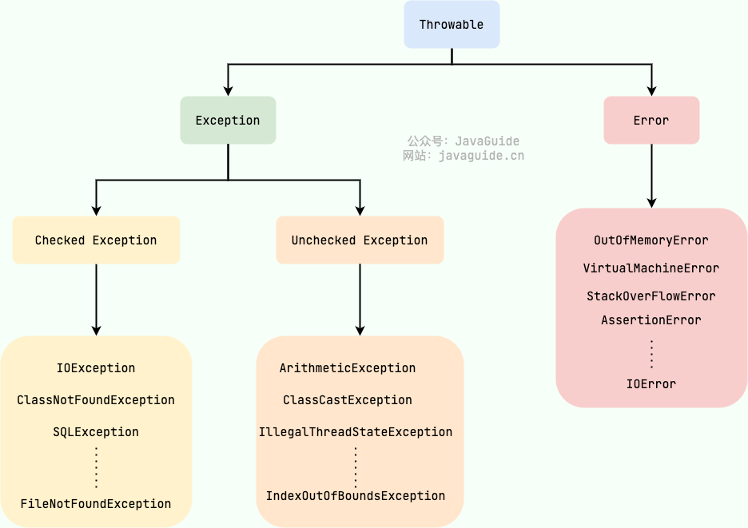

- Exception：程序本身可以处理的异常，可以通过 catch 来进行捕获
    - 分为Checked Exception和Unchecked Exception，其中受检异常，必须处理
    - 除了RuntimeException及其子类以外，其他的Exception类及其子类都属于受检异常
    - 一般来说，只有当这个异常是业务逻辑的一部分，并且调用方必须处理它时，才会使用Checked Exception
- Error：程序本身无法处理的错误，不建议通过catch捕获，这些异常发生时，JVM一般会选择线程终止

- 当某个方法抛出了异常时，如果当前方法没有捕获异常，异常就会被抛到上层调用方法，直到遇到某个try {...} catch {...} finally {}被捕获为止

```java
public class Throwable implements Serializable {
    // 返回异常的详细信息
    public String getMessage() {
        return detailMessage;
    }

    // 返回异常的本地化信息
    // 默认返回的信息和getMessage()相同，Throwable的子类可以覆写此方法生成本地化信息
    public String getLocalizedMessage() {
        return getMessage();
    }

    public String getMessage() {
        return detailMessage;
    }

    // 返回异常的简要描述
    public String toString() {
        String s = getClass().getName();
        String message = getLocalizedMessage();
        return (message != null) ? (s + ": " + message) : s;
    }

    // 打印异常及其回溯信息到标准错误流
    public void printStackTrace() {
        printStackTrace(System.err);
    }
}
```

#### 捕获异常

- 捕获异常使用`try {...} catch {...} finally {}`语句，把可能发生异常的代码放到try中，然后使用catch捕获对应的Exception及其子类

- 多个catch语句只有一个能被执行

- 存在多个catch的时候，子类异常的catch必须写在前面

- 如果某些异常的处理逻辑相同，但是异常本身不存在继承关系，可以用`|`合并到一起

```java
try {
    // do something
} catch (UnsupportedEncodingException e) {
    // do something else
} catch (IOException | NumberFormatException e) {
    // do something other
} finally {
    // do something must be done
}
```

#### 抛出异常

- 用 `throw new 异常名` 抛出异常

- 为了能追踪到完整的异常栈，在构造异常的时候，把原始的Exception实例传进去，新的Exception就可以持有原始Exception信息
  
  ```java
  try {
  // do something
  } catch (NullPointerException e) {
      throw new IllegalArgumentException(e);
  }
  ```

- 如果在try或者catch语句块中抛出异常，JVM会先执行finally，然后抛出异常

- 如果在执行finally语句时抛出异常，在catch中准备抛出的异常就被屏蔽不会再被抛出了，这时候可以先用origin变量保存原始异常，然后调用Throwable.addSuppressed()，把原始异常添加进来，最后在finally抛出。绝大多数情况下，在finally中不要抛出异常

```java
Exception origin = null;
try {
    // do something
} catch (Exception e) {
    origin = e;
    throw e;
} finally {
    Exception e = new IllegalArgumentException();
    if (origin != null) {
        e.addSuppressed(origin);
    }
    throw e;
}
```

#### 自定义异常

在一个大型项目中，可以自定义新的异常类型，但是，保持一个合理的异常继承体系是非常重要的。

一个常见的做法是自定义一个BaseException作为“根异常”，然后，派生出各种业务类型的异常。

BaseException需要从一个适合的Exception派生，通常建议从RuntimeException派生

```java
public class BaseException extends RuntimeException {
    public BaseException() {
        super();
    }

    public BaseException(String message) {
        super(message);
    }

    public BaseException(String message, Throwable cause) {
        super(message, cause);
    }

    public BaseException(Throwable cause) {
        super(cause);
    }
}
```

#### try-with-resources

- 适用于实现 java.lang.AutoCloseable或者 java.io.Closeable 的对象
- catch 或 finally 块在声明的资源关闭后运行

### 加密

#### 编码算法

##### URL编码

- URL编码是浏览器发送数据给服务器时使用的编码，它通常附加在URL的参数部分

- 如果字符是`A~Z`，`a~z`，`0~9`以及`-`、`_`、`.`、`*`，则保持不变；

- 如果是其他字符，先转换为UTF-8编码，然后对每个字节以%XX表示

```java
String encoded = URLEncoder.encode("中文!", StandardCharsets.UTF_8);
// %E4%B8%AD%E6%96%87%21
System.out.println(encoded);

String decoded = URLDecoder.decode(encoded, StandardCharsets.UTF_8);
// 中文!
System.out.println(decoded);
```

##### Base64编码

- URL编码是对字符进行编码，表示成%XX的形式，而Base64编码是对二进制数据(在Java中相当于byte[])进行编码，表示成文本格式

- 相较于二进制数据转成16进制得到的字符串，转成Base64编码得到的字符串的长度更短，占用更少的存储

```java
byte[] input = new byte[] { -28, -72, -83 };

String b64encoded = Base64.getEncoder().encodeToString(input);
// 5Lit
System.out.println(b64encoded);

byte[] output = Base64.getDecoder().decode(b64encoded);
// [-28, -72, -83]
System.out.println(Arrays.toString(output));
```

- 因为标准的Base64编码会出现`+`、`/`和`=`，所以不适合把Base64编码后的字符串放到URL中。一种针对URL的Base64编码，是可以在URL中使用的Base64编码，它仅仅是把`+`变成`-`，`/`变成`_`

```java
byte[] input = new byte[] {1, 2, 127, 0};

String b64encoded = Base64.getUrlEncoder().encodeToString(input);
// AQJ_AA==
System.out.println(b64encoded);

byte[] output = Base64.getUrlDecoder().decode(b64encoded);
// [1, 2, 127, 0]
System.out.println(Arrays.toString(output));
```

#### 哈希算法

- 用途
    - 1.校验下载文件是否已被篡改
    - 2.存储用户口令的哈希

```java
// 1.使用哈希算法SHA-512，创建一个MessageDigest实例
MessageDigest md = MessageDigest.getInstance("SHA-512");
// 2.（反复）调用update输入数据
md.update("Hello World".getBytes(StandardCharsets.UTF_8));
// 3.获取摘要
byte[] result = md.digest();
// 字符串长度128: 2c74fd17edafd80e8447b0d46741ee243b7eb74dd2149a0ab1b9246fb30382f27e853d8585719e0e67cbda0daa8f51671064615d645ae27acb15bfb1447f459b
System.out.println(HexFormat.of().formatHex(result));
```

#### BouncyCastle库

- 依赖

```groovy
implementation 'org.bouncycastle:bcprov-jdk18on:1.79'
```

Java标准库提供了一系列常用的哈希算法，如果还不满足，BouncyCastle库提供了更多的哈希算法可供使用

```java
// 1.注册BouncyCastle
Security.addProvider(new BouncyCastleProvider());
// 2.使用哈希算法RipeMD160，创建一个MessageDigest实例
MessageDigest md = MessageDigest.getInstance("RipeMD160");
// 3.（反复）调用update输入数据
md.update("Hello World".getBytes(StandardCharsets.UTF_8));
// 4.获取摘要
byte[] result = md.digest();
// 字符串长度40: a830d7beb04eb7549ce990fb7dc962e499a27230
System.out.println(HexFormat.of().formatHex(result));
```

#### Hmac算法

- 存储用户的哈希口令时，要加盐存储，让彩虹表失效

- Hmac算法是一种基于密钥（相当于盐）的消息认证码算法，是一种更安全的消息摘要算法，可以用Hmac算法取代原有的自定义的加盐算法

- Hmac算法总是和某种哈希算法配合起来用

- Hmac本质上就是把密钥混入摘要的算法。验证此哈希时，除了原始的输入数据，还要提供密钥

- 保证安全，通过Java标准库的KeyGenerator生成一个安全的随机的密钥

- 工具类：[HmacUtils](/java/HmacUtils.java)

```java
// 生成密钥和哈希
HmacUtils.EncryptionBO encryptionBO = HmacUtils.getEncryptionBO("hello world");

// 核实输入是否正确
boolean b = HmacUtils.verifyInput(encryptionBO.getSecretKey(), "hello world", encryptionBO.getHash());
System.out.println(b);
```

#### 对称加密算法

- 对称加密算法就是传统的用一个密码进行加密和解密，例如压缩和解压缩，就是用对称加密算法

- 对称加密算法的密钥长度是固定的

- 密钥长度直接决定加密强度，而工作模式和填充模式可以看成是对称加密算法的参数和格式选择
    - 工作模式决定了加密算法如何处理超过一个块（block）的数据
        - ECB (Electronic Codebook)：电子密码本模式。每个块独立加密，简单但不安全，因为相同的明文块会产生相同的密文块。
        - CBC (Cipher Block Chaining)：密文分组链接模式。每个块在加密前与前一个块的密文进行 XOR 运算。提高了安全性，但需要一个初始向量（IV）。
        - CFB (Cipher Feedback)：密文反馈模式。将加密结果反馈到加密过程。支持加密小于一个块的消息。
        - OFB (Output Feedback)：输出反馈模式。类似 CFB，但不会引入加密结果反馈，不容易出现传播错误。
        - CTR (Counter)：计数器模式。将一个递增的计数器应用到加密过程。支持并行加密，非常高效。
    - 填充模式决定了如何处理不满一个块的数据
        - PKCS5Padding：常见的填充方式，将缺少的字节填充为相同的值，适用于块大小为 8 字节（64 位）的加密算法。例如，需要填充 3 个字节，则填充值为 0x03 0x03 0x03。
        - PKCS7Padding：与 PKCS5Padding 类似，适用于任意块大小（如 16 字节块的 AES），AES 这样的块大小为 16 字节的加密算法，使用 PKCS7Padding 是一个很好的选择
        - NoPadding：不填充数据，要求输入数据必须是块大小的整数倍。如果不满足则需要手动处理。

```java
/**
 * 对称加密算法测试
 */
@Test
public void test() throws NoSuchAlgorithmException, InvalidAlgorithmParameterException, NoSuchPaddingException, IllegalBlockSizeException,
        BadPaddingException, InvalidKeyException {
    String input = "hello, world!";
    AesUtil.AesBo aesBO = AesUtil.getAesBO();
    System.out.println(aesBO.getSecretKey().length());
    String encrypt = AesUtil.encrypt(aesBO.getSecretKey(), aesBO.getIv(), input);
    System.out.println("Encrypt: " + encrypt);
    String decrypt = AesUtil.decrypt(aesBO.getSecretKey(), aesBO.getIv(), encrypt);
    System.out.println("Decrypt: " + decrypt);
}
```

#### 口令加密算法

- 由于对称加密算法的密钥长度是固定的，如果想要设置为自定义长度（如6位或8位），则需要把用户输入的口令和一个安全随机的口令采用杂凑后计算出固定长度的真正密钥

```java
/**
 * 口令加密算法测试
 */
@Test
public void test2() throws GeneralSecurityException {
    // 各自生成KeyPair:
    KeyPair keyPair1 = DhUtil.generateKeyPair();
    KeyPair keyPair2 = DhUtil.generateKeyPair();

    // 双方交换各自的PublicKey生成自己的本地密钥
    String secretKey1 = DhUtil.generateSecretKey(keyPair1.getPrivate(), Base64.getEncoder().encodeToString(keyPair2.getPublic().getEncoded()));
    String secretKey2 = DhUtil.generateSecretKey(keyPair2.getPrivate(), Base64.getEncoder().encodeToString(keyPair1.getPublic().getEncoded()));

    System.out.println("Secret key1: " + secretKey1);
    System.out.println("Secret key2: " + secretKey2);
    System.out.println(secretKey1.equals(secretKey2));
    System.out.println(secretKey1.length());
}
```

#### 密钥交换算法

密钥交换算法即DH算法，本质就是双方各自生成自己的私钥和公钥，私钥仅对自己可见，然后交换公钥，并根据自己的私钥和对方的公钥，生成最终的密钥

DH算法通过数学定律保证了双方各自计算出的密钥是相同的

后续将使用密钥进行AES加解密通信

密钥交换算法不能防止中间人攻击

```java
/**
 * 密钥交换测试
 */
@Test
public void test2() throws GeneralSecurityException {
    // 各自生成KeyPair:
    KeyPair keyPair1 = DhUtil.generateKeyPair();
    KeyPair keyPair2 = DhUtil.generateKeyPair();

    // 双方交换各自的PublicKey生成自己的本地密钥
    String secretKey1 = DhUtil.generateSecretKey(keyPair1.getPrivate(), Base64.getEncoder().encodeToString(keyPair2.getPublic().getEncoded()));
    String secretKey2 = DhUtil.generateSecretKey(keyPair2.getPrivate(), Base64.getEncoder().encodeToString(keyPair1.getPublic().getEncoded()));

    System.out.println("Secret key1: " + secretKey1);
    System.out.println("Secret key2: " + secretKey2);
    System.out.println(secretKey1.equals(secretKey2));
    System.out.println(secretKey1.length());
}
```

#### 非对称加密算法

非对称加密就是加密和解密使用的不是相同的密钥：只有同一个公钥-私钥对才能正常加解密（可以用公钥加密-用私钥解密，或者用私钥加密-用公钥解密）

非对称加密算法不能防止中间人攻击

```java
/**
 * 非对称加密/解密
 */
@Test
public void test() throws GeneralSecurityException {
    String message = "Hello world!";
    String encrypt = RsaUtil.encrypt(message);
    System.out.println("encrypt: " + encrypt);
    String decrypt = RsaUtil.decrypt(encrypt);
    System.out.println("decrypt: " + decrypt);

    String privateKey = RsaUtil.getPrivateKey();
    PrivateKey privateKey1 = RsaUtil.restorePrivateKey(privateKey);
    String s = Base64.getEncoder().encodeToString(privateKey1.getEncoded());
    System.out.println("privateKey: " + s);
    System.out.println(s.equals(privateKey));

    String publicKey = RsaUtil.getPublicKey();
    PublicKey publicKey1 = RsaUtil.restorePublicKey(publicKey);
    String s1 = Base64.getEncoder().encodeToString(publicKey1.getEncoded());
    System.out.println("publicKey: " + s1);
    System.out.println(s1.equals(publicKey));
}
```

#### 签名算法

```java
/**
 * 对消息的哈希进行签名和验证
 */
@Test
public void test() throws NoSuchAlgorithmException, InvalidKeyException, SignatureException {
    String message = "Hello world!";
    HmacUtil.EncryptionBO encryptionBO = HmacUtil.getEncryptionBO(message);
    String hashMessage = encryptionBO.getHash();
    String sign = SignatureUtil.sign(hashMessage);
    System.out.println(SignatureUtil.isValidSignature(sign, hashMessage));
}
```

#### 数字证书

- 数字证书就是集合了多种密码学算法，用于实现数据加解密、身份认证、签名等多种功能的一种安全标准

- 数字证书可以防止中间人攻击，因为它采用链式签名认证，即通过根证书（Root CA）去签名下一级证书，这样层层签名，直到最终的用户证书

- 而Root CA证书内置于操作系统中，所以，任何经过CA认证的数字证书都可以对其本身进行校验，确保证书本身不是伪造的

- 在Java程序中，数字证书存储在一种Java专用的key store文件中，JDK提供了一系列命令来创建和管理keystore

```sh
# 创建一个keystore
# -storepass：指定keystore口令
# -genkeypair：生成公钥/私钥对
# -keyalg：指定加密算法
# -keysize：指定密钥长度/位数
# -sigalg：指定签名算法
# -validity：指定有效天数
# -alias：指定密钥和证书别名，一个keystore文件中可以存储多个不同的密钥对。为了区分它们，每一个存入的条目都必须有一个独一无二的别名
# -storetype：指定keystore的类型，直接设置为PKCS12就可以，它是通用的
# -keystore：指定keystore名称
# dname 最重要的CN=www.sample.com指定了Common Name，如果证书用在HTTPS中，这个名称必须与域名完全一致
# CN (Common Name)：通用名称。这是最重要的字段！如果是本地测试，填localhost；如果是正式网站或服务，必须填写你的域名（如www.handle.com）或服务器的 IP 地址。
# OU (Organization Unit)：组织单位名称（比如具体的部门，如 IT Dept）。
# O (Organization)：组织或公司全称（如 MyCompany Inc.）。
# L (Locality)：城市或地区名称（如 Beijing）。
# ST (State/Province)：省份或州（如 Beijing 或 Guangdong）。
# C (Country)：国家的双字母代码（中国为 CN，美国为 US）。
# 此命令在当前目录创建一个my.keystore文件，并存储创建成功的一个私钥和一个证书到文件中
# 有了keystore存储的数字证书，我们就可以进行加解密和签名
keytool -storepass 'changeit' \
    -genkeypair \
    -keyalg RSA \
    -keysize 2048 \
    -sigalg SHA256withRSA \
    -validity 9999 \
    -alias vaultServer \
    -storetype PKCS12 \
    -keystore vaultServer.p12 \
    -dname 'CN=www.example.com, OU=Handle Studio, O=Handle Studio, L=Shenzhen, ST=Guangdong, C=CN'

# 从keystore（包含私钥和公钥证书），导出公钥证书（.crt证书）
# -exportcert：指定操作（导出证书）
# -alias：keystore文件里其实可以存放好几对不同的密钥和证书，需要通过别名来指定具体要导出哪一个
# -keystore 用来指定要从哪个keystore文件导出公钥证书
# -file，指定提取出来的公钥证书的名称路径
# 不加 -rfc（默认情况）：keytool 导出的是 DER 格式（二进制编码），加上 -rfc：keytool 导出的是 PEM 格式（Base64 编码的 ASCII 文本）
# 用记事本打开就能清晰看到以 -----BEGIN CERTIFICATE----- 开头、-----END CERTIFICATE----- 结尾的可读文本
# .pem、.crt、.cer 这些后缀的文件，只要它们内部是这种带 BEGIN/END CERTIFICATE 的文本格式，它们在本质上都是完全一样的，可以随意互换后缀名使用
# -storepass：keystore口令，.p12是个加密的保险箱，想要打开它并读取里面的内容，必须提供正确密码
keytool -exportcert -alias vaultServer -keystore vaultServer.p12 -file vaultServer.crt -rfc -storepass 'changeit'

# 或用openssl提取完整的公钥证书链
openssl pkcs12 -in vaultServer.p12 -nokeys -out publicKey.pem

# keytool无法导出私钥，我们需要使用 openssl导出不带密码的私钥
openssl pkcs12 -in vaultServer.p12 -nocerts -nodes -out privateKey.pem

# 用openssl直接创建公钥和私钥文件
# req -x509：直接输出一个自签名的 X.509 证书，而不是生成 CSR
# -newkey rsa:2048：同时生成一个新的 2048 位 RSA 私钥
# nodes：(no DES) 表示不对生成的私钥文件进行加密（即不需要输入密码），这在服务器自动化配置时非常方便
# -keyout server.key：指定生成的私钥文件名
# -out server.crt：指定生成的公钥证书文件名
# -days 365：设置证书的有效期为 9999 天
# -subj：自动填写证书的主体信息，避免交互式输入
openssl req -x509 \
    -newkey rsa:2048 \
    -nodes \
    -keyout privateKey.pem \
    -out publicKey.pem \
    -days 9999 \
    -subj "/C=CN/ST=Guangdong/L=Shenzhen/O=Handle Studio/OU=Handle Studio/CN=www.example.com"

# 由公钥文件和私钥文件生成keystore
# -in server.crt：指定公钥证书文件
# -inkey server.key：指定私钥文件
# -out keystore.p12：指定生成的密钥库文件名
# -name myalias：为你的证书指定一个别名（alias）
# -passout 'pass:yourpassword'：keystore口令，如果没有这个选项参数
# 则执行命令后，终端会提示你设置一个 Export Password。请牢记这个密码，它就是后续 Spring Boot 配置中的 key-store-password
openssl pkcs12 -export -in server.crt -inkey server.key -out keystore.p12 -name myalias -passout 'pass:yourpassword'
```

- 使用数字证书

[CertificateUtil](/java/CertificateUtil.java)

```java
@Test
public void test() throws GeneralSecurityException {
    String password = "handle123";
    String message = "hello world";
    String certificateAlias = "mycert";
    // 读取KeyStore
    KeyStore keyStore = CertificateUtil.loadKeyStore(ApplicationTest.class, "/my.keystore", password);
    // 读取私钥
    PrivateKey privateKey = (PrivateKey) keyStore.getKey(certificateAlias, password.toCharArray());
    // 读取证书
    X509Certificate certificate = (X509Certificate) keyStore.getCertificate(certificateAlias);
    // 读取公钥
    PublicKey publicKey = certificate.getPublicKey();

    System.out.println(publicKey.getAlgorithm());
    System.out.println(privateKey.getAlgorithm());

    // 加密
    String encrypted = CertificateUtil.encrypt(publicKey, message);
    System.out.println("encrypted: " + encrypted);

    // 解密
    String decrypted = CertificateUtil.decrypt(privateKey, encrypted);
    System.out.println("decrypted: " + decrypted);

    // 签名
    String sign = CertificateUtil.sign(privateKey, certificate, message);
    System.out.println("signature: " + sign);

    // 验证签名
    boolean verified = CertificateUtil.verify(certificate, message, sign);
    System.out.println("verify: " + verified);
}
```

### 日志

#### self4j

自定义生成的log文件路径

1. 定义LOG_HOME

```java
/**
 * 指定log文件路径为项目根路径
 */
public class LogHomeConfiguration extends PropertyDefinerBase {
    private static final String LOG_HOME = ApplicationUtils.getApplicationHome(LogHomeConfiguration.class);

    @Override
    public String getPropertyValue() {
        return LOG_HOME;
    }
}
```

2.logback.xml定义LOG_HOME

```xml
<define name="LOG_HOME" class="com.handle.application.configuration.LogHomeConfiguration"/>
```

#### Logback

```xml
<?xml version="1.0" encoding="UTF-8"?>
<configuration>
    <!-- 定义变量 -->
    <define name="LOG_HOME" class="com.handle.config.configuration.LogHomeConfiguration" />

    <!-- output to console -->
    <appender name="console" class="ch.qos.logback.core.ConsoleAppender">
        <encoder>
            <!--时间 日志级别 线程 全限定类名.方法名 消息 换行-->
            <pattern>%d{yyyy-MM-dd HH:mm:ss} %5level [%thread] %logger.%M -- %msg%n</pattern>
            <!--日志编码，不分大小写-->
            <charset>utf-8</charset>
        </encoder>
    </appender>

    <!-- output to file -->
    <appender name="FILE" class="ch.qos.logback.core.rolling.RollingFileAppender">
        <encoder>
            <pattern>%d{yyyy-MM-dd HH:mm:ss} %-5level [%thread] %logger{50}.%M -- %msg%n</pattern>
            <charset>UTF-8</charset>
        </encoder>
        <file>${LOG_HOME}/log/output.log</file>
        <!-- If true, events are appended at the end of an existing file. -->
        <append>true</append>
        <rollingPolicy class="ch.qos.logback.core.rolling.FixedWindowRollingPolicy">
            <fileNamePattern>${LOG_HOME}/log/output%d{yyyy-MM-dd}-%i.log</fileNamePattern>
        </rollingPolicy>
        <triggeringPolicy class="ch.qos.logback.core.rolling.SizeBasedTriggeringPolicy">
            <maxFileSize>50MB</maxFileSize>
        </triggeringPolicy>
    </appender>

    <!-- 日志级别，默认info：trace < debug < info < warn < error，不分大小写 -->
    <root level="INFO">
        <!-- 指定打印日志的appender -->
        <appender-ref ref="console" />
        <appender-ref ref="FILE" />
    </root>

    <!-- 根据特殊需求指定局部日志级别，可以是包名或全限定类名，日志级别不分大小写 -->
    <logger name="com.handle.application.mapper" level="debug"/>
</configuration>
```

### ProcessBuilder

ProcessBuilder 是 Java 中用于创建和管理操作系统进程（即执行外部命令行程序）的核心类

相比早期的 Runtime.exec()，它提供了更灵活、更强大的进程控制能力

每个 ProcessBuilder 实例都会管理一组进程属性

当调用 start() 方法时，它会利用这些属性创建一个新的子进程，并返回一个 Process 对象来让你与这个子进程进行交互

```java
// 命令参数列表
List<String> command = new ArrayList<>();
command.add("ffprobe");
command.add("-i");
command.add("/path/to/input.mp4");

ProcessBuilder processBuilder = new ProcessBuilder(command);
// 合并错误流和标准流， 这样错误流和标准流就都能通过Process.getInputStream()读取
// getInputStream() 和 getOutputStream() 的命名是站在父进程（Java 程序）的角度来定义的
// 子进程的输出是父进程的输入，父进程的输出是子进程的输入
processBuilder.redirectErrorStream(true);
try {
    Process process = processBuilder.start();
    // 打印命令输出，这里是阻塞读，当父线程不用向子线程写数据的时候适用，如果是双向交互，则要开线程读 + 主线程 waitFor
    try (BufferedReader reader = new BufferedReader(new InputStreamReader(process.getInputStream()))) {
        String line;
        while (null != (line = reader.readLine())) {
            System.out.println(line);
        }
    }
    // 阻塞等待子线程退出
    int exitCode = process.waitFor();
    if (0 == exitCode) {
        System.out.println("command executed success!");
    } else {
        System.out.println("command executed failed，exit code: " + exitCode);
    }
} catch (IOException | InterruptedException e) {
    throw new RuntimeException(e);
}
```

### JavaFX

- 父pom

```xml
<properties>
    <!--java8之后用maven.compiler.release标签代替maven.compiler.source标签和maven.compiler.target标签-->
    <maven.compiler.release>25</maven.compiler.release>
    <project.build.sourceEncoding>UTF-8</project.build.sourceEncoding>
    <maven-compiler-plugin.version>3.15.0</maven-compiler-plugin.version>
    <javafx.applicationName>app</javafx.applicationName>
    <javafx.version>25.0.3</javafx.version>
</properties>

<dependencyManagement>
    <dependencies>
        <dependency>
            <groupId>org.openjfx</groupId>
            <artifactId>javafx-controls</artifactId>
            <version>${javafx.version}</version>
        </dependency>
        <dependency>
            <groupId>org.openjfx</groupId>
            <artifactId>javafx-fxml</artifactId>
            <version>${javafx.version}</version>
        </dependency>
    </dependencies>
</dependencyManagement>

<build>
    <pluginManagement>
        <plugins>
            <plugin>
                <groupId>org.apache.maven.plugins</groupId>
                <artifactId>maven-compiler-plugin</artifactId>
                <version>${maven-compiler-plugin.version}</version>
                <configuration>
                    <!--java8之后用release标签代替source标签和target标签-->
                    <!--不知道为什么通过重新定义maven.compiler.release不起作用，必须在这里设置<release>具体java版本</release>覆盖父项目的设置才行-->
                    <release>25</release>
                    <annotationProcessorPaths>
                        <path>
                            <!-- 在控制台执行maven命令要加上-->
                            <groupId>org.projectlombok</groupId>
                            <artifactId>lombok</artifactId>
                        </path>
                    </annotationProcessorPaths>
                </configuration>
            </plugin>
            <plugin>
                <groupId>org.openjfx</groupId>
                <artifactId>javafx-maven-plugin</artifactId>
                <version>${javafx-maven-plugin.version}</version>
                <executions>
                    <execution>
                        <!-- Default configuration for running with: mvn clean javafx:run -->
                        <id>default-cli</id>
                        <configuration>
                            <launcher>${javafx.applicationName}</launcher>
                            <jlinkZipName>${javafx.applicationName}</jlinkZipName>
                            <jlinkImageName>${javafx.applicationName}</jlinkImageName>
                            <noManPages>true</noManPages>
                            <stripDebug>true</stripDebug>
                            <noHeaderFiles>true</noHeaderFiles>
                        </configuration>
                    </execution>
                </executions>
            </plugin>
        </plugins>
    </pluginManagement>
</build>
```

- 子pom

```xml
<properties>
    <javafx.applicationName>应用名称</javafx.applicationName>
</properties>

<dependencies>
    <dependency>
        <groupId>org.openjfx</groupId>
        <artifactId>javafx-controls</artifactId>
    </dependency>
    <dependency>
        <groupId>org.openjfx</groupId>
        <artifactId>javafx-fxml</artifactId>
    </dependency>
</dependencies>

<build>
    <plugins>
        <plugin>
            <groupId>org.apache.maven.plugins</groupId>
            <artifactId>maven-compiler-plugin</artifactId>
        </plugin>
        <plugin>
            <groupId>org.openjfx</groupId>
            <artifactId>javafx-maven-plugin</artifactId>
            <configuration>
                <mainClass>主类全限定类名</mainClass>
            </configuration>
        </plugin>
    </plugins>
</build>
```

#### 运行程序

当直接运行继承了javafx.application.Application的类的main方法时，IDE（idea和eclipse）会无法正确加载 JavaFX 的模块路径（Module Path），导致报错

由于 IDE （idea和eclipse）对普通 Java 主类和 JavaFX 主类的底层启动机制完全不同

如果直接运行继承了 javafx.application.Application 的主类，IDEA 会尝试使用 Java 9+ 的 Module Path（模块路径） 来启动它

但是，Maven 的依赖管理机制默认将 JavaFX 的 jar 包放在 Classpath（类路径） 中，而不是 Module Path 中

这就导致：你的代码在 Classpath 里，但 JavaFX 框架期望在 Module Path 里

于是启动报错：“Error: JavaFX runtime components are missing, and are required to run this application”

下面的方法解决了运行和调试的问题

但是还有一个坑，目前还没解决：如果使用模块的话就不用添加上面的VM选项了，但是mybatis的mapper识别不了

##### 解决方案一

使用`mvn javafx:run`可以直接运行程序，缺点是无法进行调试，可通过配置idea远程调试来解决

远程调试关键参数：`-Xdebug -Xnoagent -Djava.compilercompiler=NONE -Xrunjdwp:transport=dt_socket,server=yy,suspendsuspend=n,address=9081`

远程调试前提是本机有项⽬的源代码 ，在需要的地⽅打个断点，本机不⽤启动项⽬，可以直接远程调试服务器上的代码

远程调试从技术上讲，就是在本机与远程建⽴scoket通讯，所以端⼝不要冲突，⽽且本机要允许访问远程端⼝

另外这⼀段参数，放要在-jar 或 主类 的前⾯

缺点是每次调试都要执行两个应用（原本的javafx应用和调试应用）

- javafx-maven-plugin插件加上远程调试的选项参数

```xml
<plugin>
    <groupId>org.openjfx</groupId>
    <artifactId>javafx-maven-plugin</artifactId>
    <configuration>
        <options>
            <option>-agentlib:jdwp=transport=dt_socket,server=y,suspend=y,address=5005</option>
        </options>
    </configuration>
</plugin>
```

- 添加远程调试配置
    - 添加"Remote JVM Debug"
    - Debugger mode设置为：`Attach to remote JVM`
    - Host设置为localhost，跟插件的选项参数的ip要一致
    - Port设置为5005，跟插件的选项参数的端口要一致
    - 最终自动生成的Command line arguments for remote JVM内容为`-agentlib:jdwp=transport=dt_socket,server=y,suspend=n,address=*:5005`
    - 点击应用-OK

- 在终端或者通过idea的maven插件工具执行javafx:run，将会看到程序被挂起

- 然后运行刚刚的远程调试配置，当程序运行到断点处即可看到效果

##### 解决方案二

用 idea 原生 Application 执行器启动，通过添加VM选项参数指定javafx库位置来启动程序，正常进行调试

```sh
# 要先下载并解压好javafx-sdk
# 在idea编辑运行设置，添加VM选项
--module-path "/path/to/javafx-sdk/lib" --add-modules javafx.controls,javafx.fxml

# 使用idea，也可以File -> Settings -> Appearance & Behavior -> Path Variables，添加JAVAFX_PATH变量并指定值为“/path/to/javafx-sdk/lib”
# 然后在idea编辑运行设置，添加VM选项
--module-path ${JAVAFX_PATH} --add-modules javafx.controls,javafx.fxml


# --module-path 指定的类路径必须包含--add-modules所指定模块的所有依赖，这简直不是人写的东西，绝对不要用这种方法
--module-path "/home/handle/.m2/repository/org/openjfx/javafx-media/26.0.2:/home/handle/.m2/repository/org/openjfx/jdk-jsobject/26.0.2:/home/handle/.m2/repository/org/openjfx/javafx-base/26.0.2:/home/handle/.m2/repository/org/openjfx/javafx-graphics/26.0.2:/home/handle/.m2/repository/org/openjfx/javafx-controls/26.0.2:/home/handle/.m2/repository/org/openjfx/javafx-web/26.0.2"
--add-modules javafx.controls,javafx.web
```

但是这样做添加的javafx的maven依赖又多此一举了

##### 解决方案三

用自带javafx的jdk啊，但缺点是你运行的时候也必须用自带javafx的jre！

##### 解决方案四

把项目变成模块

##### 终极方案

用一个普通的 Java 类作为“跳板”来启动JavaFX

这时IDEA 会把项目当成一个标准的 Java Application 来处理

IDEA 自动把 Maven 依赖（包括 JavaFX 的模块）正确挂载到类路径和模块路径中

```java
public class Main {
    public static void main(String[] args) {
        Application.launch(FxApplication.class, args);
    }
}
```

#### JavaFX的Scene Graph

笔记的内容来自：<https://fxdocs.github.io/docs/html5/>

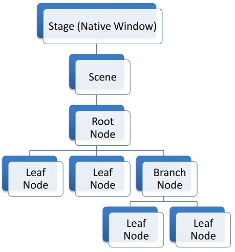

- JavaFX的结构是一个树形结构
    - 顶层Stage，代表本地操作系统的窗体
    - Scene是JavaFX scene graph的一个容器，每个Stage在某个时间只能有一个关联的Scene
    - 所有JavaFX scene graph的元素代表了Node对象，有3种类型的Node：root, branch and leaf
        - root是唯一没有父node并且直接放置到scene中的node
        - branch有子node，leaf没有子node
        - 除了root，其它node只能有一个父node
        - 一个附属当前可见scene的活动的node，只能被JavaFX应用线程修改

- 下面是一个 "Hello World" scene graph的示例图

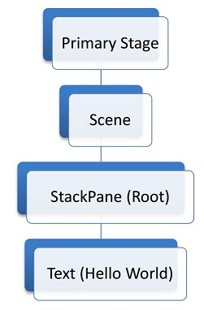

- 对应的代码实现如下

```java
public class HelloWorld extends Application {
    @Override
    public void start(Stage stage) throws Exception {
        Text leaf = new Text("hello world");
        StackPane root = new StackPane(leaf);
        Scene scene = new Scene(root, 720, 480);
        stage.setScene(scene);
        stage.show();
    }

    public static void main(String[] args) {
        launch(args);
    }
}
```

#### 获取屏幕尺寸

```java
// 获取主屏幕的物理边界
Rectangle2D bounds = Screen.getPrimary().getBounds();

// 获取主屏幕的可视边界（排除任务栏等系统UI）
Rectangle2D visualBounds = Screen.getPrimary().getVisualBounds();

double visualWidth = visualBounds.getWidth();
double visualHeight = visualBounds.getHeight();
```

#### 控件

##### ChoiceBox

青春版的单选下拉框，选项不可编辑，且下拉框的位置会改变

```java
public class ChoiceBoxDemo extends Application {
    // ChoiceBox的项可以用最简单的String类型
    // 也可以用复制的类型，如Pair（一个通用的键值对容器）
    private static final ChoiceBox<Pair<String, String>> CHOICE_BOX = new ChoiceBox<>();

    // 定义EMPTY_PAIR对象避免CHOICE_BOX.getValue()空指针异常
    private static final Pair<String, String> EMPTY_PAIR = new Pair<>("", "");

    @Override
    public void start(Stage primaryStage) {
        Label label = new Label("Size:");

        CHOICE_BOX.setPrefWidth(200);
        initChoice();

        Button saveButton = new Button("Save");
        saveButton.setOnAction(event -> {
            System.out.println("saving " + CHOICE_BOX.getValue());
        });

        HBox hBox = new HBox(label, CHOICE_BOX, saveButton);
        hBox.setSpacing(10.0);
        hBox.setAlignment(Pos.CENTER);
        hBox.setPadding(new Insets(40));

        Scene scene = new Scene(hBox);
        primaryStage.setScene(scene);
        primaryStage.setTitle("ChoiceBoxDemo");
        primaryStage.show();
    }

    private void initChoice() {
        List<Pair<String, String>> list = new ArrayList<>();
        list.add(new Pair<>("小", "100"));
        list.add(new Pair<>("中", "200"));
        list.add(new Pair<>("大", "300"));

        // 当使用复杂对象做ChoiceBox的项时，由于界面上只能显示文本（字符串）
        // 就要用到StringConverter了
        CHOICE_BOX.setConverter(new StringConverter<Pair<String, String>>() {
            // 对象 → 字符串（用于显示）
            @Override
            public String toString(Pair<String, String> pair) {
                return pair.getKey();
            }

            // 字符串 → 对象（用于还原），这里用不到就不写逻辑了
            @Override
            public Pair<String, String> fromString(String string) {
                return null;
            }
        });

        CHOICE_BOX.getItems().add(EMPTY_PAIR);
        CHOICE_BOX.getItems().addAll(list);
        // 默认值
        CHOICE_BOX.setValue(EMPTY_PAIR);
    }
}
```

##### ComboBox

完整版的单选下拉框，选项可编辑，且下拉框的位置固定，感觉更友好，高级操作如状态值的颜色编码形状渲染等也要用到它

```java
public class ComboBoxDemo extends Application {
    // ComboBox的项可以用最简单的String类型
    // 也可以用复制的类型，如Pair（一个通用的键值对容器）
    private static final ComboBox<Pair<String, String>> COMBO_BOX = new ComboBox<>();

    // 定义EMPTY_PAIR对象避免COMBO_BOX.getValue()空指针异常
    private static final Pair<String, String> EMPTY_PAIR = new Pair<>("", "");

    @Override
    public void start(Stage primaryStage) {
        Label label = new Label("Size:");

        COMBO_BOX.setPrefWidth(200);
        initComboBox();

        Button saveButton = new Button("Save");
        saveButton.setOnAction(event -> {
            System.out.println("saving " + COMBO_BOX.getValue());
        });

        HBox hBox = new HBox(label, COMBO_BOX, saveButton);
        hBox.setSpacing(10.0);
        hBox.setAlignment(Pos.CENTER);
        hBox.setPadding(new Insets(40));

        Scene scene = new Scene(hBox);
        primaryStage.setScene(scene);
        primaryStage.setTitle("ComboBoxDemo");
        primaryStage.show();
    }

    private void initComboBox() {
        List<Pair<String, String>> list = new ArrayList<>();
        list.add(new Pair<>("小", "100"));
        list.add(new Pair<>("中", "200"));
        list.add(new Pair<>("大", "300"));

        COMBO_BOX.getItems().add(EMPTY_PAIR);
        COMBO_BOX.getItems().addAll(list);
        // 默认值
        COMBO_BOX.setValue(EMPTY_PAIR);


        //  JavaFX 的虚拟化渲染设计核心思想是
        // 控件不会为每个数据项创建一个 UI 节点，而是只创建少量可复用的 Cell，通过不断调用 updateItem() 来"换皮"显示不同数据
        // 定义一个"工厂"，通过ListView<Pair<String, String>来生产ListCell<Pair<String, String>>
        // 这里也可以用StringConverter，显示优先级：Callback > StringConverter > toString()
        Callback<ListView<Pair<String, String>>, ListCell<Pair<String, String>>> factory = listView -> new ListCell<>() {
            @Override
            protected void updateItem(Pair<String, String> item, boolean empty) {
                super.updateItem(item, empty);
                if (empty) {
                    setText("");
                } else {
                    // 设置Pair的key作为ListCell的文本
                    setText(item.getKey());
                }
            }
        };
        // 下拉列表里每个选项怎么显示
        COMBO_BOX.setCellFactory(factory);
        // 选中后，按钮上显示什么，如果不设置，则会调用选项的toString方法
        COMBO_BOX.setButtonCell(factory.call(null));
    }
}
```

#### 布局

##### VBox and HBox

这两个是最基础的了

```fxml
<?xml version="1.0" encoding="UTF-8"?>

<?import javafx.scene.control.Button?>
<?import javafx.scene.layout.HBox?>
<?import javafx.scene.layout.VBox?>
<VBox xmlns="http://javafx.com/javafx"
      xmlns:fx="http://javafx.com/fxml"
      fx:controller="com.example.MyController"
      stylesheets="@/path/to/my.fx.css"
>
    <HBox>
        <Button fx:id="sendButton" onAction="#onSendButtonClick">发送</Button>
    </HBox>
</VBox>
```

```css
VBox {
    -fx-background-color: purple;
    -fx-alignment: center;
}

HBox {
    -fx-alignment: center;
}
```

##### StackPane

‌StackPane 是一个层叠布局容器，最后添加的子节点在最顶层，默认将所有子节点居中对齐

- 应用场景
    - 背景+文字的场景
    - GridPane + StackPane 实现居中对齐

- 这样就可以实现前面VBox 和 HBox的布局了

```fxml
<?xml version="1.0" encoding="UTF-8"?>

<?import javafx.scene.control.Button?>
<?import javafx.scene.layout.StackPane?>
<StackPane xmlns="http://javafx.com/javafx"
           xmlns:fx="http://javafx.com/fxml"
           fx:controller="com.example.MyController"
           stylesheets="@/path/to/my.fx.css"
>
    <Button fx:id="sendButton" onAction="#onSendButtonClick">发送</Button>
</StackPane>
```

```css
StackPane {
    -fx-background-color: purple;
}
```

##### BorderPane

BorderPane在顶部、底部、左侧、右侧和中间位置布置子节点

BorderPane‌ 非常适合用来搭主窗口大框架

```fxml
<BorderPane>
    <left></left>
    <right></right>
    <top></top>
    <bottom></bottom>
    <center></center>
</BorderPane>
```

- 这样就可以实现前面VBox 和 HBox的布局了

```fxml
<?xml version="1.0" encoding="UTF-8"?>

<?import javafx.scene.control.Button?>
<?import javafx.scene.layout.BorderPane?>
<BorderPane xmlns="http://javafx.com/javafx"
           xmlns:fx="http://javafx.com/fxml"
           fx:controller="com.example.MyController"
           stylesheets="@/path/to/my.fx.css"
>
    <center>
        <Button fx:id="sendButton" onAction="#onSendButtonClick">发送</Button>
    </center>
</BorderPane>
```

```css
BorderPane {
    -fx-background-color: purple;
}
```

#### 打包javafx应用

目前打包javafx应用为本地二进制文件时，运行总是会报错

笔者决定放弃了，还是用AOT Cache吧，能提升多少算多少

### GUI

#### JFrame

```java
public class MainFrame extends JFrame {

    private final float scale = 1.5F;

    public MainFrame() {

        // 设置标题栏的文本
        this.setTitle("Home");

        // 设置框架的图标
        URL url = this.getClass().getClassLoader().getResource("static/icons/favicon.png");
        Image img = new ImageIcon(url).getImage();
        this.setIconImage(img);

        // 设置框架的位置居中和大小
        Dimension dimension = this.getSystemResolution();
        this.setBounds((int) (dimension.width * (1 - 1 / scale) / 2), (int) (dimension.height* (1 - 1 / scale) / 2), (int) (dimension.width / scale), (int) (dimension.height / scale));

        // 框架的大小是否允许用户改变
        this.setResizable(false);

        // 设置框架大小
        // this.setSize(DEFAULT_WIDTH, DEFAULT_HEIGHT);

        // 将框架设置为最大
        // this.setExtendedState(Frame.MAXIMIZED_BOTH);

        // 让窗口系统控制窗口的位置
        // this.setLocationByPlatform(true);

        // 设置框架的位置
        // this.setLocation(400, 200);

        // 关闭所有框架装饰（按钮、标题栏、图标）,设置后， 框架显示中将没有标题栏或关闭按钮这样的装饰。
        // this.setUndecorated(false);

    }

    public Dimension getSystemResolution() {
        return Toolkit.getDefaultToolkit().getScreenSize();
    }
}
```

#### 设置框架图标

```java
// 方法1
try(InputStream inputStream = this.getClass().getClassLoader().getResourceAsStream("static/icons/favicon.png")) {
    Image image = ImageIO.read(inputStream);
    this.setIconImage(image);
} catch (IOException e) {
    e.printStackTrace();
}

// 方法2
URL url = this.getClass().getClassLoader().getResource("static/icons/favicon.png");
try {
    Image image = ImageIO.read(url.openStream());
    this.setIconImage(image);
} catch (IOException e) {
    e.printStackTrace();
}

// 方法3 推荐
URL url = this.getClass().getClassLoader().getResource("static/icons/favicon.png");
Image img = new ImageIcon(url).getImage();
this.setIconImage(img);
```

#### 添加组件到容器

```java
// 方法1
// 将组件添加到内容窗格中,自动调用contentPane.add(component)
frame.add(component);

// 方法2
// 获取内容窗格
Container contentPane = frame.getContentPane();
// 将组件添加到内容窗格中
contentPane.add(component);
```

### 序列化/反序列化

Jackson 是基于 JSON 文本序列化（反射解析字段 + 文本转换）的独立框架

它不依赖 JDK 原生的序列化机制，只关心对象的结构（无参构造、Getter/Setter），无论类是否实现了 Serializable 接口，Jackson 都能正常工作

但在实际的企业级开发中，很多开发者依然会选择让实体类（如VO）实现 Serializable

这主要是出于通用性和规范性的考虑

如果该对象未来需要用于微服务间的 RPC 调用（如 Dubbo）、消息队列传输（如 RabbitMQ/Kafka）或分布式缓存（如 Redis/Ehcache）

这些底层框架依赖的是 Java 原生的序列化机制，此时就必须实现 Serializable 接口

- JSON和XML这种属于文本类序列化方式（比如后端返回前端的json），这样的实体类可以不实现可序列化接口
- 如果实体对象需要转为字节（通常是二进制字节流）的形式传输（数据存储/网络传输），就必须实现可序列化接口
- 当实体类的所有属性都已经实现了可序列化接口时，实体类可以不实现序列化接口
- serialVersionUID 起版本控制的作用。
    - 反序列化时，会检查 serialVersionUID 是否和当前类的 serialVersionUID 一致
    - 如果 serialVersionUID 不一致则会抛出 InvalidClassException 异常

```java
public class ClassName implements Serializable {
    // 推荐手动指定，生成一个64位的哈希字段
    private static final long serialVersionUID = -6898003192839424203L;

    // 如果不手动指定，编译器会生成默认的 serialVersionUID = 1L
    private static final long serialVersionUID = 1L;
}
```

- 对于不想进行序列化的变量，可以使用`transient`关键字修饰
- `transient`只能修饰变量，不能修饰类和方法。
- `transient`修饰的变量，在反序列化后变量值将会被置成类型的默认值。
- `static`变量因为不属于任何对象，无论有没有`transient`关键字修饰，均不会被序列化

### XML

XML是可扩展标记语言（eXtensible Markup Language）的缩写，它是是一种数据表示格式，可以描述非常复杂的数据结构，常用于传输和存储数据。

XML有几个特点：一是纯文本，默认使用UTF-8编码，二是可嵌套，适合表示结构化数据。如果把XML内容存为文档，那幺它就是一个XML文档，例如`book.xml`。此外，XML内容经常通过网络作为消息传输。

#### XML的结构

1. 首行必定是`<?xml version="1.0"?>`，可以加上可选的编码。如 `<?xml version="1.0" encoding="UTF-8"?>`

2. 紧接着，是文档定义类型（DTD：Document Type Definition），DTD是可选的。如`<!DOCTYPE note SYSTEM "book.dtd">`

3. 接下来是XML的文档内容，一个XML文档有且仅有一个根元素，根元素可以包含任意个子元素，元素可以包含属性，例如，`<isbn lang="CN">1234567</isbn>`包含一个属性`lang="CN"`，且元素必须正确嵌套。如果是空元素，可以用`<tag/>`表示。

4. 如果使用了`<`、`>`以及引号等标识符，如果内容出现了特殊符号，需要使用`&???;`表示转义。

常见的特殊字符如下：

|字符|表示|
|:-|:-|
|<|`&lt;`|
|>|`&gt;`|
|&|`&amp;`|
|"|`&quot;`|
|'|`&apos;`|

格式正确的XML（Well Formed）是指XML的格式是正确的，可以被解析器正常读取。而合法的XML是指，不但XML格式正确，而且它的数据结构可以被DTD或者XSD验证。

DTD文档可以指定一系列规则，例如：

- 根元素必须是`book`
- `book`元素必须包含`name`，`author`等指定元素
- `isbn`元素必须包含属性`lang`
- ...

如何验证XML文档的正确性呢？最简单的方式是通过浏览器验证。可以直接把XML文档拖拽到浏览器窗口，如果格式错误，浏览器会报错。

和结构类似的HTML不同，浏览器对HTML有一定的“容错性”，缺少关闭标签也可以被解析，但XML要求严格的格式，任何没有正确嵌套的标签都会导致错误。

XML是一个技术体系，除了我们经常用到的XML文档本身外，XML还支持：

- DTD和XSD：验证XML结构和数据是否有效；
- Namespace：XML节点和属性的名字空间；
- XSLT：把XML转化为另一种文本；
- XPath：一种XML节点查询语言；
- ...

实际上，XML的这些相关技术实现起来非常复杂，在实际应用中很少用到，通常了解一下就可以了。

### JSON

JSON作为数据传输的格式，有几个显着的优点：

- JSON只允许使用UTF-8编码，不存在编码问题；
- JSON只允许使用双引号作为key，特殊字符用`\`转义，格式简单；
- 浏览器内置JSON支持，如果把数据用JSON发送给浏览器，可以用JavaScript直接处理。

因此，JSON适合表示层次结构，因为它格式简单，仅支持以下几种数据类型：

- 键值对：`{"key": value}`
- 数组：`[1, 2, 3]`
- 字符串：`"abc"`
- 数值（整数和浮点数）：`12.34`
- 布尔值：`true`或`false`
- 空值：`null`

### Servlet

#### 1. Servlet 组件

#### 2. Filter 组件

JavaEE的Servlet规范还提供了一种Filter组件，即过滤器，它的作用是，在HTTP请求到达Servlet之前，可以被一个或多个Filter预处理，类似打印日志、登录检查等逻辑，完全可以放到Filter中。

编写Filter时，必须实现`Filter`接口，在`doFilter()`方法内部，要继续处理请求，必须调用`chain.doFilter()`。最后，用`@WebFilter`注解标注该Filter需要过滤的URL。这里的`/*`表示所有路径。

多个Filter会组成一个链，每个请求都被链上的Filter依次处理。如果一定要给每个Filter指定顺序，就必须在`web.xml`文档中对这些Filter再配置一遍。

```java
// 过滤所有url
@WebFilter(urlPatterns = "/*")
public class EncodingFilter implements Filter {

    @Override
    public void doFilter(ServletRequest request, ServletResponse response, FilterChain chain)
            throws IOException, ServletException {

        request.setCharacterEncoding("UTF-8");
        response.setCharacterEncoding("UTF-8");
        // 如果还要继续处理请求，必须调用chain.doFilter()
        chain.doFilter(request, response);
    }

}
```

#### 3. Listener 组件

1. **ServletContextListener**：一个Web服务器可以运行一个或多个WebApp，对于每个WebApp，Web服务器都会为其创建一个全局唯一的`ServletContext`实例，`ServletContext`实例最大的作用就是设置和共享全局信息；此外，`ServletContext`还提供了动态添加Servlet、Filter、Listener等功能，它允许应用进程在运行期间动态添加一个组件，虽然这个功能不是很常用；
2. `HttpSessionListener`：监听HttpSession的创建和销毁事件；
3. `ServletRequestListener`：监听ServletRequest请求的创建和销毁事件；
4. `ServletRequestAttributeListener`：监听ServletRequest请求的属性变化事件（即调用`ServletRequest.setAttribute()`方法）；
5. `ServletContextAttributeListener`：监听ServletContext的属性变化事件（即调用`ServletContext.setAttribute()`方法）；

- 任何标注为`@WebListener`，且实现了特定接口的类会被Web服务器自动初始化。
- 可以把初始化数据库连接池等工作放到`contextInitialized()`回调方法中，把清理资源的工作放到`contextDestroyed()`回调方法中，因为Web服务器保证在`contextInitialized()`执行后，才会接受用户的HTTP请求

```java
@WebListener
public class Applistener implements ServletContextListener {

    private final Logger LOGGER = LoggerFactory.getLogger(getClass());

    // 在此初始化WebApp,例如打开数据库连接池等
    @Override
    public void contextInitialized(ServletContextEvent sce) {
        LOGGER.info("WebApp Initialized....");
    }

    // 在此清理WebApp,例如关闭数据库连接池等
    @Override
    public void contextDestroyed(ServletContextEvent sce) {
        LOGGER.info("WebApp Destroyed!");
    }

}
```

### Tomcat

- 1 下载tomcat压缩包.zip，解压到任意目录，不用配置环境变量
- 2 启动Tomcat：找到并运行tomcat根目录/bin/startup.bat，出现Server startup in...时表示启动成功，可以最小化Tomcat小黑窗但不要关闭，有且只能有一个Tomcat运行
- 3 编写.jsp文档mainWeb.jsp，保存到WebPage目录下，PS：在Tomcat开启的状态下也可以往目录中放.jsp文档
- 4 .jsp文档放到Tomcat 的JSP 默认目录：tomcat根目录/webapps/ROOT
- 5 .jsp文档放到自定新的JSP的Web服务目录：打开tomcat根目录/conf/server.xml文档，在</Host>的前面加入

```xml
<!-- 其中"/web"为虚拟目录，对应的为服务目录为"E:/Code/Java/workspace/LWeb/WebContent/WebPage"，可自行定义，修改server.xml后要重启Tomcat -->
<Context path="/web" docBase="E:/Code/Java/workspace/LWeb/WebContent/WebPage" debug="0" reloadable="true"></Context>
```

- 6 访问：
    1. 默认目录访问：`http://localhost:8080`
    2. 自定目录访问：`http://localhost:8080/web/mainWeb.jsp`
    必要时将localhost:8080替换成服务器的ip地址
- 7 关闭Tomcat：找到并运行tomcat根目录/bin/shutdown.bat

### 打包部署

#### jlink

java9开始，可以使用jlink打包项目，甚至可以生成最小自包含jre的项目包

java9开始，jdk默认不包含jre了，可以使用jlink生成包含指定模块的jre

打包最小化运行时镜像思路：jdeps得到依赖的jdk模块，然后在jlink的时候指定这些模块，最终得到最小化运行时镜像

#### 生成包含指定模块的jre

- linux系统

```sh
# 打印app.jar依赖的模块，对于反射的依赖无能为力
# 如果指定了类路径，则会将依赖jar的依赖模块也打印出来
# --multi-release 27，为了避免有些jar包是多版本发布的情况，指定release版本，也就是说你最终想要让程序运行在哪个版本的jre就设置为该版本
# --print-module-deps慎用，有些jar包依赖的模块为not found，导致报错
jdeps --multi-release 27 -s  app.jar lib/*.jar

# comm 专门用于比较两个‌已排序‌文件的命令
# -12 中的1: 不显示只在第一个文件（jdeps 结果）中出现的行
# -12 中的2: 不显示只在第二个文件（JDK 模块列表）中出现的行
# 结果：只显示两个文件中‌共同存在‌的行（即交集）
comm -12 \
  <(jdeps --multi-release 27 -s app.jar lib/*.jar | cut -d " " -f 3 | sort -u) \
  <(java --list-modules | cut -d "@" -f 1 | sort -u)

# 下面的命令的意思：
# 根据 --module-path 指定的模块路径
# 解析并组装‌ --add-modules 中列出的模块及其‌所有传递依赖‌
# 最终在 --output 指定的目录生成一个‌可执行的、精简的自定义 Java 运行时环境

# 生成jre，包含所有模块（实际上算是jdk的副本了）
# 使用ALL-MODULE-PATH 时，必须显式提供 --module-path 参数
jlink --module-path $JAVA_HOME/jmods \
    --add-modules ALL-MODULE-PATH \
    --output /path/to/jre

# 生成jre，包含指定模块
# 指定多个模块路径linux用冒号分隔，windows用分号分隔
jlink --module-path app.jar:lib:$JAVA_HOME/jmods \
    --add-modules java.xml,hello.world \
    --output /path/to/jre
```

- windows系统

```sh
# 1.打开cmd（权限不够时用管理员身份打开cmd）
# 2.进入某个目录，生成的jre会在这个目录下
cd 指定目录

# 3.生成jre
jlink.exe --module-path jmods --add-modules java.xml --output jre
```

#### SpringBoot的fat jar生成AOT Cache文件

相比于编译本地镜像，AOT Cache是零侵入的，并且生成简单，是目前提升启动速度的最优解！

```sh
# 提取fat jar到app目录下
# 注意提取后得到的目录名可以改变但是目录里面的文件结构不能动
java -Djarmode=tools -jar app.jar extract --destination app

# 进入app目录
cd app

# 生成aot文件，这个文件实际上就是机器码，因此不能跨平台使用，并且还要求java版本不能变
# 生成aot文件后可以进一步用jpackage，指定好jvm参数，打包生成最终的带bin和lib的一个常见app目录
# 注意-XX:AOTCacheOutput=app.aot是springboot打包的fat jar才支持使用
# 注意这里可以指定垃圾收集器
# 非springboot打包的jar还没研究
java -XX:AOTCacheOutput=app.aot -Dspring.context.exit=onRefresh -jar app.jar

# 运行
# 生成aot文件的时候用的是什么垃圾收集器，这里就要用什么垃圾收集器运行
# 直到java26才支持通用的非垃圾收集器特定格式的aot
# 注意不要用jpackage，会使得aot无效
# 运行的时候不要加--enable-native-access=ALL-UNNAMED，否则java26运行应用时，aot完全失效
# --enable-native-access=javafx.fxml,javafx.controls这样写也不行
java -XX:AOTCache=app.aot -jar app.jar
```

#### jpackage

java16开始，可以使用jpackage将项目打包成Linux的deb和rpm，windows的exe，以及macOS的pkg和dmg

```sh
# 将jar打包：生成一个目录，包含bin目录和lib目录
# jpackage会根据当前jdk将全部模块导出生成一个jre，直接双击bin目录的二进制文件即可运行该应用程序
# --type app-image：生成一个目录
# --name -n：生成的目录名称，也是bin目录的二进制文件的名称，建议命名为jar的名称
# --input -i：要打包的文件所在的目录，该目录的所有文件都会打包进应用程序镜像
# --main-class com.example.Main：如果jar包的 MANIFEST.MF 中已经指定了 Main-Class，这个参数可以省略（如springboot插件生成的fat jar）
# --main-jar fat.jar：应用程序主jar（包含主类）的文件名
# --dest output：输出目录，可以不写，默认是当前目录（默认时在当前目录生成一个"--name"选项设置的值为名称的目录）
# --app-version：应用程序/安装包版本
# --java-options：指定程序运行时的jvm选项，一次只能指定一个
jpackage --type app-image \
    --name demo-app \
    --input input \
    --main-class com.example.Main \
    --main-jar demo.jar \
    --dest . \
    --app-version "1.0.0" \
    --java-options "-Xms8m" \
    --java-options "-Xmx128m" \
    --java-options "-XX:MetaspaceSize=16m" \
    --java-options "-XX:MaxMetaspaceSize=256m" \
    --java-options "-XX:+UseSerialGC" \
    --java-options "-Dprism.order=sw"
```

#### 生成可执行文件graalvm

- 父pom

```xml
<properties>
    <native.maven.plugin.version>1.1.1</native.maven.plugin.version>
</properties>

<build>
    <pluginManagement>
        <plugins>
            <!--锁定插件版本和通用配置-->
            <plugin>
                <groupId>org.graalvm.buildtools</groupId>
                <artifactId>native-maven-plugin</artifactId>
                <version>${native.maven.plugin.version}</version>
                <extensions>true</extensions>
                <executions>
                    <execution>
                        <id>build-native</id>
                        <goals>
                            <!--compile-no-fork目标在package阶段构建本机可执行文件，避免启动maven的第二个生命周期-->
                            <goal>compile-no-fork</goal>
                        </goals>
                        <phase>package</phase>
                    </execution>
                </executions>
            </plugin>
        </plugins>
    </pluginManagement>
</build>
<profiles>
    <profile>
        <id>native</id>
        <build>
            <plugins>
                <!-- 在这里引用插件，子模块激活该 profile 时就会生效 -->
                <plugin>
                    <groupId>org.graalvm.buildtools</groupId>
                    <artifactId>native-maven-plugin</artifactId>
                </plugin>
            </plugins>
        </build>
    </profile>
</profiles>
```

- 子pom

```xml
<build>
    <plugins>
        <plugin>
            <groupId>org.graalvm.buildtools</groupId>
            <artifactId>native-maven-plugin</artifactId>
            <configuration>
                <!--指定主类-->
                <mainClass>com.handle.nativeImage.Application</mainClass>
            </configuration>
        </plugin>
    </plugins>
</build>
```

- 用native-image工具生成可执行文件

```sh
# graalvm的bin目录下的native-image工具，依赖本地工具链：header files for the C library, glibc-devel, zlib, gcc, and/or libstdc++-static
# archlinux直接安装base-devel就行了，笔者发现自己的电脑上已经有zlib了，不知道什么时候安装的
sudo pacman -S base-devel [zlib]

# 如果是windows系统要先关闭`360`
# target目录下生成的so文件是编译过程中的中间产物（共享库），是给链接器用的，运行时不需要
# 生成的二进制文件是一个完全独立的本地可执行文件，不再需要目标机器上有jre
mvn -Pnative native:compile

# 如果报Execution of ..\jdk-xxx\bin\native-image.cmd @target\tmp\native-image-xxxxxxxxxx.args returned non-zero result
native-image @target\tmp\native-image-xxxxxxx.args
```

#### spring boot项目生成本地可执行文件

- 为了简化配置，假设项目是继承自spring-boot-starter-parent的

- maven依赖

```xml
<plugin>
    <groupId>org.graalvm.buildtools</groupId>
    <artifactId>native-maven-plugin</artifactId>
</plugin>
<plugin>
    <groupId>org.springframework.boot</groupId>
    <artifactId>spring-boot-maven-plugin</artifactId>
</plugin>
```

- 生成本地可执行文件

```sh
# -Pnative，激活native profile（在spring-boot-starter-parent有声明）
# 下面两个命令随便执行一个都可以

# 编译慢，高级别优化，生成的可执行文件运行性能更好，适合生产发布
mvn -Pnative native:compile

# 编译快，只做基础优化，生成的可执行文件运行性能较低，适合日常开发
mvn -Pnative package
```

简单说明

首先，spring-boot-maven-plugin 执行 process-aot，生成 AOT 优化后的类、Bean 定义、资源配置等

其次，native-maven-plugin 执行 native:compile，调用 GraalVM 的 native-image 工具，把预处理后的产物编译成原生可执行文件

## Java高级

### NIO

同步非阻塞IO，相关类都放在java.nio包及子包下

三大核心：Selector、Channel、Buffer

```java
// Buffer的简单使用
// 定义一个可以存放5个int的IntBuffer
IntBuffer intBuffer = IntBuffer.allocate(5);
for (int i = 0; i < intBuffer.capacity(); i++) {
    // 向IntBuffer存数据
    intBuffer.put(i * 2);
}
// IntBuffer读写切换
intBuffer.flip();
while (intBuffer.hasRemaining()) {
    // 从IntBuffer取数据
    System.out.println(intBuffer.get());
}
```

#### Buffer

Buffer本质上是一个可读写数据的内存块，可以看成一个数组

除了boolean，其它7中基本数据类型都有对应的Buffer子类，ByteBuffer会比较常用

- 每个Buffer都有四个属性，提供关于其所包含的数据元素的信息
    - mark，标记，一旦flip后就废了，一般不会主动去改动
    - position，位置，下一个要被读或写的元素的索引
        - 每次读写缓冲区数据时都会改变改值，为下次读写做准备
    - limit，表示缓冲区的当前终点，不能对缓冲区超过极限的位置进行读写操作，且极限是可以修改的
        - 比如设置容量为5，limit就是5，index只能是0-4
    - capacity，容量，即可以容纳的最大数据量，在缓冲区创建时被设定且不能改变

- 常用方法
    - capacity()，返回缓冲区的容量
    - position()，返回缓冲区的位置
    - position(int newPosition)，设置缓冲区的位置
    - limit()，返回缓冲区的限制
    - limit(int newLimit)，设置缓冲区的限制
    - clear()，清除缓冲区，将各个标记恢复到初始状态，但是数据并没有真正清除
    - flip()，反转缓冲区
        - 会将position赋值给limit，以及将position设置为0
    - hasRemaining()，在当前位置和限制之间是否还有元素
    - isReadOnly()，缓冲区是否只读
    - hasArray()，缓冲区是否具有可访问的底层实现数组
    - array()，返回缓冲区的底层实现数组

##### ByteBuffer

- 常用方法
    - allocateDirect(int capacity)，创建直接内存缓冲区
    - allocate(int capacity)，设置缓冲区的初始容量
    - get()，从当前位置获取，position会自动加1
    - get(int index)，从指定位置获取
    - put(byte b)，从当前位置添加，position会自动加1
    - put(int index, byte b)，从指定位置添加

- 注意事项
    - put放入的是什么数据类型，get就要用相应类型取出，否则就可能抛异常
    - rewind()，倒带，position设置为0，mark作废

```java
ByteBuffer byteBuffer = ...;
...
byteBuffer.flip();
// 可以转为只读buffer
ByteBuffer byteBuffer2 = byteBuffer.asReadOnlyBuffer();
```

#### Channel（通道）

通道类似于流，但可以同时读写

- 常用的通道类有
    - FileChannel，主要用来对本地文件进行读写，常用方法
        - read(ByteBuffer dst)，从通道读取数据并放到缓冲区中
        - write(ByteBuffer src)，把缓冲区的数据写到通道中
        - transferFrom(src, position, count)，从指定通道中复制数据到当前通道
        - transferTo(position, count, target)，把数据从当前通道复制到目标通道
        - 不要盲目用FileChannel，只有部分方法会比传统的I/O流更快，使用直接内存只比传统的I/O流快一丢丢，用jvm内存甚至会更慢
    - DatagramChannel，用于UDP的数据读写
    - ServerSocketChannel和SocketChannel，用于TCP的数据读写

```java
// 用通道写文件
String content = "你好，世界! " + System.currentTimeMillis();
try (FileOutputStream fileOutputStream = new FileOutputStream("./file.txt");
        FileChannel fileChannel = fileOutputStream.getChannel();) {
    ByteBuffer byteBuffer = ByteBuffer.allocate(content.getBytes(StandardCharsets.UTF_8).length);
    byteBuffer.put(content.getBytes(StandardCharsets.UTF_8));
    byteBuffer.flip();
    fileChannel.write(byteBuffer);
} catch (IOException e) {
    throw new RuntimeException(e);
}

// 用通道读文件
try (FileInputStream fileInputStream = new FileInputStream("./file.txt");
        FileChannel fileChannel = fileInputStream.getChannel();) {
    // 要注意文件大小是否溢出int
    ByteBuffer byteBuffer = ByteBuffer.allocate((int) fileChannel.size());
    fileChannel.read(byteBuffer);
    System.out.println(new String(byteBuffer.array(), StandardCharsets.UTF_8));
} catch (IOException e) {
    throw new RuntimeException(e);
}

// 用一个byteBuffer循环读写
// 一定不要忘了这句，不然fileChannel2写完后，position和limit的值相等，fileChannel1.read(byteBuffer)将永远返回0
while(true) {
    byteBuffer.clear();
    int read = fileChannel1.read(byteBuffer);
    if (read == -1) {
        break;
    }
    byteBuffer.flip();
    fileChannel2.write(byteBuffer);
}

// 文件拷贝
fileChannel2.transferFrom(fileChannel1, 0, fileChannel1.size());


// 修改文件内容
try {
    RandomAccessFile randomAccessFile = new RandomAccessFile("./file.txt", "rw");
    FileChannel fileChannel = randomAccessFile.getChannel();
    // MappedByteBuffer可以直接在堆外内存修改文件，操作系统无需进行一次拷贝
    // 参数1: FileChannel.MapMode.READ_WRITE，使用读写模式
    // 参数2: 修改的起始位置
    // 参数3: 映射到内存的大小，不是索引位置，即将文件的多少个字节映射到内存
    MappedByteBuffer mappedByteBuffer = fileChannel.map(FileChannel.MapMode.READ_WRITE, 0, 15);
    mappedByteBuffer.put(9, "Handle".getBytes(StandardCharsets.UTF_8));
} catch (IOException e) {
    throw new RuntimeException(e);
}

// Scattering（分散）：将数据写入buffer时，可以指定一个buffer数组，如果第一个buffer不够写，将会依次写入下一个buffer
// Gathering（聚集）：从buffer读取数据时，可以指定一个buffer数组，将会依次读取每个buffer的数据
// 下面的代码还没测试
try (ServerSocketChannel serverSocketChannel = ServerSocketChannel.open();) {
    InetSocketAddress inetSocketAddress = new InetSocketAddress(8888);
    // 绑定端口到socket并启动
    serverSocketChannel.socket().bind(inetSocketAddress);
    // 监听客户端连接
    SocketChannel socketChannel = serverSocketChannel.accept();

    ByteBuffer[] byteBuffers = new ByteBuffer[2];
    byteBuffers[0] = ByteBuffer.allocate(6);
    byteBuffers[1] = ByteBuffer.allocate(4);

    int messageLength = 8;
    while (true) {
        int byteRead = 0;

        // 读
        while (byteRead < messageLength) {
            long length = socketChannel.read(byteBuffers);
            byteRead += length;
            System.out.println("byteRead = " + byteRead);
            for (ByteBuffer item : byteBuffers) {
                System.out.println(item);
            }
        }
        for (ByteBuffer item : byteBuffers) {
            item.flip();
        }
        // 写
        int byteWrite = 0;
        while (byteWrite < messageLength) {
            long length = socketChannel.write(byteBuffers);
            byteWrite += length;
        }
        for (ByteBuffer item : byteBuffers) {
            item.clear();
        }
        System.out.println("byteWrite = " + byteWrite);
    }
} catch (IOException e) {
    throw new RuntimeException(e);
}
```

#### Selector

```java
@Test
public void testServer() {
    try (ServerSocketChannel serverSocketChannel = ServerSocketChannel.open();
            Selector selector = Selector.open();) {
        // 绑定监听端口
        serverSocketChannel.socket().bind(new InetSocketAddress(8888));
        // 设置为非阻塞
        serverSocketChannel.configureBlocking(false);
        // 把serverSocketChannel注册到selector
        // 关心的事件为OP_ACCEPT
        serverSocketChannel.register(selector, SelectionKey.OP_ACCEPT);
        while (true) {
            if (selector.select(1000) == 0) {
                // System.out.println("服务器等待了1s，无连接");
                continue;
            }
            // selector.select返回大于0，则获取selectionKeys
            Set<SelectionKey> selectionKeys = selector.selectedKeys();
            Iterator<SelectionKey> iterator = selectionKeys.iterator();
            while (iterator.hasNext()) {
                SelectionKey selectionKey = iterator.next();
                if (selectionKey.isAcceptable()) {
                    SocketChannel socketChannel = serverSocketChannel.accept();
                    System.out.println("客户端连接：" + socketChannel.hashCode());
                    // 设置为非阻塞
                    socketChannel.configureBlocking(false);
                    // 将socketChannel注册到selector，并关联一个buffer
                    socketChannel.register(selector, SelectionKey.OP_READ, ByteBuffer.allocate(1024));
                }
                if (selectionKey.isReadable()) {
                    SocketChannel socketChannel = (SocketChannel) selectionKey.channel();
                    ByteBuffer byteBuffer = (ByteBuffer) selectionKey.attachment();
                    int read = socketChannel.read(byteBuffer);
                    // 这么写有bug的，只是用于演示无所谓了
                    System.out.println("from SocketChannel " + new String(byteBuffer.array(), 0, read, StandardCharsets.UTF_8));
                }
                // 记得删除该selectionKey，防止重复操作
                iterator.remove();
            }
        }
    } catch (IOException e) {
        throw new RuntimeException(e);
    }
}

@Test
public void testClient() {
    try (SocketChannel socketChannel = SocketChannel.open();) {
        // 设置为非阻塞
        socketChannel.configureBlocking(false);
        // 服务器ip和端口
        InetSocketAddress inetSocketAddress = new InetSocketAddress("127.0.0.1", 8888);
        if (!socketChannel.connect(inetSocketAddress)) {
            // 连接需要时间，客户端不会阻塞，可以做别的事情
            while (!socketChannel.finishConnect()) {
                // todo
            }
        }

        String message = "你好，世界！";
        // ByteBuffer.wrap直接将一个字节数组包装到buffer，不用手动设置buffer长度
        ByteBuffer byteBuffer = ByteBuffer.wrap(message.getBytes(StandardCharsets.UTF_8));
        // 发送一个字符串到服务器
        socketChannel.write(byteBuffer);
        // 这一行是用来阻塞的
        System.in.read();
    } catch (IOException e) {
        throw new RuntimeException(e);
    }
}
```

##### SelectionKey相关方法

- selector()，获取与之关联的selector对象
- channel()，获取与之关联的通道
- attachment()，获取与之关联的共享数据
- interestOps(int ops)，设置或改变监听事件
- isAcceptable()
- isReadable()
- isWritable()

##### ServerSocketChannel相关方法

ServerSocketChannel负责监听新的客户端Socket连接

- open()，获取一个ServerSocketChannel
- bind(SocketAddress local)，设置服务器端口
- configureBlocking(boolean block)，设置是否为阻塞模式，false表示非阻塞
- accept()，接收一个连接，返回代表这个连接的通道
- register(Selector selector, int ops)，注册一个选择器并设置监听事件

##### SocketChannel相关方法

SocketChannel，负责读写操作

- open()，获取一个SocketChannel
- configureBlocking(boolean block)，设置是否为阻塞模式，false表示非阻塞
- connect(SocketAddress remote)，连接服务器
- finishConnect()，如果上面的方法连接失败，就要通过该方法完成连接操作
- read(ByteBuffer byteBuffer)，从通道读数据
- write(ByteBuffer byteBuffer)，往通道写数据
- register(Selector selector, int ops, Object att)，注册一个选择器并设置监听事件，最后一个参数可以设置共享数据

#### 零拷贝

零拷贝：从操作系统角度看，无CPU拷贝

传统4次拷贝，4次空间切换

常用的方式有mmap（内存映射）和sendFile

- mmap（内存映射）
    - 将文件映射到内存缓冲区，同时，用户空间可以共享内核空间的数据
    - 这样，在进行网络传输时，就可以减少内核空间到用户空间的拷贝次数（减少为3次拷贝，4次空间切换）
    - 适合小数据量读写

- sendFile函数
    - Linux2.1时，数据根本不经过用户态，直接从内核缓冲区进入到SocketBuffer
        - 同时，由于和用户态完全无关，减少了一次上下文切换（减少为3次拷贝，3次空间切换）
    - Linux2.4时，做了一些修改，避免了从内核缓冲区拷贝到SocketBuffer的操作，直接拷贝到协议栈，从而再一次减少了数据拷贝（减少为2次拷贝，3次空间切换）
    - 适合大文件传输

- 实现
    - FileChannel的实例方法transferTo，linux系统一次就可以完成传输，windows系统一次只能发送8M，大文件需要分段传输（文件大小除以8M得到传输次数），每次transferTo指定相应的大小和位置

### AIO

AIO即Asynchronous I/O，异步非阻塞I/O，也即NIO 2.0

AIO引入异步通道的概念，采用Proactor模式，简化了程序编写，有效的请求才启动线程

它的特点是先由操作系统完成后才通知服务端程序启动线程去处理，一般适用于连接数较多且连接时间较长的应用

### Netty

官网：<https://netty.io/>

Netty是一个异步的事件驱动的网络应用框架

它简化了NIO的开发过程

- Reactor模式
    - 单Reactor单线程
    - 单Reactor多线程
    - 主从Reactor多线程

### JVM

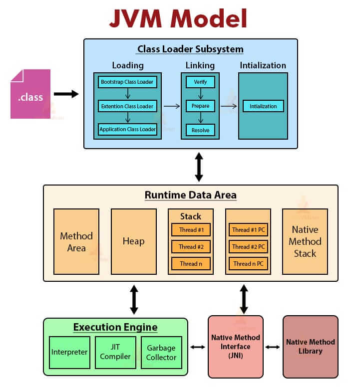

- 类加载器子系统
    - 加载阶段
        - 引导类加载器
        - 扩展类加载器
        - 应用类加载器
    - 链接阶段
        - 验证
        - 准备
        - 解析
    - 初始化阶段
- 运行时数据区
    - 堆（1:2），线程共享，线程之间通过TLAB隔离
        - 新生代（8:1:1），MinorGC
            - Eden
            - S0
            - S1
        - 老年代Tenured/Old generation，MajorGC
    - 方法区
        - 元空间(永久代)
            - 类型信息
            - 域信息
            - 方法信息
            - 运行时常量池
                - string constants
                - numberic constants
                - class references
                - field references
                - method references
                - name and type
                - invoke dynamic
    - 虚拟机栈，线程私有
        - 栈帧
            - 局部变量表
            - 操作数栈
            - 动态链接
            - 方法返回地址
            - 一些附加信息
    - 本地方法栈，线程私有
    - 程序计数器，线程私有
- 执行引擎
    - 解释器
    - JIT编译器
        - 中间代码生成器
        - 代码优化器
        - 目标代码生成器
    - 垃圾收集器
- 本地方法接口
- 本地方法库

#### 类加载器

类加载器是JVM执行类加载机制的前提

类加载器的作用：类加载器是Java的核心组件，所有的类都是由类加载器进行加载的，类加载器负责通过各种方式将类的二进制数据流读入JVM，转为一个与目标类对应的Class实例，然后交给JVM进行链接、初始化等 操作。

因此，类加载器在整个加载阶段，只能影响到类的加载，而无法改变类的链接和初始化行为。

至于加载的类是否可以运行，则由执行引擎决定

- 类加载的分类：
    - 显式加载：
        - 使用Class.forName("全限定类名")
        - 使用xxx.getClassLoader().loadClass("全限定类名")
        - 使用ClassLoader.getSystemClassLoader().loadClass("全限定类名")
    - 隐式加载：不在代码中直接调用类加载器的方法加载类，而是通过JVM自动加载到内存中
        - 在加载某个类的字节码文件时，该类的字节码文件引用了另外一个类的对象，此时额外引用的类将通过JVM自动加载到内存中

- 类的唯一性：
    - 对于任意一个类，都需要由加载它的类加载器和这个类本身一同确认其在JVM中的唯一性
    - 每一个类加载器，都拥有一个独立的类名称空间：比较两个类是否相等，只有在这两个类是同一个类加载器加载的前提下才有意义。
    - 即使这两个类源自同一个字节码文件，被同一个虚拟机加载，只要加载它们的类加载器不同，这两个类就必定不相等

- 命名空间
    - 每个类加载器都有自己的命名空间，命名空间有该加载器及所有的父加载器所加载的类组成
    - 在同一个命名空间中，不会出现全限定类名相同的两个类
    - 在不同的命名空间中，可能出现全限定类名相同的两个类
    - 在大型应用中，往往借助这一特性来运行同一个类的不同版本

- 类加载机制的三个基本特征
    - 双亲委派机制。但不是所有类加载都遵循这个机制，有的时候，引导类加载器所加载的类型，是可能要加载用户代码的，如JDK内部的ServiceProvider/ServiceLoader机制，用户可以在标准API框架上，提供自己的实现，JDK也需要提供些默认的实现。例如，JNDI、JDBC、文件系统、Cipher等很多方面，都是利用的这种机制，这种情况就不会用双亲委派机制去加载，而是利用上下文加载器
    - 可见性，子类加载器可以访问父类加载器加载的类型，但是反过来是不允许的。不然，因为缺少必要的隔离，我们就没办法利用类加载器去实现容器的逻辑
    - 单一性，父加载器加载过的类型，就不会在子加载器中重复加载。但是，“兄弟”类加载器间，同一类型仍然可以被加载多次，因为互相并不可见

##### 类加载器的分类

分为引导类加载器和自定义类加载器两种

JVM规范将所有派生于抽象类ClassLoader的类加载器都划分为自定义类加载器

除了引导类加载器外，自定义类加载器都应该有自己的“父类”加载器（实际上并非继承关系，而是包含着“父类”加载器的引用）

##### 引导类加载器

这个类加载器是用C/C++实现的，嵌套在JVM内部，并不继承java.lang.ClassLoader，没有父加载器

用来加载Java的核心库（rt.jar或sun.boot.class.path路径下的内容，如java、javax、sun等开头的类），提供JVM自身需要的类

加载扩展类加载器和应用类加载器，并指定为它们的父加载器

##### 扩展类加载器

Java语言编写，是sun.misc.Launcher的内部类ExtClassLoader，间接继承于ClassLoader

父类加载器为引导类加载器

加载`java.ext.dirs`系统属性指定的目录中的类库，或者`JDK家目录/jre/lib/ext`中的类库。如果用户创建的jar放在此目录下，也会由扩展类加载器加载

##### 应用类加载器

Java语言编写，是sun.misc.Launcher的内部类AppClassLoader，间接继承于ClassLoader

父类加载器为扩展类加载器

加载环境变量classpath或系统属性`java.class.path`指定路径下的类库

我们的应用程序的类加载器默认是应用类加载器

是用户自定义的类加载器的默认父类加载器

通过ClassLoader的getSystemClassLoader()方法可以获取到该类加载器

##### 自定义类加载器

在日常开发中，类的加载几乎是由上述三种类加载器想回配合执行的。必要时，还可以自定义类加载器

自定义类加载器要继承ClassLoader

自定义类加载器可以实现类库的动态加载，加载源可以是本地jar包，也可以是网络上的远程资源

自定义类加载器还可以实现绝妙的插件机制，如OSGI组件框架，Eclipse的插件机制。其为应用程序提供了一种动态增加新功能的机制，这种机制无需重新打包发布应用程序就能实现

同时，自定义类加载器能够实现应用隔离，如Tomcat、Spring等中间件和组件框架都在内部实现了自定义类加载器，并通过它们隔离不同的组件模块

###### 实现方式

- 继承ClassLoader
    - 重写loadClass()方法，loadClass()内部会调用findClass()方法，重写它可能破坏双亲委派机制，不破坏的话，就要保留双亲委派的代码，造成冗余
    - 重写findClass()方法，推荐
- 编写好自定义类加载器后，便可以在程序中调用loadClass()方法来实现类加载

```java
@Test
public void test() throws ClassNotFoundException {
    MyClassLoader myClassLoader = new MyClassLoader("字节码文件的所在目录");
    String className = "全限定类名";
    Class<?> clazz = myClassLoader.loadClass(className);
    System.out.println(clazz.getClassLoader().getClass().getName());
    System.out.println(clazz.getClassLoader().getParent().getClass().getName());
}

public class MyClassLoader extends  ClassLoader {
    private String bytecodePath;

    public MyClassLoader(String bytecodePath) {
        this.bytecodePath = bytecodePath;
    }

    @Override
    public Class<?> loadClass(String name) throws ClassNotFoundException {
        // 如果类名为某个类，就不走双亲委派，自己加载
        if ("全限定类名".equals(name)) {
            return findClass(name);
        }
        return super.loadClass(name);
    }

    @Override
    protected Class<?> findClass(String className) throws ClassNotFoundException {
        String fileName = bytecodePath + className.replace(".", "/") + ".class";
        try (BufferedInputStream bufferedInputStream = new BufferedInputStream(new FileInputStream(fileName));
             ByteArrayOutputStream byteArrayOutputStream = new ByteArrayOutputStream()) {
            bufferedInputStream.transferTo(byteArrayOutputStream);
            byte[] bytes = byteArrayOutputStream.toByteArray();
            // 这里还可以对bytes做一些操作，如解密
            return defineClass(className, bytes, 0, bytes.length);
        } catch (IOException e) {
            throw new ClassNotFoundException(className);
        }
    }
}
```

##### 获取类加载器的途径

```java
// 通过某个类的Class实例获取类加载器
clazz.getClassLoader()

// 获取当前线程上下文的类加载器，默认情况下它就是应用类加载器
Thread.currentThread().getContextClassLoader()

// 获取应用类加载器
ClassLoader.getSystemClassLoader()

// jdk21
// jdk.internal.loader.ClassLoaders$AppClassLoader
ClassLoader systemClassLoader = ClassLoader.getSystemClassLoader();
// jdk.internal.loader.ClassLoaders$PlatformClassLoader
ClassLoader extClassLoader = systemClassLoader.getParent();
// null
ClassLoader bootstrapClassLoader = extClassLoader.getParent();
```

数组类的Class对象，不是由类加载器创建的，而是在运行期间JVM根据需要自动创建的

对于数组类的类加载器来说，是通过clazz.getClassLoader()返回的，与数组的元素类型的加载器是一样的

如果数组当中的元素类型是基本数据类型，这个数组类是没有类加载器的

```java
UserVo[] arr = new UserVo[5];
// class [Lcom.handle.demo.vo.UserVo;
System.out.println(arr.getClass());
// jdk.internal.loader.ClassLoaders$AppClassLoader
System.out.println(arr.getClass().getClassLoader());
```

#### 类的生命周期

在Java中的数据类型分为基本数据类型和引用数据类型

基本数据类型由JVM预先定义，引用数据类型则需要进行类的加载

类的生命周期包括如下7个阶段

- 1.加载
- 2.链接
    - 1.验证
    - 2.准备
    - 3.解析
- 3.初始化
- 4.使用
- 5.卸载

##### 1. 加载阶段

将Java类的字节码文件加载到JVM中，并在内存中构建出Java类的原型（类模板对象）：

通过类的全名，获取类的二进制数据流

解析类的二进制数据流为方法区内的数据结构（Java类模板）

在堆中创建该类的java.lang.Class实例，指向方法区该类的的类模板数据

java.lang.Class的构造方法是私有的，只有JVM可以创建该类的实例，它是访问类型元数据的接口

###### 数组类的加载

数组类本身并不是由类加载器负责创建，而是由JVM在运行时根据需要而直接创建的

数组的元素类型仍然需要类加载器去创建

- 创建数组类过程：
    - 1.如果数组的元素类型是引用类型，就遵循定义的加载过程递归加载和创建数组的元素类型
    - 2.JVM使用指定的元素类型和数组维度来创建新的数组类

如果数组的元素类型是引用类型，数组类的可访问性就由元素类型的可访问性决定；否则将被缺省定义为public

##### 2. 链接阶段

###### 1.验证环节

当类加载到JVM后，就开始链接操作，验证是链接操作的第一步

目的是保证加载的字节码是合法、合理并符合规范的

- 大体上JVM要做以下检查
    - 格式验证：
        - 魔数检查、版本检查、长度检查（数据中的每一项是否都有正确的长度）
        - 和加载阶段一起执行。验证通过之后，类加载器才会将类的二进制数据信息加载到方法区中
        - 格式验证之外的验证操作将会在方法区进行
    - 语义验证：
        - 是否有父类（除了Object都应该有父类）
        - 是否继承了final的类或重写了final方法
        - 非抽象类是否实现了所有抽象方法或接口方法
        - 是否存在不兼容的方法（如定义的方法的签名一样，让JVM无从下手调度；abstract方法定义为final）
    - 字节码验证：
        - 在字节码指令的执行过程中，是否会跳转到一条不存在的指令位置
        - 操作数类型是否合理（方法传参类型是否正确、变量赋值类型是否正确）
        - Code属性的StackMapTable（栈映射帧）属性就是在这个阶段，用于检测在特定的字节码处，其局部变量表和操作数栈是否有着正确的数据类型
        - 但是100%准确地判断一段字节码是否可以被安全执行是无法实现的，该过程只是尽可能检查出可以预知的问题
        - 如果没通过这个阶段的检查，JVM也不会正确装载这个类
        - 如果通过了这个阶段的检查，也不能说明这个类是完全没问题的
    - 符号引用验证：符号引用的直接引用是否存在
        - 在解析环节才会执行

###### 2.准备环节

为类的静态变量分配内存，并将其初始化为默认值

这里不包括用static final修饰的基本数据类型（以及用字面量方式定义的字符串类型）的类的静态常量，因为它们在编译的时候，就分配了一个指向常量池的字面量了，准备环节会显式赋值

类的静态变量会分配在方法区中

|类型|默认值|
|:-|:-|
|byte|(byte)0|
|short|(short)0|
|int|0|
|long|0L|
|float|0.0F|
|double|0.0|
|boolean|boolean内部实现是int，int默认值是0,故boolean的默认值就是false|
|char|\u0000|
|referenct|null|

###### 3.解析环节

将类、接口、字段、方法的符号引用转为直接引用，也就是它们在内存中的指针或者偏移量

符号引用就是一些字面量的引用，和JVM的内部数据结构及内存布局无关

字节码文件中就通过常量池进行了大量的符号引用。但是在程序运行时，只有符号引用是不够的，JVM需要明确知道符号引用指向的具体位置

解析环节往往会伴随着JVM在执行完初始化之后再执行

- 关于CONSTANT_String的解析
    - 当在Java源代码中直接使用字符串常量时，就会在字节码文件常量池中出现CONSTANT_String，它表示字符串常量，并且会引用常量池的一个CONSTANT_UTF8的常量项
    - 在运行时常量池中，会维护一张字符串拘留表（intern），它保存所有出现过的字符串常量，并且没有重复项
    - 只要以CONSTANT_String形式出现的字符串都会在这张表中
    - 使用String的intern()方法可以得到一个字符串在拘留表中的引用
    - 因为拘留表中没有重复项，所以任何字面量相同的字符串调用intern()方法的返回总是相等的

##### 3. 初始化阶段

为类的静态变量赋正确的初始值

初始化阶段是类装载的最后一个阶段

如果前面的步骤都没有问题，就表示类可以顺利装载到系统中，此时，才会开始执行字节码指令（如类的静态成员的赋值语句以及static语句块的字节码指令）

- 初始化阶段的重要工作是执行类的初始化方法（`<clinit>()`）
    - 该方法仅能由Java编译器生成并由JVM调用，程序员无法自定义一个同名的方法，更无法直接在Java程序中调用该方法
    - 它是由类的静态成员的赋值语句以及static语句块合并生成的

在加载一个类之前，JVM总是试图加载该类的父类，因此父类的`<clinit>()`总是在子类的`<clinit>()`之前被调用

- Java编译器并不会为所有的类都生成`<clinit>()`初始化方法，如下的类就不会生成：
    - 类中没有声明任何的类静态变量，也没有静态代码块
    - 类中声明了类静态变量，但是没有显式赋值的初始化语句以及静态代码块
    - 类中包含基本数据类型或String类型的静态常量，并且这些常量是直接在声明时用字面量方式显式赋值初始化的，这中情况在准备环节就完成了初始化

###### `<clinit>()`的线程安全性

JVM会在内部确保`<clinit>()`在多线程环境中的安全性

如果有多个线程同时去初始化一个类，那么只会有一个线程去执行这个类的`<clinit>()`方法

正是因为`<clinit>()`是线程安全的，因此如果在一个类的`<clinit>()`方法中有耗时很长的操作，就可能造成多个线程阻塞，引发死锁。并且这种死锁是很难发现的，因为看起来它们并没有可用的锁信息（`<clinit>()`的访问标识只有static，没有synchornized）

如果之前的线程成功加载了类，则在队列中等待的线程就没有机会再执行`<clinit>()`方法了。当需要使用这个类的时候，JVM会直接返回给它已经加载好的类信息

###### 类的初始化情况：主动使用和被动使用

- 主动使用
    - JVM规定，一个类或接口在初次使用前必须进行初始化，这里的“使用”，是指主动使用
    - 如果出现如下的情况，则会对类进行初始化操作（之前的加载、验证、准备已经完成）
        - 当创建一个类的实例时，如使用new关键字，或者通过反射、克隆、反序列化
        - 当调用类的静态方法时，即当使用了invokestatic指令时
        - 当使用类、接口的静态字段时（final修饰的特殊考虑），如getstatic或putstatic
        - 当使用java.lang.reflect包中的方法反射类的方法时，如Class.forName("全限定类名")
        - 当初始化子类时，如果发现父类还没有进行初始化，则需要先触发父类的初始化
        - 如果一个接口定义了default方法，那么直接实现或者间接实现该接口的类初始化时，该接口要在其之前被初始化
        - 当JVM启动时，用户需要指定一个要执行的主类，虚拟机会先初始化这个主类
            - 说明：JVM启动时通过引导类加载器加载一个初始类，这个类在调用主类的main方法之前被链接和初始化。这个方法的执行将一次导致所需类的加载、链接和初始化
        - 当初次调用MethodHandle实例时，初始化该MethodHandle指向的方法所在的类（涉及解析REF_getStatic、REF_putStatic、REF_invokeStatic方法句柄对应的类）
    - 当JVM初始化一个类时要求它的所有父类都已经初始化，但是这条规则不适用于接口
        - 在初始化一个类时，并不会先初始化它所实现的接口
        - 在初始化一个接口时，并不会先初始化它的父接口
        - 因此，一个父接口并不会因为它的子接口或者实现类的初始化而初始化。而是只有当程序首次使用这个接口的静态字段时，才会导致该接口的初始化

- 被动使用
    - 除了以上情况属于主动使用，其他的情况均属于被动使用。被动使用不会引起类的初始化
        - 也就是说，并不是在代码中出现的类，就一定会被加载或者初始化
    - 当访问一个静态字段时，只有真正声明这个字段的类才会被初始化
        - 比如当通过子类引用父类的静态变量，不会导致子类初始化
    - 通过数组定义类引用，不会触发此类的初始化
    - 引用常量不会触发此类或接口的初始化，因为常量在准备环节就已经被显式赋值了
    - 调用ClassLoader类的loadClass()方法加载一个类，并不是对类的主动使用，不会导致类的初始化

- 如下代码可以知道接口是否初始化了

```java
public interface ClinitService {
    // 查看字节码可以知道OBJECT的初始化代码在ClinitService的clinit中
    // 并且只要OBJECT初始化了，就会输出下面的内容
    // 也就是说只要输出了下面的内容，就说明ClinitService的clinit方法被调用了，即ClinitService接口初始化了
    Object OBJECT = new Object() {
        {
            System.out.println("调用了ClinitService的clinit方法");
        }
    };
}
```

##### 4. 类的使用

开发人员在程序中访问和调用类的静态成员信息，或者使用new关键字创建类的对象

##### 5. 类的卸载

- 类、类的加载器、类的实例之间的引用关系

在类加载器的内部实现中，用一个Java集合来存放所加载类的引用

类的Class实例总是会引用它的类加载器，调用getClassLoader()方法就能获得它的类加载器

类的对象总是引用这个类的Class实例，调用getClass()方法就能获取它所属的类的Class实例

此外，所有Java类都有一个静态属性class，它引用这个类的Class实例

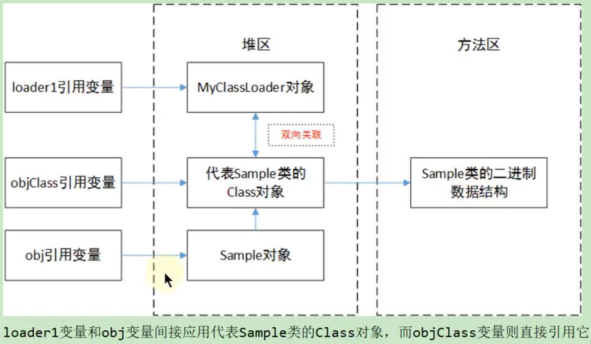

- 类的生命周期

当一个类被加载、链接和初始化后，它的生命周期就开始了

当一个类的Class实例不再被引用，即不可触及时，Class实例就会结束生命周期，这个类在方法区的数据也会被卸载，从而结束这个类的生命周期

一个类合适结束生命周期，取决于代表它的Class实例何时结束生命周期

- 类的卸载
    - 引导类加载器加载的类型在整个运行期间是不可能被卸载的
    - 被扩展类加载器和应用类加载器加载的类型在运行期间不太可能被卸载，因为扩展类加载器的实例或应用类加载器的实例基本上在整个运行期间总能直接或间接访问得到，它们不可达的可能性极小
    - 被开发人员自定义的类加载器的实例加载的类型只有在很简单的上下文环境中才能被卸载，而且一般还要借助于强制调用虚拟机的垃圾收集功能才可以做到
    - 可以预想，复杂点的应用场景中（比如开发人员自定义类加载器实例的时候采用缓存的策略以提高系统性能），被加载的类型在运行期间是几乎不可能被卸载的（至少卸载的时间是不确定的）
    - 综上，一个已经加载的类型被卸载的几率很小，至少被卸载的时间是不确定的。因此，开发人员在开发的时候，不应该在对虚拟机的类型卸载做任何假设的前提下，来实现系统中的特定功能

#### 字节码文件

一个Java源文件(.java)经过编译器编译之后便会生成一个（或多个，如果一个源文件里面定义了多个类）字节码文件(.class)

字节码文件是一种二进制的类文件，它的内容是JVM的指令

##### 字节码文件的格式

- 字节码文件格式采用一种类似于C语言结构体的方式进行数据存储，这种结构只有两种数据类型：无符号数和表
    - 无符号数属于基本的数据类型，以u1、u2、u4、u8来分别代表1、2、4、8个字节的无符号数。无符号数可以用来描述数字、索引引用、数量值或按照UTF-8编码构成字符串值

    - 表是由多个无符号数或其它表作为数据项构成的复合数据类型，所有表都习惯性地以“_info”结尾。表用于描述有层次关系的复合结构的数据，整个字节码文件本质上就是一张表。由于表没有固定长度，所以通常会在其前面加上个数说明

```c
ClassFile {
    u4             magic;// 魔数，用于识别字节码文件格式（是否合法）
    u2             minor_version;// 编译的小版本号
    u2             major_version;// 编译的大版本号
    u2             constant_pool_count;// 常量池计数器
    cp_info        constant_pool[constant_pool_count-1]; // 常量池表
    u2             access_flags;// 访问标识
    u2             this_class;// 类索引，值为常量池的索引（可以理解成数组下标）
    u2             super_class;// 父类索引，值为常量池的索引（可以理解成数组下标）
    u2             interfaces_count;// 接口计数器
    u2             interfaces[interfaces_count];// 接口集合
    u2             fields_count;// 字段计数器
    field_info     fields[fields_count];// 字段表
    u2             methods_count;// 方法计数器
    method_info    methods[methods_count];// 方法表
    u2             attributes_count;// （class文件）属性计数器
    attribute_info attributes[attributes_count];// （class文件）属性表
}
```

##### 常量池

###### 全限定名

`全类名`com.handle.test.Demo中的`.`替换成`/`，变成com/handle/test/Demo，就是`全限定名`，为了使连续的多个全限定名之间不产生混淆，在使用时最后一般加`;`，表示全限定名结束

###### 简单名称

没有类型和参数修饰的方法或字段名称

```java
public class UserVo {
    private String name;

    public String getName() {
        return name;
    }
}
// 简单名称分别是name和getName
```

###### 描述符

作用：描述字段的数据类型、方法的参数列表（包括数量、类型以及顺序）和返回值

基本数据类型及void类型都用一个大写字符（单词的首字母）来表示

对象类型用字符L加对象的全限定名来表示

long类型用`J`表示(L被对象类型前缀占用了)

boolean类型用`Z`表示(B被byte类型占用了)

数组类型用`[`表示，一个`[`代表一维，如int[][]的描述符为`[[I`

描述方法时，按照先参数列表，后返回值的顺序描述，参数列表按照方法的参数声明顺序放在`()`内，如`int sum(int x, int y)`的描述符为`(I[I) I`

###### 常量池表

- 常量池计数器的计数是从1开始的，因此对应的常量池表的长度是[常量池计数器-1]

- 这是为了满足后面某些指向常量池的索引值的数据在特定情况下需要表达“不引用任何一个常量池表的项的含义”，这种情况就可以用索引值0来表示

- 常量池表中，主要存放各种`字面量（Literal）`和`符号引用（Symbolic Reference）`

- 字面量包含文本字符串和声明为final的常量值

- 符号引用包含类和接口的全限定名、字段的名称和描述符、方法的名称和描述符

- 常量池表中每一项都具备相同的特征，第一个字节（tag byte）作为类型标记，用于确定该项的格式，如下表的标识列

```c
CONSTANT_Utf8_info {
    u1 tag;// 标识，值为1
    u2 length;// 字符串长度
    u1 bytes[length];// 字符串内容
}

CONSTANT_Methodref_info {
    u1 tag;// 标识，值为10
    u2 class_index;// 指向声明此方法的类的描述符，值为常量池的索引（可以理解成数组下标）
    u2 name_and_type_index;// 指向此方法的名称及类型（形参类型及顺序、返回值类型）的描述符，值为常量池的索引（可以理解成数组下标）
}
```

|类型|标识|描述|
|:-|:-|:-|
|CONSTANT_Utf8|1|UTF-8编码的字符串|
|CONSTANT_Integer|3|整型字面量|
|CONSTANT_Float|4|浮点型字面量|
|CONSTANT_Long|5|长整型字面量|
|CONSTANT_Double|6|双精度浮点型字面量|
|CONSTANT_Class|7|类或接口的符号引用|
|CONSTANT_String|8|字符串类型字面量|
|CONSTANT_Fieldref|9|字段的符号引用|
|CONSTANT_Methodref|10|类中方法的符号引用|
|CONSTANT_InterfaceMethodref|11|接口中方法的符号引用|
|CONSTANT_NameAndType|12|字段或方法的符号引用|
|CONSTANT_MethodHandle|15|方法句柄|
|CONSTANT_MethodType|16|方法类型|
|CONSTANT_Dynamic|17||
|CONSTANT_InvokeDynamic|18||
|CONSTANT_Module|19||
|CONSTANT_Package|20||

##### 访问标识

|Flag Name|Value|Interpretation|
|:-|:-|:-|
|ACC_PUBLIC|0x0001|Declared public; may be accessed from outside its package.|
|ACC_FINAL|0x0010|Declared final; no subclasses allowed.|
|ACC_SUPER|0x0020|Treat superclass methods specially when invoked by the invokespecial instruction.|
|ACC_INTERFACE|0x0200|Is an interface, not a class.|
|ACC_ABSTRACT|0x0400|Declared abstract; must not be instantiated.|
|ACC_SYNTHETIC|0x1000|Declared synthetic; not present in the source code.|
|ACC_ANNOTATION|0x2000|Declared as an annotation interface.|
|ACC_ENUM|0x4000|Declared as an enum class.|
|ACC_MODULE|0x8000|Is a module, not a class or interface.|

##### 接口集合

每一个元素的值为常量池的索引（可以理解成数组下标），指向的是CONSTANT_Class_info结构的数据

```c
CONSTANT_Class_info {
    u1 tag;
    u2 name_index;
}
```

接口表长度为interfaces_count

interfaces[i]的i的范围是`[0,interfaces_count)`，接口表各元素表示的接口顺序（索引从小到大）和对应源代码中实现的接口顺序一样（从左往右）

##### 字段表

描述接口或类中声明的字段（静态字段和实例字段）

不包含从父类或者实现的接口中继承而来的字段

有可能包含源代码中不存在的字段，如在内部类中为了保持对外部类的访问性，会自动添加指向外部类实例的字段

字段表每个元素都是field_info结构的数据

```c
field_info {
    u2             access_flags;// 字段访问标识
    u2             name_index; // 字段名索引，值为常量池的索引（可以理解成数组下标），指向的是CONSTANT_Utf8_info结构的数据
    u2             descriptor_index;// 字段描述符索引，值为常量池的索引（可以理解成数组下标），指向的是CONSTANT_Utf8_info结构的数据
    u2             attributes_count;// 字段属性计数器
    attribute_info attributes[attributes_count];// 字段属性集合，具体参考属性表章节笔记
}
```

###### 字段访问标识

|Flag Name|Value|Interpretation|
|:-|:-|:-|
|ACC_PUBLIC|0x0001|Declared public; may be accessed from outside its package.|
|ACC_PRIVATE|0x0002|Declared private; accessible only within the defining class and other classes belonging to the same nest.|
|ACC_PROTECTED|0x0004|Declared protected; may be accessed within subclasses.|
|ACC_STATIC|0x0008|Declared static.|
|ACC_FINAL|0x0010|Declared final; never directly assigned to after object construction.|
|ACC_VOLATILE|0x0040|Declared volatile; cannot be cached.|
|ACC_TRANSIENT|0x0080|Declared transient; not written or read by a persistent object manager.|
|ACC_SYNTHETIC|0x1000|Declared synthetic; not present in the source code.|
|ACC_ENUM|0x4000|Declared as an element of an enum class.|

###### 字段描述符

描述字段的数据类型

|FieldType term|Type|Interpretation|
|:-|:-|:-|
|B|byte|signed byte|
|C|char|Unicode character code point in the Basic Multilingual Plane, encoded with UTF-16|
|D|double|double-precision floating-point value|
|F|float|single-precision floating-point value|
|I|int|integer|
|J|long|long integer|
|L`ClassName;`|reference|an instance of class ClassName|
|S|short|signed short|
|Z|boolean|true or false|
|`[`|reference|one array dimension|

##### 方法表

- 只描述当前类或接口中声明的方法，不包括从父类或父接口继承的方法

- 有可能出现由编译器自动添加的方法，如
    - 类（接口）初始化方法:<clinit>()，静态代码块的内容就会整合到这个方法中
    - 实例初始化方法:<init>()，非静态代码块、构造方法的内容就会整合到这个方法中

- 方法表每个元素都是method_info结构的数据

```c
method_info {
    u2             access_flags;// 方法访问标识
    u2             name_index;// 方法名索引，值为常量池的索引（可以理解成数组下标），指向的是CONSTANT_Utf8_info结构的数据
    u2             descriptor_index;// 方法描述符索引，值为常量池的索引（可以理解成数组下标），指向的是CONSTANT_Utf8_info结构的数据
    u2             attributes_count;// 方法属性计数器
    attribute_info attributes[attributes_count];// 方法属性集合，具体参考属性表章节笔记
}
```

###### 方法访问标识

|Flag Name|Value|Interpretation|
|:-|:-|:-|
|ACC_PUBLIC|0x0001|Declared public; may be accessed from outside its package.|
|ACC_PRIVATE|0x0002|Declared private; accessible only within the defining class and other classes belonging to the same nest.|
|ACC_PROTECTED|0x0004|Declared protected; may be accessed within subclasses.|
|ACC_STATIC|0x0008|Declared static.|
|ACC_FINAL|0x0010|Declared final; must not be overridden.|
|ACC_SYNCHRONIZED|0x0020|Declared synchronized; invocation is wrapped by a monitor use.|
|ACC_BRIDGE|0x0040|A bridge method, generated by the compiler.|
|ACC_VARARGS|0x0080|Declared with variable number of arguments.|
|ACC_NATIVE|0x0100|Declared native; implemented in a language other than the Java programming language.|
|ACC_ABSTRACT|0x0400|Declared abstract; no implementation is provided.|
|ACC_STRICT|0x0800|In a class file whose major version number is at least 46 and at most 60: Declared strictfp.|
|ACC_SYNTHETIC|0x1000|Declared synthetic; not present in the source code.|

##### 属性表

- 字节码文件、字段表、方法表、方法表的Code属性都可以有自己的属性表

- 字节码文件的属性信息通常被用于Java虚拟机的验证和运行，以及Java程序的调试

- 属性表每个元素都是attribute_info结构的数据

```c
// 这是通用的属性结构，除了attribute_name_index和attribute_length是都有外
// 属性表info部分，根据不同属性（名）对应着不同的项
attribute_info {
    u2 attribute_name_index;// 属性名索引，值为常量池的索引（可以理解成数组下标），指向的是CONSTANT_Utf8_info结构的数据
    u4 attribute_length;// 属性长度（字节）
    u1 info[attribute_length];// 属性表，不同属性（名）对应着不同的项
}

// 这是ConstantValue属性的结构
ConstantValue_attribute {
    u2 attribute_name_index;
    u4 attribute_length;
    u2 constantvalue_index;
}

// 这是StackMapTable的结构
StackMapTable_attribute {
    u2              attribute_name_index;
    u4              attribute_length;
    u2              number_of_entries;
    stack_map_frame entries[number_of_entries];// 这里的stack_map_frame又是另一种结构
}

// 这是Code的结构
Code_attribute {
    u2 attribute_name_index;// 属性名索引，值为常量池的索引（可以理解成数组下标），指向的是CONSTANT_Utf8_info结构的数据
    u4 attribute_length;// 属性长度（字节）
    u2 max_stack;// 操作数栈深度最大值
    u2 max_locals;// 局部变量表最大长度
    u4 code_length;// 字节码指令长度
    u1 code[code_length];// 字节码指令（操作码 [操作数]）集合，操作码一般是一个字节，操作数为两个字节（如果有），操作数的值也是常量池的索引（可以理解成数组下标），指向的是CONSTANT_Utf8_info结构的数据
    u2 exception_table_length;// 异常表长度
    {   u2 start_pc;// 字节码指令集合（code[code_length]）的开始索引（try块开始位置）
        u2 end_pc;// 字节码指令集合（code[code_length]）的结束索引（try块结束位置）
        u2 handler_pc;// 字节码指令集合（code[code_length]）的catch异常处理索引（catch块开始位置）
        u2 catch_type;// catch的异常类型
    } exception_table[exception_table_length];// 异常表
    u2 attributes_count;// Code属性计数器
    attribute_info attributes[attributes_count];// Code属性的属性表（集合），例如LineNumberTable、LocalVariableTable
}
// 行号表
LineNumberTable_attribute {
    u2 attribute_name_index;// 属性名索引，值为常量池的索引（可以理解成数组下标），指向的是CONSTANT_Utf8_info结构的数据
    u4 attribute_length;// 属性长度（字节）
    u2 line_number_table_length;// 行号表长度
    {   u2 start_pc;// 字节码指令集合（code[code_length]）的开始索引，源文件一行代码对应多条字节码指令，每条指令占1到多个字节
        u2 line_number; // 源文件代码行号
    } line_number_table[line_number_table_length];// 行号表集合
}

// 局部变量表
LocalVariableTable_attribute {
    u2 attribute_name_index;// 属性名索引，值为常量池的索引（可以理解成数组下标），指向的是CONSTANT_Utf8_info结构的数据
    u4 attribute_length;// 属性长度（字节）
    u2 local_variable_table_length;// 局部变量表长度
    {   u2 start_pc;// 变量的作用域在字节码指令集合（code[code_length]）的开始索引
        u2 length;// 变量的作用域长度（字节），变量的作用域为code[start_pc]到code[start_pc + length -1]
        u2 name_index; // 变量名，即源代码中定义的变量名
        u2 descriptor_index;// 变量的描述符（指明变量的类型）索引，值为常量池的索引（可以理解成数组下标），指向的是CONSTANT_Utf8_info结构的数据
        u2 index;// 变量在局部变量表集合中的索引（槽，一个槽4个字节），通常从方法形参开始，按照变量的定义顺序索引从0依次递增（非静态方法索引0位置是this变量，其它变量索引从1开始）
    } local_variable_table[local_variable_table_length]; // 局部变量表集合
}

// 源文件
SourceFile_attribute {
    u2 attribute_name_index;// 属性名索引，值为常量池的索引（可以理解成数组下标），指向的是CONSTANT_Utf8_info结构的数据
    u4 attribute_length;// 属性长度，官方指定必须是2
    u2 sourcefile_index;// 源文件名称索引，值为常量池的索引（可以理解成数组下标），指向的是CONSTANT_Utf8_info结构的数据
}
```

###### 属性（名）

- java21有30种属性（名），每一种属性又对应着不同的属性表结构，如下表

|Attribute|Location|
|:-|:-|
|SourceFile|ClassFile|
|InnerClasses|ClassFile|
|EnclosingMethod|ClassFile|
|SourceDebugExtension|ClassFile|
|BootstrapMethods|ClassFile|
|Module, ModulePackages, ModuleMainClass|ClassFile|
|NestHost, NestMembers|ClassFile|
|Record|ClassFile|
|PermittedSubclasses|ClassFile|
|ConstantValue|field_info|
|Code|method_info|
|Exceptions|method_info|
|RuntimeVisibleParameterAnnotations, RuntimeInvisibleParameterAnnotations|method_info|
|AnnotationDefault|method_info|
|MethodParameters|method_info|
|Synthetic|ClassFile, field_info, method_info|
|Deprecated|ClassFile, field_info, method_info|
|Signature|ClassFile, field_info, method_info, record_component_info|
|RuntimeVisibleAnnotations, RuntimeInvisibleAnnotations|ClassFile, field_info, method_info, record_component_info|
|LineNumberTable|Code|
|LocalVariableTable|Code|
|LocalVariableTypeTable|Code|
|StackMapTable|Code|
|RuntimeVisibleTypeAnnotations, RuntimeInvisibleTypeAnnotations|ClassFile, field_info, method_info, Code, record_component_info|

##### 字节码指令

Java虚拟机的指令由一个字节长度的、代表着某种特定操作含义的数字（操作码，opcode），

以及跟随其后的零个或多个代表此操作所需参数的操作数（operand）所构成，即`操作码 [操作数]`

由于JVM采用面向操作数栈而不是寄存器的结构，所以大多数的指令都不包含操作数，只有一个操作码

###### 带数据类型的字节码指令

对于大部分与数据类型相关的字节码指令，它们的操作码助记符中都有特殊的字符来表明专门为哪种数据类型服务，如`iload`

至于byte、short、char、boolean类型的数据都会转成int再进行操作

|操作码助记符前缀|描述|
|:-|:-|
|i|代表对`int`类型的数据进行操作|
|l|代表对`long`类型的数据进行操作|
|f|代表对`float`类型的数据进行操作|
|d|代表对`double`类型的数据进行操作|
|a|代表对`引用`类型的数据进行操作|

###### 局部变量压入操作数栈指令

|指令（助记符）|描述|
|:-|:-|
|xload_n|x=(i,l,f,d,a)，n=[0,3]，表示将局部变量表中，第n个索引位置的变量压入操作数栈|
|xload n|x=(i,l,f,d,a)，n=正整数，当n大于3时，`xload_n`不再适用，就要用到这个指令了|

###### 常数压入操作数栈指令

将常数n压入操作数栈，根据数据类型和入栈内容的不同，又可以分为const系列、push系列和ldc系列的指令

|指令（助记符）|描述|
|:-|:-|
|iconst_n|n=[-1,5]，PS：n=-1时，指令为iconst_m1|
|lconst_n|n=[0,1]|
|fconst_n|n=[0,2]|
|dconst_n|n=[0,1]|
|bipush_n|n=[-128,127]，byte int，接收1字节整数作为参数|
|sipush_n|n=[-32768,-32767]，short int，接收2字节整数作为参数|
|ldc index|接收1字节的index，它是指向常量池中的int、float或者String的索引|
|ldc_w w_index|接收2字节的w_index，它是指向常量池中的int、float或者String的索引，能支持的常量池索引范围大于ldc index|
|ldc2_w w_index|接收2字节的w_index，它是指向常量池中的long或者double的索引|
|aconst_null|将null压入操作数栈|

##### 操作数栈出栈存到局部变量表

用于将操作数栈中栈顶元素弹出后，装入局部变量表的指定位置，用于给局部变量赋值

|指令（助记符）|描述|
|:-|:-|
|xstore_n|x=(i,l,f,d,a)，n=[0,3]，表示从操作数栈弹出一个值，并把它赋值给局部变量表索引为n位置的变量|
|xstore n|x=(i,l,f,d,a)，n为1个字节的正整数，表示从操作数栈弹出一个值，并把它赋值给局部变量表索引为n位置的变量|

##### 算术指令

用于对两个操作数栈上的值进行某种特定运算，并把结果重新压入操作数栈

|指令（助记符）|描述|
|:-|:-|
|xadd|x=(i,l,f,d)，加法指令|
|xsub|x=(i,l,f,d)，减法指令|
|xmul|x=(i,l,f,d)，乘法指令|
|xdiv|x=(i,l,f,d)，除法指令|
|xrem|x=(i,l,f,d)，取余指令，remainder|
|xneg|x=(i,l,f,d)，取反指令，negation|
|iinc|自增指令，`iinc index by number`局部变量表索引为index的值加number|
|xshl|x=(i,l)，左移指令|
|xshr|x=(i,l)，右移指令|
|xushl|x=(i,l)，无符号左移指令|
|xushr|x=(i,l)，无符号右移指令|
|xand|x=(i,l)，按位与或指令|
|por|p=(i,l)，按位或指令|
|pxor|p=(i,l)，按位异或指令|

##### 比较指令

操作数栈栈顶两个元素出栈，比较大小，然后将比较结果入栈

- 假设栈顶元素为v2, 第二个元素为v1
    - 若`v1=v2`, 比较结果为0
    - 若`v1>v2`，比较结果为1
    - 若`v1<v2`，比较结果为-1

|指令（助记符）|描述|
|:-|:-|
|lcmp|l表示long|
|xcmpl|x=(f,d)，如果遇到NaN值，结果为-1，l表示lesser|
|xcmpg|x=(f,d)，如果遇到NaN值，结果为1，g表示greater|

##### 类型转换指令

###### 自动类型转换

将两种不同的数值类型（基本数据类型）进行相互转换

一般用于实现代码中的显式类型转换

或者用来处理字节码指令集中数据类型相关指令无法与数据类型一一对应的问题（如byte转long）

从byte、short、char到int实际上是没有相关的指令的，直接将它们看成是int了

简化为：int->long->float->double

|指令（助记符）|描述|
|:-|:-|
|i2l|int转为long|
|i2f|int转为float，可能损失精度|
|i2d|int转为double|
|l2f|long转为float，可能损失精度|
|l2d|long转为double，可能损失精度|
|f2d|float转为double|

###### 强制类型转换

可能会发生上限溢出、下限溢出和精度丢失的问题

当float转为byte时是没有相关指令的，生成f2i和i2b两条指令来完成，long转为byte同理也是生成两条指令

- 当将一个浮点值转为整型（int或long）时
    - 如果浮点值为NaN，则转换结果为0
    - 如果浮点值不是无穷大，则向零舍入取整，获得整数v
        - 如果v在int或long的范围内，则转换结果是v
        - 如果v不在int或long的范围内，则根据v的符号转为int或long能表示的最大正负值
    - 如果浮点值是无穷大，则根据其符号转为int或long能表示的最大正负值

- 当将一个double转为float时
    - 如果转换结果的绝对值太小无法用float表示，将返回float类型的正负零
    - 如果转换结果的绝对值太大无法用float表示，将返回float类型的正负无穷大
    - 如果是double类型的NaN，则转为float类型的NaN

|指令（助记符）|描述|
|:-|:-|
|i2b|int转为byte|
|i2s|int转为short|
|i2c|int转为char|
|l2i|long转为int|
|f2i|float转为int|
|f2l|float转为long|
|d2i|double转为int|
|d2l|double转为long|
|d2f|double转为float|

##### 对象的创建与访问指令

###### 对象创建指令

|操作码助记符|描述|
|:-|:-|
|new index|创建类实例，接收一个操作数，为指向常量池的索引，表示创建的类型，执行完成后，将对象的引用压入操作数栈|
|newarray|创建基本类型数组|
|anewarray|创建引用类型数组|
|multianewarray|创建二维以上数组|

###### 字段访问指令

|指令（助记符）|描述|
|:-|:-|
|getstatic index|访问类静态字段，index为指向常量池的Fieldref索引，作用是获取Fieldref指定的对象或值，并压入操作数栈|
|putstatic index|访问类静态字段，index为指向常量池的Fieldref索引，作用是设置Fieldref指定的对象或值，并将类的引用和字段要设置的值弹出操作数栈|
|getfield index|访问类实例字段，index为指向常量池的Fieldref索引，作用是获取Fieldref指定的对象或值，并压入操作数栈|
|putfield index|访问类实例字段，index为指向常量池的Fieldref索引，作用是设置Fieldref指定的对象或值，并将类的引用和字段要设置的值弹出操作数栈|

###### 数组操作指令

b表示byte和boolean

|指令（助记符）|描述|
|:-|:-|
|xaload|x=(b,s,i,l,f,d,c,a)，把栈顶数组索引arrayIndex和栈顶顺位第2个元素即数组引用arrayReference都出栈，将array[arrayIndex]入栈|
|xastore|x=(b,s,i,l,f,d,c,a)，把栈顶的数值v，栈顶顺位第2个元素即数组索引arrayIndex和栈顶顺位第3个元素即数组引用arrayReference都出栈，并将v赋给array[arrayIndex]|
|arraylength|把栈顶的数组引用出栈，获取数组长度并压入操作数栈|

###### 类型检查指令

|指令（助记符）|描述|
|:-|:-|
|instanceof constant_pool_index|constant_pool_index为指向CONSTANT_Class结构的常量池索引，判断给定对象是否为某个类的实例，将判断结果压入操作数栈|
|checkcast constant_pool_index|constant_pool_index为指向CONSTANT_Class结构的常量池索引，检查是否可以类型强转，如果可以，checkcast指令不改变操作数栈，如果不可以，抛出ClassCastException|

##### 方法指令

###### 方法调用指令

|指令（助记符）|描述|
|:-|:-|
|invokeinterface|用于调用接口方法，在运行时搜索由特定对象所实现的这个接口方法，并找出适合的方法进行调用，如：IUserService userService = new UserServiceImpl(); userService.getUserById(userId);getUserById指向的是IUserService中的方法，就会用这个指令|
|invokevirtual|用于调用对象的实例方法，根据对象的实际类型进行分派（虚方法分派），支持多态。如UserServiceImpl userService = new UserServiceImpl(); userService.getUserById(userId);getUserById指向的是UserServiceImpl中的方法，这个方法可能是被子类重写过的，就会用这个指令|
|invokespecial|用于调用一些需要特殊处理的实例方法，包括构造器方法（<init>）、私有方法和父类方法，这些方法都是静态类型绑定的（这些方法不存在重写，具有确定性），不会在调用时动态派发|
|invokestatic|用于调用类静态方法，也是静态绑定的|
|invokedynamic|用于调用动态绑定的方法，jdk1.7后新增的指令。在运行时解析调用点限定符所引用的方法，并执行该方法。前4调指令的分派逻辑固化在JVM内部，而此指令的分派逻辑由用户设定的引导方法决定|

###### 方法返回指令

将当前方法操作数栈栈顶元素弹出，并将这个元素压入调用者方法的操作数栈中

如果当前方法是synchronized方法，还会执行一个隐含的monitorexit指令，推出临界区

最后，会丢弃当前方法的整个栈帧，恢复调用者方法的栈帧，并将控制权转交给调用者方法

|指令（助记符）|返回类型|
|:-|:-|
|return|void|
|ireturn|int（byte,short,char,boolean）|
|lreturn|long|
|freturn|float|
|dreturn|double|
|areturn|reference|

##### 操作数栈管理指令

这些指令属于通用型，无需指明数据类型

只要将dup和_x的系数相加，结果即为需要插入的位置，如dup_x2为1+2, 即栈顶3个slot下面

|指令（助记符）|描述|
|:-|:-|
|pop|将栈顶的1个slot数值出栈|
|pop2|将栈顶的2个slot数值出栈，如1个double类型数值|
|dup|复制栈顶的1个slot的数值并压入栈顶，如1个int或1个引用|
|dup2|复制栈顶的2个slot的数值并压入栈顶，如1个long，或2个int|
|dup_x1|复制栈顶的1个slot的数值并压入栈顶往栈底的2个位置，假设复制前栈顶为索引0（索引往栈底递增）, 则复制后插入的位置为索引2的位置，相当于原来的索引2开始往栈底的slot索引都加1|
|dup_x2||
|dup2_x1|复制栈顶的2个slot的数值并压入栈顶往栈底的3个位置，假设复制前栈顶为索引0（索引往栈底递增）, 则复制后插入的位置为索引3的位置，相当于原来的索引3开始往栈底的slot索引都加2|
|dup2_x2||
|swap|将栈顶的两个slot的数值交换，JVM没有提供交换两个8字节的数据类型（long、double）数值的指令|
|nop|字节码为0x00, 表示什么都不做，可用于调式、占位等|

##### 控制转移指令

###### 条件跳转指令

弹出栈顶元素，测试它`（跟0比较或跟null比较）`是否满足某一条件，`比较结果不入栈`，如果满足条件，则跳转到指定位置，否则继续执行下一条指令

这些指令都接收2个字节的操作数，用于计算跳转的位置

byte、short、char、boolean类型的条件分支比较操作，都是用int类型的比较指令完成

long、float、double类型的条件分支比较操作，则会先执行相应类型的比较指令，将运算结果（int类型，-1, 0, 1）压入操作数栈，然后再执行int类型的条件分支比较操作

|指令（助记符）|描述|
|:-|:-|
|ifeq|当栈顶int类型数值`等于0`时跳转|
|ifne|当栈顶int类型数值`不等于0`时跳转|
|iflt|当栈顶int类型数值`小于0`时跳转|
|ifle|当栈顶int类型数值`小于等于0`时跳转|
|ifgt|当栈顶int类型数值`大于0`时跳转|
|ifge|当栈顶int类型数值`大于等于0`时跳转|
|ifnull|当栈顶元素`为null`时跳转|
|ifnonnull|当栈顶元素`不为null`时跳转|

###### 比较条件跳转指令

相当于比较指令+条件跳转指令二合一

弹出栈顶的两个元素进行比较，`比较结果不入栈`。条件成立则跳转，否则继续执行下一条指令

i前缀表示int类型的比较（包括byte、short、char、boolean），a前缀表示对象引用的比较

这些指令都接收2个字节的操作数，用于计算跳转的位置

假设栈顶元素为v2, 栈顶顺位第二个元素为v1

|指令（助记符）|描述|
|:-|:-|
|if_icmpeq|`v1=v2`时跳转|
|if_icmpne|`v1!=v2`时跳转|
|if_icmplt|`v1<v2`时跳转|
|if_icmple|`v1<=v2`时跳转|
|if_icmpgt|`v1>v2`时跳转|
|if_icmpge|`v1>=v2`时跳转|
|if_acmpeq|`v1=v2`时跳转|
|if_acmpne|`v1!=v2`时跳转|

###### 多条件分支跳转指令

用于switch条件跳转

tableswitch要求case值是连续的，它内部只存放起始值和终止值，以及若干个跳转偏移量，通过给定的操作数index，可以立即定位到跳转偏移量位置，因此效率比较高

lookupswitch内部存放着各个离散的case-offset对，每次执行要搜索全部的case-offset对，找到匹配的case值，并根据对应的offset计算跳转地址，因此效率低

lookupswitch出于效率考虑，会将case-offset对安照case值大小进行排序

|指令（助记符）|描述|
|:-|:-|
|tableswitch|case值连续时|
|lookupswitch|case值不连续时|

###### 无条件跳转指令

jsr、jsr_w和ret主要用于try-finally语句，由于try-finally已经用异常表来表示了，现在已经逐渐被JVM废弃

|指令（助记符）|描述|
|:-|:-|
|goto|接收2个字节的操作数，用于指定跳转的位置|
|goto_w|接收4个字节的操作数，用于指定跳转的位置，可以表示更大的地址范围|
|jsr|接收2个字节的操作数，并将jsr下一条指令地址压入操作数栈|
|jsr_w|接收4个字节的操作数，并将jsr下一条指令地址压入操作数栈|
|ret|返回到指定的局部变量所给出的指令位置（一般与jsr、jsr_w联合使用）|

##### 异常处理指令

###### 抛出异常指令

除了显式抛出异常外，JVM规范还规定了许多运行时异常会在其它指令检测到异常情况时自动抛出

|指令（助记符）|描述|
|:-|:-|
|athrow|显式抛出异常|

###### 异常处理与异常表

在JVM中，处理异常（catch语句）不是由字节码指令来实现的（早期使用jsr、jsr_w、ret指令），而是用异常表来完成的

如果一个方法定义了try-catch或try-finally的异常处理，就会创建一个异常表

- 异常表保存了每个异常的处理信息，如
    - 起始位置
    - 结束位置
    - 程序计数器记录的代码处理的偏移地址
    - 被捕获的异常类在常量池中的索引

当一个异常被抛出时，JVM会在当前的方法里找一个匹配的处理，如果没有找到，这个方法会强制结束并弹出当前栈帧，并且异常会重新抛给上层的调用者方法（将异常实例压入调用者方法的操作数栈上）。如果在所有栈帧弹出前仍然没有找到合适的异常处理，这个线程将终止。如果这个异常在最后一个非守护线程里抛出（比如main线程），将会导致JVM自己终止

如果异常处理最终匹配了所有异常类型，代码就会继续执行。如果方法没有抛出异常，也会执行finally块，在return前，跳到finally块执行

##### 同步控制指令

JVM支持两种同步结构：方法级的同步和方法内部一段指令序列的同步，这两种同步都是使用monitor来支持的

###### 方法级的同步

方法级的同步是隐式的，即无需通过字节码指令来控制，它实现在方法调用和返回操作中

JVM可以从方法表的访问标识ACC_SYNCHRONIZED得知一个方法是否声明为同步方法，如果是同步方法，会在方法调用前进行加锁

当同步方法执行完毕（无论是正常结束还是抛出异常），由JVM释放锁

###### 方法内指定指令序列的同步

在JVM中，任何对象都有一个监视器与之相关联，用来判断对象是否被锁定，当监视器被持有后，对象处于锁定状态

monitorenter和monitorexit在执行时，都会在操作数栈栈顶压入对象，之后的锁定和释放都是针对这个对象的监视器进行的

- 线程使用monitorenter指令请求进入同步代码块
    - 如果当前对象的监视器计数器为0,则允许进入
    - 如果当前对象的监视器计数器为1,则判断持有当前监视器的线程是否为自己
        - 如果是，则允许进入
        - 如果不是，则等待

|指令（助记符）|描述|
|:-|:-|
|monitorenter|进入同步块|
|monitorexit|退出同步块|

##### 字节码解析工具

- 直接用vscode的16进制编辑器打开看

- jclasslib软件或idea的jclasslib插件

- javap指令

```sh
# -v:Print additional information（包括行号、局部变量表、反汇编的字段以及字节码指令等信息）
# -p:Show all classes and members
javap -v -p 字节码文件名.class

# 输出到txt文件
javap -v 字节码文件名.class >somename.txt
```

#### 局部变量表

在方法执行时，JVM使用局部变量表完成方法参数的传递

程序计算的结果可以缓存在局部变量表中

JVM将局部变量表当成一个数组，依次存放this指针（仅非静态方法）、方法的参数以及方法中定义的局部变量

除了long和double类型的值占据两个单元（槽，一个槽4个字节），其余类型仅占一个单元

#### 操作数栈

操作数栈 主要作为方法调用的中转站使用，用于存放方法执行过程中产生的中间计算结果。另外，计算过程中产生的临时变量也会放在操作数栈中。

每当为方法分配栈帧时，JVM需要开辟一块额外空间作为操作数栈，存放用于计算的操作数及其返回结果

执行每一条指令之前，JVM要求该指令的操作数已经入栈

在执行指令时，JVM会将该指令的操作数弹出，并将执行指令的结果重新入栈

操作数栈也是一个槽4个字节，做为一个单元

#### 动态链接

在 Class 文件中，方法调用以符号引用的形式存在于常量池。

为了执行调用，这些符号引用必须被转换为内存中的直接引用。

这个转换过程分为两种情况：对于静态方法、私有方法等在编译期就能确定版本的方法，这个转换在类加载的解析阶段就完成了，这称为静态解析。

而对于需要根据对象实际类型才能确定具体实现的虚方法（这是实现多态的基础），这个转换过程则被推迟到程序运行期间，由动态链接来完成。

因此，动态链接的核心作用是在运行时解析虚方法的调用点，将其链接到正确的方法版本上

#### 堆

对象头包括两部分：标记字段（Mark Word）和类型指针（Klass Word）

标记字段还存放了对象的年龄信息、哈希码、锁状态等

Hotspot 遍历所有对象时，按照年龄从小到大对其所占用的大小进行累加，当累加到某个年龄时，所累加的大小超过了 Survivor 区的一半，则取这个年龄和 MaxTenuringThreshold 中更小的一个值，作为新的晋升年龄阈值

java.lang.OutOfMemoryError: GC Overhead Limit Exceeded：当 JVM 花太多时间执行垃圾回收并且只能回收很少的堆空间时，就会发生此错误。

java.lang.OutOfMemoryError: Java heap space :假如在创建新的对象时, 堆内存中的空间不足以存放新创建的对象, 就会引发此错误。

##### 对象的内存布局

在 Hotspot 虚拟机中，对象在内存中的布局可以分为 3 块区域：对象头（Header）、实例数据（Instance Data）和对齐填充（Padding）

- 对象头包括两部分信息
    - 标记字段（Mark Word）：用于存储对象自身的运行时数据， 如哈希码（HashCode）、GC 分代年龄、锁状态标志、线程持有的锁、偏向线程 ID、偏向时间戳等
    - 类型指针（Klass pointer）：对象指向它的类元数据的指针，虚拟机通过这个指针来确定这个对象是哪个类的实例
- 实例数据是对象真正存储的有效信息，也是在程序中所定义的各种类型的字段内容
- 对齐填充不是必然存在的，也没有什么特别的含义，仅仅起占位作用。
    - 因为 Hotspot 虚拟机的自动内存管理系统要求对象起始地址必须是 8 字节的整数倍，换句话说就是对象的大小必须是 8 字节的整数倍。
    - 而对象头部分正好是 8 字节的倍数（1 倍或 2 倍），因此，当对象实例数据部分没有对齐时，就需要通过对齐填充来补全

##### 对象的访问定位

建立对象就是为了使用对象，我们的 Java 程序通过栈上的 reference 数据来操作堆上的具体对象。对象的访问方式由虚拟机实现而定，目前主流的访问方式有：使用句柄、直接指针

使用句柄来访问的最大好处是 reference 中存储的是稳定的句柄地址，在对象被移动时只会改变句柄中的实例数据指针，而 reference 本身不需要修改。

使用直接指针访问方式最大的好处就是速度快，它节省了一次指针定位的时间开销。

###### 句柄

Java 堆中将会划分出一块内存来作为句柄池，reference 中存储的就是对象的句柄地址，而句柄中包含了对象实例数据与对象类型数据各自的具体地址信息
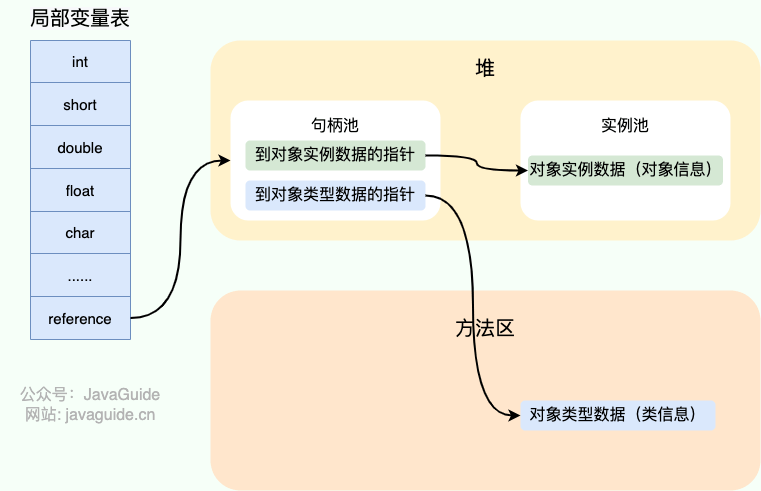

###### 直接指针

如果使用直接指针访问，reference 中存储的直接就是对象的地址
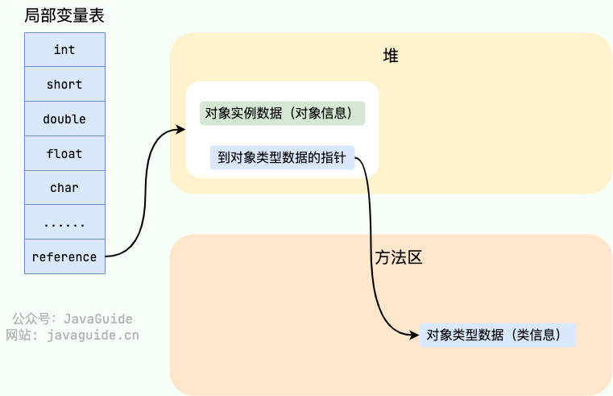

#### 方法区

存放：类的元数据（结构/字段/方法信息）、方法的字节码（原始指令序列）、运行时常量池（字面量与符号引用）

字符串常量池和静态变量从jdk1.7开始移到java堆了

jit代码缓存放到了独立的code cache区域

- 永久代 (PermGen) 替换为元空间的理由
    - 整个永久代有一个 JVM 本身设置的固定大小上限，无法进行调整（也就是受到 JVM 内存的限制），而元空间使用的是本地内存，受本机可用内存的限制，虽然元空间仍旧可能溢出，但是比原来出现的几率会更小
    - 元空间里面存放的是类的元数据，这样加载多少类的元数据就不由 MaxPermSize 控制了, 而由系统的实际可用空间来控制，这样能加载的类就更多了
    - 合并 HotSpot 和 JRockit 的代码时, JRockit 从来没有一个叫永久代的东西, 合并之后就没有必要额外的设置这么一个永久代的地方了
    - 永久代会为 GC 带来不必要的复杂度，并且回收效率偏低

##### 运行时常量池

运行时常量池是每个类独有的，由 Class 文件中的常量池转换而来，用于存放编译期生成的各种字面量和对类型、字段、方法的符号引用

字面量包括整数、浮点数和字符串字面量。常见的符号引用包括类符号引用、字段符号引用、方法符号引用、接口方法符号

##### 字符串常量池（String Intern Pool）

字符串常量池 是 JVM 为了提升性能和减少内存消耗针对字符串（String 类）专门开辟的一块区域，主要目的是为了避免字符串的重复创建

字符串常量池从jdk1.7开始不在方法区中了，移到java堆了

将字符串常量池移动到堆中主要是因为永久代（方法区实现）的 GC 回收效率太低，只有在整堆收集 (Full GC)的时候才会被执行 GC。Java 程序中通常会有大量的被创建的字符串等待回收，将字符串常量池放到堆中，能够更高效及时地回收字符串内存。

字符串常量池底层是一个StringTable，本质是一个固定长度的数组+链表结构的HashTable，key是字符串内容的hash，value是对象引用，指向堆中的字符串对象

字符串常量池里存放的是指向堆中某个String对象的引用

- 保证字符串变量s指向的是字符串常量池中的数据的两种方式
    - 1.字面量定义的方式：String s = "hello";
    - 2.调用intern方法：String s = xxxString.intern();

```sh
# 字符串常量池是一个哈希表
# 设置字符串常量池大小（jdk21默认65536，最小128）
-XX:StringTableSize=65536

# 打印字符串常量池统计信息
-XX:+PrintStringTableStatistics
```

#### 直接内存

直接内存是一种特殊的内存缓冲区，并不在 Java 堆或方法区中分配的，而是通过 JNI 的方式在本地内存上分配的

避免 Java 堆与 Native 堆来回复制数据，显著提高 I/O 性能，减少垃圾回收对应用的影响

#### JVM的运行时参数

##### 标准参数选项（以-开头）

这类参数选项比较稳定，后续版本基本不会变化

```sh
# 列出所有的标准参数
java --help

# 使用标准参数选项例子
java -version
```

##### -X参数选项

这类参数选项比较稳定，但是后续版本可能会变更

```sh
# 列出所有的-X参数选项
java -X

# 使用-X参数选项例子
# 采用解释器+即时编译器的混合模式执行程序
-Xmixed
```

##### -XX参数选项

是使用得最多的参数类型，这类选项属于实验性，不稳定

- 布尔类型格式

```sh
# 启用选项
-XX:+选项

# 禁用选项（有的选项默认是启用的，可以禁用）
-XX:-选项
```

- 非布尔类型格式(key-value类型)

```sh
# 数值类型格式
-XX:选项=数值

# 非数值类型格式
-XX:选项=字符串
```

- 列出所有的-XX参数名称和默认值

```sh
# 包括diagnostic和Experimental的参数
-XX:+PrintFlagsFinal -XX:+UnlockDiagnosticVMOptions -XX:+UnlockExperimentalVMOptions
```

##### 添加JVM参数选项

```sh
# 运行jar包
java [JVM参数选项1 JVM参数选项2 ... JVM参数选项n] -jar /path/to/file.jar

# Java程序运行过程中
# 设置布尔类型的JVM参数选项
jinfo -flag [+/-]JVM参数选项名称 进程id

# 设置非布尔类型的JVM参数选项
jinfo -flag JVM参数选项名称=值 进程id
```

##### 指定堆（新生代+老年代）大小

- 默认情况下，堆的初始内存大小为电脑的内存大小/64，堆的最大内存大小为电脑的内存大小/4

- 通常将堆的初始内存大小和堆的最大内存大小设置为相同的值，其目的是垃圾收集清理后不需要重新分隔机算堆区的大小，从而提高性能

- 获取默认堆内存大小，并计算电脑内存大小

```java
// 获取初始的堆内存大小
long initialHeapSize = Runtime.getRuntime().totalMemory();
// 获取最大堆内存大小
long maxHeapSize = Runtime.getRuntime().maxMemory();

System.out.println("初始堆内存大小: " + initialHeapSize / (1024 * 1024) + " MB");
System.out.println("最大堆内存大小: " + maxHeapSize / (1024 * 1024) + " MB");

System.out.println("电脑内存大小: " + initialHeapSize * 64 / (1024 * 1024 * 1024)  + " GB");
System.out.println("电脑内存大小: " + maxHeapSize * 4 / (1024 * 1024 * 1024)  + " GB");
```

```sh
# 指定堆的最小内存和初始内存(单位：g、m、k)
# memory start
-Xms4g

# 仅仅设置堆的初始内存(单位：g、m、k)，如果后面出现-Xms，则后者设置的堆初始内存生效
-XX:InitialHeapSize=2g

# 指定堆的最大内存(单位：g、m、k)，下面两种写法都行
# memory max
-Xmx8g

-XX:MaxHeapSize=8g
```

##### 指定新生代的大小

```properties
# 方法1
-XX:NewSize=512m
-XX:MaxNewSize=1024m

# 方法2（NewSize，MaxNewSize设置为一致），这种方式很少用，通常都是指定堆大小和老年代/新生代的比例的方式
-Xmn512m

# 方法3，设置老年代/新生代内存的比例，在Xms=Xmx并且设置了Xmn的情况下，该参数不需要进行设置，如果设置了也是-Xmn指定的新生代大小生效
# 表示老年代占n（默认是2），新生代占1，新生代占整个堆的1/(1+n)
-XX:NewRatio=n

# 表示eden/两个survivor的比例，默认8:1:1
# 但是如果不显式指定比例，就算加上-XX:-UseAdaptiveSizePolicy，默认的比例也是不生效的
# 如果显示指定比例，就算-XX:+UseAdaptiveSizePolicy，也是手动指定的比例生效
-XX:SurvivorRatio=8

# 关闭（关闭用减号，开启用加号）自适应的内存分配策略
# 建议启用，不要手动指定SurvivorRatio
-XX:-UseAdaptiveSizePolicy
```

##### 指定对象晋升到老年代的年龄阈值

```properties
# 默认是15，一般不会去改
-XX:MaxTenuringThreshold=15
```

##### 空间分配担保

- 在Minor GC前，JVM会检查老年代最大可用的连续空间是否大于新生代所有对象的总空间
    - 如果大于，进行一次Minor GC（安全）
    - 如果小于，JVM则继续检查老年代最大可用的连续空间是否大于历次晋升到老年代的对象的平均大小
        - 如果大于，进行一次Minor GC（有风险）
        - 如果小于，进行一次Full GC

```properties
# 是否设置空间分配担保（jdk6 update24后这个参数不会再影响jvm的空间分配担保策略，相当于这个值无论设置与否都是true）
-XX:HandlePromotionFailure
```

##### 指定元空间的大小

对于一个64位的服务器端JVM来说，默认的-XX:MetaspaceSize值为21MB

这就是初始的高水位线，一旦触及这个水位线，将触发Full GC并卸载没用的类，以及这些类对应的类加载器，然后这个高水位线将会重置

新的高水位线的值取决于GC后释放了多少元空间内存

如果释放的内存不足，那么在不超过-XX:MaxMetaspaceSize时，适当提高该值

如果释放的内存过多，则适当降低该值

如果初始化的高水位线设置过低，上述高水位线调整情况会发生多次

为了避免频繁Full GC，建议将初始高水位线设置为一个相对较高的值

```properties
# 首次触发 Full GC 的元空间的阈值，非元空间初始大小
-XX:MetaspaceSize=1024m

# 元空间的最大大小，默认值为unlimited，只受系统内存的限制，一般不做改动
-XX:MaxMetaspaceSize=2048m

# 禁用类卸载
-XX:+NoClassGC

# 允许类卸载（默认开启），-XX:+NoClassGC优先级更高
-XX:+ClassUnloading

# 打印类加载信息
-XX:+TraceClassLoading

# 打印类卸载信息
-XX:+TraceClassUnloading
```

##### 记录GC活动

###### GC相关的参数选项

```sh
# 打印GC简要信息1
-XX:+PrintGC

# 打印GC简要信息2
-verbose:gc

# 打印GC简要信息3
-Xlog:gc

# 打印GC详情1
-XX:+PrintGCDetails

# 打印进程执行时间，不能单独使用，要加上打印GC的参数一起使用，如-XX:+PrintGCDetails
-XX:+PrintGCTimeStamps

# 打印系统时间（包括时区信息），不能单独使用，要加上打印GC的参数一起使用，如-XX:+PrintGCDetails
-XX:+PrintGCDateStamps

# 打印GC详情2
-Xlog:gc*

# 输出GC信息到指定文件
-Xlog:gc:文件名

# 输出GC详情到控制台，并且包含时间信息
-Xlog:gc*:stdout:time

# 把GC日志写入到一个文件中去，而不是打印到标准输出中
-Xloggc:/.../gc.log

# 启用GC日志文件的自动转储
-XX:+UseGCLogFileRotation 

# GC日志文件的循环数目
-XX:NumberOfGCLogFiles=1 

# GC日志文件的大小
-XX:GCLogFileSize=100m

# 打印GC时线程的停顿时间
-XX:+PrintGCApplicationStoppedTime

# 每次GC前和GC后，都打印堆信息
-XX:+printHeapAtGC
```

###### GC日志格式

- GC日志中有三个时间
    - user：CPU执行用户态代码（核心之外）所使用的时间
    - sys：进程在内核态消耗的CPU时间，即在内核执行系统调用或等待系统事件所使用的CPU时间
    - real：此次GC事件从开始到结束所用的时间
        - 由于多核的存在，一般的GC事件中，real是小于sys+user的
        - 如果real大于sys+user，则应用可能存在IO负载非常重或是CPU不够用


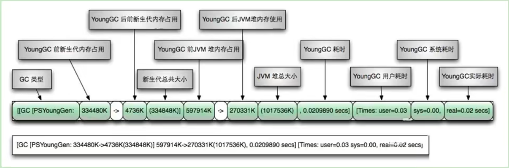

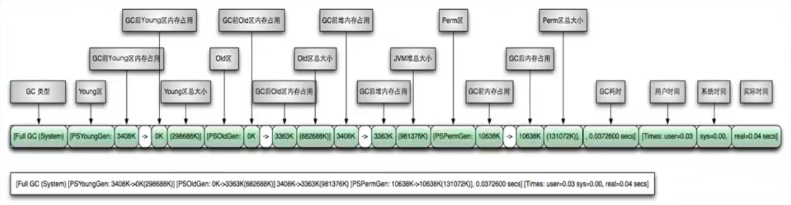

- 日志中的垃圾收集器
    - DefNew：Seriall收集器（Default New Generation）
    - ParNew：ParNew收集器
    - PSYoung：Parallel Scanvenge收集器
    - 老年代和新生代同理

- 日志中的新生代总容量，是整个新生代的9/10,因为幸存者区有一个是空着的，没算进去
- 日志中的堆内存总容量=9/10新生代+老年代，因此是小于初始化的内存大小的
- 日志中的Full GC（GC发生的原因）
    - Metadata GC Threshold：元空间不够用了
    - Ergonomics：JVM自适应调整导致的GC
    - System：调用了System.gc()方法

##### 逃逸分析

在JDK 6u23版本之后，HotSpot默认开启了逃逸分析

```properties
# 开启逃逸分析
-XX:+DoEscapeAnalysis

# 查看逃逸分析的筛选结果
-XX:+PrintEscapeAnalysis
```

##### 同步省略

JIT编译器借助逃逸分析来判断同步块所使用的锁对象是否只能够被一个线程访问，而没有被发布到其他线程，

如果是，那么JIT编译器在编译这个同步块的时候就会取消对这部分代码的同步，

这个取消同步的过程就叫同步省略，也叫锁消除

##### 标量替换

- 标量是指无法再分解成更小的数据的数据

- 在Java中，基本数据类型的数据就是标量，引用数据类型的数据就是聚合量

- 在JIT阶段，如果分析到对象未逃逸，就会把这个对象拆解成若干个标量，这个过程就是标量替换（它是栈上分配的一种特例）

```properties
# 开启标量替换（默认打开），允许将（未逃逸）对象打散分配在栈上
-XX:+EliminateAllocations
```

##### OOM相关的JVM参数选项

```sh
# 在OOM的时候生成dump文件
-XX:+HeapDumpOnOutOfMemoryError 

# 在Full GC发生前生成dump文件（OOM之前肯定会FULL GC，所以可能会看到多个dump文件）
-XX:+HeapDumpBeforeFullGC

# 不指定-XX:HeapDumpPath，则在当前目录下生成dump文件
# 指定一个目录就行，如果指定一个文件，OOM时将覆盖该文件内容
-XX:HeapDumpPath=/path

# 当OOM时要执行的命令或脚本的路径，比如重启服务
-XX:OnOutOfMemoryError="echo OOM"
-XX:OnOutOfMemoryError=/path/to/file.sh
```

##### 其它jvm设置

```sh
# 设置栈内存大小
-Xss1024K

# 禁止hotspot执行System.gc()，默认
-XX:+DisableExplicitGC

# 指定代码缓存大小
-XX:InitialCodeCacheSize=512m
-XX:ReservedCodeCacheSize=512m

# 启用代码缓存刷新，让JVM放弃一些被编译的代码
# 避免代码缓存被占满时JVM切换到只解释执行的情况
-XX:+UseCodeCacheFlushing

# 开启逃逸分析
-XX:+DoEscapeAnalysis

# 开启偏向锁
-XX:+UseBiasedLocking

# 开启使用大页面
-XX:+UseLargePages

# 开启TLAB空间（TLAB在Eden空间中，每个线程有自己的TLAB空间）
-XX:+UseTLAB

# 设置TLAB的大小
-XX:TLABSize=1m

# 打印TLAB的使用情况
-XX:+PrintTLAB

# 设置TLAB空间占Eden空间的百分比，默认TLAB仅占整个Eden空间的1%
# 一旦对象在TLAB空间分配内存失败，JVM就会使用加锁机制，在Eden空间分配内存
-XX:TLABWasteTargePercent

# 查看所有参数的默认初始值
-XX:+PrintFlagsInitial

# 查看所有参数的最终值（可能存在修改，不再是初始值）
# =的是默认值，:=的是赋值过的
-XX:+PrintFlagsFinal

# 查看已经被用户或者JVM设置过的详细的参数名称和值
-XX:+PrintCommandLineFlags

# 设置可使用的最大直接内存，默认与堆空间最大值（-Xmx参数值）一致
# java进程使用的内存可以简单看成等于java堆+直接内存
-XX:MaxDirectMemorySize=1g

# 方法被调用超过n次后，触发JIT编译
-XX:CompileThreshold=n

# 当超过一定的时间限度，如果方法的调用次数仍然不足以让它提交给即使编译器编译，这个方法的调用计数器就会被减少一半
# 这个过程称为方法调用计数器热度的衰减
# 而这段时间就称为半衰周期
# 热度衰减的动作是在垃圾收集时顺便进行的
# 关闭热度衰减
-XX:-UseCounterDecay

# 设置半衰周期的时间，单位是秒
-XX:CounterHalfLifeTime=60

# 完全采用解释器模式执行程序
-Xint

# 完全采用即时编译器模式执行程序，如果即时编译出问题，解释器会介入执行
-Xcomp

# 采用解释器+即时编译器的混合模式执行程序
-Xmixed

# java14开始，启用可以在空指针异常时获取详细的调用信息
# 更往后的版本这个选项是默认开启了的
-XX:+ShowCodeDetailsInExceptionMessages
```

##### 建议的jvm选项参数整合

垃圾收集器的选项参数根据具体的垃圾收集器来设置

```sh
# 根据具体物理内存情况，将 -Xms 和 -Xmx 设为一致，避免调整开销
# 指定堆的最小内存和初始内存(单位：g、m、k)
# memory start
-Xms4g

# 指定堆的最大内存(单位：g、m、k)，下面两种写法都行
# memory max
-Xmx4g

# OOM异常终止时自动导出dump文件
-XX:+HeapDumpOnOutOfMemoryError -XX:HeapDumpPath=/path/to/dumpfile.hprof

# (JDK 8u20+) 尝试识别并共享底层 char[] 数组相同的 String 对象，以减少内存占用
# 适用于存在大量重复字符串的场景
-XX:+UseStringDeduplication

# 禁止代码中显式调用 System.gc()，避免人为触发不必要的 Full GC，默认
-XX:+DisableExplicitGC

# java25开始，可以启用紧凑对象头，减少堆内存占用
# java27开始，HotSpot JVM默认启用紧凑对象头
-XX:+UseCompactObjectHeaders

# ‌强制 JavaFX 使用软件渲染模式（Software Rendering）‌，而不是默认的硬件加速渲染（GPU 渲染）
# 对于桌面应用建议设置为软件渲染模式，启动更快
# -D‌：表示设置一个系统属性（System Property）
# prism.order‌：JavaFX 图形引擎 ‌Prism‌ 的核心配置项，用于指定渲染管道（Pipeline）的尝试顺序
# sw‌：代表 ‌Software‌（软件渲染）
-Dprism.order=sw 
```

#### 垃圾收集

##### 相关概念

- JVM在进行垃圾收集时，并非每次都对新生代、老年代和方法区的内存进行收集，大多数时候收集的都是新生代的内存

- 部分收集
    - 新生代收集（Minor GC/Young GC）：新生代（Eden/S0、S1）的垃圾收集
    - 老年代收集（Major GC/Old GC）：老年代的垃圾收集
        - 除了并行收集器（如CMS GC）有只单独收集老年代的收集策略，老年代收集经常伴随至少一次的新生代收集
        - 老年代收集后，如果内存还是不足，就报OOM了
- 混合收集（Mixed GC）：整个新生代以及部分老年代的垃圾收集
    - G1 GC就会混合收集
- 整堆收集（Full GC）：整个Java堆和方法区的垃圾收集

- `System.gc()`(方法内部调用`Runtime.getRuntime().gc()`)，系统会建议执行`Full GC`，但是不是必然执行

- 内存溢出（OOM）：没有空闲内存，并且垃圾收集也无法提供更多内存

- 内存泄漏（Memory Leak）：狭义上，对象不会再被程序用到，但是GC又不能将其回收的情况；广义上，不规范的对象声明和定义，导致其生命周期变得很长最终导致OOM的情况

- 垃圾收集的并行：多个垃圾收集线程并行工作，但此时的用户线程处于等待状态

- 垃圾收集的串行：单个垃圾收集线程进行工作，但此时的用户线程处于等待状态

- 垃圾收集的并发：垃圾收集线程和用户线程同时执行（不一定是并行，可能交替执行），垃圾收集线程执行时不会停顿用户线程的执行

###### 安全点

- 程序执行时并非在所有地方都能停顿下来开始GC，只有在特定的位置才可以，这些位置称为`安全点（Safe Point）`

- 安全点的选择很重要，如果太少可能导致GC等待的时间太长，如果太多可能导致运行时的性能问题

- 通常选择一些执行时间较长的指令作为安全点，如方法调用、循环跳转和异常跳转等

- 如何在GC发生时，检查所有线程都跑到最近的安全点停下来呢？
    - 抢先式中断（目前没有虚拟机采用了）：先中断所有线程，如果还有线程不在安全点，就将线程恢复让其跑到安全点
    - 主动式中断：设置一个中断标志，各线程运行到安全点的时候主动轮询这个标志，如果为真，则将自己中断挂起

###### 安全区域

- 在一段代码片段中，对象的引用关系不会发生变化，在这个区域中的任何位置开始GC都是安全的，这个区域就是`安全区域（Safe Region）`

- 安全区域可以看作时可扩展了的安全点

- 安全点机制保证了程序执行时，在不太长的时间内就会遇到可进入的GC安全点

- 在程序“不执行”时，如线程处于Sleep或Blocked状态时，无法响应JVM的中断请求，走到安全点去中断挂起，JVM也不太可能等待线程被唤醒。这种情况，就需要安全区域来解决了

- 机制
    - 当线程运行到安全区域的代码时，首先表示已经进入了安全区域，如果这段时间内发生GC，JVM会忽略进入安全区域状态的线程
    - 当线程即将离开安全区域时，会检查JVM是否已经完成GC，如果完成了，则继续执行，否则线程必须等待直到收到可以离开安全区域的信号为止

###### 强引用、软引用、弱引用和虚引用

特别注意，在程序设计中一般很少使用弱引用与虚引用，使用软引用的情况较多，这是因为软引用可以加速 JVM 对垃圾内存的回收速度，可以维护系统的运行安全，防止内存溢出（OutOfMemory）等问题的产生

|引用类型|GC是否回收|描述|
|:-|:-|:-|
|强引用|不回收|使用new操作符创建一个新的对象，并将其赋值给一个变量，这个变量就成为指向该对象的一个强引用|
|软引用|内存不足才回收，回收后还是不够，就会抛出OOM|通常用来实现内存敏感的缓存|
|弱引用|发现即回收，只能生存到下一次垃圾收集发生|和软引用一样，适合保存可有可无的缓存数据|
|虚引用|如果一个对象只有虚引用，那么它和没有引用几乎一样，随时可能被回收，虚引用不能单独使用，无法通过虚引用来获取被引用的对象，试图通过调用get方法获得对象时，总是返回null|对象回收跟踪，比如能在这个对象被回收时收到一个系统通知|
|终结器引用|jdk17之后可以忘了finalize()方法了，只做了解|在GC时，终结器引用入队。由Finalizer线程通过终结器引用找到对象并调用它的finalize()方法，第二次GC时才能回收被引用对象|

- 强引用的对象只要是可达的，垃圾收集器就永远不会回收被引用的对象

- 而软引用、弱引用和虚引用的可达的的对象，在一定条件下，也都是可以被回收的

```java
// 创建一个对象并建立软引用
SoftReference<UserVo> softReference = new SoftReference<>(new UserVo("handle"));
// 从软引用中获得对象
System.out.println(softReference.get());

// 创建一个对象，建立弱引用
WeakReference<UserVo> weakReference = new WeakReference<>(new UserVo("handle"));
// 从弱引用中获得对象
System.out.println(weakReference.get());

// WeakHashMap的键是弱引用
WeakHashMap<String, String> weakHashMap = new WeakHashMap<>();
weakHashMap.put(new String("k1"), "v1");
System.out.println(weakHashMap);

// 虚引用必须和引用队列一起使用
// 当垃圾收集器准备回收一个对象时，如果发现它还有虚引用
// 就会在回收对象后，将这个虚引用加入到引用队列中，以通知应用程序对象的回收情况
// 由于虚引用可以跟踪对象的回收时间，因此可以将一些资源释放的操作放置在虚引用中执行和记录
ReferenceQueue<UserVo> phantomQueue = new ReferenceQueue<>();
PhantomReference<UserVo> phantomReference = new PhantomReference<>(new UserVo("handle"), phantomQueue);
// 虚引用的get方法总是返回null，无法通过虚引用获取对象
System.out.println(phantomReference.get());
```

###### GC的性能指标

- 吞吐量（throughput）：CPU用于运行用户代码的时间与CPU总消耗时间的比值，即吞吐量=运行用户代码时间/（运行用户代码时间+垃圾收集时间）

- 暂停时间（pause time）：一个时间段内应用程序暂停，让GC线程执行的时间

##### 垃圾收集算法

- 垃圾标记阶段
    - 引用计数算法（Python）
        - 缺点：循环引用问题。解决：手动解除循环引用、使用弱引用
    - 可达性分析算法（Java、C#）
        - 根集合（GC Roots）：一组必须活跃的引用
        - 思路：按照从上到下的方式搜索被根对象集合所连接的目标对象是否可达
        - 可以作为GC Root的元素
            - 虚拟机栈中引用的对象
            - 本地方法栈内引用的对象
            - 方法区中类静态属性引用的对象
            - 方法区中常量引用的对象
                - 如字符串常量池里的引用
            - 所有被同步所持有的对象
            - 虚拟机内部的引用
                - 基本数据类型对应的Class对象
                - 一些常驻的异常对象（NullPointerException、OutOfMemoryError）
                - 系统类加载器
            - 反映虚拟机内部情况的JMXBean、JVMTI中注册的回调、本地代码缓存等

- 垃圾清除阶段
    - 标记-清除算法（标记可达对象，在对象的Header中记录，然后遍历堆内存的对象，如果某个对象的Header中没有标记其为可达对象，则将其清除）
    - 标记-复制算法
    - 标记-压缩算法

- 分代收集算法：新生代用标记-复制算法，老年代用标记-清除或标记-压缩算法

- 增量收集算法：垃圾收集线程每次只收集一部分，与用户线程交替执行

- 分区算法（G1）：将整个堆空间划分成连续的不同小区间，每个小区间都独立使用和独立回收，每次回收若干个小区间

##### 垃圾收集器

- 串行收集器：Serial、Serial Old

- 并行收集器：ParNew、Parrallel Scavenge、Parrallel Old

- 并发收集器：CMS（jdk14中已删除）、G1

- 新生代收集器：Serial、ParNew、Parrallel Scavenge

- 老年代收集器：Serial Old、Parrallel Old、CMS（jdk14中已删除）

- 整堆收集器：G1

- 垃圾收集器组合
    - Serial和Serial Old
    - Serial和CMS（jdk8中废弃，但是还能用，jdk9中开始不能用）
    - ParNew和CMS
    - ParNew和Serial Old（jdk8中废弃，但是还能用，jdk9中开始不能用）
    - Parrallel Scavenge和Parrallel Old
    - Parrallel Scavenge和Serial Old（jkd14中废弃，但是还能用）
    - CMS和Serial Old：CMS失败时Serial Old接手垃圾收集
    - 只用G1

###### Serial GC

- Serial收集器是最基本，历史最悠久的垃圾收集器

- Serial收集器还提供用于执行老年代垃圾收集的Serial Old

- 他们是HotSpot中Client模式下默认的新生代和老年代垃圾收集器

- Serial和Serial Old都采用串行回收（单CPU，单线程完成收集工作）和“Stop the World”机制

- Serial采用标记-复制算法，Serial Old采用标记-压缩算法

- Serial Old主要的两个用途
    - 与新生代垃圾收集器Parrallel Scavenge配合使用
    - 作为老年代垃圾收集器CMS的后备垃圾收集方案

- 在单核CPU的时候才有优势，对于交互较强的应用而言，这种收集器是不能接受的，一般在java web应用程序中也不会采用串行垃圾收集器

```sh
# Serial GC垃圾收集器，新生代用Serial GC，老年代用Serial Old GC
-XX:+UseSerialGC
```

###### ParNew GC

- Par是Parrallel的缩写，New表示收集新生代的垃圾

- 可以看作是Serial收集器的多线程版本，采用标记-复制算法和STW机制

- 是很多JVM运行在Server模式下，新生代默认的收集器

```sh
# ParNew垃圾收集器，新生代使用ParNew GC，不影响老年代
-XX:+UseParNewGC

# 指定垃圾收集线程数量，默认和CPU相同的线程数
-XX:ParrallelGCThreads=2
```

###### Parallel GC

- Parallel Scavenge和Parallel Old也是并行的垃圾回收器，也使用STW机制

- Parallel Old是jdk1.6时提供的用于代替Serial Old的老年代垃圾收集器

- Parallel Scavenge采用标记-复制算法，Parallel Old采用标记-压缩算法

- 和ParNew不同的是，它是`吞吐量优先`的垃圾收集器，以及它有自适应调节策略（动态内存调整分配）

- 高吞吐量可以高效率地利用CPU时间，尽快完成程序的运算任务，主要适合在后台运算而不需要太多交互的任务。因此，常见在服务器环境中使用，例如批处理、订单处理、工资支付、科学计算

- jdk8中默认是此垃圾收集器

```sh
# 新生代用Parallel Scavenge，老年代用Parallel Old，与UseParallelOldGC互相激活
-XX:+UseParallelGC

# 新生代用Parallel Scavenge，老年代用Parallel Old，与UseParallelGC互相激活
-XX:+UseParallelOldGC

# 垃圾收集器的线程数，一般最好与CPU相等
# 默认情况下，当CPU数量小于8时，它等于CPU数量
# 当CPU数量大于8时，它等于3+[5*CPU数量]/8
-XX:ParallelGCThreads=8

# 垃圾收集器最大停顿的毫秒时间（STW的时间），慎用
-XX:MaxGCPauseMillis=20

# 垃圾收集时间占总时间的比例=1/(n+1)，这里指的是这个n的值，取值范围(0,100)，默认99, 也就是垃圾收集时间不超过1%
-XX:GCTimeRatio=99

# 开启Parallel Scavenge的自适应调节策略
# 新生代的大小、Eden和Survivor的比例、晋升老年代的年龄等参数会被自动调整，以达到在堆大小、吞吐量和停顿时间之间的平衡点
# 在手动调优比较困难的场合，可以开启它，仅指定虚拟机的最大堆、目标吞吐量和停顿时间，让虚拟机自己完成调优工作
-XX:+UseAdaptiveSizePolicy
```

###### CMS（Concurrent Mark Sweep）

- jdk1.5时推出的第一款真正意义上的并发收集器，第一次实现了垃圾收集线程和用户线程同时工作

- CMS的关注点时尽可能缩短垃圾收集时用户线程的`停顿时间（低延迟）`

- CMS采用标记-清除算法和STW机制，对`老年代`垃圾进行收集

- 工作原理
    - 初始标记：用户线程短暂暂停，标记出GC Roots能直接关联到的对象，一旦标记完成就恢复用户线程。由于直接关联的对象比较少，所以这个阶段很快完成

    - 并发标记：从GC Roots的直接关联对象开始遍历整个对象图，这个过程耗时较长但是不需要停顿用户线程，可以与垃圾收集线程并发执行

    - 重新标记：由于在并发标记阶段中，用户线程和垃圾收集线程同时运行或交叉运行，因此为了修正并发标记期间，因用户线程继续执行导致标记产生变动的那部分对象的标记记录，这个阶段的停顿时间通常比初始标记阶段稍长，但也远比并发标记阶段花的时间短

    - 并发清除：清理标记阶段判断的已死亡的对象，释放内存。由于不需要移动存活对象，所以这个阶段也可以与用户线程并发执行

- 由于在垃圾收集阶段用户线程没有中断，因此，CMS不能像其它收集器那样等到老年代几乎满了再进行收集，而是当堆内存使用率达到某个阈值时，就要开始进行垃圾收集，以确保CMS垃圾收集期间，用户线程有足够的内存使用。要是CMS垃圾收集期间，预留的内存无法满足程序需要，就会出现一次“Concurrent Mode Failure”失败，这时虚拟机将启动后备预案：临时启用Serial Old收集器来重新进行老年代的垃圾收集，这样停顿时间就很长了

- 弊端
    - 会产生内存碎片，在无法分配大对象的情况下，提前触发Full GC
    - 占用一部分CPU线程，导致应用程序变慢，吞吐量降低
    - 在并发标记阶段如果产生新的垃圾，无法及时回收

```sh
# CMS垃圾收集器，将激活-XX:+UseParNewGC
# 形成组合：新生代ParNew，老年代CMS和SerialOld（备用）
-XX:+UseConcMarkSweepGC

# 堆（指老年代）内存使用率的阈值，一旦到达，CMS便会进行垃圾收集
# jdk5及以前默认值时68，jdk6及以上默认值是92
# 如果内存增长缓慢，可以设置一个稍大的值，降低CMS频率
# 如果内存增长较快，则应该设置为稍小的值，避免频繁Serial Old，进而有效降低Full GC次数
-XX:CMSlnitiatingOccupancyFraction=92

# 在执行完Full GC后对内存进行压缩整理避免内存碎片产生，但是会让停顿时间变长
-XX:+UseCMSCompactAtFullCollection

# 在执行多少次Full GC后对内存空间进行压缩整理
-XX:CMSFullGCsBeforeCompaction=3

# CMS的线程数量，默认（ParallelGCThreads + 3）/ 4
-XX:ParallelCMSThreads=2
```

###### G1（Garbage First） GC

- G1是一个并行收集器，它把堆内存分割为很多不相关的且物理上不连续的区域（Region），使用不同的区域来表示Eden、S0、S1, 老年代，Humongous（G1新增的内存区域，存放超过1.5个region的大对象）

- 设置Humongous的原因：对于堆中的大对象，默认直接分配到老年代，但是如果它是一个短期存在的大对象，就会堆垃圾收集器造成负面影响。为此G1划分出Humongous专门存放大对象。如果1个H区装不下一个大对象，G1会寻找连续的H区来存储。为了能找到连续的H区，有时候不得不启动Full GC。G1的大多数行为都把H区作为老年代的一部分来看待

- G1有计划地避免在整个Java堆中进行全区域的垃圾收集。G1跟踪各个区域里面的垃圾堆积的价值大小（收集所获得的空间大小以及所需时间的经验值），在后台维护一个优先列表，每次根据允许的收集时间，优先收集价值最大的区域

- G1是面向服务端应用的垃圾收集器，主要针对配备多核CPU及大容量内存的机器，以`极高概率满足GC停顿时间的同时，还兼具高吞吐量`的性能特征

- HotSpot垃圾收集器里，除了G1外，其它的都使用内置的JVM线程执行GC的多线程操作，而G1可以采用应用线程承担后台运行的GC工作，即当JVM的GC线程处理速度慢时，系统会调用应用程序线程帮助加速垃圾回收过程

- jdk1.7版本正式启用G1，jdk9为默认的垃圾收集器

- 在下面的情况下，使用G1可能比CMS好：
    - 超过50%的Java堆被活动数据占用
    - 对象分配频率或年代提升频率变化很大
    - GC停顿时间过长（长于0.5-1s）

- G1特点
    - 兼具并行与并发
    - 分代型垃圾收集器，兼顾新生代和老年代
    - 垃圾收集以区域为基本单位，区域之间是标记-复制算法，整体上可以看作是标记-压缩算法，都能避免内存碎片
    - 每次根据允许的收集时间，优先收集价值最大的区域，保证在有限的时间内获取尽可能高的收集效率
        - 相比CMS，G1未必能做到CMS在最好的情况下的停顿，但是比CMS最差情况下的停顿要好很多

- G1提供了3种垃圾回收模式：YoungGC、Mixed GC和Full GC，在不同条件下触发

- G1 GC垃圾收集过程主要包括如下三个环节
    - 新生代GC，是一个并行的独占式收集器，当Eden区用尽时开始这个过程
    - （新生代GC和）老年代并发标记过程（Concurrent Marking），当堆内存使用达到一定值（默认45%）时，开始这个过程
    - 混合收集（Mixed GC），标记完成就马上开始这个过程，一次只需要回收一部分老年代的Region，它和新生代一起被回收
    - Full GC（如果需要，单线程、独占式、高强度的Full GC还是继续存在的，它针对GC的评估失败提供了一种失败保护机制，即强力回收）

- G1的设计原则就是简化JVM性能调优，只需要以下三步即可完成调优
    - 开启G1垃圾收集器
    - 设置堆的最大内存
    - 设置最大的停顿时间

```sh
# 启用G1垃圾收集器
-XX:+UseG1GC

# 设置每个Region的大小，值是2的幂，范围1MB-32MB之间，默认是堆内存的1/2000
# 目标是根据最小的Java堆大小划分出约2048个区域
-XX:G1HeapRegionSize=1m

# 期望达到的最大GC停顿时间（JVM会尽力实现，但不保证达到），默认是200ms
-XX:MaxGCPauseMillis=200

# 并行（会STW）的垃圾收集线程数, 最多是8
-XX:ParallelGCThreads=8

# 并发的垃圾收集线程数，一般为ParallelGCThreads的1/4左右
-XX:ConcGCThreads

# 触发并发GC周期的Java堆占用率阈值，超过这个值就触发GC，默认45
-XX:InitiatingHeapOccupancyPercent=45

# G1就不要用-Xmn和-XX:NewRatio来设置新生代了
# 新生代占用整个堆内存的最小百分比（默认5%）
-XX:G1NewSizePercent
# 新生代占用整个堆内存的最大百分比（默认60%）
-XX:G1MaxNewSizePercent

# 保留内存区域，防止Survivor中的to区溢出
-XX:G1ReservePercent=10

# 设置堆占用率的百分比（0-100），达到这个数值的时候触发全局并发标记
# 默认45%，值为0表示间断进行全局并发标记
-XX:InitiatingHeapOccupancyPercent

# 设置老年代的region被回收时的对象占比，默认85%
# 只有老年代的region中存活的对象占用达到了这个值，才会在Mixed GC中被回收
-XX:G1MixedGCLiveThresholdPercent

# 在全局并发标记结束后，可以知道所有的区有多少空间要被回收
# 每次Young GC之后再次发生Mixed GC之前，会检查垃圾占比是否达到这个值
# 只有达到了，下次才会发生Mixed GC
-XX:G1HeapWastePercent

# 一次全局并发标记之后，最多执行Mixed GC的次数，默认8
-XX:G1MixedGCCountTarget

# 设置Mixed GC收集周期中要收集的老年代region数的上限，默认是Java堆的10%
-XX:G1OldGCSetRegionThresholdPercent
```

###### ZGC

- ZGC采用标记-复制算法，不过 ZGC 对该算法做了重大改进

```sh
# 使用ZGC垃圾收集器，并启用分代ZGC功能
-XX:+UseZGC -XX:+ZGenerational
```

###### Shenandoah GC

```sh
# java15开始，可以使用Shenandoah GC
# java25开始，可以使用分代 Shenandoah GC
-XX:+UseShenandoahGC -XX:ShenandoahGCMode=generational
```

###### 查看默认的垃圾收集器

```sh
# 查看命令行相关参数
-XX:+PrintCommandLineFlags

# 查看具体垃圾收集器参数的值
jinfo -flag 垃圾收集器参数（如：UseG1GC） 进程id
```

###### 垃圾收集器组合

有线连接的都是可以组合来用，虚线表示过时的组合

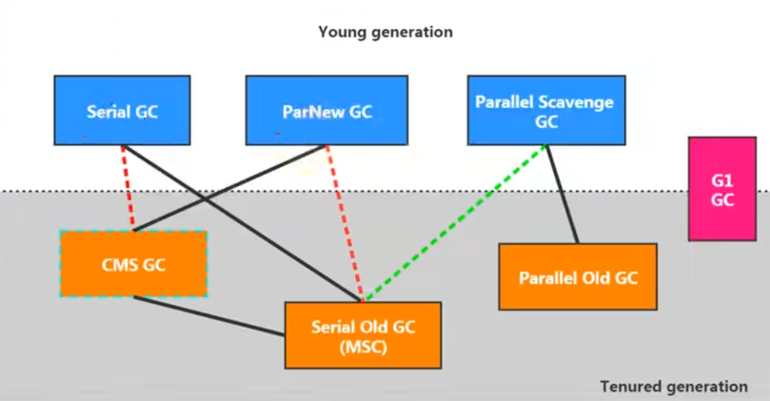

#### 性能调优

##### 性能调优目的

减少GC频率，减少Full GC出现次数，以较小的内存获得较低的延迟或较高的吞吐量

##### 性能调优指标

对于web应用来说，响应时间和吞吐量是最看重的两个指标

- 1.响应时间
- 2.吞吐量
- 3.并发数
- 4.堆内存占用

##### 性能调优步骤

- 1.性能监控
    - GC频繁
    - CPU Load过高
    - OOM
    - 内存泄漏
    - 死锁
    - 程序响应时间较长
- 2.性能分析
    - 打印GC日志
    - 命令行工具：jstack，jmap，jinfo等
    - dump出堆文件，使用内存分析工具分析
    - 使用jconsole，jvisualvm来查看jvm状态
- 3.性能性能调优
    - 适当增加内存，根据业务背景选择垃圾回收器
    - 优化代码，控制内存使用
    - 增加机器，分散节点压力
    - 合理设置线程池线程数量
    - 使用中间件提高程序效率，如缓存，消息队列等

##### 性能调优工具

###### jps(JVM Process Status）

```sh
# jps（Java Process Status）查看当前正在运行的java进程信息
# -q：只显示进程id
# -l：显示完整的进程名称（如主类全限定类名、jar包的完整路径）
# -m：显示进程启动时传递给main方法的参数
# -v：显示进程启动时指定的JVM参数
# hostid：由hostname[:port]构成，适用于监控远程主机上的java程序
# 如果要监控远程主机上的java程序，还需要安装jstatd，但是要考虑到安全问题
# 比如虽然设置了可信主机或网络的访问，但是也容易受到ip地址欺诈攻击
# 除了-q只能单独使用外其它参数可以组合使用
# 如果进程使用了-XX:-UsePerfData参数，则jpa、jstat将无法获取到该进程
jps -lmv
```

###### jstat（JVM Statistics Monitoring Tool）

jstat：JVM Statistics Monitoring Tool

作用：查看JVM统计信息（进程内存使用和垃圾收集信息）

用法：`jstat -<option> [-t] [-h<lines>] <vmid> [<interval> [<count>]]`

- option：选项，可以用jstat -options查看所有的选项

|序号|选项|描述|
|:-|:-|:-|
|1|-class|显示类加载/卸载的信息，如：类加载/卸载数量，占用空间，消耗的时间等|
|2|-compiler|显示jit编译器编译过的方法、耗时等信息|
|3|-gc|显示垃圾收集相关的信息，如Eden、两个Survivor、老年代、元空间等的容量，已用空间、GC时间合计等信息|
|4|-gccapacity|显示内容与-gc基本相同，但输出主要关注java堆各个区域使用到的最大、最小空间|
|5|-gccause|显示内容与-gcutil一样，但是会额外输出导致最后一次或当前正在发生的GC的原因|
|6|-gcmetacapacity|显示元空间使用到的最大、最小空间|
|7|-gcnew|显示新生代GC信息|
|8|-gcnewcapacity|显示内容与-gcnew基本相同，但主要关注使用到的最大、最小空间|
|9|-gcold|显示老年代GC信息|
|10|-gcoldcapacity|显示内容与-gcold基本相同，但主要关注使用到的最大、最小空间|
|11|-gcutil|显示内容与-gc基本相同，但输出主要关注已使用空间占总空间的百分比|
|12|-printcompilation|显示已经被jit编译的方法|

- `-t`：在输出的信息前加上时间（从进程启动开始算起），单位为秒
    - 可以比较进程的启动时间和总GC时间，或者两次测量的间隔时间，得出GC时间占运行时间的比例
        - 如果该比例超过20%，说明目前堆的压力较大
        - 如果该比例超过90%，说明堆里几乎没有可用空间了，随时可能OOM

- `-h`：在周期性数据输出时，输出多少行后输出一行表头

- vmid：虚拟机id，也就是进程id

- interval：用于指定输出统计数据的周期，即查询间隔，单位为毫秒

- count：用于指定查询的总次数

```sh
jstat [指定option] [-t] -h[指定行数] 进程id [指定interval] [指定count]
```

- `-gc`的表头描述
    - S0C：幸存者0区容量
    - S1C：幸存者1区容量
    - S0U：幸存者0区已使用的空间
    - S1U：幸存者1区已使用的空间
    - EC：伊甸园区容量
    - EU：伊甸园区已使用的空间
    - OC：老年代容量
    - OU：老年代已使用的空间
        - 可以每隔一段较长时间获取多组-gc数据，每一组看OU最小值
            - 如果这些值呈上涨趋势，说明老年代使用的空间在不断上涨
            - 意味着无法回收的对象在不断增加，有可能存在内存泄漏
    - MC：方法区容量
    - MU：方法区已使用的空间
    - CCSC：压缩类的容量
    - CCSU：压缩类已使用的空间
    - YGC：Young GC发生的次数
    - YGCT：Young GC花费的时间
    - FGC：Full GC发生的次数
    - FGCT：Full GC花费的时间
    - GCT：总的GC时间（Young GC花费的时间 + Full GC花费的时间）

###### jinfo (Configuration Info for Java)

jinfo：Configuration Info for Java

作用：实时查看和修改JVM配置参数

用法：`jinfo <option> <pid>`

- option：选项，可以用jinfo命令查看所有的选项

|序号|选项|描述|
|:-|:-|:-|
|1|no option|输出全部的JVM参数和系统属性|
|2|-flag name|输出对应名称的JVM参数值|
|3|-flag [+/-] name|开启或关闭对应名称的JVM参数，只有被标记为manageable的参数才可以被动态修改|
|4|-flag name=value|设置对应名称的JVM参数的值|
|5|-flags|输出全部（赋值过）的参数，Non-default的就是赋值过的参数|
|6|-sysprops|输出系统属性|

```sh
# 查看java进程某个参数的值（最终值）
jinfo -flag 参数名（比如NewRatio） 进程id

# 查看标记为manageable的JVM参数
java -XX:+PrintFlagsFinal -version | grep manageable
```

###### jmap(Memory Map for Java)

jmap将访问堆中所有对象，为保证在此过程中不被应用线程干扰，jmap需要借助安全点机制

让所有线程停留在不改变堆中数据的状态。所以jmap导出的堆快照是安全点位置的，这可能导致基于堆快照的分析结果存在偏差。

如果对象的生命周期在两个安全点之间，那么加上live的子选项将无法探知这些对象

如果某个线程长时间无法跑到安全点，jmap将一直等下去

jmap：JVM Memory Map

作用：导出内存映像文件、内存使用情况和查看系统的类加载信息等

用法：`jmap option <pid>`

|序号|选项|描述|
|:-|:-|:-|
|1|-clstats|输出类加载统计信息|
|2|-dump|生成java堆的存储快照：dump文件|
|3|-finalizerinfo|查看被放入Finalization Queue，等待Finalizer线程执行finalize()方法的对象信息|
|4|-histo|输出堆空间中对象的统计信息，包括类、实例数量和合计容量|

- `-dump`还有自己的子选项

|序号|选项|描述|
|:-|:-|:-|
|1|live|只dump堆中存活的对象，如果也指定了all选项，live生效|
|2|all|dump堆中所有的对象，如果没有指定live和all选项，它是默认的|
|3|format=b|二进制格式|
|4|file=文件名|dump堆中的对象到指定文件|
|5|gz=压缩级别数字|如果指定了此选项，则将dump数据以指定的压缩级别压缩为gz，1最快，9压缩比最高|

```sh
jmap -dump:<dump-options> <pid>

jmap -dump:live,format=b,file=heap.bin <pid>
```

- `-histo`也有自己的子选项

|序号|选项|描述|
|:-|:-|:-|
|1|live|只统计存活的对象，如果也指定了all选项，live生效|
|2|all|统计所有的对象，如果没有指定live和all选项，它是默认的|
|3|file=文件名|dump出堆统计信息到指定文件|
|4|parallel=number|堆审查所使用的并行线程数量，默认为0,由JVM自己决定；1表示只用一个线程，不并行；其它数值，JVM将尝试用指定的线程数，但是最终可能会少于指定的线程数|

```sh
jmap -histo[:[<histo-options>]] <pid>

jmap -histo:live,file=/tmp/histo.data <pid>
```

- 导出内存映像文件（dump文件）

```sh
# 手动导出，指定了format=b，文件名推荐.hprof二进制文件格式
jmap -dump:format=b,file=dumpfile.hprof 进程id

# 生产环境导出比较关注的是存活的对象，因此这个命令使用比较多
jmap -dump:live,format=b,file=dumpfile.hprof 进程id

# OOM异常终止时自动导出
-XX:+HeapDumpOnOutOfMemoryError -XX:HeapDumpPath=dumpfile.hprof
```

###### jstack(Stack Trace for Java)

jstack：JVM Stack Trace

作用：生成JVM中指定进程当前时刻的线程快照（每一条线程正在执行的方法堆栈的集合），可用于定位线程长时间停顿的原因

用法：`jstack [-l][-e] <pid>`

|序号|选项|描述|
|:-|:-|:-|
|1|-l|除堆栈外，还显示关于锁的附加信息|
|2|-e|除堆栈外，还显示关于线程的附加信息|

###### jcmd

作用：可以用来实现除了jstat之外所有命令的功能

用法：
    - `jcmd <pid | main class> <command ...|PerfCounter.print|-f file>`
    - `jcmd -l`

```sh
# 列出所有的JVM进程
jcmd -l

# 列出支持该进程的所有命令
jcmd pid help

# 对指定进程执行指定命令
jcmd pid 具体命令
```

###### jstatd

上述的一些命令行工具（jps、jstat），也可以对远程计算机进行监控，只需配合使用jstatd工具

jstatd是一个RMI服务端程序，它的作用相当于代理服务器，建立本地计算机与远程监控工具的通信

jstatd服务器将本机的Java应用程序信息传递到远程计算机

作用：远程主机信息收集

###### jconsole

作用：对正在执行的JVM进程的内存、线程（可以检测死锁）和类等的监控，是一个基于JMX（java management extensions）的GUI性能监控工具

###### VisualVM

官网：<https://visualvm.github.io/>

VisualVM 集成了多个jdk命令行工具的功能，是一个功能强大的多合一故障诊断和性能监控的可视化工具

作用：可用于显示JVM进程、进程配置和环境信息（jps、jinfo）；监视应用程序的CPU、GC、堆、方法区及线程的信息（jstat、jstack）等，甚至代替jconsole

- 推荐安装的插件：Visual GC

- 主要功能
    - 生成/读取堆内存快照
    - 生成/读取线程快照
    - CPU和内存抽样分析，进行快照
    - 查看JVM参数和系统属性
    - 查看运行中的虚拟机进程
    - 实时监控程序资源
    - JMX代理连接
    - 远程环境监控

- 远程连接Java服务
    - 1.确定远程服务器的ip
    - 2.添加JMX（通过JMX技术具体监控远端服务器的哪个Java进程）
    - 3.修改bin/catalina.sh文件，连接远程的tomcat
    - 4.在.../conf中添加jmxremote.access和jmxremote.password文件
    - 5.将服务器地址改为公网ip地址
    - 6.设置阿里云安全策略和防火墙策略
    - 7.启动tomcat，查看tomcat启动日志和端口监听
    - 8.JMX中输入端口号、用户名、密码进行登录

- 程序结束不了，看下是不是出现了死锁，看cpu哪个方法占用的时间多
- Full GC多，或者OOM了，就看内存那些实例占用多

###### MAT

MAT：Memory Analyzer Tool，是一款功能强大的Java堆内存分析器，用于查找内存泄漏及查看内存消耗情况

官网：<https://eclipse.dev/mat/>

作用：可生成/分析dump文件，查看堆内存信息，特别是生成内存泄漏报表，方便定位问题和分析问题

- 这些内存信息包括
    - 所有的对象信息，包括对象实例、成员变量、存储于栈中的基本类型值和存储于堆中的其它对象的引用值
    - 所有的类信息，包括类加载器、类名称、父类、静态变量等
    - GCRoot到所有的这些对象的引用路径
    - 线程信息，包括线程的调用栈及此线程的线程局部变量（TLS）

- 浅堆（Shallow Heap）：一个对象所消耗的内存，对象的基本类型字段+引用类型字段（每个4个字节）+对象头，最后还可能向8字节对齐

- 保留集（Retained Set）：对象A的保留集指当对象A被垃圾回收后，可以被释放的所有的对象集合（包括对象A本身），即对象A的保留集可以被认为是只能通过对象A直接或间接访问到的所有对象的集合。通俗地说，就是指仅被对象A所持有的对象的集合

- 深堆（Retained Heap）：对象的保留集中所有对象的浅堆大小之和

- 对象实际大小：一个对象所能触及的所有对象的浅堆大小之和

- 支配树（Dominator Tree）：在对象引用图中，所有指向对象B的路径都经过对象A，则认为对象A支配对象B。如果对象A是离对象B最近的一个支配对象，则认为对象A为对象B的直接支配者，它有以下性质：
    - 对象A的子树（所有被对象A支配的对象集合）表示对象A的保留集，即深堆
    - 如果对象A支配对象B，那么对象A的直接支配者也支配对象B
    - 支配树的边与对象引用图的边不直接对应

- OQL(Object Query Language),类SQL的查询语音，可以进行对象的查找和筛选

```sql
# from可以指定类名、正则或对象地址
select * from java.util.Vector
select * from "com\.handle\..*"
select * from 0x123456

# objects：以对象的形式显示结果集的项
select objects v.elementData from from java.util.Vector v
select objects s.value from from java.lang.String s

# as retained set：得到所得对象的保留集
select as retained set * from java.lang.String

# 去重
select distince objects classof(s) from java.lang.String s

select * from char[] s where s.@length>10
select * from java.lang.String s where toString(s) like ".*handle.*"
select * from java.lang.String s where s.value!=null
# 数组长度>15, 深堆>1000字节的所有Vector对象
select * from java.util.Vector v where v.elementData.@length>15 and v.@retainedHeapSize>1000

# 访问属性和方法
select toString(f.path.value) from java.io.File f
select s.toString() from java.lang.String s

# 所有的Vector对象及其子类型
select * from instanceof java.util.Vector
```

###### Arthas（阿尔萨斯）

阿里巴巴开源的Java命令行诊断工具，于服务器上在线排除问题，无需重启，动态跟踪Java代码，实时监控JVM状态

官网：<https://arthas.aliyun.com/>

```sh
# 启动方式1，启动后选择JVM进程数字
./as.sh

# 启动方式2，启动后选择JVM进程数字
java -jar arthas-boot.jar

# 启动方式3，先jps查看JVM进程id
java -jar arthas-boot.jar 进程id

# 退出当前客户端
quit/exit

# 退出所有客户端，并关闭arthas
stop/shutdown

# 卸载
rm -rf ~/.arthas/
rm -rf ~/logs/arthas
```

- 常用命令

```sh
# 查看指定命令的帮助
dashboard -h

# 每隔1秒打印一次数据面板，打印3次
dashboard -i 1000 -n 3

# 查看线程信息，不加参数默认按cpu使用率排序展示
thread

# 查看JVM进程的系统属性
sysprop

# dump出活的对象到文件
heapdump --live /tmp/dump.hprof

# 查看JVM已加载的类信息
# -d：输出当前类的详细信息
sc -d com.handle.Application

# 查看已加载类的方法信息
# -d：展示每个方法的详细信息
sm -d com.handle.Application [方法名]

# 反编译指定已加载类的源码
jad com.handle.Application [方法名]

# 编译.java文件生成.class
# mc 命令有可能失败。如果编译失败可以在本地编译好.class文件，再上传到服务器
# -c：指定 classloader
# -d：指定输出目录
 mc --classloader org.springframework.boot.loader.LaunchedURLClassLoader /tmp/UserController.java -d /tmp
 
# 加载外部的.class文件
retransform /tmp/MathGame.class

# 查看 classloader 的继承树，urls，类加载信息
# -t：打印所有 ClassLoader 的继承树
classloader -t

# 方法执行监控
# -c：统计周期，默认值为 60 秒
monitor -c 30 fully.qualified.ClassName methodName

# 方法执行数据观测
# 能观察到的范围为：返回值、抛出异常、入参
# 观察表达式，默认值：{params, target, returnObj}
watch fully.qualified.ClassName methodName {params, returnObj}

# 方法内部调用路径，并输出方法路径上的每个节点上耗时
# -n：执行次数，默认值为 100
trace -n 10 fully.qualified.ClassName methodName

# 输出当前方法被调用的调用路径
# -n：执行次数
stack -n 10 fully.qualified.ClassName methodName

# 方法执行数据的时空隧道，记录下指定方法每次调用的入参和返回信息，并能对这些不同的时间下调用进行观测
# -t：表明希望记录下所指定的类的方法的每次执行情况
# -n：指定记录的次数
tt -t -n 3 fully.qualified.ClassName methodName

# 启动profiler
# 默认情况下，生成的是cpu的火焰图，即event为cpu。可以用--event参数指定其他性能分析模式
profiler start

# 获取已采集的sample的数量
profiler getSamples

# 查看profiling状态
profiler status

# 停止profiler
# 默认情况下，结果是 Flame Graph 格式的 html 文件，也可以用 -o 或 --format 参数指定其他内容格式，包括 flat、traces、collapsed、flamegraph、tree、jfr
profiler stop --format flamegraph

# 通过浏览器查看arthas-output下面的profiler结果
# http://localhost:3658/arthas-output/
```

###### JMC（JDK Mission Control）

官网：<https://www.oracle.com/java/technologies/jdk-mission-control.html>

JMC是对Java应用程序进行管理、监视、概要分析和故障排除的工具套件，内置了Java Flight Recorder

它采用取样，而不是传统的代码植入技术，对性能的影响极小，完全可以开着JMC做压测

- 如果是连接远程服务器，要开JMX，然后才能在JMC连接

```sh
-Dcom.sun.management.jmxremote.port=${YOUR PORT}
-Dcom.sun.management.jmxremote
-Dcom.sun.management.jmxremote.authenticate=false
-Dcom.sun.management.jmxremote.ssl=false
-Djava.rmi.server.hostname=${YOUR HOST/IP}
```

- JFR（Java Flight Recorder）
    - 是JMC的其中一个组件
    - 它能以极低的性能开销收集JVM的性能数据
    - JMC能够对它收集的数据进行高效、详细的分析

- JFR使用前，服务器要加参数

```sh
-XX:+UnlockCommercialFeature
-XX:+FlightRecorder
```

- 当启用JFR时，它将记录JVM进程运行过程中发生的一系列事件，共有4种事件类型
    - 瞬时事件（Instant Event），用户关心的是它们发生与否，例如异常、线程启动事件
    - 持续事件（Duration Event），用户关心的是它们的持续时间，如垃圾回收事件
    - 计时事件（Timed Event），是时长超出指定阈值的持续事件
    - 取样事件（Sample Event），是周期性取样的事件
        - 如方法抽样，即每隔一段时间统计各个线程的栈轨迹。如果在这些抽样取得的栈轨迹中存在一个反复出现的方法，那么可以推测该方法是热点方法

###### TProfiler

官网：<https://github.com/alibaba/TProfiler>，已经停更

TProfiler最重要的特性就是能够统计出指定时间段内JVM的top method，这些top method极有可能就是造成JVM性能瓶颈的元凶

###### 其它工具

Btrace、YourKit、JProbe、String Insight

建议是VisualVM、MAT和Arthas掌握就行

#### 火焰图（Flame Graphs）

在追求极致性能的场景下，了解程序运行过程中CPU在干什么很重要，火焰图就是一种非常直观的展示CPU在程序整个生命周期过程中时间分配的工具，能显示出调用栈中的CPU消耗瓶颈

- y轴是函数调用栈，x轴是方法调用时的CPU时间占比，一个个方框就是一个个方法

#### 内存泄漏

- 长生命周期的对象持有短生命周期对象的引用，如定义集合类型变量为类的静态变量，集合中的元素就不会被回收
- 单例对象持有外部对象的引用，这个外部对象也不会被回收
- 外部类的实例方法返回内部类的实例对象，这个内部类对象被长期引用，那么由于内部类持有外部类的实例对象，导致外部类的实例对象不会被回收
- 连接（数据库连接、网络连接、IO等）没有关闭，导致相关资源无法被回收
- 变量不合理的作用域，导致不会被回收或长时间没被回收
- 当一个对象被存储进哈希集合（如HashMap、HashSet）后，改变对象中参与计算哈希值的字段，导致无法从哈希集合中删除该对象，造成内存泄漏
- 缓存泄漏，没有用弱引用的结构存放缓存对象，数据量大导致启动慢或卡死，甚至直接OOM
- 监听器和回调

#### 一些指令

```sh
# -g：Generate all debugging info（如在字节码文件中生成局部变量表信息）
javac -g xxx.java
```

#### 操作系统环境变量和JVM系统属性

```java
// 获取操作系统环境变量
System.getenv("JAVA_HOME");

// 设置环境变量，这种方式设置的环境变量仅在当前命令行会话中有效。一旦关闭该会话或重新启动系统，环境变量将失效
MY_VARIABLE=myValue java -jar myApp.jar

// 获取JVM系统属性
System.getProperty("java.home");

// 设置JVM系统属性，这种方式设置的JVM系统属性仅在当前Java进程的生命周期内有效。一旦Java程序停止并重新启动，系统变量将失效
System.setProperty("myVariable", "myValue");

// 设置JVM系统属性，这种方式设置的JVM系统属性仅在当前Java进程的生命周期内有效。一旦Java程序停止并重新启动，系统变量将失效
java -DmyVariable=myValue -jar myApp.jar

// 指定文件名和路径编码。处理非 ASCII 字符文件名时很重要
java -Dsun.jnu.encoding=UTF-8 myApp.jar
```

### JMM（Java 内存模型）

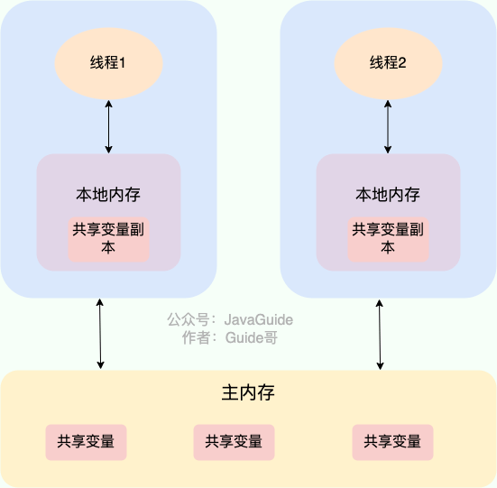

volatile 关键字可以保证变量的可见性，将变量声明为 volatile ，这就指示 JVM，这个变量是共享且不稳定的，每次使用它都到主存中进行读取

volatile 还有一个重要的作用就是防止 JVM 的指令重排序，在对这个变量进行读写操作的时候，会通过插入特定的 内存屏障 的方式来禁止指令重排序

volatile 关键字能保证数据的可见性，但不能保证数据的原子性。synchronized 关键字两者都能保证

### 对象创建过程

#### 1.类加载检查

虚拟机遇到一条 new 指令时，首先将去检查这个指令的参数是否能在常量池中定位到这个类的符号引用，并且检查这个符号引用代表的类是否已被加载过、解析和初始化过。

如果没有，那必须先执行相应的类加载过程

#### 2.分配内存

在类加载检查通过后，接下来虚拟机将为新生对象分配内存。

对象所需的内存大小在类加载完成后便可确定，为对象分配空间的任务等同于把一块确定大小的内存从 Java 堆中划分出来。

分配方式有 “指针碰撞” 和 “空闲列表” 两种，选择哪种分配方式由 Java 堆是否规整决定，而 Java 堆是否规整又由所采用的垃圾收集器是否带有压缩整理功能决定。

##### 指针碰撞

适用场合：堆内存规整（即没有内存碎片）的情况下

原理：用过的内存全部整合到一边，没有用过的内存放在另一边，中间有一个分界指针，只需要向着没用过的内存方向将该指针移动对象内存大小位置即可

使用该分配方式的 GC 收集器：Serial, ParNew

##### 空闲列表

适用场合：堆内存不规整的情况下

原理：虚拟机会维护一个列表，该列表中会记录哪些内存块是可用的，在分配的时候，找一块儿足够大的内存块儿来划分给对象实例，最后更新列表记录。

使用该分配方式的 GC 收集器：CMS

##### 内存分配并发问题

- 虚拟机采用两种方式来保证线程安全：
    - CAS+失败重试
    - TLAB：为每一个线程预先在 Eden 区分配一块儿内存，JVM 在给线程中的对象分配内存时，首先在 TLAB 分配，当对象大于 TLAB 中的剩余内存或 TLAB 的内存已用尽时，再采用上述的 CAS 进行内存分配

#### 3.初始化零值

内存分配完成后，虚拟机需要将分配到的内存空间都初始化为零值（不包括对象头），

这一步操作保证了对象的实例字段在 Java 代码中可以不赋初始值就直接使用，程序能访问到这些字段的数据类型所对应的零值。

#### 4.设置对象头

初始化零值完成之后，虚拟机要对对象进行必要的设置，例如这个对象是哪个类的实例、如何才能找到类的元数据信息、对象的哈希码、对象的 GC 分代年龄等信息

这些信息存放在对象头中。 另外，根据虚拟机当前运行状态的不同，如是否启用偏向锁等，对象头会有不同的设置方式。

#### 5.执行init方法

在上面工作都完成之后，从虚拟机的视角来看，一个新的对象已经产生了，

但从 Java 程序的视角来看，对象创建才刚开始，<init> 方法还没有执行，所有的字段都还为零。

所以一般来说，执行 new 指令之后会接着执行 <init> 方法，把对象按照程序员的意愿进行初始化，这样一个真正可用的对象才算完全产生出来。

### 设计模式

#### 单例模式

单例模式有很多中写法，一般静态内部类写法和饿汉式写法就能应付绝大多数情况了

- 懒汉式写法（线程不安全）

```java
public class Singleton {
    private static Singleton instance;

    private Singleton() {}

    public static Singleton getInstance() {
        if (Objects.isNull(instance)) {
            instance = new Singleton();
        }
        return instance;
    }
}
```

- 懒汉式写法（线程安全），也叫双重校验锁写法

```java
public class Singleton {
    private static volatile Singleton instance;

    private Singleton() {}

    public static Singleton getInstance() {
        if (Objects.isNull(instance)) {
            synchronized (Singleton.class) {
                if (Objects.isNull(instance)) {
                    instance = new Singleton();
                }
            }
        }
        return instance;
    }
}
```

- 懒汉式写法（线程安全），也叫静态内部类写法
    - 类的加载遵循“按需加载”的原则
    - 仅仅加载外部类，或者调用外部类的其他方法，都不会触发静态内部类的加载
    - 对于静态内部类，JVM 只有在主动使用它时才会去加载它

```java
public class Singleton {
    private Singleton() {}

    private static class SingletonHolder {
        private static final Singleton INSTANCE = new Singleton();
    }

    public static Singleton getInstance() {
        return SingletonHolder.INSTANCE;
    }
}
```

- 饿汉式写法（线程安全）
    - JVM 保证类加载的线程安全：在 JVM 中，类的加载、链接和初始化过程本身就是线程安全的
    - 当多个线程同时首次访问 Singleton.getInstance() 时，JVM 会保证 Singleton 类只被加载和初始化一次

```java
public class Singleton {
    private static final Singleton INSTANCE = new Singleton();

    private Singleton() {}

    public static Singleton getInstance() {
        return INSTANCE;
    }
}
```

- 枚举写法，不但线程安全还能防⽌反序列化重新创建新的对象

```java
public enum Singleton {
    INSTANCE;
    // 根据需要定义其它方法
}
```

#### 迭代器模式

迭代器（Iterator）模式，提供⼀种⽅法访问⼀个容器（container）对象中各
个元素，⽽⼜不需暴露该对象的内部细节

以ArrayList为例，其继承信息如下图

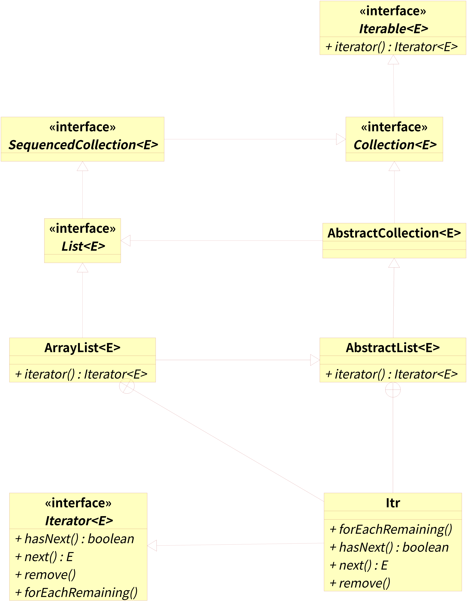

- ArrayList定义了一个内部类Itr，并实现了Iterator接口的方法

- ArrayList实现了Iterable接口的iterator()方法，该方法返回一个Itr对象，从而通过Itr对象遍历元素

#### 代理模式

##### 静态代理

静态代理在编译时就将接口、实现类、代理类这些都变成了一个个实际的 class 文件

静态代理对目标对象的每个方法的增强都要手动完成
    - 非常不灵活：比如接口一旦新增加方法，目标对象和代理对象都要进行修改
    - 且麻烦：需要对每个目标类都单独写一个代理类

- 1.定义一个接口及其实现类

```java
public interface UserService {
    void save(String name);
}

public class UserServiceImpl implements UserService {
    @Override
    public void save(String name) {
        System.out.println("save user: " + name);
    }
}
```

- 2.创建代理类并同样实现该接口

```java
public class UserServiceProxy implements UserService {
    private final UserService userService;

    public UserServiceProxy(UserService userService) {
        this.userService = userService;
    }

    @Override
    public void save(String name) {
        // 调用方法前添加自己的操作
        System.out.println("before method " + "save");
        // 调用被代理对象的方法
        userService.save(name);
        // 调用方法后添加自己的操作
        System.out.println("after method " + "save");
    }
}
```

- 3.使用代理对象调用方法

```java
UserService userService = new UserServiceImpl();
UserServiceProxy proxy = new UserServiceProxy(userService);
proxy.save("handle");
```

##### 动态代理

从JVM角度来说，动态代理是在运行时动态生成类字节码，并加载到JVM中。

###### JDK原生动态代理

缺点：只能代理实现了接口的类

核心：InvocationHandler接口和Proxy类

- 1.定义一个接口及其实现类

```java
public interface UserService {
    void save(String name);
}

public class UserServiceImpl implements UserService {
    @Override
    public void save(String name) {
        System.out.println("save user: " + name);
    }
}
```

- 2.实现InvocationHandler接口并重写invoke方法，在invoke方法中我们会调用被代理对象的方法并自定义一些处理逻辑；

```java
public class UserInvocationHandler implements InvocationHandler {
    // 被代理对象
    private final Object target;

    public UserInvocationHandler(Object target) {
        this.target = target;
    }

    @Override
    public Object invoke(Object proxy, Method method, Object[] args) throws Throwable {
        // 调用方法前添加自己的操作
        System.out.println("before method " + method.getName());
        // 调用被代理对象的方法
        Object result = method.invoke(target, args);
        // 调用方法后添加自己的操作
        System.out.println("after method " + method.getName());
        return result;
    }
}
```

- 3.通过`Proxy.newProxyInstance(ClassLoader loader,Class<?>[] interfaces,InvocationHandler h)`方法创建代理对象

```java
// 被代理对象
UserService userService = new UserServiceImpl();
// 代理对象
UserService proxyInstance = (UserService) Proxy.newProxyInstance(
    userService.getClass().getClassLoader(),
    userService.getClass().getInterfaces(), 
    new UserInvocationHandler(userService)
);
// 代理对象调用方法
proxyInstance.save("Tom");
```

###### CGLIB动态代理

Maven依赖

```xml
<dependency>
    <groupId>cglib</groupId>
    <artifactId>cglib</artifactId>
    <version>${cglib.version}</version>
</dependency>
```

CGLIB是一个基于ASM的字节码生成库，它允许我们在运行时对字节码进行修改和动态生成

缺点：CGLIB通过继承方式实现代理，因此不能代理终结类和终结方法

核心：MethodInterceptor接口和Enhancer类

- 1.定义一个类

```java
public class UserServiceImpl {
    public void save(String name) {
        System.out.println("save user: " + name);
    }
}
```

- 2.实现MethodInterceptor接口并重写intercept方法，intercept用于增强被代理类的方法

```java
public class UserMethodInterceptor implements MethodInterceptor {
    @Override
    public Object intercept(Object obj, Method method, Object[] args, MethodProxy proxy) throws Throwable {
        // 调用方法前添加自己的操作
        System.out.println("before method " + method.getName());
        // 调用被代理对象的方法
        Object result = proxy.invokeSuper(obj, args);
        // 调用方法后添加自己的操作
        System.out.println("after method " + method.getName());
        return result;
    }
}
```

- 3.通过Enhancer类的create()创建代理类

```java
// 创建被代理对象
UserServiceImpl userService = new UserServiceImpl();
  
Enhancer enhancer = new Enhancer();
enhancer.setClassLoader(userService.getClass().getClassLoader());
enhancer.setSuperclass(userService.getClass());
enhancer.setCallback(new UserMethodInterceptor());
// 创建代理对象
UserServiceImpl proxyInstance = (UserServiceImpl) enhancer.create();

// 代理对象调用方法
proxyInstance.save("Tom");
```

- 4.Java 17及以上版本，运行需要添加如下jvm参数

```jvm
--add-opens java.base/java.lang=ALL-UNNAMED
--add-opens java.base/sun.net.util=ALL-UNNAMED
```

#### 观察者模式

- 对象间⼀对多的依赖关系
    - 一：被观察者，subject
    - 多：观察者，observer
- 所有观察者实现相同的接口，因此都有一个同名方法，该方法用来更新观察者的状态（通知）
- 被观察者内部保存观察者对象
- 当被观察者的状态发⽣改变时，遍历内部保存的观察者对象，执行同名方法（观察者得到通知并被⾃动更新）

```java
// 观察者接口
public interface Observer {
    void update();
}

// A观察者
public class AObserverImpl implements Observer {
    @Override
    public void update() {
        System.out.println("A观察者被通知更新");
    }
}

// B观察者
public class BObserverImpl implements Observer {
    @Override
    public void update() {
        System.out.println("B观察者被通知更新");
    }
}

// 被观察者
public class Subject {
    private List<Observer> observers = new ArrayList<>();

    public void addObserver(Observer observer) {
        observers.add(observer);
    }
    public void advise() {
        for (Observer item : observers) {
            item.update();
        }
    }
}

// 测试
public void test() {
    AObserverImpl aObserver = new AObserverImpl();
    BObserverImpl bObserver = new BObserverImpl();
    Subject subject = new Subject();
    subject.addObserver(aObserver);
    subject.addObserver(bObserver);
    subject.advise();
}
```

#### 装饰器模式

装饰器模式（Decorator Pattern）的核心思想是：在不修改原有类代码的情况下，动态地给一个对象添加一些额外的职责。它比生成子类更为灵活

当一个类的功能需要频繁变动，或者需要以各种方式组合功能时，装饰器模式就该上场了

```java
// 基类
public class Food {
    private String foodName;

    public Food() {

    }
    public Food(String foodName) {
        this.foodName = foodName;
    }

    public String make() {
        return foodName;
    }
}

// 装饰器1
public class Bread extends Food{
    private Food basicFood;

    public Bread(Food basicFood) {
        this.basicFood = basicFood;
    }

    @Override
    public String make() {
        return basicFood.make() + "+面包";
    }
}

// 装饰器2
public class Vegetable extends Food{
    private Food basicFood;

    public Vegetable(Food basicFood) {
        this.basicFood = basicFood;
    }

    @Override
    public String make() {
        return basicFood.make() + "+蔬菜";
    }
}

public void test() {
    Food food = new Bread(new Vegetable(new Food("炸鸡")));
    // 先调用最外层Bread的make方法：return basicFood.make() + "+面包"
    // Bread的basicFood这里是Vegetable，调用Vegetable的make方法：basicFood.make() + "+蔬菜"
    // Vegetable的basicFood这里是Food，调用Food的make方法：返回foodName，即"炸鸡"
    // 然后返回炸鸡+蔬菜
    // 最后返回炸鸡+蔬菜+面包
    System.out.println(food.make());
}
```

#### 责任链模式

按照链的顺序执⾏⼀个个处理⽅法，链上的每⼀个任务都持有它后⾯那个任务的对象引⽤

以⽅便⾃⼰这段执⾏完成之后，调⽤其后⾯的处理逻辑

```java
public interface Filter {
    void filtering();
}

public abstract class AbstractFilter implements Filter{
    private Filter filter;

    public AbstractFilter(Filter filter) {
        this.filter = filter;
    }

    @Override
    public void filtering() {
        System.out.println("invoke " + this.getClass().getSimpleName());
        if (Objects.nonNull(filter)) {
            filter.filtering();
        }
    }
}

public class XFilter extends AbstractFilter{
    public XFilter(Filter filter) {
        super(filter);
    }
}

public class YFilter extends AbstractFilter{
    public YFilter(Filter filter) {
        super(filter);
    }
}

public class ZFilter extends AbstractFilter{
    public ZFilter(Filter filter) {
        super(filter);
    }
}

public class FilterChain {
    public void runChain() {
        ZFilter zFilter = new ZFilter(null);
        YFilter yFilter = new YFilter(zFilter);
        XFilter xFilter = new XFilter(yFilter);
        xFilter.filtering();
    }
}

public class ResponsibilityChainTest {
    @Test
    public void test() {
        new FilterChain().runChain();
    }
}
```

## Lombok

注意：java版本变更后，Lombok的版本也要跟着变，否则编译会报兼容问题的错误

- maven依赖

```xml
<dependency>
    <groupId>org.projectlombok</groupId>
    <artifactId>lombok</artifactId>
    <version>${lombok.version}</version>
    <scope>provided</scope>
</dependency>
```

- gradle依赖

```groovy
compileOnly 'org.projectlombok:lombok'
// 加上这个注解告诉Gradle在编译过程中使用Lombok的注解处理器，不然编译会报错
annotationProcessor 'org.projectlombok:lombok'
```

- 常用注解

```java
@Getter
@Setter
@ToString
@NoArgsConstructor(access = AccessLevel.PRIVATE)
@Slf4j
public class AccountPo {}
```

## EasyExcel

```java
// 同步读，headRowNumber(0)：标题行和数据行都读到列表中
List<Map<Integer, String>> listMap = EasyExcel.read(inputStream).sheet().headRowNumber(0).doReadSync();
```

## 获取应用家目录

- 使用springboot工具

```java
ApplicationHome home = new ApplicationHome(this.getClass());
```

- 自己实现

```java
/**
 * 获取应用家目录：可执行jar包所在目录，或maven项目的target/classes目录
 *
 * @param clazz 通常为主程序入口类
 * @return 获取应用家目录
 */
private static <T> String getApplicationHome(Class<T> clazz) {
    // 获取带文件协议前缀的规范类路径
    String classPath = clazz.getResource("").toExternalForm();
    String osName = System.getProperty("os.name").toLowerCase();
    if (osName.contains("linux")) {
        if (classPath.startsWith("jar")) {
            // jar包的类路径
            // jar:file:/path/to/file.jar!/path/to/clazz/
            String jarPath = classPath.substring(classPath.indexOf("/"), classPath.indexOf("!"));
            return jarPath.substring(0, jarPath.lastIndexOf("/"));
        } else {
            // 非jar包的类路径（maven项目）
            // file:/path/to/projectName/target/classes/path/to/clazz/
            return classPath.substring(classPath.indexOf("/"), classPath.indexOf("classes") + "classes".length());
        }
    } else if (osName.contains("win")) {
        if (classPath.contains("!")) {
            // jar包的类路径
            // jar:file:/C:/xxx/xxx.jar!/path/to/clazz/
            String jarPath = classPath.substring(classPath.indexOf("/") + 1, classPath.indexOf("!"));
            return jarPath.substring(0, jarPath.lastIndexOf("/"));
        } else {
            // 非jar包的类路径（maven项目）
            // file:/C:/xxx/target/classes/path/to/clazz/
            // file:/C:/xxx/target/test-classes/path/to/clazz/
            return classPath.substring(classPath.indexOf("/") + 1, classPath.indexOf("classes") + "classes".length());
        }
    } else {
        throw new RuntimeException("不支持的系统类型：" + osName + " 目前只支持windows和linux的应用家目录获取");
    }
}
```

## react

官网：<https://projectreactor.io/>

- 依赖

```xml
<dependency>
    <groupId>io.projectreactor</groupId>
    <artifactId>reactor-core</artifactId>
    <version>3.8.7</version>
</dependency>
```

- demo

```java
// 生产者
// Mono用来封装单个数据的流
Mono<Integer> mono = Mono.just(1);
// 消费流
mono.subscribe(System.out::println);

// Flux用来封装多个数据的流
Flux<Integer> flux = Flux.just(1, 2, 3);
// 消费流
flux.subscribe(System.out::println);

// 只有一个代表流已完成的信号
Flux<Object> empty = Flux.empty();
empty.subscribe(System.out::println);
```

### doOnXXX事件

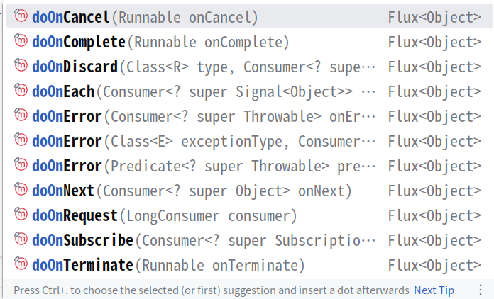

doOnNext：每个数据（流的数据）到达的时候触发

doOnEach：每个元素（流的数据和信号）到达的时候触发

信号：有正常/异常信号，具体看SignalType

doOnXxx：发生这个事件的时候产生一个回调，只做通知，不能改变元素、信号

onXxx：发生这个事件后执行一个动作，可以改变元素、信号

```java
Flux<Integer> flux = Flux.range(0, 3)
        .delayElements(Duration.ofSeconds(1))
        // 每个doOnXXX事件对它的上一调用链的流起作用
        // 这里即对delayElements生成的流起作用
        .doOnComplete(() -> System.out.println("流已完成"))
        .doOnCancel(() -> System.out.println("流已取消"));
```

### subscribe

只有订阅流了，相关的操作才会执行

```java
// 定义空订阅
flux.subscribe();

// 打印流数据
flux.subscribe(System.out::println);

// 此外还有别的subscribe方法
```

#### 自定义消费者

```java
flux.subscribe(new BaseSubscriber<>() {
    // 以下这些是生命周期钩子，订阅关系绑定的时候触发
    // 这些方法类似doOnXxx，但是在消费者端生效
    @Override
    protected void hookOnSubscribe(Subscription subscription) {
        // 流被订阅的时候触发
        System.out.println("绑定了 " + subscription);
        
        // request(n)表示找发布者要n次数据，总共得到n*bufferSize个数据
        // 找发布者要一次数据
        request(1);
        // 找发布者要无限次数据
        // requestUnbounded();
    }

    @Override
    protected void hookOnNext(Integer value) {
        // 数据到达的时候触发
        System.out.println("数据到达 " + value);
        request(1);


        // 取消流
        // cancel();
    }

    @Override
    protected void hookOnComplete() {
        // 流正常结束触发
        System.out.println("流结束了");
    }

    @Override
    protected void hookOnError(Throwable throwable) {
        // 流异常的时候触发
    }

    @Override
    protected void hookOnCancel() {
        // 流被取消的时候触发
    }

    @Override
    protected void hookFinally(SignalType type) {
        // 最终回调
    }
});
```

#### 请求重塑-buffer

request(n)表示找发布者要n次数据，总共得到n*bufferSize个数据

```java
Flux<Integer> flux = Flux.range(0, 9)
                .buffer(2);
```

#### 请求重塑-limitRate

```java
Flux.range(1, 1000).log()
    // 默认75%预取策略
    // 第一次抓取100个数据，但是达到75%预取策略即取到75个数据后
    // 如果这75%的元素已经处理了，继续抓取新的75%元素
    .limitRate(100).subscribe();
```

#### 创建序列

- 同步环境用generate

```java
Flux<Object> flux = Flux.generate(
        // state初始值，可以是一个atomic变量值
        () -> 0, (state, sink) -> {
            // 生成0-10
            if (state <= 10) {
                // sink翻译是水槽，用通道理解更贴切，这里作为一个接收端
                // 把元素传出去
                sink.next(state);
            } else {
                sink.complete();
            }
            return state + 1;
        });
flux.log().subscribe();
```

- 异步/多线程用create

```java
Flux.create(sink -> {
    // todo
});
```

#### 自定义元素处理

```java
Flux.range(0, 10).handle((value, sink) -> {
    System.out.println("拿到的值 " + value);
    sink.next("自定义处理后 " + value);
}).log().subscribe();
```

#### 取消操作

```java
Flux<Integer> flux = Flux.range(0, 10).delayElements(Duration.ofSeconds(1)).log();
// subscribe方法返回是一个Disposable，可以执行取消操作
Disposable disposable = flux.subscribe();
try {
    TimeUnit.SECONDS.sleep(3);
    disposable.dispose();
} catch (InterruptedException e) {
    throw new RuntimeException(e);
}
```

#### 线程调度

```java
Flux.range(0, 3)
    // 指定发布者线程
    // Schedulers.immediate()，当前线程，默认
    // Schedulers.single()，固定的一个单线程
    // Schedulers.boundedElastic()，有界，动态线程，弹性调度，线程池有10*cpu核心个线程，队列长度100k
    // Schedulers.newBoundedElastic()，自己创建一个线程池
    // Schedulers.fromExecutor()，从指定executor创建一个线程池
    // Schedulers.parallel()，并发
    // 只要没有手动指定线程池，发布者使用的线程和订阅者只用的线程一样
    .publishOn(Schedulers.single())
    .log()
    // 指定订阅者线程
    .subscribeOn(Schedulers.single())
    .log()
    .subscribe();
```

#### 常用api

类似Stream，Mono/Flux也有一些同名的api，如filter、map、flatmap

```java
Flux.just("a b", "c d")
    .flatMap(item -> {
        String[] strings = item.split(" ");
        return Flux.fromArray(strings);
    })
    .log()
    .subscribe();

// 连接操作1
Flux.concat(Flux.just(1, 2), Flux.just(3, 4))
    .log()
    .subscribe();

// 连接操作2
Flux.just(1, 2)
    .concatWith(Flux.just(3, 4))
    .log()
    .subscribe();

// 这个例子不太合适，先放着吧
Flux.just(1, 2)
    .concatMap(item -> Flux.just(item * 2))
    .log()
    .subscribe();

// 模拟从其它地方获取到Flux，Flux.empty()表示没有元素的空流，只有完成信号
Flux<Integer> flux = Flux.empty();
// 如果发布者flux元素为空，则指定默认值
flux.defaultIfEmpty(3)
    .log()
    .subscribe();

// 模拟从其它地方获取到Flux
Flux<Integer> flux = Flux.empty();
// 如果发布者flux元素为空，则指定默认值
flux.switchIfEmpty(Flux.just(1, 2))
    .log()
    .subscribe();


Flux<Integer> flux1 = Flux.just(1, 2)
                            .delayElements(Duration.ofSeconds(1));
Flux<Integer> flux2 = Flux.just(3, 4)
                            .delayElements(Duration.ofMillis(100));
// merge和concat不一样的地方是前者是按照元素到达的时间顺序合并，后者是按照flux顺序拼接
Flux.merge(flux1, flux2)
    .log()
    .subscribe();

try {
    TimeUnit.SECONDS.sleep(4);
} catch (InterruptedException e) {
    throw new RuntimeException(e);
}

// mergeWith
flux1.mergeWith(flux2)
    .log()
    .subscribe();

// 按照哪个流先发元素的顺序合并，先发的流的所有元素发完后再合并后面的流
Flux.mergeSequential(flux1, flux2)
    .log()
    .subscribe();

// 压缩，最多支持8个流的压缩，超过八个可以拆分8个压缩一次
// 多出来的元素会被忽略
// zipWith例子就不写了
Flux.zip(Flux.just(1, 2, 3), Flux.just("a", "b"))
    .map(tuple -> tuple.getT1() + ":" + tuple.getT2())
    .log()
    .subscribe();
```

#### 错误处理

```java
Flux.just(1, 2, 0, 3)
    .map(item -> 10 / item)
    // 发生错误后返回一个兜底值
    // 会吃掉异常，消费者无异常感知，不会走subscribe方法的异常处理，流会正常完成
    // .onErrorReturn(0)
    .onErrorReturn(ArithmeticException.class, 0)
    .log()
    .subscribe(System.out::println, throwable -> System.out.println(throwable.getLocalizedMessage()),
    () -> System.out.println("流结束"));

Flux.just(1, 2, 0, 3)
    .map(item -> 10 / item)
    // 发生错误后执行一个兜底方法
    // 会吃掉异常，消费者无异常感知，不会走subscribe方法的异常处理，流会正常完成
    // .onErrorResume(throwable -> Flux.just(5, 6))

    // 会吃掉异常，消费者有异常感知，流会异常完成
    .onErrorResume(throwable -> Flux.error(
                    new RuntimeException("发生异常：" + throwable.getLocalizedMessage(), throwable)))
    .log()
    .subscribe(System.out::println, throwable -> System.out.println(throwable.getLocalizedMessage()),
                () -> System.out.println("流结束"));

Flux.just(1, 2, 0, 3)
    .map(item -> 10 / item)
    // 会吃掉异常，消费者有异常感知，抛新异常，流会异常完成
    .onErrorMap(throwable -> new RuntimeException("发生异常：" + throwable.getLocalizedMessage(), throwable))
    .log()
    .subscribe(System.out::println, throwable -> System.out.println(throwable.getLocalizedMessage()),
                () -> System.out.println("流结束"));

Flux.just(1, 2, 0, 3)
    .map(item -> 10 / item)
    // 不会吃掉异常，消费者有异常感知，流会异常完成
    .doOnError(throwable -> System.out.println("记录异常日志：" + throwable.getLocalizedMessage()))
    .log()
    .subscribe(System.out::println, throwable -> System.out.println(throwable.getLocalizedMessage()),
                () -> System.out.println("流结束"));

Flux.just(1, 2, 0, 3)
    .map(item -> 10 / item)
    // 不管正常还是报错都执行
    .doFinally(signalType -> System.out.println("流信号：" + signalType))
    .log()
    .subscribe(System.out::println, throwable -> System.out.println(throwable.getLocalizedMessage()),
                () -> System.out.println("流结束"));

Flux.just(1, 2, 0, 3)
    .map(item -> 10 / item)
    // 忽略当前异常，仅作通知记录，流继续
    .onErrorContinue((throwable, item) -> System.out.println(
            "错误信息：" + throwable.getLocalizedMessage() + "当前项：" + item))
    .log()
    .subscribe(System.out::println, throwable -> System.out.println(throwable.getLocalizedMessage()),
                () -> System.out.println("流结束"));

Flux.just(1, 2, 0, 3)
    .map(item -> 10 / item)
    // 错误结束信号替换为正常结束信号
    .onErrorComplete()
    .log()
    .subscribe(System.out::println, throwable -> System.out.println(throwable.getLocalizedMessage()),
                () -> System.out.println("流结束"));

Flux.interval(Duration.ofMillis(50))
    .map(item -> 3 / (3 - item))
    // 发生错误后停止
    .onErrorStop()
    .log()
    .subscribe(System.out::println, throwable -> System.out.println(throwable.getLocalizedMessage()),
                () -> System.out.println("流结束"));

try {
    TimeUnit.SECONDS.sleep(1);
} catch (InterruptedException e) {
    throw new RuntimeException(e);
}

Flux.just(1)
    .delayElements(Duration.ofSeconds(2))
    .log()
    .timeout(Duration.ofSeconds(1))
    // 把流从头到尾重新请求一次的重试次数
    .retry(2)
    .subscribe(System.out::println, throwable -> System.out.println(throwable.getLocalizedMessage()),
                () -> System.out.println("流结束"));
```

#### Sinks工具类

```java
// 发送Flux数据
Sinks.many();
// 发送Mono数据
Sinks.one();
// 单播：此sink管道只能绑定单个订阅者（消费者）
Sinks.many()
        .unicast();
// 多播：此sink管道能绑定多个订阅者
Sinks.many()
        .multicast();
// 重放：此sink管道是否给后来的订阅者发送之前的元素
// 也就是它决定从头消费还是从订阅那一刻开始消费，默认是从订阅的那一刻开始消费的
Sinks.many()
        .replay();

Sinks.many()
    .multicast()
    // 背压队列
    .onBackpressureBuffer();


Sinks.Many<Integer> sinks = Sinks.many()
    .multicast()
    // 背压队列
    .onBackpressureBuffer(5);

Thread.startVirtualThread(() -> {
    for (int i = 0; i < 10; i++) {
        sinks.tryEmitNext(i);
        try {
            TimeUnit.MILLISECONDS.sleep(200);
        } catch (InterruptedException e) {
            throw new RuntimeException(e);
        }
    }
});

sinks.asFlux()
        .subscribe(item -> System.out.println("订阅者1: " + item));
// 如果unicast这里就会报错，不能订阅两次
// 如果unicast这里就会报错，不能订阅两次
Thread.startVirtualThread(() -> {
    try {
        TimeUnit.MILLISECONDS.sleep(500);
    } catch (InterruptedException e) {
        throw new RuntimeException(e);
    }
    // 模拟后来订阅
    // 这样就可以看到订阅者2默认就不是从头开始消费了
    sinks.asFlux()
            .subscribe(item -> System.out.println("订阅者2: " + item));
});

try {
    TimeUnit.SECONDS.sleep(3);
} catch (InterruptedException e) {
    throw new RuntimeException(e);
}

Sinks.Many<Integer> sinks = Sinks.many()
        .replay()
        // 只重放2个历史数据
        .limit(3);


Flux<Integer> flux = Flux.range(1, 5)
        .delayElements(Duration.ofSeconds(1))
        .cache(3);
```

#### 阻塞式API

```java
Integer value = Flux.just(1, 2, 5)
                    // .blockFirst()
                    .blockLast();
System.out.println(value);

List<Integer> list = Flux.just(1, 2, 5)
                            .collectList()
                            .block();
System.out.println(list);
```

#### 分批处理

```java
// 100数据，6个线程，每个线程处理10，直至结束
Flux.range(1, 100)
    .buffer(10)
    .parallel(6)
    .runOn(Schedulers.newParallel("subThread"))
    .log()
    .subscribe();
```

#### 上下文

```java
Flux.just(1, 2, 3)
    .transformDeferredContextual((flux, context) -> {
        System.out.println("flux: " + flux + "context: " + context);
        return flux.map(item -> item + " " + context.get("suffix"));
    })
    .contextWrite(Context.of("suffix", "你干嘛"))
    .subscribe(System.out::println);
```

## javacv

javacv是一个opencv、ffmpeg的java api

官网：<https://github.com/bytedeco/javacv>

- 依赖

```xml
<dependency>
    <groupId>org.bytedeco</groupId>
    <artifactId>javacv-platform</artifactId>
    <version>1.5.13</version>
</dependency>
```

- ffmpeg例子

```java
try (FFmpegFrameGrabber grabber = new FFmpegFrameGrabber("/path/to/input.mp4")) {
    grabber.start();

    int videoBitrate = grabber.getVideoBitrate() / 1000;
    String videoFrameRate = BigDecimal.valueOf(grabber.getVideoFrameRate()).setScale(2, RoundingMode.HALF_UP).toString();
    String videoInformation = String.format("视频编解码器：%s，比特率：%d kb/s，分辨率：%dx%d，帧数：%s fps",
                                            grabber.getVideoCodecName(), videoBitrate, grabber.getImageWidth(), 
                                            grabber.getImageHeight(), videoFrameRate);
    System.out.println(videoInformation);

    int audioBitrate = grabber.getAudioBitrate() / 1000;
    String audioFrameRate = BigDecimal.valueOf(grabber.getAudioFrameRate() * 1000).setScale(0, RoundingMode.HALF_UP).toString();
    String audioInformation = String.format("音频编解码器：%s，比特率：%d kb/s，采样率：%s Hz，声道数：%d",
                                            grabber.getAudioCodecName(), audioBitrate, audioFrameRate, grabber.getAudioChannels());
    System.out.println(audioInformation);

    grabber.stop();
} catch (FrameGrabber.Exception e) {
    throw new RuntimeException(e);
}
```

## swagger

- 依赖

```xml
<dependency>
    <groupId>org.springdoc</groupId>
    <artifactId>springdoc-openapi-starter-webmvc-ui</artifactId>
    <version>2.6.0</version>
</dependency>
```

- 配置文件

```java
@Configuration
public class SwaggerConfiguration {
    // 分组配置，请求路径是/pay/**都归为支付模块
    @Bean
    public GroupedOpenApi payApi() {
        return GroupedOpenApi.builder().group("支付模块").pathsToMatch("/pay/**").build();
    }

    @Bean
    public GroupedOpenApi otherApi() {
        return GroupedOpenApi.builder().group("其它模块").pathsToMatch("/other/**").build();
    }

    // 其它描述信息
    @Bean
    public OpenAPI openApi() {
        return new OpenAPI()
        .info(new Info().title("projectName")
            .description("projectName api")
            .version("1.0.0"))
        .externalDocs(new ExternalDocumentation()
            .description("handle studio")
            .url("https://www.handle.com"));
    }
}
```

- 实体类

```java
@Schema(title = "支付模块入参")
public class PayInputVo {
    @Schema(title = "支付流水号")
    private String payNumber;
}
```

- 控制器

```java
@Tag(name = "支付模块", description = "支付增删改查")
public class PayController {
    @Operation(summary = "新增", description = "新增支付记录") 
    @GetMapping("/add")
    public String add(@RequestBody PayInputVo payInputVo) {
    return "add success";
    }
}
```

- 访问页面：<http://ip:port/swagger-ui/index.html>

## Knife4j

集成了swagger功能，更加强大

- 依赖

```xml
<dependency>
    <groupId>com.github.xiaoymin</groupId>
    <artifactId>knife4j-openapi3-jakarta-spring-boot-starter</artifactId>
    <version>4.5.0</version>
</dependency>
```

- 文档地址：`http://ip:port/doc.html`

## Jmeter

### 线程组

- 10个线程，执行5秒，每次执行2个请求

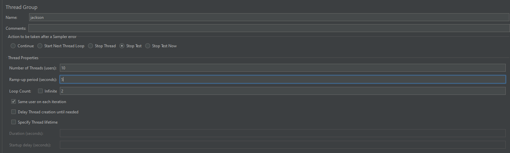

### get请求

- 注意点：如果直接在Path输入框中输入：<http://localhost:8080/jackson/get2>，然后填写请求参数，那么请求参数是不会拼接到请求路径后面的

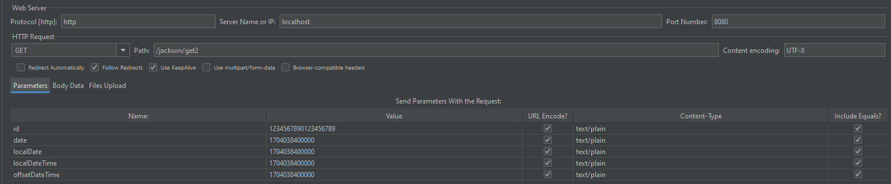

## 分布式id

### tinyid

- 官网：<https://github.com/didi/tinyid>

- 下载源码后用IDE打开

- 将tinyid/tinyid-server/db.sql改成postgresql数据库支持的sql，然后创建表

```sql
create table tiny_id_info (
    id bigserial not null,
    biz_type varchar(63) not null default '',
    begin_id bigint not null default '0',
    max_id bigint not null default '0',
    step integer default '0',
    delta integer not null default '1',
    remainder integer not null default '0',
    create_time timestamptz not null default '2024-01-01 00:00:00',
    update_time timestamptz not null default '2024-01-01 00:00:00',
    version bigint not null default '0',
    primary key (id),
    constraint uniq_biz_type unique (biz_type)
);

comment on table  tiny_id_info is '账号表'; 
comment on column tiny_id_info.id is '自增主键';
comment on column tiny_id_info.biz_type is '业务类型，唯一';
comment on column tiny_id_info.begin_id is '开始id，仅记录初始值，无其他含义。初始化时begin_id和max_id应相同';
comment on column tiny_id_info.max_id is '当前最大id';
comment on column tiny_id_info.step is '步长';
comment on column tiny_id_info.delta is '每次id增量';
comment on column tiny_id_info.remainder is '余数';
comment on column tiny_id_info.create_time is '创建时间';
comment on column tiny_id_info.update_time is '更新时间';
comment on column tiny_id_info.version is '版本号';

create table tiny_id_token (
    id bigserial not null,
    token varchar(255) not null default '',
    biz_type varchar(63) not null default '',
    remark varchar(255) not null default '',
    create_time timestamptz not null default '2024-01-01 00:00:00',
    update_time timestamptz not null default '2024-01-01 00:00:00',
    primary key (id)
);

comment on table  tiny_id_token is 'token信息表'; 
comment on column tiny_id_token.id is '自增主键';
comment on column tiny_id_token.token is 'token';
comment on column tiny_id_token.biz_type is '此token可访问的业务类型标识';
comment on column tiny_id_token.remark is '备注';
comment on column tiny_id_token.create_time is '创建时间';
comment on column tiny_id_token.update_time is '更新时间';

insert into tiny_id_info (id, biz_type, begin_id, max_id, step, delta, remainder, create_time, update_time, version)
values
 (1, 'test', 1, 1, 100000, 1, 0, '2024-09-30 14:30:06', '2024-09-30 14:30:06', 1);

insert into tiny_id_info (id, biz_type, begin_id, max_id, step, delta, remainder, create_time, update_time, version)
values
 (2, 'test_odd', 1, 1, 100000, 2, 1, '2024-09-30 14:30:06', '2024-09-30 14:30:06', 3);

insert into tiny_id_token (id, token, biz_type, remark, create_time, update_time)
values
 (1, '0f673adf80504e2eaa552f5d791b644c', 'test', '1', '2024-09-30 16:36:46', '2024-09-30 16:36:48');

insert into tiny_id_token (id, token, biz_type, remark, create_time, update_time)
values
 (2, '0f673adf80504e2eaa552f5d791b644c', 'test_odd', '1', '2024-09-30 16:36:46', '2024-09-30 16:36:48');
```

- 修改pom，添加postgresql驱动依赖（mysql的可以删了）

```xml
<dependency>
    <groupId>org.postgresql</groupId>
    <artifactId>postgresql</artifactId>
    <version>42.6.0</version>
</dependency>
```

- 修改配置文件，tinyid-server/src/main/resources/offline下的application.properties

```properties
datasource.tinyid.primary.driver-class-name=org.postgresql.Driver
datasource.tinyid.primary.url=jdbc:postgresql://localhost:5432/tinyid
datasource.tinyid.primary.username=postgres
datasource.tinyid.primary.password=postgres123
```

- 其它地方根据运行的Java环境和依赖版本做调整

### idgenerator

- 官网：<https://github.com/yitter/IdGenerator>

- 依赖

```xml
<dependency>
    <groupId>com.github.yitter</groupId>
    <artifactId>yitter-idgenerator</artifactId>
    <version>1.0.6</version>
</dependency>
```

- 使用

```java
public class ApplicationTest {
    @BeforeEach
    public void init() {
        // 创建 IdGeneratorOptions 对象，可在构造函数中输入 WorkerId：
        IdGeneratorOptions options = new IdGeneratorOptions((short)1);
        // options.WorkerIdBitLength = 10; // 默认值6，限定 WorkerId 最大值为2^6-1，即默认最多支持64个节点。
        // options.SeqBitLength = 6; // 默认值6，限制每毫秒生成的ID个数。若生成速度超过5万个/秒，建议加大 SeqBitLength 到 10。
        // options.BaseTime = Your_Base_Time; // 如果要兼容老系统的雪花算法，此处应设置为老系统的BaseTime。
        // ...... 其它参数参考 IdGeneratorOptions 定义。

        // 保存参数（务必调用，否则参数设置不生效）：
        YitIdHelper.setIdGenerator(options);

        // 以上过程只需全局一次，且应在生成ID之前完成。
    }
    @Test
    public void test() {
        // 初始化后，在任何需要生成ID的地方，调用以下方法：
        long newId = YitIdHelper.nextId();
        System.out.println(newId);
    }
}
```

## 数据库

ACID：（Atomicity）原子性、（Consistency）一致性、（Isolation）独立性、（Durability）持久性

- sql语句和注释应该用通用写法，这样在不同数据库之间都兼容

```sql
-- 注释内容，注意双减号后有空格
```

- 如果考虑到后期会进行数据库迁移，可以用Long类型来定义时间字段
    - 如：create_at_utc_milli，直接点明了时区基准（零时区），避免了夏令时和跨地域部署的坑，数据单位和精度（毫秒级）

## 静态服务器

Java 18 开始，可以使用 jwebserver 命令启动一个简易的静态 Web 服务器

比如可以用来测试vue的构建结果

既然是静态服务器当然只能访问静态文件啦，如果要测试路由之类的功能还是乖乖用nginx做静态服务器和配置反向代理以解决跨域问题吧

```sh
# -p 端口
# -d 静态服务器的位置
# -b 监听的地址
# -o none|info|verbose 输出日志级别
jwebserver -p 8080 -d /path/to/server -b 0.0.0.0 -o info
```

当然也可以自己写代码实现

```java
public static void main(String[] args) {
    InetSocketAddress address = new InetSocketAddress(8080);
    Path path;
    try {
        path = Path.of(Main.class.getClassLoader().getResource("static").toURI());
    } catch (URISyntaxException e) {
        throw new RuntimeException(e);
    }
    HttpServer httpServer = SimpleFileServer.createFileServer(address, path, SimpleFileServer.OutputLevel.INFO);
    httpServer.start();
    System.out.println("服务启动完成！");
}
```

## Deep Java Library

- 模型训练流程
    - 准备数据集
    - 构建神经网络
    - 构建模型（让这个模型应用上一步的神经网络）
    - 训练配置（如何训练，训练数据集、验证数据集、测试数据集）
    - 训练模型
    - 保存模型
- 模型使用流程
    - 加载模型（上面保存的模型）
    - 预测（给模型一个新输入，让其判断）

- 未训练的模型是参数值不确定的公式，训练好的模型是参数值确定的公式

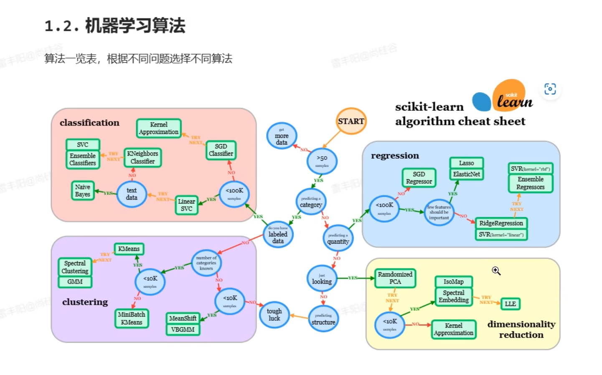

目前Deep Java Library没有办法使用amdgpu进行加速，看了底层代码都没有amd显卡的判断逻辑，因此打算直接用python训练玩玩了

## 算法篇

### 全局唯一id生成器

- snowflake算法
- 百度开源的分布式唯一id生成器UidGenerator
- Leaf--美团点评分布式id生成系统

## 踩坑记录

- 服务器要避开使用用浏览器的非安全端口
    - Edge/谷歌
        - 6000
        - 6665-6669
        - 修改成可以使用：桌面快捷图标右键->属性->目标->最后后加上空格，然后加上`--explicitly-allowed-ports=6000,6665`
