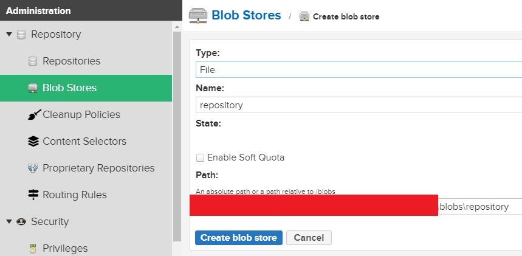
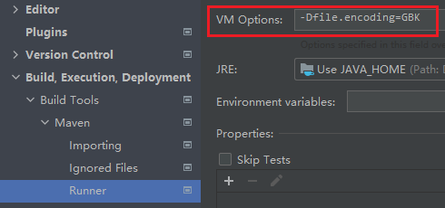

# Maven

## 安装Maven

- 1.添加环境变量：MAVEN_HOME=`maven根目录`

- 2.环境变量Path追加：`%MAVEN_HOME%\bin`

- 3.修改`MAVEN_HOME\conf\settings.xml` 配置文件
  
```xml
<!-- 1.设置本地仓库路径 -->
<localRepository>...\repository</localRepository>
  
<mirrors>
    <!-- 2.设置下载jar包的镜像地址 -->
    <mirror>
        <id>alimaven</id>
        <mirrorOf>*</mirrorOf>
        <name>aliyun maven</name>
        <url>https://maven.aliyun.com/repository/public</url>
    </mirror>
    <mirror>
      <id>maven-default-http-blocker</id>
      <!-- 匹配所有外部的、且使用 HTTP 协议的仓库 -->
      <mirrorOf>external:http:*</mirrorOf>
      <name>Pseudo repository to mirror external repositories initially using HTTP.</name>
      <!-- http://0.0.0.0/ 在这里没有任何实际的网络请求意义，它只是一个占位符 -->
      <!-- 在 Maven 的 <mirror> 配置中，<url> 是一个必填标签。如果不填，Maven 在解析 XML 配置文件时就会报错。-->
      <!-- 但是，这个特定的拦截器配置（maven-default-http-blocker）根本不需要去下载任何东西，它的唯一目的就是拦截。 -->
      <url>http://0.0.0.0/</url>
      <!-- 表示对于匹配到的仓库，Maven 会直接阻断请求，不会去下载依赖 -->
      <blocked>true</blocked>
    </mirror>
</mirrors>  
  
<profiles>
    <!-- 3.设置默认jdk -->
    <profile>
        <id>jdk-21</id>
        <activation>
            <jdk>21</jdk>
            <activeByDefault>true</activeByDefault>
        </activation>
        <properties>
            <maven.compiler.source>21</maven.compiler.source>
            <maven.compiler.target>21</maven.compiler.target>
            <encoding>UTF-8</encoding>
        </properties>
    </profile>
</profiles>
```

## idea配置Maven

- File->Settings->Build,Execution,Deployment->Build Tools->Maven
    - 勾选 Print exception stack traces
    - Maven home path，指定Maven家目录
    - User settings file，勾上Override，选择Maven的settings.xml配置文件路径
    - Use settings from .mvn/maven.config，取消勾选
    - 点击Runner子选项，勾上Skip Tests
    - Importing->Automatically download，都不要勾选，如果需要看源码可以逐个手动下载

## scope

|依赖范围|编译有效|测试有效|运行有效|打包有效|例子|
|:-|:-|:-|:-|:-|:-|
|compile|true|true|true|true|spring-core|
|test|false|true|false|false|junit|
|provided|true|true|false|false|lombok|
|runtime|false|true|true|true|数据库驱动|
|system|true|true|false|false|本地maven仓库之外的类库，基本用不到|

## 依赖的传递性

- maven依赖默认是有传递性的

- maven依赖的optional属性说明
    -Flagging the dependency as optional prevents it from being transitively applied to other modules that use your project

```xml
<dependencies>
    <dependency>
        <groupId>some-groupId</groupId>
        <artifactId>some-artifactId</artifactId>
        <!-- 防止传递依赖 -->
        <optional>true</optional>
    </dependency>
</dependencies>
```

## Maven的profile

profile用来为不同环境（dev/test/prod）或不同构建场景准备不同的配置集，在构建时按需启用

在settings.xml和pom.xml中都可以定义profile，定义后在ide的maven面板中看到

- 在settings.xml中定义profile

```xml
<profile>
    <id>jdk-21</id>
    <activation>
        <jdk>21</jdk>
        <activeByDefault>true</activeByDefault>
    </activation>
    <properties>
        <maven.compiler.source>21</maven.compiler.source>
        <maven.compiler.target>21</maven.compiler.target>
        <encoding>UTF-8</encoding>
    </properties>
</profile>
```

- 在pom.xml文件中定义配置文件

```xml
<profiles>
    <profile>
        <id>development</id>
        <activation>
            <activeByDefault>true</activeByDefault>
        </activation>
        <properties>
            <environment>dev</environment>
        </properties>
    </profile>
    <profile>
        <id>production</id>
        <properties>
            <environment>prod</environment>
        </properties>
    </profile>
</profiles>
```

- 使用命令行参数激活构建设置

```sh
mvn clean install -P production
```

## maven生命周期

maven的生命周期有三类：clean、default、site，它们相互独立

每类生命周期都包含了多个阶段，并且这些阶段是有序的，也就是说，后面的阶段依赖于前面的阶段。当执行某个阶段的时候，会先执行它前面的阶段

```sh
# 执行 Maven 生命周期的命令格式
mvn 阶段 [阶段2...阶段n]
mvn clean install
```

### clean生命周期

清理由先前构建创建的工件，共包含3个阶段：

- pre-clean
- clean
- post-clean

### default生命周期（也称为构建生命周期）

default生命周期是在没有任何关联插件的情况下定义的，是Maven的主要生命周期，用于构建应用程序，共包含23个阶段，下面列出常见的几个阶段：

- validate，验证项目是否正确，并且所有必要的信息可用于完成构建过程
- generate-sources，了解
- process-sources，了解
- generate-resources，了解
- process-resources，了解
- compile，编译项目的源代码
- test，使用合适的单元测试框架（Junit 就是其中之一）运行测试
- package，获取已编译的代码并将其打包成可分发的格式，例如 JAR、WAR 或 EAR 文件
- integration-test，如有必要，将包处理并部署到可以运行集成测试的环境中，了解
- verify，运行任何检查以验证打的包是否有效并符合质量标准
- install，将包安装到maven的本地仓库，以便在本地其他项目中作为依赖项使用
- deploy，在集成或发布环境中完成，将最终包复制到远程仓库，以便与其他开发人员和项目共享

### site生命周期

官网的说法：site生命周期是为这个项目生成站点文档

site 生命周期的目的是建立和发布项目站点，共包含 4 个阶段：

- pre-site，执行一些需要在生成站点文档之前完成的工作
- site，生成项目文档和站点信息
- post-site，执行一些需要在生成站点文档之后完成的工作，并且为部署做准备
- site-deploy，将生成的站点文档部署到特定的服务器上

## 常用的maven变量

- project.basedir，项目根目录
- project.build.directory，target目录
- project.build.outputDirectory，target/classes目录

## maven插件

- Maven本质上是⼀个插件框架，它的核⼼并不执⾏任何具体的构建任务，所有这些任务都交给插件来完成

- 每个插件会有⼀个或者多个⽬标

- 可以将Maven插件理解为一组任务的集合，每个任务对应了⼀个插件⽬标（goal）

- 用户可以通过命令行直接运行指定插件的目标，也可以将插件目标挂载到构建生命周期，随着生命周期运行

### 调⽤Maven插件⽬标

- 直接在命令⾏指定要执⾏的插件⽬标

```sh
mvn spring-boot:repackage
```

- 将插件⽬标与⽣命周期阶段（lifecycle phase）绑定

```xml
<plugin>
    <groupId>org.springframework.boot</groupId>
    <artifactId>spring-boot-maven-plugin</artifactId>
    <executions>
        <execution>
            <goals>
                <goal>repackage</goal>
            </goals>
        </execution>
    </executions>
</plugin>
```

### maven-compiler-plugin

为了确保构建的‌确定性‌和‌可重复性，从 Maven 3.5.0 开始，显式声明插件版本已成为最佳实践和强制规范

```xml
<dependency>
    <groupId>org.apache.maven.plugins</groupId>
    <artifactId>maven-compiler-plugin</artifactId>
    <!-- 显式声明插件版本 -->
    <version>3.16.0</version>
    <configuration>
        <!-- 不知道为什么maven.compiler.release失效，必须在这里设置覆盖父项目的设置才行 -->
        <release>27</release>
        <!-- 跳过测试编译 -->
        <skip>true</skip>
        <annotationProcessorPaths>
            <path>
                <!-- 使用了lombok的话，在控制台执行maven命令要加上 -->
                <groupId>org.projectlombok</groupId>
                <artifactId>lombok</artifactId>
            </path>
        </annotationProcessorPaths>
    </configuration>
</dependency>
```

### 不打包，只生成包含所有的目录

```xml
<properties>
    <package.name>app</package.name>
</properties>

<!-- 复制 classes 目录下的所有内容到指定目录 -->
<plugin>
    <groupId>org.apache.maven.plugins</groupId>
    <artifactId>maven-resources-plugin</artifactId>
    <executions>
        <execution>
            <id>copy-resources</id>
            <phase>package</phase>
            <goals>
                <goal>copy-resources</goal>
            </goals>
            <configuration>
                <!-- 输出目录 -->
                <outputDirectory>${project.basedir}/target/${package.name}</outputDirectory>
                <resources>
                    <resource>
                        <!-- resources目录为编译后的 classes 目录 -->
                        <directory>${project.build.outputDirectory}</directory>
                        <includes>
                            <include>**/*</include>
                            <include>static/**</include>
                        </includes>
                    </resource>
                </resources>
            </configuration>
        </execution>
    </executions>
</plugin>
<!-- 复制依赖包到指定目录-->
<plugin>
    <groupId>org.apache.maven.plugins</groupId>
    <artifactId>maven-dependency-plugin</artifactId>
    <executions>
        <execution>
            <id>copy-dependencies</id>
            <!-- 绑定到 package 阶段 -->
            <phase>package</phase>
            <goals>
                <goal>copy-dependencies</goal>
            </goals>
            <configuration>
                <!-- 指定依赖包的输出目录 -->
                <outputDirectory>${project.basedir}/target/${package.name}/lib</outputDirectory>
                <!-- 仅复制运行时需要的依赖，避免复制测试等无关依赖 -->
                <includeScope>runtime</includeScope>
            </configuration>
        </execution>
    </executions>
</plugin>
```

### 打包为可执行瘦jar+lib子目录放依赖jar（非springboot项目）

```xml
<plugin>
    <groupId>org.apache.maven.plugins</groupId>
    <artifactId>maven-compiler-plugin</artifactId>
    <configuration>
        <!-- 不知道为什么maven.compiler.release失效，必须在这里设置覆盖父项目的设置才行 -->
        <release>26</release>
        <!-- 跳过测试编译 -->
        <skip>true</skip>
    </configuration>
</plugin>
<plugin>
    <groupId>org.apache.maven.plugins</groupId>
    <artifactId>maven-surefire-plugin</artifactId>
    <configuration>
        <!-- 跳过测试执行 -->
        <skipTests>true</skipTests>
    </configuration>
</plugin>
<plugin>
    <groupId>org.apache.maven.plugins</groupId>
    <artifactId>maven-jar-plugin</artifactId>
    <configuration>
        <excludes>
            <!--static目录不打包进jar中-->
            <exclude>static/**</exclude>
        </excludes>
        <archive>
            <manifest>
                <!--入口类-->
                <mainClass>com.handle.pureWebview.Main</mainClass>
                <!--MANIFEST.MF添加Class-Path属性-->
                <addClasspath>true</addClasspath>
                <!--依赖包都放在跟可执行jar同目录的lib子目录下，因此清单前缀写成lib/-->
                <classpathPrefix>lib/</classpathPrefix>
            </manifest>
        </archive>
        <outputDirectory>${package.directory}</outputDirectory>
    </configuration>
</plugin>
<plugin>
    <groupId>org.apache.maven.plugins</groupId>
    <artifactId>maven-dependency-plugin</artifactId>
    <executions>
        <execution>
            <id>copy-dependencies</id>
            <phase>package</phase>
            <goals>
                <goal>copy-dependencies</goal>
            </goals>
            <configuration>
                <!--依赖包都复制到跟可执行jar同目录的lib子目录下 -->
                <outputDirectory>${package.directory}/lib</outputDirectory>
                <includeScope>runtime</includeScope>
            </configuration>
        </execution>
    </executions>
</plugin>
<!-- 复制 classes 目录下的指定内容到某个目录 -->
<plugin>
    <groupId>org.apache.maven.plugins</groupId>
    <artifactId>maven-resources-plugin</artifactId>
    <executions>
        <execution>
            <id>copy-resources</id>
            <phase>package</phase>
            <goals>
                <goal>copy-resources</goal>
            </goals>
            <configuration>
                <!-- 输出目录 -->
                <outputDirectory>${package.directory}</outputDirectory>
                <resources>
                    <resource>
                        <!-- resources目录为编译后的 classes 目录 -->
                        <directory>${project.build.outputDirectory}</directory>
                        <includes>
                            <include>static/**</include>
                        </includes>
                    </resource>
                </resources>
            </configuration>
        </execution>
    </executions>
</plugin>
<plugin>
    <groupId>org.apache.maven.plugins</groupId>
    <artifactId>maven-antrun-plugin</artifactId>
    <executions>
        <execution>
            <id>generate-aot-file</id>
            <phase>package</phase>
            <goals>
                <goal>run</goal>
            </goals>
            <configuration>
                <target>
                    <!-- 生成aot文件，会运行程序，因此要先把静态文件复制过去-->
                    <exec executable="java">
                        <!--line按空格识别参数，注意参数值不能有空格-->
                        <arg line="-XX:AOTCacheOutput=${package.directory}/${package.name}.aot -Dspring.context.exit=onRefresh"/>
                        <arg line="-jar ${package.directory}/${package.name}.jar"/>
                    </exec>
                    <!-- 创建运行脚本文件，这种写法换行了导致命令也跟着换行，编辑器wrap也会导致命令换行！需要贴着编辑器左边写最好，不支持特殊字符 -->
                    <!--<echo file="${package.directory}/start.sh" append="false">-->
                    <!--    #!/usr/bin/env bash${line.separator}java -XX:AOTCache=${package.name}.aot &#45;&#45;enable-native-access=ALL-UNNAMED -jar-->
                    <!--    ${package.name}.jar-->
                    <!--</echo>-->
                    <!--这种写法支持特殊字符，换行了导致命令也跟着换行，但是不会触发编辑器wrap，命令分多行的话也建议贴着编辑器最左边-->
                    <echo file="${package.directory}/start.sh" append="false">
                        <![CDATA[
#!/usr/bin/env bash
java -XX:AOTCache=${package.name}.aot -Dprism.order=sw -jar ${package.name}.jar
                        ]]>
                    </echo>
                    <!-- 赋予运行脚本文件执行权限-->
                    <chmod file="${package.directory}/start.sh" perm="755"/>
                </target>
            </configuration>
        </execution>
    </executions>
</plugin>
```

### 打包为可执行胖jar+解压+生成aot文件（springboot项目）

```xml
<plugin>
    <groupId>org.apache.maven.plugins</groupId>
    <artifactId>maven-compiler-plugin</artifactId>
    <configuration>
        <!-- 不知道为什么maven.compiler.release失效，必须在这里设置覆盖父项目的设置才行 -->
        <release>26</release>
        <!-- 跳过测试编译 -->
        <skip>true</skip>
    </configuration>
</plugin>
<plugin>
    <groupId>org.apache.maven.plugins</groupId>
    <artifactId>maven-surefire-plugin</artifactId>
    <configuration>
        <!-- 跳过测试执行 -->
        <skipTests>true</skipTests>
    </configuration>
</plugin>
<plugin>
    <groupId>org.apache.maven.plugins</groupId>
    <artifactId>maven-jar-plugin</artifactId>
    <configuration>
        <excludes>
            <!--static目录不打包进jar中-->
            <exclude>static/**</exclude>
        </excludes>
    </configuration>
</plugin>
<plugin>
    <groupId>org.springframework.boot</groupId>
    <artifactId>spring-boot-maven-plugin</artifactId>
</plugin>
<plugin>
<groupId>org.apache.maven.plugins</groupId>
<artifactId>maven-antrun-plugin</artifactId>
    <executions>
        <execution>
            <id>generate-aot-file</id>
            <phase>package</phase>
            <goals>
                <goal>run</goal>
            </goals>
            <configuration>
                <target>
                    <!-- 解压fat jar，必须先解压fat jar，否则解压到已存在的不为空的目录会解压失败 -->
                    <exec executable="java">
                        <!--line按空格识别参数，注意参数值不能有空格-->
                        <arg line="-Djarmode=tools"/>
                        <arg line="-jar ${project.build.directory}/${package.name}.jar"/>
                        <arg line="extract --destination ${package.directory}"/>
                    </exec>
                    <!-- 复制静态文件 -->
                    <exec executable="cp">
                        <!--line按空格识别参数，注意参数值不能有空格-->
                        <arg line="-r ${project.build.outputDirectory}/static ${package.directory}/static"/>
                    </exec>
                    <!-- 生成aot文件，会运行程序，因此要先把静态文件复制过去-->
                    <exec executable="java">
                        <!--line按空格识别参数，注意参数值不能有空格-->
                        <arg line="-XX:AOTCacheOutput=${package.directory}/${package.name}.aot -Dspring.context.exit=onRefresh"/>
                        <arg line="-jar ${package.directory}/${package.name}.jar"/>
                    </exec>
                    <!-- 创建运行脚本文件，这种写法换行了导致命令也跟着换行，编辑器wrap也会导致命令换行！需要贴着编辑器左边写最好，不支持特殊字符 -->
                    <!--<echo file="${package.directory}/start.sh" append="false">-->
                    <!--    #!/usr/bin/env bash${line.separator}java -XX:AOTCache=${package.name}.aot &#45;&#45;enable-native-access=ALL-UNNAMED -jar-->
                    <!--    ${package.name}.jar-->
                    <!--</echo>-->
                    <!--这种写法支持特殊字符，换行了导致命令也跟着换行，但是不会触发编辑器wrap，命令分多行的话也建议贴着编辑器最左边-->
                    <echo file="${package.directory}/start.sh" append="false">
                        <![CDATA[
#!/usr/bin/env bash
java -XX:AOTCache=${package.name}.aot -Dprism.order=sw -jar ${package.name}.jar
                        ]]>
                    </echo>
                    <!-- 赋予运行脚本文件执行权限-->
                    <chmod file="${package.directory}/start.sh" perm="755"/>
                </target>
            </configuration>
        </execution>
    </executions>
</plugin>
```

## 创建Maven继承/聚合工程

继承：在父工程中统一声明版本信息，是一种依赖管理的版本简化

聚合：通过父工程统一构建子工程，它会优化构建顺序，是一种构建管理的简化

- 创建一个maven项目作为父工程，只留下pom文件

```xml
<?xml version="1.0" encoding="UTF-8"?>
<project xmlns="http://maven.apache.org/POM/4.0.0"
         xmlns:xsi="http://www.w3.org/2001/XMLSchema-instance"
         xsi:schemaLocation="http://maven.apache.org/POM/4.0.0 https://maven.apache.org/xsd/maven-4.0.0.xsd">
    <modelVersion>4.0.0</modelVersion>

    <!-- 1.填写父工程坐标 -->
    <groupId>com.handle</groupId>
    <artifactId>application</artifactId>
    <version>1.0-SNAPSHOT</version>

    <!-- 2.定义打包方式为pom -->
    <packaging>pom</packaging>

    <!-- 3.填写子工程名称（可选，如果子工程不想聚合给父工程统一管理则可以不写） -->
    <modules>
        <module>子工程名称1</module>
        <module>子工程名称n</module>
    </modules>

    <!-- 4.依赖声明，可以被子工程继承 -->
    <!-- dependencyManagement只能做版本管理，像scope作用域配置必须在子模块中声明 -->
    <dependencyManagement>
        <dependencies>
            ...
        </dependencies>
    </dependencyManagement>

     <!-- 5.插件声明，可以被子工程继承 -->
    <pluginManagement>
        <plugins>
            ...
        </plugins>
    </pluginManagement>
</project>
```

- 创建一个maven项目作为子工程，修改pom文件，继承父工程

```xml
<?xml version="1.0" encoding="UTF-8"?>
<project xmlns="http://maven.apache.org/POM/4.0.0" 
         xmlns:xsi="http://www.w3.org/2001/XMLSchema-instance" 
         xsi:schemaLocation="http://maven.apache.org/POM/4.0.0 https://maven.apache.org/xsd/maven-4.0.0.xsd">
    <modelVersion>4.0.0</modelVersion>

    <!-- 1.填写父工程坐标以继承父工程 -->
    <parent>
        <groupId>com.handle</groupId>
        <artifactId>application</artifactId>
        <version>1.0-SNAPSHOT</version>
    </parent>

    <!-- 2.填写子工程名称 -->
    <artifactId>子工程名称</artifactId>

    <!-- 3.填写依赖，继承自父工程的依赖不用写version和scope -->
    <dependencies>
        <dependency>
            <groupId>...</groupId>
            <artifactId>...</artifactId>
        </dependency>
    </dependencies>
</project>
```

### BOM（Bill of Materials，物料清单）

- 有一个项目P，它只有一个`pom.xml`文件，并且里面声明了`<packaging>pom</packaging>`
    - 其他项目不是通过 `<parent>`继承它，而是通过依赖声明引入它，那么这个项目P就扮演了BOM的角色
        - 它的核心作用是统一版本管理，但是不能管理插件版本和配置
        - 必须在 `<dependencyManagement>`标签内声明，并且必须指定`<type>pom</type>` 和 `<scope>import</scope>`
        - 在`<pluginManagement>`里面的插件声明是无效的
        - 这种方式告诉 Maven 将该 POM 中的依赖管理规则导入到当前项目中
    - 其它项目通过`<parent>`继承它，那么这个项目P就扮演了普通父POM的角色
        - 它的核心作用除了版本管理，还可以用于传递插件配置、项目属性、全局变量等，是一种强绑定关系的继承
        - 通过`<parent>`引入父POM，一个Maven项目中只能有一个直接父POM
            - 可以定义一个父POM，继承spring-boot-start-parent
            - 然后让其它项目继承这个父POM
        - 在`<pluginManagement>`里面的插件声明是有效的，并且主要就是使用父POM这种机制进行插件版本和配置的管理

## 打包时跳过测试

- 1.命令方式

```sh
mvn clean package -Dmaven.test.skip=true
```

- 2.插件方式

```xml
<build>
    <plugins>
        <!-- maven 打包时跳过测试 -->
        <plugin>
            <groupId>org.apache.maven.plugins</groupId>
            <artifactId>maven-surefire-plugin</artifactId>
            <version>${maven.surefire.plugin.version}</version>
            <configuration>
                <skipTests>true</skipTests>
            </configuration>
        </plugin>
    </plugins>
</build>
```

## 安装远程仓库（私服）

- 解压安装包 `nexus-3.33.0-01-win64.zip`

- 添加环境变量 `..\nexus-3.33.0-01-win64\nexus-3.33.0-01\bin`

- 配置地址、端口、上下文路径 `..\nexus-3.33.0-01-win64\nexus-3.33.0-01\etc\nexus-default.properties`

- 以系统管理员身份打开`cmd`

- 安装 `nexus /install`

- 启动

- 后台启动 ，看不到实时日志`nexus /start`

- 实时启动，可以看到日志，不能关闭cmd窗口 `nexus /run`

- 输入 `http://localhost:8001` 访问，如果默认端口已经改了以新的端口为准

- 查看初始密码 `..\nexus-3.33.0-01-win64\sonatype-work\nexus3\admin.password`

- 输入账号 `admin` 及上面文档的密码登录

- 修改密码

- 设置jar包保存路径
  
    

- 设置`maven`配置文档`..\apache-maven-3.6.3\conf\settings.xml` server的id和repository的id要一致

- 设置maven登录私服的账号密码
  
  ```xml
  <server>
      <id>releases</id>
      <username>admin</username>
      <password>Nexus**..</password>
  </server>
  <server>
      <id>snapshots</id>
      <username>admin</username>
      <password>Nexus**..</password>
  </server>
  <server>
      <id>nexus</id>
      <username>admin</username>
      <password>Nexus**..</password>
  </server>
  ```

- 设置私服镜像，镜像id要和server标签的id一致
  
  ```xml
  <mirrors>
      <mirror>
          <id>nexus</id>
          <url>http://localhost:8001/repository/maven-public/</url>
          <mirrorOf>*</mirrorOf>
      </mirror>
  </mirrors>  
  ```

- 设置pom.xml上传jar包到私服的配置，repository的id要和server的id一致

```xml
<distributionManagement>
    <repository>
        <id>releases</id>
        <url>
            http://localhost:8001/repository/maven-releases/
        </url>
    </repository>
    <snapshotRepository>
        <id>snapshots</id>
        <url>
            http://localhost:8001/repository/maven-snapshots/
        </url>
    </snapshotRepository>
</distributionManagement>
```

- 设置`..\apache-maven-3.6.3\conf\settings.xml` 从私服下载jar包的配置

```xml
<profiles>
    <profile>
        <id>nexus</id>
        <repositories>
            <repository>
                <id>central</id>
                <url>http://localhost:8001/repository/maven-public/</url>
                <releases>
                    <enabled>true</enabled>
                </releases>
                <snapshots>
                    <enabled>true</enabled>
                </snapshots>
            </repository>
        </repositories>
        <pluginRepositories>
            <pluginRepository>
                <id>central</id>
                <name>nexus repositories</name>
                <url>http://localhost:8001/repository/maven-public/</url>
            </pluginRepository>
        </pluginRepositories>
    </profile>
</profiles>

<!-- 激活 profile -->
<activeProfiles>
    <!-- nexus 为上面定义的 profile id -->
    <activeProfile>nexus</activeProfile>
</activeProfiles>
```

- 卸载 `nexus /uninstall`

- maven 安装本地 jar 到 本地 repository

```cmd
mvn install:install -file -Dfile=d:\sqljdbc-4.1.5605.jar -Dpackaging=jar \
    -DgroupId=com.microsoft.sqlserver -DartifactId=sqljdbc -Dversion=4.1.5605
```

## pom.xml 文档设置

- 设置基本信息
  
  ```xml
  <properties>
      <maven.compiler.source>21</maven.compiler.source>
      <maven.compiler.target>21</maven.compiler.target>
      <maven.compiler.encoding>UTF-8</maven.compiler.encoding>
      <project.build.sourceEncoding>UTF-8</project.build.sourceEncoding>
      <project.reporting.outputEncoding>UTF-8</project.reporting.outputEncoding>
  </properties>
  ```

- 设置打包时生成source.jar
  
  ```xml
  <plugin>
      <groupId>org.apache.maven.plugins</groupId>
      <artifactId>maven-source-plugin</artifactId>
      <version>3.2.1</version>
      <!-- 指定插件的 goal -->
      <executions>
          <execution>
              <id>attach-sources</id>
              <goals>
                  <goal>jar</goal>
              </goals>
              <!-- 将 goal 和 maven 生命周期的 package 阶段绑定 -->
              <phase>package</phase>
          </execution>
      </executions>
  </plugin>
  ```

- 设置打包时生成javadoc.jar
  
  ```xml
  <plugin>
      <groupId>org.apache.maven.plugins</groupId>
      <artifactId>maven-javadoc-plugin</artifactId>
      <version>3.3.0</version>
      <!-- 指定插件的 goal -->
      <executions>
          <execution>
              <id>attach-javadocs</id>
              <goals>
                  <goal>jar</goal>
              </goals>
              <!-- 将 goal 和 maven 生命周期的 package 阶段绑定 -->
              <phase>package</phase>
              <!-- configuration 标签用来设置插件的参数 -->
              <configuration>
                  <!-- Specifies the encoding name of the source files. -->
                  <!-- If not specificed, the encoding value will be the value of the file.encoding system property. -->
                  <encoding>UTF-8</encoding>
  
                  <!-- Specifies the encoding of the generated HTML files-->
                  <!--  If not specificed, the docencoding value will be UTF-8. -->
                  <docencoding>UTF-8</docencoding>
                  <!-- Specifies the HTML character set for this document. -->
                  <!-- If not specificed, the charset value will be the value of the docencoding parameter. -->
                  <charset>UTF-8</charset>
  
                  <tags>
                      <!-- define @date tag -->
                      <tag>
                          <name>date</name>
                          <!-- define @date tag for all places -->
                          <placement>a</placement>
                          <head>created time:</head>
                      </tag>
                  </tags>
              </configuration>
          </execution>
      </executions>
  </plugin>
  ```

## 依赖冲突解决

- 先定义先使用
- 路径最近原则（直接声明使用）
- 手动排除依赖

## maven 选项参数

```sh
# -T，指定线程数，有两种写法
# 第一种写法，指定一个整数，即线程数，如：4
# 第二种写法，指定一个N（可以是整数或浮点数），然后加后缀C，表示线程数=N * CPU核心数，如：2C/2.5C
mvn -T 1C [其它选项参数]
```

## maven 常见问题及解决方案

### 1. maven 控制台日志乱码

- 查看 maven 默认编码：`mvn -v`

- 设置maven默认编码：`-Dfile.encoding=GBK`
  
    

## Maven Daemon

- 官网：<https://github.com/apache/maven-mvnd>

- 可以看作是maven的增强版，内嵌了maven，只需将maven的命令mvn改成mvnd即可

### 安装Maven Daemon

- 1.下载zip压缩包

- 2.添加环境变量：MVND_HOME=`Maven Daemon根目录`

- 3.环境变量Path追加：`%MVND_HOME%\bin`

- 4.修改`MVND_HOME\conf\mvnd.properties` 配置文件，设置maven的settings.xml文件位置为`MVND_HOME\mvn\conf\settings.xml`

```sh
# 相当于maven的-T，如果不指定，默认为系统的CPU线程数-1
# 个人觉得，在开发的时候至少预留三个线程比较好，一个给系统，一个给ide，一个给正在启动的java程序
# 改完后，启动java程序就会生效，如打印：Using the SmartBuilder implementation with a thread count of 3
mvnd.threads = 0.6C

# 指定maven的settings.xml文件位置
maven.settings=/path/to/settings.xml
```

- 5.修改`MVND_HOME\mvn\conf\settings.xml` 配置文件

- 6.测试`mvnd -v`

### Idea配置Maven Daemon

- IntelliJ IDEA 2024.3 (Community Edition)还没支持Maven Daemon，通过Maven Helper插件来使用

- 点击`File->Settings->Other Settings->Maven Helper`
    - 勾上`Use a Terminal to run goals, with a custom mvn command`
    - 并指定命令为`mvnd`，然后关闭再打开Idea，如果不行就直接指定命令的全路径为`MVND_HOME\bin\mvnd.cmd`

- 使用：右键->Run Maven选择对应指令执行即可

### mvnd常用命令

```sh
# 停止mvnd daemon线程
mvnd --stop

mvnd --status
```
