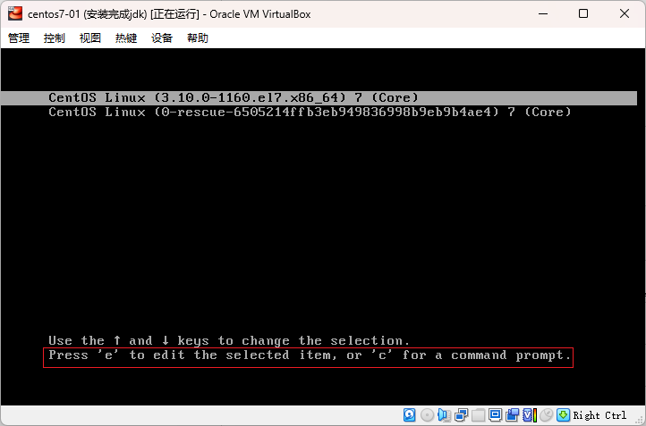
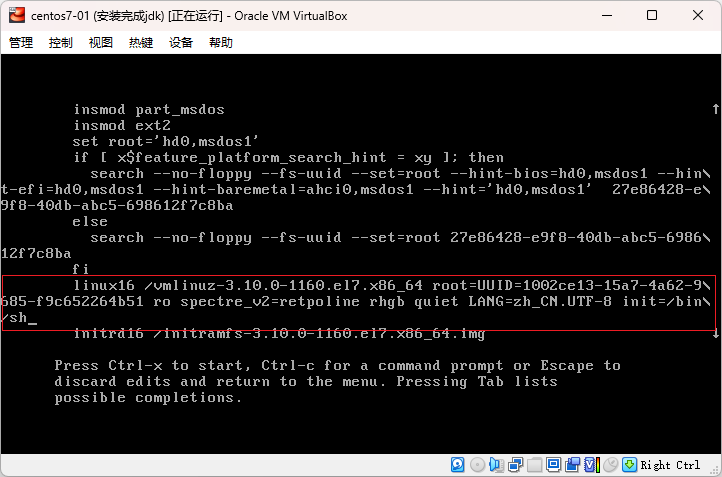
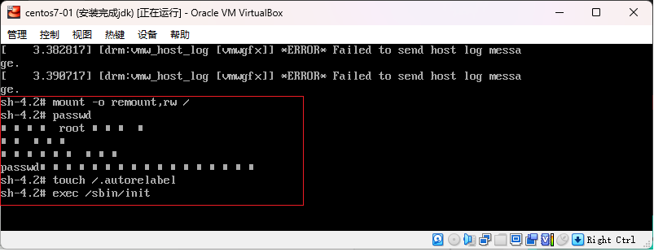
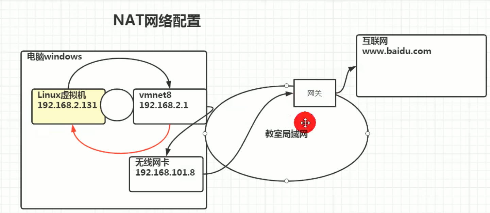
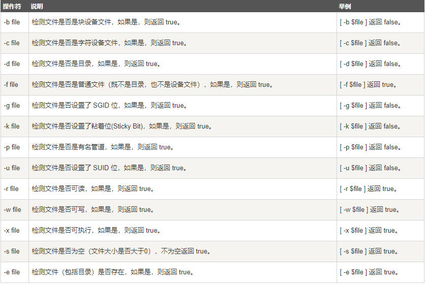
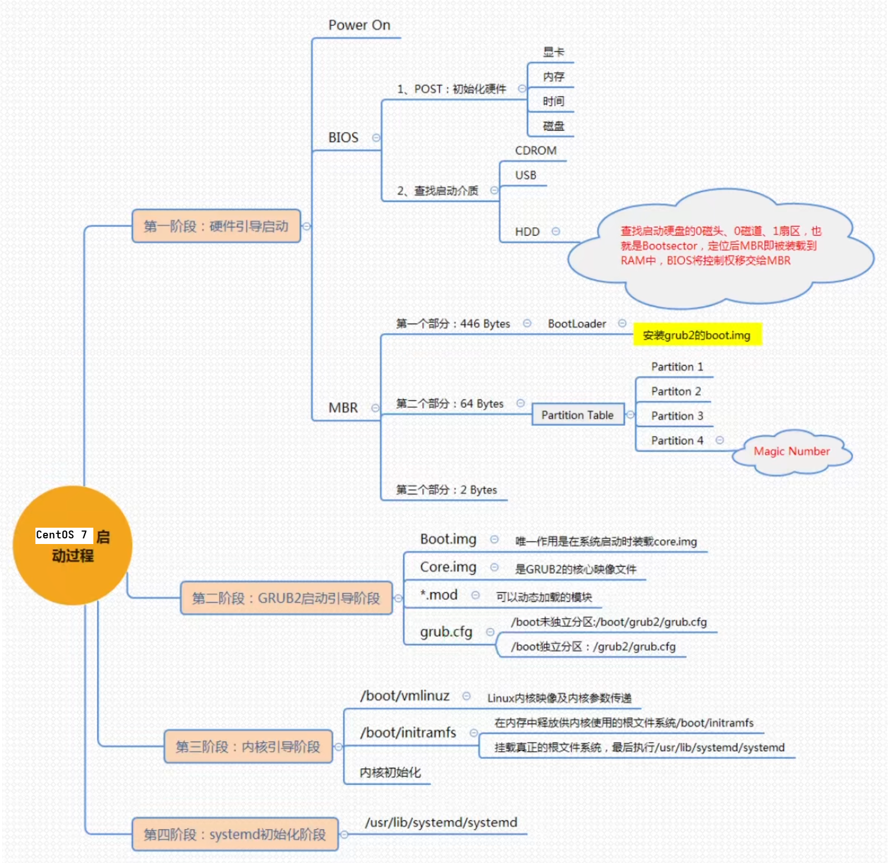
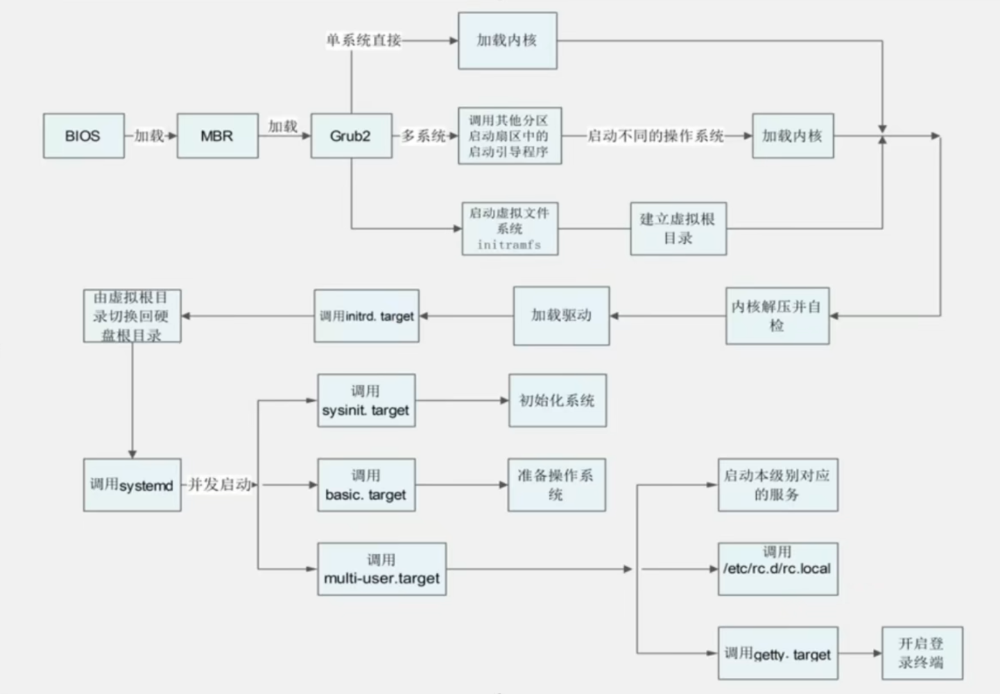

# Linux Note

software RAID devices：把多块硬盘组合成一个更安全或更快的虚拟设备，例如把/dev/sda和/dev/sdb做成/dev/md0

- LVM volumes：
    - 第一层：物理硬盘（Physical Disk）
    - 第二层：物理分区，如/dev/sda1、/dev/sda2
    - 第三层：物理卷 PV（Physical Volume），物理分区可以变成物理卷
    - 第四层：卷组 VG（Volume Group）
    - 第五层：逻辑卷 LV（Logical Volume）：是一个虚拟分区，传统分区如：/dev/sda1、/dev/sda2不能扩扩缩容，但是虚拟分区可以

```sh
# 创建物理卷
pvcreate

# 创建卷组
vgcreate

# 创建逻辑卷
lvcreate
```

## inode

- 硬盘以扇区（sector）为最小物理存储单位，而操作系统和文件系统以块（block）为单位进行读写，块由多个扇区组成
- 固态硬盘虽然没有物理扇区，但使用逻辑块，与传统硬盘的块类似
- 文件的数据存储在块中
- 文件的元信息（inode号、文件类型、权限、所有者、大小、修改时间等）存储在inode中，每个文件都有唯一的inode
- inode不存储文件的数据，而是存储指向文件数据的指针，操作系统通过指针找到并读取文件数据
- inode是一种固定大小的数据结构，在文件系统创建时就确定了
- 系统可以通过inode号直接定位到文件的元信息，无需遍历整个文件系统
- inode的数量是有限的，每个文件系统只能包含固定数量的inode

```sh
# 查看文件的inode信息
stat /path/to/filename
```

## 用户态和内核态

- 用户态(User Mode) :
    - 用户态运行的进程可以直接读取用户程序的数据，拥有较低的权限。
    - 当应用程序需要执行某些需要特殊权限的操作，例如读写磁盘、网络通信等，就需要向操作系统发起系统调用请求，进入内核态。

- 内核态(Kernel Mode) ：
    - 内核态运行的进程几乎可以访问计算机的任何资源包括系统的内存空间、设备、驱动程序等，不受限制，拥有非常高的权限。
    - 当操作系统接收到进程的系统调用请求时，就会从用户态切换到内核态，执行相应的系统调用，并将结果返回给进程，最后再从内核态切换回用户态。

内核态相比用户态拥有更高的特权级别，因此能够执行更底层、更敏感的操作。不过，由于进入内核态需要付出较高的开销（需要进行一系列的上下文切换和权限检查），应该尽量减少进入内核态的次数，以提高系统的性能和稳定性。

- 用户态切换到内核态的 3 种方式：
    - 系统调用（Trap）：这是最主要的方式，是应用程序主动发起的。
        - 比如，当我们的程序需要读取一个文件或者发送网络数据时，它无法直接操作磁盘或网卡，就必须调用操作系统提供的接口（如 read(),send()）, 这会触发一次从用户态到内核态的切换。
    - 中断（Interrupt）：这是被动的，由外部硬件设备触发。
        - 比如，当硬盘完成了数据读取，会向 CPU 发送一个中断信号，CPU 会暂停当前用户态的程序，切换到内核态去处理这个中断。
    - 异常（Exception）：这也是被动的，由程序自身错误引起。
        - 比如，我们的代码执行了一个除以零的操作，或者访问了一个非法的内存地址（缺页异常），CPU 会捕获这个异常，并切换到内核态去处理它。

在系统的处理上，中断和异常类似，都是通过中断向量表来找到相应的处理程序进行处理。区别在于，中断来自处理器外部，不是由任何一条专门的指令造成，而异常是执行当前指令的结果。

最后，需要强调的是，这种状态切换是有性能开销的。因为它涉及到保存用户态的上下文（寄存器等）、切换到内核态执行、再恢复用户态的上下文。因此，在高性能编程中，我们常常需要考虑如何减少这种切换次数，比如通过缓冲 I/O 来批量读写文件，就是一个典型的例子。

## Linux的目录结构

Linux 使用一种称为目录树的层次结构来组织文件和目录

|序号|目录|描述|
|:-|:-|:-|
|1|/|根目录，在此目录下创建其它目录|
|2|/bin,usr/bin,usr/local/bin|binary的缩写，存放二进制可执行文件，最常用的命令一般都在这里（ls、mkdir、cp等）|
|3|/sbin,usr/sbin,usr/local/sbin|存放二进制可执行文件，系统管理员使用的系统级别的管理命令和程序|
|4|/home|普通用户的主目录，每个用户都有一个自己的家目录，一般家目录名是用户的账号，如：/home/handle|
|5|/root|系统管理员的用户主目录|
|6|/mnt|临时挂载点，系统提供该目录是为了让用户临时挂载别的文件系统，我们可以将外部的存储挂载在/mnt上，然后进入该目录就可以查看里面的内容了|
|7|/media|系统会自动识别一些设备，把自动识别出来的设备挂载到这个目录下（例如U盘、光驱等）|
|8|/etc|所有的系统管理所需要的配置文件和目录，比如mysql的my.conf|
|9|/usr|用户的很多应用程序和文件都放在这个目录下，类似Windows的program files目录|
|10|/usr/local|也是安装软件所安装的目录，一般是通过编译源码方式安装的程序，存放的是可执行程序|
|11|/opt|optional，系统之外的、可选安装的第三方软件放在这里，如vscode解压后得到的整个文件夹|
|12|/tmp|用于存放各种临时文件，是公用的临时文件存储点|
|13|/lib,lib64|存放着和系统运行相关的库文件，类似Windows的dll文件，几乎所有的应用程序都需要用到这些共享库|
|14|/boot|存放用于系统引导时使用的各种文件|
|15|/dev|device的缩写，类似Windows的设备管理器，把所有的硬件用文件的形式存储|
|16|/lost+found|这个目录一般情况下是空的，系统非法关机后，这里就存放了一些“无家可归”的文件|
|17|/var|存放着在不断扩充的东西，习惯将经常被修改的目录放在这里，包括各种日志文件|
|18|/proc|不能动，这个目录是一个虚拟的目录，它是系统内存的映射，访问这个目录来获取系统信息|
|19|/selinux|security-enhanced linux，是一种安全子系统，它能控制程序只能访问特定文件，有三种工作模式，可以自行设置|
|20|/srv|不能动，service的缩写，该目录存放一些服务启动之后需要提取的数据|
|21|/sys|不能动，这是linux2.6内核的一个很大的变化，该目录下安装了2.6内核中新出现的一个文件系统sysfs|

## Linux软件安装

### 安装`*.src.rpm`形式的源代码软件包

安装

```sh
# 将源代码编译并在/usr/src/dist/RPMS下生成二进制的rpm包
rpm -rebuild *.src.rpm
```

cd /usr/src/dist/RPMS
rpm -ivh*.rpm

卸载：rpm -e packgename
说明：rpm --rebuild*.src.rpm命令将源代码编译并在/usr/src/dist/RPMS下生成二进制的rpm包，然后再安装该二进制包即可。packgename如前所述，两种方法如下：

法1：
rpm -i your-package.src.rpm
cd /usr/src/redhat/SPECS
rpmbuild -bp your-package.specs           #一个和你的软件包同名的specs文件
cd /usr/src/redhat/BUILD/your-package/    #一个和你的软件包同名的目录
./configure                    #这一步和编译普通的源码软件一样，可以加上参数
make
make instal
法2：
rpm -i you-package.src.rpm cd /usr/src/redhat/SPECS  #前两步和方法一相同
rpmbuild -bb your-package.specs   #一个和你的软件包同名的specs文件
这时在/usr/src/redhat/RPM/i386/（根据具体包的不同，也可能是i686,noarch等等）在这个目录下，有一个新的rpm包，这个是编译好的二进制文件。
rpm -i new-package.rpm即可安装完成。

### 安装`*.tar.gz/*.tgz`或`*.bz2`形式的源代码软件包

- 解压文件

```sh
# 解压文件
tar -zxvf *.tar.gz
# 先解压然后进入解压后的目录
tar -jxvf *.tar.gz
```

- 配置安装路径

```sh
./configure --prefix=安装目标路径
```

- 编译

```sh
make
```

- 安装

```sh
make install
```

- 卸载

```sh
make uninstall
```

- 彻底删除安装路径

```sh
rm -rf 安装目标路径
```

## 命令

- 命令选项的参数写法

|选项类型|写法|
|:-|:-|
|短选项`-x`|如果是必选参数，可以写成`-x参数`或`-x 参数`，标准写法是后者；如果是可选参数，必须写成`-x参数`|
|短选项组合`-xyz`|`-xyz 参数`，这个参数只会绑定到组合里的最右边的选项，只适用`-z`是必选参数的情况，建议带参数还是不要用组合写法了|
|长选项`--x`|如果是必选参数，可以写成`--x 参数`或`--x=参数`；如果是可选参数，必须写成`--x=参数`|

### Linux帮助命令

```sh
# 获得命令/配置文件的帮助信息
man 命令/配置文件

# 获得shell内置命令的帮助信息
help 命令

# 如果没有安装man和help，对于大多数命令
命令 --help
```

### 重启和关机

- 立即重启，`shutdown -r now` 或 `reboot` 或 `systemctl reboot`

- 立即关机，`shutdown -h now` 或 `halt` 或 `systemctl poweroff`

- 一分钟后关机，`shutdown` 或 `shutdown -h 1`

- 把内存数据同步到磁盘，`sync`

注意：虽然shutdown/reboot/halt等命令已经在关机前进行了`sync`，我们在重启或关机前最好还是执行一次`sync`

### 登录和注销

登录时尽量少用root账号登录，避免操作失误；当权限不够时，可以通过切换用户命令切换为管理员身份

- 切换用户

```sh
# su即switch user
# 切换用户，但不加载该用户的登录环境，当前目录等不会切换
su 用户名

# 切换用户，并加载该用户的完整登录环境，当前目录变成切换后的用户家目录
# 从权限高的用户切换到权限低的用户，不需要输入密码，反之需要输入密码
# 切换用户后返回到原来用户，使用 exit/logout
su - 用户名
```

- 注销，`logout`

注意：`logout`在运行级别3以下有效，在图形运行级别无效

### 用户管理

- 添加用户

```sh
# 创建用户成功后，会自动创建和用户名相同的家目录: /home/用户名
useradd 用户名

# 创建新用户
# -m，创建该用户的家目录，将该家目录的所有者设置为该用户
# -G，加入wheel，但是也会创建和用户名相同的用户组
# -s，指定用户登录时使用的默认shell为/bin/bash，一定要确认该bash存在，不然会导致用户登录不了，这种情况执行："chsh -s path/to/正确的bash 用户名"来纠正
useradd -m [-G wheel] [-s /bin/bash] 用户名

# 创建新用户并指定家目录
useradd -d 指定目录 用户名

# 创建新用户时指定用户组，如果不指定则系统默认创建一个和用户同名的组，并将用户添加到组中
useradd -g 用户组名称 用户名
```

- 删除用户

```sh
# 删除用户，但是保留用户的家目录
userdel 用户名

# 删除用户及用户的家目录，谨慎使用
userdel -r 用户名
```

- 指定/修改用户密码，不指定用户名时是对当前用户进行操作

```sh
passwd 用户名
```

- 查看用户信息

```sh
# 查看当前用户名（是登录用户，非切换后的用户）
whoami

# 查看当前用户信息（是登录用户，非切换后的用户）
who am i

# 查看指定用户的信息
id 用户名

# 查看所有用户
cat /etc/passwd
```

#### 用户所在组

在Linux中，每个用户都必须属于一个组

```sh
# 修改用户所属的用户组
usermod -g 新用户组名称 用户名

# 移除用户组的某个用户
gpasswd -d 用户名 用户组

# 改变该用户登录的初始目录，该用户要有进入该目录的权限才会成功
usermod -d 目录 用户名
```

#### 用户组

用户组类似于角色，系统通过用户组对有共性（权限）的用户进行统一管理

```sh
# 新增用户组
groupadd 用户组名称

# 删除用户组
groupdel 用户组名称

# 修改用户组
sudo groupmod -n 新组名 旧组名

# 列出系统中已经存在的用户组
cat /etc/group
```

#### 用户和组相关文件

- /etc/passwd文件 用户的配置文件，记录用户的各种信息

每行的含义：用户名:口令(x):用户标识号(uid):组标识号(gid):注释性描述:主目录(家目录):登录Shell(一般是Bash shell)

- /etc/shadow文件 口令的配置文件

每行的含义：登录名:加密口令:最后一次修改时间:最小时间间隔:最大时间间隔:警告时间:不活动时间:失效时间:标志

- /etc/group文件 用户组的配置文件，记录Linux包含的组的信息

每行的含义：组名:口令(x):组标识号(uid):组内用户列表

### 运行级别

运行级别说明：

- 0：关机

- 1：单用户【找回丢失密码】

- 2：多用户状态无网络服务

- 3：多用户状态有网络服务

- 4：系统未使用，保留给用户的运行级别

- 5：图形界面

- 6：系统重启

- 常用运行级别是3和5，可以指定默认运行级别

- 切换运行级别

```sh
init 运行级别
```

- CentOS 7 在/etc/inittab文件中进行了简化

multi-user.target:analogou to runlevel 3
graphical.target.target:analogou to runlevel 5

```sh
# 获取当前机器默认运行级别
systemctl get-default

# 设置当前机器默认运行级别
systemctl set-default multi-user.target
```

### 找回root密码

- 重启系统，在开机界面按“e”进入编辑界面



- 在编辑界面光标往下移动，定位到“linux16”开头最在行的末尾，输入`init=/bin/sh`，完成后按“Ctrl + X”进入单用户模式



- 在光标闪烁的位置输入`mount -o remount,rw /`，完成后按`回车`

- 在新的一行输入`passwd`，完成后按`回车`

- 然后输入新密码，完成后按`回车`；然后再次输入新密码，完成后按`回车`；显示passwd...的样式，说明密码修改成功

- 在光标闪烁的位置输入`touch /.autorelabel`，完成后按`回车`

- 在光标闪烁的位置输入`exec /sbin/init`，完成后按`回车`，等待系统自动修改密码，过程可能有点长，完成后系统会自动重启，就可以输入密码登录了



### 文件/目录命令

#### 常用目录

```sh
# 当前目录
.

# 当前目录的上一级目录
..

# 家目录
~
```

#### 切换到指定目录

```sh
# 切换到指定目录
cd 目录

# 显示当前所在目录的绝对路径
pwd

# 切换到当前目录上一级目录
cd ..

# 切换到上上级目录
cd ../..

# 切换到家目录
cd ~

# 切换到上一个操作所在目录
cd -
```

#### 增删改文件/目录

```sh
# 新建文件
touch 文件名

# 新建目录
# mkdir默认创建一级目录，
# -p：parents，确保目录路径中的所有父级目录都被创建
# -m 755，设置文件权限，所有者拥有读、写、执行权限，所属组和其他用户只有读、执行权限
mkdir [-p] [-m 755] 目录名称

# 删除空目录
rmdir [可选项] 目录名称

# 删除文件/非空目录（谨慎操作）
# -r：递归
# -f：强制
rm [-rf] 文件/目录

# 复制文件/目录到指定目录
# \ 强制覆盖不提示 
# -r 递归整个目录
[\]cp [-r] 源文件/目录 目的目录

# 移动/重命名文件/目录
# 当源文件/目录与目的文件/目录名称一样时，就是重命名
# 当源文件/目录与目的文件/目录名称不一样时，就是移动并重命名
mv 源目录/文件 目的目录/文件
```

#### ls查看目录内容

```sh
# -a，展示当前目录下所有的文件和目录，包括隐藏的
# -h，human readable
# -l，以列表的方式显示信息
ls -ahl 文件/目录

# 只展示文件（"^-"表示"-"开头）
ls -l 目录 | grep "^-"

# 统计目录下的文件数
ls -l 目录 | grep "^-" | wc -l

# 统计目录下的子目录数
ls -l 目录 | grep "^d" | wc -l

# 统计目录下的文件数，包括子目录里面的
ls -Rl 目录 | grep "^-" | wc -l

# 以树状展示目录结构
# 一般要手动安装tree
# arch安装命令：sudo pacman -S tree
tree 目录
```

#### cat查看文件内容

```sh
# cat只能浏览不能修改
# -n 显示行号
# 带上"| more"：将cat命令的处理结果交给more命令处理
cat [-n] 文件名 [| more]
```

#### more命令

more命令是基于vi编辑器的文本过滤器，它以全屏幕的方式按页显示文本文件的内容

```sh
more 文件名称
```

|快捷键|功能|
|:-|:-|
|空格|下一页|
|回车|下一行|
|ctrl + f|下一屏|
|ctrl + b|上一屏|
|=|当前行号|
|:f|文件名和当前行号|
|q|退出more|

#### less命令

less命令用来分屏查看文件内容，功能比more强大

less根据显示需要加载内容，对于大型文件具有更高的效率

```sh
less  文件名称
```

|快捷键|功能|
|:-|:-|
|空格|下一页|
|pagedown|下一页|
|pageup|上一页|
|/字符串|向下查找字符串，n向下查找；N向上查找|
|?字符串|向上查找字符串，n向下查找；N向上查找|
|q|退出less|

#### head命令

head用于显示文件的开头部分内容，默认前10行

```sh
# 查看文件前[任意行]内容
head [-n 任意正整数]  文件名称
```

#### tail命令

用于显示文件的末尾部分内容，默认末尾10行

```sh
# 查看末尾[任意行]内容
tail [-n 任意正整数]  文件名称

# 实时追踪该文档的所有更新
tail -f 文件名称
```

#### 文件/目录的所有者、所在组、其它组

- 在Linux中，每个文件都有所有者、所在组、其它组
    - 创建文件的用户就是该文件的所有者（当然创建文件后，所有者是可以改的）
    - 创建文件的用户所属组就是该文件的所在组
    - 对于该文件来说，该文件的所在组之外的组，就是其它组

```sh
# chown：change owner，修改文件/目录的所有者
# 可以先用ls命令查看文件的所有者信息
# 用户名必须是已经存在的
# -R：如果是目录，则使其所有子文件/子目录递归生效
chown [-R] 用户名 文件/目录

# 同时修改文件/目录的所有者和所在组
chown [-R] 用户名:用户组 文件/目录

# chgrp：change group，修改文件/目录的所在组
# -R：如果是目录，则使其所有子文件/子目录递归生效
chgrp [-R] 组名 文件/目录
```

#### 文件/目录权限


- `ls -l`显示内容的第一例有10位字符
    - 1.第0位确定文件类型
        - `-`：普通文件，如（图像、声音、视频、pdf、text、源代码等）
        - d：目录（directory）
        - l：链接（link）
        - c：字符设备文件，如鼠标、键盘
        - b：块设备文件（block），如硬盘
        - p：管道文件（pipe），用于进程之间的通信
        - s：套接字文件（socket），用于进程间的网络通信，也可以用于本机之间的非网络通信
    - 2.第1-3位确定所有者拥有该文件的权限
    - 3.第4-6位确定所属组（的用户）拥有的该文件的权限
    - 4.第7-9位确定其它组（的用户）拥有的该文件的权限

- `ls -l`显示内容的第二列
    - 如果是一个文件，则为：1
    - 如果是一个目录，则为：子目录数+子文件数

- `ls -l`显示内容的第三列为文件/目录的所有者

- `ls -l`显示内容的第四列为文件/目录的所在组

- `ls -l`显示内容的第五列
    - 如果是文件，则为：文件大小（字节）
    - 如果是目录，则为：4096（字节）

- `ls -l`显示内容的第六列为：最后修改日期

- `ls -l`显示内容的第七列为：文件/目录名

##### rwx权限详解

- 对于文件
    - r：可读，也可以用数字4表示
    - w：可写，但是不代表可删除，可删除的前提是对该文件所在目录有写权限，也可以用数字2表示
    - x：可执行（对于可执行文件），也可以用数字1表示

- 对于目录
    - r：可读（ls查看目录内容）
    - w：可写，如创建、删除文件/（子）目录，重命名（子）目录
    - x：可进入该目录（cd）
        - 如果对目录没有x权限，就算对该目录下的文件有读写权限也不能查看、修改
        - 如果对目录没有x权限，就算对目录有w权限，也不能删除该目录下的文件

##### 修改文件权限

- 第一种方式：
    - 通过`+`（增加权限）、`-`（撤回权限）、`=`（赋予权限）
    - `u`：所有者；`g`：所在组；`o`：其它组；`a`：所有人（all）
    - 如果不指定u/g/o/a，chmod默认使用a
- 第二种方式：通过数字变更权限
      - r=4,w=2,x=1,赋予了什么权限就将其权限值相加

```sh
# 相当于 chmod 751 文件/目录
chmod u=rwx,g=rx,o=x 文件/目录

chmod u-x,g+w+x,o+r 文件/目录

# 给文件所有者、所在组、其它组都加x权限的三种写法
chmod u+x,g+x,o+x 文件/目录
chmod a+x 文件/目录
chmod +x 文件/目录
```

##### 给文件加锁

```sh
# 加锁
chattr +i /etc/passwd

# 移动chattr到别的目录
mv /usr/bin/chattr /path/to/target

# 继续给chattr改名，这样任何人都无法执行chattr -i /etc/passwd解锁了
# 想要解锁的时候，将文件名改回chattr并移动到原来的目录，就可以了
mv /path/to/chattr /path/to/target

# 解锁
chattr -i /etc/passwd
```

- 除了给文件加锁外，还可以使用SUID，SGID，Sticky设置特殊权限

- 还可以用chkrootkit或rootkit hunter检测rootkit脚本（rootkit是入侵者使用工具）

- 还可以用Tripwire检测文件系统完整性

### tr字符处理命令

tr专门做字符级别的转换、删除、压缩

- 用法

```sh
tr [OPTION]... STRING1 [STRING2]
```

|选项|描述|
|:-|:-|
|-c或-C|取反|
|-d|删除|
|-s|压缩|
|-t|截断|

|字符集|描述|
|:-|:-|
|a-z|小写字母|
|A-Z|大写字母|
|0-9|数字|

- 例

```sh
# 把一组字符替换成另一组字符，输出：ABC123
echo "abc123" | tr 'a-z' 'A-Z'

# 把符合的子串abc截断成12一样的长度，得到ab，将ab替换为12，c不受影响，输出：12c123
echo "abc123" | tr -t 'a-z' '12'

# 删除字符，输出：abc
echo "abc123" | tr -d '0-9'

# 压缩重复字符，输出：abc123
echo "aabc123" | tr -s 'a'

# 取反，将所有非小写字母和换行符都变成d，输出：abcddd
# 写成echo "abc123" | tr -c 'a-z' 'd'，控制台会输出：abcdddd[用户名@主机名 ~]$，因为它把换行符也取反了
echo "abc123" | tr -c 'a-z\n' 'd'
```

### echo命令

用于输出内容到控制台

```sh
echo [可选项] 输出内容

# 输出环境变量（要大写）
echo $PATH

# 输出字符串
echo "hello world"
```

### >命令

输出重定向（覆盖）

```sh
# 将输出到控制台的字符串重定向（覆盖写）到hello.txt（文件不存在会自动创建）
echo "hello world" > hello.txt
```

### >>命令

追加

```sh
# 将输出到控制台的字符串追加写到hello.txt
echo "hello world" >> hello.txt
```

### ln命令

- 硬链接（Hard Link）：
    - 和源文件的inode号相同，对文件系统来说是完全平等的，删除其中一个对另一个没有影响
    - 只有删除了源文件和它所有的硬链接文件，该文件才真正被删除
    - 不能对目录以及不存在的文件创建硬链接
    - 硬链接不能跨越文件系统

- 软链接/符号链接（Symbolic Link）：
    - 类似于Windows系统的快捷方式，存放了链接到其它文件的路径
    - 软链接和源文件的inode号不同
    - 源文件删除后，软链接依然存在，只是指向的是一个无效的文件路径
    - 可以对目录以及不存在的文件创建软链接
    - 软链接可以跨越文件系统

```sh
# 给目录/文件创建一个软链接
# -s：ln命令默认创建的是硬链接，通过指定-s创建软链接
ln -s 目录/文件 软链接名称

# 删除链接
rm 链接名称
```

### history命令

查看执行过的历史命令

```sh
# 显示最近执行过的任意条命令
history [任意正整数]

# 执行对应历史编号的命令
!历史命令编号
```

### 系统命令

```sh
# 显示操作系统的发行版号
uname -r

# 显示系统名、节点名称、操作系统的发行版号、内核版本等信息
uname -a

# 查看linux系统版本，适用于Redhat的Linux
cat /etc/redhat-release

# 总体内存占用，-m 用Mb单位来显示
free -m
```

### 日志命令

```sh
# 查看关于nginx的系统日志
cat /var/log/messages | grep nginx
```

### 压缩/解压命令

#### tar.gz文件

|选项|描述|
|:-|:-|
|-c|产生.tar打包文件|
|-v|显示详细信息|
|-f|指定压缩后的文件名/要解压的压缩包文件名|
|-z|tar只负责打包/解包，不负责压缩/解压，把数据推给其它压缩/解压程序处理|
|-x|解包.tar文件|

```sh
# 压缩多个文件
tar -zcvf xxx.tar.gz 被压缩文件1 被压缩文件2

# 压缩文件夹
tar -zcvf xxx.tar.gz 被压缩文件夹

# 解压到当前目录
tar -zxvf xxx.tar.gz

# 解压到指定目录
tar -zxvf xxx.tar.gz -C /path/to/directory
```

#### gz文件

```sh
# 将文件（不能压缩目录）压缩为*.gz文件
gzip 被压缩文件

# 解压
gunzip xxx.gz
```

#### zip文件

```sh
# 压缩文件
zip xxx.zip 被压缩文件

# 压缩目录
zip -r xxx.zip 被压缩目录

# 解压到当前目录
unzip xxx.zip

# 解压到指定目录
unzip -d /path/to/directory xxx.zip
```

### 文件传输命令

远程文件写法：user@remote:/path/to/file.txt

```sh
# scp 即 secure copy，安全复制
# 用于通过SSH协议进行安全的文件传输，可以实现从本地到远程主机的上传和从远程主机到本地的下载
# 例如：scp -r my_directory user@remote:/home/user ，将本地目录my_directory上传到远程服务器 /home/user 目录下
# scp -r user@remote:/home/user/my_directory ，将远程服务器的 /home/user 目录下的my_directory目录下载到本地
# 需要注意的是，scp 命令需要在本地和远程系统之间建立 SSH 连接进行文件传输，因此需要确保远程服务器已经配置了 SSH 服务，并且具有正确的权限和认证方式
scp [-r] 源文件/目录 目的文件/目录

# 在本地和远程系统之间高效地进行文件复制，并且能够智能地处理增量复制，节省带宽和时间
rsync [-r] 源文件/目录 目的文件/目录 
```

### 日期/时间类命令

```sh
# 显示当前时间（年月日时分秒和星期）
date

# 显示当前年
date +%Y

# 显示为：年-月-日 时:分:秒
date "+%Y-%m-%d %H:%M:%S"

# 设置时间
date -s "2025-10-28 15:20:00"

# 显示当前日历信息（只显示本月日历）
cal

# 显示当前日历信息（显示2025年的日历）
cal 2025
```

### 查找命令

#### find

从指定目录向下递归遍历其各个子目录，将满足条件的文件或者目录显示在终端

|选项|功能|
|:-|:-|
|-name `文件名`|按照指定文件名查找文件|
|-user `用户名`|查找属于指定用户的所有文件|
|-size `文件大小`|按照指定大小查找文件|

```sh

find 指定目录 可选选项

# 前缀：+、-，表示大于、小于，不加前缀表示等于
# 单位：k、M、G
find /home -size +10M

# 删除指定目录下10天前的所有tar.gz文件
find /path/to/directory -atime +10 -name "*.tar.gz" -exec rm -rf {} \;
```

#### locate

快速定位文件路径

locate指令利用事先建立的系统中所有文件名称及路径的locate数据库实现快速定位

```sh
# 在第一次执行locate前，必须使用updatedb命令创建locate数据库
# 之后每次有新增、删除或者移动文件的操作，需要再次执行这个命令
updatedb

locate 文件名
```

#### which

查看指定命令在哪个目录下

```sh
which ls
```

#### grep命令和管道符号`|`

grep：过滤查找

`|`：将`|`左边命令的处理结果传递给右边的命令处理

|选项|功能|
|:-|:-|
|-n|显示匹配行及行号|
|-i|忽略字母大小写|

```sh
grep 可选选项 查找内容 源文件

# 如下两个命令的功能一样
grep "handle" /path/to/hello.txt
cat /path/to/hello.txt | grep "handle"

# 忽略大小写搜索 /var/log/syslog 中所有包含 error 的行
grep -i "error" /var/log/syslog
```

### alias定义命令别名

别名优点：不污染$PATH

- 别名缺点
    - 非交互式Shell、Shell脚本、cron定时任务中默认不加载别名，直接使用会报command not found错误
    - 别名本质是纯文本替换，没有内置参数接收能力
        - 如：`alias myalias="cp $1 /backup"`
        - 当执行`myalias /path/to/file`时
        - 只是最终拼接成`cp $1 /backup /path/to/file`
        - 并不会将`$1`替换为`/path/to/file`
    - 执行`which myalias`不会找到命令的具体位置

```sh
# 查看所有别名
alias

# 创建别名
alias 别名='命令'

# 删除别名
unalias unalias 别名

# 上面的创建和删除别名都是在当前终端生效，只要关闭了终端就没了
# 想要让别名在终端永久生效，可以写入 ~/.bashrc，如果使用zsh的话可以添加到~/.zshrc中，但是笔者没试过
alias ll='ls -l'
```

### crond任务调度

任务调度：系统在某个时间执行的特定的命令或程序（周而复始地反复执行）

- 任务调度分类：
    - 1.系统工作：有些重要的工作必须周而复始地执行，如病毒扫描
    - 2.用户工作：个别用户可能希望执行某些程序，如备份数据库

- 用法：

```sh
crontab [options] file
crontab [options]
crontab -n [hostname]

# 重启任务调度
service crond restart

# 1.执行
crontab -e

# 2.在调度文件中输入任务，wq保存
*/10 * * * * date >> /tmp/out.txt
# 记得给当前用户赋予file.sh的执行权限
*/10 * * * * /path/to/file.sh
```

|序号|选项|描述|
|:-|:-|:-|
|1|-e|编辑定时crontab任务|
|2|-l|列出crontab任务|
|3|-r|删除当前用户所有的crontab任务|

- cron语法（注意每个时间之间有空格）：`* * * * *`，从左往右每个`*`含义如下

|项|含义|范围|
|:-|:-|:-|
|第1个`*`|一小时当中的第几分钟|0-59|
|第2个`*`|一天当中的第几小时|0-23|
|第3个`*`|一月当中的第几天|1-31|
|第4个`*`|一年当中的第几月|1-12|
|第5个`*`|一周当中的星期几|0-7（0和7都表示星期日）|

- 特殊符号说明

|序号|特殊符号|描述|
|:-|:-|:-|
|1|*|表示任何时间，如第一个*就表示一小时中每分钟都执行|
|2|,|表示不连续的时间，如`0 8,12,16 * * *`表示每天的8点整、12点整、16点整都执行一次|
|3|-|表示连续的时间，如`0 5 * * 1-6`表示周一到周六的5点整执行|
|4|*/n|表示每个多久执行一次，如`*/10 * * * *`表示每隔10分钟执行|

- 星期几和几号最好不要同时出现，它们定义的都是天，容易混乱

### at定时任务

- at命令是一次性的定时计划任务，at的守护进程atd以后台模式运行，检查任务队列运行定时任务
- 默认情况下，atd守护进程每60秒检查任务队列，有任务时，会检查任务运行时间，如果与当前时间匹配，则运行此任务
- 在使用at命令的时候，一定要保证atd进程的启动

```sh
# archlinux安装at
sudo pacman -S at

# 检查atd是否已经启动
ps -ef | grep atd

# at命令格式，输入完后按两次Ctrl+D结束具体任务内容输入
at 选项 时间

# 步骤1：任务时间
at 8am tomorrow

# 步骤2：任务内容
date > /tmp/date.log

# 查询在等待执行的定时任务
atq

# 删除任务，先通过atq得到任务号
atrm 任务编号
```

|选项|描述|
|:-|:-|
|-m|当指定的任务被完成后，将给用户发送邮件，即使没有标准输出|
|-I|查询，atq的别名|
|-d|删除，atrm的别名|
|-v|显示任务将被执行的时间|
|-c|打印任务的内容到标准输出|
|-V|显示版本信息|
|-q <队列>|使用指定的队列|
|-f <文件>|从指定文件读入任务而不是从标准输入读入|
|-t <时间参数>|以时间参数的形式提交要运行的任务|

|时间|描述|
|:-|:-|
|hh:mm|如果当天该时间已经过去，就会在第二天执行，如04:00|
|midnight或noon或teatime|使用比较模糊的词语来指定时间，teatime一般是下午4点|
|采用12小时计时制，时间后加上am或pm|如8am|
|指定具体日期，month day或mm/dd/yy或dd.mm.yy|指定的日期必须跟在指定的时间后面，如04:00 2026-01-03|
|now + 数字 时间单位|时间单位有minutes、hours、days、weeks，如now + 5 minutes|
|today或tomorrow|直接使用这两个词语中的某个指定时间|

### Linux分区

一个硬盘可以分很多个分区，但是对于Linux来说，它就只有一个根目录，一个独立且唯一的文件结构，每个分区都是用来组成这个文件系统的一部分

#### 硬盘说明

Linux硬盘分IDE硬盘和SCSI硬盘，此外还有nvme固态硬盘，目前基本上是SCSI硬盘

- 对于IDE硬盘，驱动器标识符为`hdx~`
    - `hd`：分区所在设备的类型，这里就是指IDE硬盘了
    - `x`：盘号，a为基本盘，b为基本从属盘，c为辅助主盘，d为辅助从属盘
    - `~`：分区，前4个分区用数字1-4表示，它们是主分区或扩展分区，从5开始就是逻辑分区
    - `hdb2`：第二个IDE硬盘上的第二个主分区或扩展分区
- 对于SCSI硬盘，驱动器标识符为`sdx~`
    - `sd`：分区所在设备的类型，这里就是指SCSI硬盘了
    - 其余和IDE硬盘的表示方法一样
- 对于nvme固态硬盘，待补充

```sh
# 查看所有设备挂载情况
# -f：列出文件系统信息
lsblk [-f]

# 查看系统整体磁盘使用情况
df -h

# 查看指定目录的磁盘占用情况
# -s：只显示汇总
# -h：人类可读格式
# -a：统计包含文件，而不只是目录
# -d：最大子目录深度，为"-d 0"时和-s结果一样
# -c：生成汇总
du -h 目录
```

## 环境变量

- 按照作用域来分
    - 用户级别环境变量 :`~/.bashrc`、`~/.bash_profile`
    - 系统级别环境变量 : `/etc/bashrc`、`/etc/profile`、`/etc/profile.d`、`/etc/environment`

- 上述配置文件执行先后顺序为：`/etc/environment` –> `/etc/profile` –> /`etc/profile.d` –> `~/.bash_profile` –> `/etc/bashrc` –> `~/.bashrc`

- `etc/profile.d`被`/etc/profile`加载

```sh
# 设置环境变量，让子进程（如新打开的终端、脚本）继承
# 实际上配置文件也是一个脚本文件
# 设置环境变量就是用export语句，将shell变量输出为环境变量
export 变量名=变量值

# 让修改后的配置信息立即生效
source /path/to/config_file

# 查看环境变量的值
echo "$PATH"

# 查看所有的环境变量
env
```

## 网络

### NAT网络配置



主机上有一个虚拟网卡vmnet8，这个网卡可以跟虚拟机的网卡相互ping通，它们在同一个网段

虚拟机访问互联网要通过主机的虚拟网卡，无线网卡对虚拟网卡的请求进行代理

### 网络命令

```sh
# 查看ip地址信息1
ip addr

# 查看ip地址信息2
# 此命令一般需要先安装相应工具
ifconfig

# 列出网络接口（设备）
# 网络接口（设备）被udev管理，通过systemd.link文件进行配置
# 前缀en表示有线/以太网，wl表示无线/WLAN，ww表示mobile broadband/WWAN
# lo： Virtual Loopback Interface（虚拟回环接口），是操作系统网络栈里的一种特殊接口，用来让主机和自己通信。它不是物理网卡，而是纯软件实现的网络接口。
# 只显示网络接口（设备）名称
ls /sys/class/net

# 除了显示网络接口（设备）名称外还有别的信息显示
ip link

# 进入对应网卡文件进行修改
vi /etc/sysconfig/network-scripts/ifcfg-enp0s3

# 重启网络
service network restart

# 修改主机名，编辑/etc/hostname文件并保存重启
vim /etc/hostname

# 设置主机名/域名和hosts映射，
# 编辑/etc/hosts文件，输入：10.0.2.5 你的主机名/域名
vim /etc/hosts

# 监听本机，将来自ip:22的连接数据保存到/var/log/tcpdump.log
# ens33表示本机网卡
tcpdump -i ens33 host ip and port 22 >> /var/log/tcpdump.log
```

### 主机名解析机制

- 例子：在浏览器输入www.baidu.com访问百度网页
    - 1.浏览器先检查浏览器缓存有没有该域名信息，如果有就使用缓存完成域名解析
    - 2.如果没有，就检查系统缓存有没有该域名信息，如果有就使用系统缓存完成域名解析
    - 3.如果没有，就检查系统hosts文件中有没有配置对于的域名IP映射，如果有就使用它完成域名解析
    - 4.如果没有，则到域名服务（DNS）解析域名得到IP
    - 5.如果DNS也没有，则返回域名不存在

### 防火墙命令

```sh
# 开启/关闭防火墙，开启/关闭防火墙自启动，查看防火墙状态
systemctl <start|stop|enable|disable|status> firewalld

# 查看所有开放的端口，观察ports关键字列出的端口，默认是空的
firewall-cmd --list-all

# 查看某个端口是否开放
firewall-cmd --query-port=端口/协议

# 打开/关闭端口，需要重新加载防火墙才会生效
firewall-cmd --permanent --zone=public --add-port=端口/协议
firewall-cmd --permanent --zone=public --remove-port=端口/协议

# 重新加载防火墙
firewall-cmd --reload
```

### 监控网络状态

#### netstat

netstat（net-tools包）已经过时，推荐使用ss命令（arch的iproute2包）

```sh
# 查看系统网络状况
# -an：按一定顺序排列输出
# -p：显示那个进程正在调用
netstat [选项]

# 可以查看端口使用的协议
netstat -anp

# 查看应用占用的端口
netstat -tunlp [| grep 应用名]

# 查看端口有没有被某个进程占用
lsof -i:6379

# 检测两个主机间的网络连接是否联通
ping [域名|IP]

# 统计连接到服务器的各个ip情况，并按连接数从大到小排序并截取前两条
# awk -F " " '{print $5}'：按空格分割，取第5段的字符串
# cut -d ":" -f 1：按:分割，取第1段
# uniq -c：统计个数，统计前要先排序
# sort -nr：从大到小排序
# head -2：截取前面两条
netstat -an | grep ESTABLISHED | awk -F " " '{print $5}' | cut -d ":" -f 1 | sort | uniq -c | sort -nr | head -2
```

## 进程

在Linux中，每个执行的程序都称为一个进程，系统为每个进程都分配一个进程号（pid）

- 每个进程都可能以两种方式存在：前台和后台
    - 前台进程：用户可以在屏幕上进行操作的进程
    - 后台进程：用户无法在屏幕上看到，但实际上在执行的进程
    - 一般的系统服务都是以后台进程的方式存在，而且开机后常驻系统中，直到关机才结束

### ps命令查看进程信息

查看目前系统中有哪些进程正在执行，以及它们的状态

- `ps -aux`显示的信息字段

|字段|描述|
|:-|:-|
|USER|执行进程的用户|
|PID|进程ID|
|%CPU|进程占用CPU的百分比|
|%MEM|进程占用物理内存的百分比|
|VSZ|进程占用虚拟内存的大小（kb）|
|RSS|进程占用物理内存的大小（kb）|
|TTY|终端名称|
|STAT|进程状态，S：睡眠，s：该进程是会话的先导进程，N：进程拥有比普通优先级更低的优先级，R：正在运行，D：短期等待，Z：僵死（可能进程死掉了但是内存没有释放，需要定时清除），T：被跟踪或者被停止|
|START|进程的启动时间|
|TIME|进程占用的CPU时间|
|COMMAND|执行此进程所用的命令，如果过长会截断显示，进程名称也是看这个字段|

- `ps -ef`显示的信息字段，只展示上面表格没出现过的

|字段|描述|
|:-|:-|
|PPID|父进程ID|
|C|CPU用于计算执行优先级的因子，数值越大，表示进程是CPU密集型运算，执行优先级会降低；数值越小，表示进程是I/O密集型运算，执行优先级会提高|
|STIME|进程的启动时间|

```sh
# -a：显示当前终端的所有进程信息
# -u：以用户的格式显示进程信息
# -x：显示后台进程运行的参数
# -e：显示所有进程
# -f：全格式，包括命令行
ps [-aux]

# 以全格式显示当前所有的进程
ps -ef

# 查看进程树
# -p：显示进程id
# -u：显示进程所属用户
pstree [选项]

# 查看应用有没有启动
ps -ef|grep 应用名

# 查看打开的终端
ps -aux | grep bash

# 查看远程登录服务进程，可以看到谁登录并且通过进程号终止进程进而强制用户下线
# 要是终止了sshd服务，可以通过"sudo systemctl start sshd"重启sshd服务
ps -aux | grep sshd

# grep -v "grep"：不匹配自己
ps -aux | grep sshd | grep -v "grep"
```

### top动态更新显示正在执行的进程

```sh
# -d 秒数：指定每隔几秒更新，默认3秒
# -i：不显示闲置或者僵死进程
# -p：指定进程id
top [选项]

# 在top实时监控的终端界面，可以按下一些按键进行交互
# P：按CPU使用率排序，默认
# M：按内存使用率排序
# N：按进程ID排序
# 输入u然后输入用户名然后回车，可以监视特定用户
# 输入k然后输入进程id然后回车，然后输入一个信号量（数字9）回车，可以终止该进程
# q或"Ctrl+c"：退出top
```

- top显示的内容

```sh
# 13:14:28表示当前时间
# 2:08表示系统运行时间
# 1 user表示系统用户数量
# load average: 1.11, 0.51, 0.52表示负载均衡，这3个值加起来除以3,如果在0.7以上，表示系统负载较大
top - 13:14:28 up  2:08,  1 user,  load average: 1.11, 0.51, 0.52

# 任务信息
# zombie：僵尸进程，已经死掉了但是内存没释放，需要定时清除僵尸进程
Tasks: 305 total, 1 running, 304 sleep, 0 d-sleep, 0 stopped, 0 zombie

# CPU占用百分比
# us表示用户占用的百分比
# sy表示系统占用的百分比
# id表示空闲的百分比
# wa表示CPU等待I/O的百分比
# hi表示CPU用于处理硬件中断的百分比
# si表示CPU用于处理软件中断的百分比
# st表示CPU被偷走用于运行虚拟机的百分比
%Cpu(s):  8.0 us,  6.7 sy,  0.0 ni, 82.7 id,  0.0 wa,  1.3 hi,  1.3 si,  0.0 st 

# 内存占用情况
MiB Mem :  32021.4 total,  21731.5 free,   4856.2 used,   5430.5 buff/cache     

# swap占用情况
# avail Mem表示系统在不触发 swap 的情况下，应用程序仍然可以立即使用的内存估算值，即上面的物理内存free大小
MiB Swap:      0.0 total,      0.0 free,      0.0 used.  27165.1 avail Mem

# PR：进程优先级（数值越小优先级越高）
# NI：Nice 值（影响 PR，范围 -20～19）
# VIRT：进程使用的虚拟内存总量（含代码、数据、共享库、swap 等）
# RES：Resident Memory，实际占用的物理内存（不含 swap）
# SHR：共享内存大小（共享库、共享页等）
# S：进程状态
PID USER      PR  NI    VIRT    RES    SHR S  %CPU  %MEM     TIME+ COMMAND 
```

### iotop显示进程的I/O使用信息

```sh
sudo pacman -S iotop

sudo iotop
```

### 终止进程

```sh
# 通过进程id终止进程
# -9：强制进程立即停止
kill [选项] 进程id

# 通过进程名称终止进程，这个进程的所有子进程也会被终止
# 支持通配符，这在系统因负载过大而变得很慢时很有用
killall 进程名称
```

## 服务

服务（service）本质就是在后台运行的进程，又称为守护进程，通常会监听某个的端口，等待其它程序的请求，如mysqld、sshd、防火墙等

### 服务管理

```sh
# 在CentOS 7.0后很多服务不再使用service，而是用systemctl
# Arch Linux默认没有安装这个工具
# 启动/停止/重启/重新加载服务/查看服务状态
service 服务名 [start|stop|restart|reload|status]

# service指令管理的服务在/etc/init.d可以看到
ls -l /etc/init.d

# 查看所有服务
# Arch Linux没有这个命令工具
setup
```

### 服务的运行级别

- Linux有7种运行级别（runlevel）：常用的级别是3和5
    - 0: 系统停机状态，系统默认运行级别不能设置为0,否则不能正常启动
    - 1: 单用户工作状态，root权限，用于系统维护，禁止远程登录
    - 2: 多用户状态（没有NFS），不支持网络
    - 3: 完全的多用户状态（有NFS），登录后进入控制台命令行模式
    - 4: 系统未使用，保留
    - 5: X11控制台，登录后进入图形GUI模式
    - 6: 系统正常关闭并重启，默认运行级别不能设置为6,否则不能正常启动

- 开机流程：开机->BIOS->/boot->systemd进程->运行级别->启动运行级别对应的服务

```sh
# CentOS 7.0后
# multi-user.target表示运行级别3
# graphical.target表示运行级别5

# 查看系统默认的运行级别
sudo systemctl get-default

# 设置系统默认的运行级别
sudo systemctl set-default graphical.target
```

#### chkconfig命令

设置服务在各个运行级别下开启/关闭自启动，比如设置某个服务在运行级别3的时候自启动，在运行级别五的时候关闭自启动

Arch Linux没有这个命令工具

```sh
# chkconfig指令管理的服务在/etc/init.d可以看到
ls -l /etc/init.d

# 查看服务
chkconfig --list
chkconfig 服务名 --list

# 设置后重启生效
chkconfig --level 5 服务名 [on|off]
```

### systemctl命令

```sh
# 查看systemctl指令管理的服务
ls -l /usr/lib/systemd/system [| grep 服务名关键字]

# 注意：当服务名是xxx.service时，指定服务名时可以带或者不带.service
# 启动/停止/重启/重新加载服务/查看服务状态
systemctl <start|stop|restart|reload|status> 服务名

# 开启/关闭自启动
systemctl <enable|disable> 服务名

# 相当于执行了enable和start
systemctl enable --now 服务名

# 相当于执行了disable和stop
systemctl disable --now 服务名

# 列出所有/符合条件的服务的开机自启动状态
systemctl list-unit-files [| grep 服务名关键字]

# 查看某个服务是否开启了自启动
systemctl is-enabled 服务名
```

#### systemd环境变量

特别提一下，systemd是系统服务，不会读取普通用户的的家目录下的配置文件，如~/.bashrc

因此要么将环境变量设置到系统级配置文件中，要么通过systemd的覆盖机制来配置环境变量

```sh
# 打开服务编辑器
sudo systemctl edit 服务名

# 在编辑器里面添加环境变量，然后wq保存退出
[Service]
Environment="环境变量名1=值1"
Environment="环境变量名2=值2"

# 重新加载systemd
sudo systemctl daemon-reload

# 重启服务
sudo systemctl restart 服务名
```

## ssh

ssh：Secure Shell，是建立在应用层和传输层上的安全协议，由IETF的网络工作小组制定

ssh是目前较可靠，专为远程登录会话和其它网络服务提供安全的协议，常用于远程登录

几乎所有的Unix/Linux都可以运行ssh，要使用ssh服务，就要安装相应的服务器和客户端

- 安装ssh

```sh
# ubuntu，openssh-server实际上包含了服务器和客户端
sudo apt-get install openssh-server

# archlinux
sudo pacman -S openssh

# 启动sshd，作为服务器，作为客户端不需要
sudo systemctl start sshd

# 开机自启动sshd，作为服务器，作为客户端不需要
sudo systemctl enable sshd

# 连接
# 如果访问出现错误，尝试删除~/.ssh/known_ssh
ssh 用户名@服务器地址

# 登出方法1
exit

# 登出方法2
logout
```

## 日志

日志文件是重要的系统信息文件，其中记录了许多重要的系统事件

包括用户的登录信息、系统的启动信息、系统的安全信息、邮件相关信息、各种服务相关的信息等

日志对于安全来说也很重要，它记录了系统每天发生的各种事情

通过日志来检查错误发生的原因，或者受到攻击时攻击者留下的痕迹

简而言之，日志是用来记录重大事件的工具

- `/var/log`是系统日志文件的保存目录，日志文件如下表

|日志文件|描述|
|:-|:-|
|boot.log|系统启动日志|
|cron|与系统定时任务相关的日志|
|cpus/|记录打印信息|
|dmesg|系统在开机时内核自检的信息，可以使用dmesg命令查看内核自检信息|
|btmp|错误登录日志，此文件是二进制文件，要用lastb命令查看|
|lastlog|记录系统中所有用户最后一次登录的时间，此文件是二进制文件，要用lastlog命令查看|
|mailog|记录邮件信息|
|message|记录系统重要消息，如果系统出现问题，首先要检查的就是这个文件|
|secure|记录验证和授权的信息，只要涉及账号和密码都会记录，如系统登录、ssh登录、su切换用户、sudo授权，甚至添加用户和修改用户密码都会记录在这个日志文件中|
|wtmp|永久记录所有用户的登录、注销信息，同时记录系统的启动、重启和关机事件，此文件是二进制文件，要用last命令查看|
|ulmp|记录当前已登录的用户的信息，这个文件会随着用户的登录和注销不断变化，只记录当前登录用户的信息，要用w、who、users等命令查看|

### 日志管理服务

```sh
# CentOS 7.6, 查看系统的rsyslog服务是否已经启动
ps -aux | grep rsyslog

# CentOS 7.6, 查看rsyslog服务是否开启了自启动
sudo systemctl list-unit-files | grep rsyslog
```

#### rsyslog服务配置文件

rsyslog服务配置文件：`/etc/rsyslog.conf`，配置什么日志写到什么日志文件

格式`*.*`，第一个`*`表示日志类型，第二个`*`表示日志级别

- 日志类型见下表

|日志类型|描述|
|:-|:-|
|auth|pam产生的日志|
|authpriv|ssh、ftp等登录信息的验证信息|
|corn|时间任务相关|
|kern|内核|
|lpr|打印|
|mail|右键|
|`mark(syslog)-rsyslog`|服务内部的信息，时间表示|
|news|新闻组|
|user|用户程序产生的相关信息|
|uucp|unix to unix copy主机之间相关的通信日志|
|`local 1-7`|自定义的日志设备|

- 日志级别见下表

|日志级别|描述|
|:-|:-|
|debug|包含调试信息，日志信息最多|
|info|一般信息，最常用|
|notice|最重要的普通信息|
|warning|警告信息|
|err|错误级别，阻止某个功能或者模块不能正常工作的信息|
|crit|严重级别，阻止整个系统或者整个软件不能正常工作的信息|
|alert|需要立刻修改的信息|
|emerg|内核崩溃等重要信息|
|none|什么都不记录|

```sh
# 自定义日志服务
# 增加一行：*.*                /var/log/handle.log
# 如果没有/var/log/handle.log会自动创建，自己创建要设置读写权限
# 然后重启，就可以看到日志了
vim /etc/rsyslog.conf
```

#### rsyslog服务记录的日志文件

- 日志文件格式包含以下4列
    - 产生事件的时间
    - 产生事件服务器的主机名
    - 产生事件的服务名或程序名
    - 事件的具体信息

### 日志轮替

就是把酒的日志文件移动并改名，同时新建的空日志文件，当旧日志文件超出保存的范围后，就会进行删除

- 日志轮替文件命名
    - centos7用logrotate进行日志轮替管理，想要改变日志轮替文件名字，通过修改/etc/logrotate.conf中“ddateext”参数
    - 如果配置文件中有“ddateext”参数，就会用日期作为日志文件后缀，例如secure-20260108, 这样日志文件名就不会重叠，也就不需要日志文件的改名，只需要指定保存日志的个数，删除多余的日志文件即可
    - 如果配置文件中无“ddateext”参数，日志文件就需要改名了。第一次轮替时，当前的secure日志自动改名为secure.1，然后新建secure日志；第二次轮替时，secure.1自动改名为secure.2, 当前的secure日志自动改名为secure.1，然后新建secure日志；以此类推

- 把自己的日志加入日志轮替
    - 方法1：直接在/etc/logrotate.conf中写入该日志的轮替策略
    - 方法2: 在/etc/logrotate.d中创建日志轮替文件，并写入该日志的轮替策略（推荐）

```conf
# 把/etc/logrotate.d这个目录中所有的子配置文件（也算是单独设置）读取进来
include /etc/logrotate.d

# 单独设置比全局设置的优先级更高
# 下面的写法可以作为单独的子配置文件（如bootlog）内容或者追加在/etc/logrotate.conf中
/var/log/wtmp {
    # 每月堆日志文件进行一次轮替
    monthly
    # 建立新的日志文件，权限：0664，所有者：root，所在组：utmp
    create 0664 root utmp
    # 最小轮替大小，日志超过这个值才会轮替，否则就是时间到了一个月，也不进行日志转储
    minsize 1M
    # 仅保留一个日志备份: 即只有wtmp和wtmp.1
    rotate 1
}
/var/log/btmp {
    # 如果日志不存在，则忽略该日志的警告信息
    missingok
    monthly
    # ...
}
```

- /etc/logrotate.conf文件参数

|参数|描述|
|:-|:-|
|daily|每天轮替|
|weekly|每周轮替|
|monthly|每月轮替|
|rotate 数字|保留的日志文件个数，0表示不备份|
|compress|日志轮替时，压缩旧日志|
|create mode owner group|创建新日志，同时指定新日志的权限、所有者和所在组|
|mail address|轮替时，输出内容发送到指定邮件|
|missingok|如果日志不存在，则忽略该日志的警告信息|
|notifempty|如果日志为空文件，则不进行日志轮替|
|minsize|日志轮替的最小值，达到这个值，并且到了轮替时间，才会轮替|
|size|按指定大小进行日志轮替，而不是按时间|
|dateext|用日期作为日志轮替文件的后缀|
|sharedscripts|在此关键字之后的脚本只执行一次|
|prerotate/endscript|在日志轮替之前执行脚本|
|postrotate/endscript|在日志轮替之后执行脚本|

- 日志轮替原理：在/etc/cron.daily目录，有一个可执行文件logrotate，定时任务执行它来实现日志轮替

### 内存日志

内存日志重启会清空

```sh
# 查看内存日志
# -n 3：查看最新3条
# --since 19:00 --until 19:10：查看起始时间至结束时间的日志，可加秒和日期
# -p err：查看报错日志
# -o verbose：查看详情
# _PID=进程id _COMM=sshd：查看包含进程id和sshd的日志，也可以用grep筛选
# -u 是 --unit 参数的缩写，指定Systemd单元（Unit），Systemd 使用“单元（Unit）”来管理和组织各种服务、挂载点、定时任务等
journalctl | grep sshd


# 标准命令
journalctl -u 服务名

# 实时追踪日志（推荐用于排查启动问题）
journalctl -u 服务名 --no-pager --follow --pager-end
```

## 终端快捷键

|快捷键|描述|
|:-|:-|
|`ctrl+c`|正常退出，机制‌：发送 ‌EOF (End Of File)‌ 信号，表示输入流结束，推荐用于结束交互式会话，如：python、jshell|
|`ctrl+d`|强制中断，机制‌：发送 ‌SIGINT (Interrupt)‌ 信号，中断当前正在运行的进程，推荐用于结束持续输出到终端、卡死的时候或取消当前操作，如：ping|

## vi/vim编辑器

vim就是vi的增强版

```sh
# ubuntu
sudo apt-get install vim
```

|序号|命令|描述|
|:-|:-|:-|
|1|`vi/vim 文件名`|打开文件|
|2|`i`|从一般模式进入编辑模式|
|3|`:`或`/`|从一般模式进入命令模式|
|4|`esc`|从编辑/命令模式进入一般模式|
|5|`:wq`|保存退出|
|6|`:q`|退出|
|7|`:q!`|强制退出，不保存|
|8|`[n]yy`|复制当前光标所在行[及其向下的共n行]|
|9|`p`|粘贴|
|10|`[n]dd`|删除当前光标所在行[及其向下的共n行]|
|11|`u`|撤销|
|12|`:set nu`|显示行号|
|13|`:set nonu`|隐藏行号|
|14|`n shift g`|跳转到第n行|
|15|`gg`|跳到文档开始行|
|16|`G`|跳到文档末尾行|
|17|`/关键字`|按回车开始查找，按`n`查找下一个|
|18|`Ctrl + Shift + V`|粘贴剪切板的内容|

## Shell

Shell是一个命令解释器，解释执行用户所输入的命令和程序

Shell为用户提供了一种命令行的接口，接收用户的键盘输入，并分析和执行输入字符串中的命令，然后返回执行结果

### 常用命令

```sh
# 查看当前用户Shell类型
echo $SHELL

# 查看帮助或保留关键字
help

# 不同版本的 bash 在某些特性上会有差异
# 可以先查看bash版本，再查询支不支持某个语法
bash --version
```

### 创建第一个Shell脚本文件

- Shebang的两种写法，注意#和!和指定路径中间是没有空格的

```sh
#!/bin/bash
# 方法1，直接指定bash路径，路径固定，不容易被中间人攻击或环境变量欺骗

#!/usr/bin/env bash
# 方法2，通过env查找bash，可移植，适合不同系统（如macOS/Linux），如果$PATH被恶意篡改，可能调用到伪造的bash
```

- 新建文件并输入内容

```sh
#!/bin/bash
echo "Hello World!"

# 严格模式：遇错退出、未定义变量报错、管道失败报错
# 启用选项：set -o <选项名>
# 禁用选项：set +o <选项名>
# -e：errexit，任何命令返回非零退出状态时立即终止脚本执行，如果自定义方法有非零值返回并且不想终止脚本，需要在方法中局部关闭或做其它处理
# -u：nounset，引用未定义变量时视为错误并退出
# -o pipefail，管道命令中任一命令失败则整体返回失败状态
set -euo pipefail  

# 第一行"#!/bin/bash"，告诉内核这是一个脚本文件，用"#!"后面的"/bin/bash"解释器来执行它
# 如果没有这一行，系统会用默认shell（通常是/bin/sh）
# 但"/bin/sh"只是一个“指向某个 shell 的符号链接（symlink）”，而不同Linux发行版会把它指向不同的shell
# 如CentOS/RHEL默认shell是bash，Debian/Ubuntu的默认shell是dash（功能比bash少很多）
# 如果不写第一行，并且使用了默认shell不支持的语法，则运行将会报错
```

- 赋予脚本文件执行权限

```sh
chmod u+x /path/to/file.sh
```

- 执行脚本

```sh
# 如果脚本文件是在当前目录下，命令必须是"./file.sh"，而不能是"file.sh"
# 因为输入"file.sh"并回车后，shell会按顺序搜索PATH环境变量中的目录
# 但是当前目录"."默认不在PATH中（出于安全考虑），所以直接输入"file.sh"时，shell找不到它
# 而"./file.sh"则是明确告诉了shell去指定的目录找到这个文件并执行它
/path/to/file.sh

# 以后台的方式运行
/path/to/file.sh &

# 脚本没被赋予执行权限的执行方式
sh /path/to/file.sh
```

### Shell语法

#### 注释

```sh
# 单行注释
# 注释内容

# 多行注释
:<<!
注释内容
!
```

#### Shell变量

Shell变量分为系统变量（所有环境变量都是系统变量）和用户自定义变量

- 用户自定义变量

```sh
# 定义和使用用户自定义变量
# 变量名不能以数字开头，规范为大写
# 赋值语句=左右不能有空格
变量名=变量值

# 使用变量，为了规范，变量作为命令参数时一致加双引号
echo "$变量名"

# 撤销（销毁）变量
unset 变量名

# 定义只读变量（不能unset）
readonly 变量名=变量值

# 将命令的结果赋给变量的两种写法
# $(具体命令)：把命令的输出作为字符串返回
变量名=`具体命令`
变量名=$(具体命令)

# 将算术运算的结果赋给变量
# $((运算表达式))：执行算术运算并返回结果
变量名=$((运算表达式))
```

- 系统变量

```sh
# 显示当前shell中所有变量
set
```

#### 位置参数变量

|语法|描述|
|:-|:-|
|`$n`或`${n}`|当n=0-9时，用`$n`，`$0`表示命令本身，`$1-$9`表示第1-第9个参数;当n>=10,用`${n}`|
|`$*`|表示命令行中的所有参数，并且把所有的参数看成一个整体|
|`$@`|表示命令行中的所有参数，但是把每个参数区分对待|
|`$#`|表示命令行中所有参数的总个数|

```sh
# 当执行下面的脚本时，如果希望获取到命令行的参数信息，就可以用到位置参数变量了
sh /path/to/file.sh p1 p2 pn

# 比如想在/path/to/file.sh中输出第一个参数的值可以这样写
echo "$1"

# 所有参数作为整体在一行中全部输出
# 但是如果不加引号，则跟下面的例子一样
for item in "$*"; do
  echo "$item"
done

# 有多少个参数输出多少行
for item in "$@"; do
  echo "$item"
done
```

#### 预定义变量

预定义变量就是shell设计者事先已经定义好的变量，可以直接在shell脚本中使用

|语法|描述|
|:-|:-|
|`$$`|表示当前进程的进程id|
|`$!`|表示后台运行的最后一个进程的进程id|
|`$?`|表示最后一次执行的命令的返回值，如果为0,说明上一个命令正确执行；如果为非0, 说明上一个命令执行不正常|

#### 字符串

```sh
# 可以用单引号或双引号定义字符串
# 单引号中的特殊字符被视为字面量，双引号中的特殊字符会被转义
# 当字符串不包含特殊字符（如空格 $, *, !, ?, (), {}, [] 等），可以不加引号，但是不推荐
name='Handle'
hello="Hello, $name!"

# 拼接字符串
hello="Hello, $name!"
hello="Hello, ${name}!"
hello="Hello, "$name"!"
hello='Hello, '$name'!'

# 获取字符串长度的两种方式
# bash 内置功能，性能更好
echo ${#name}
# 外部命令（性能较差）
expr length "$name"

# 截取字符串
# 从字符串第0个字符开始往后截取2个字符（索引从 0 开始）
# Ha
echo ${name:0:2}
```

#### 数组

```sh
# 只支持一维数组，不限定数组大小
# 创建数组
array=(1 2 3)

# 获取数组长度的两种方式
echo ${#array[@]}
echo ${#array[*]}

# 获取数组第0个元素
echo ${array[0]}

# 删除数组第0个元素，这时候如果"echo ${array[0]}"将输出空行，不会报错
unset array[0]

# 删除整个数组
unset array

# 遍历数组
# 删除元素后，如果使用 ${array[0]} 访问会得到空值
# 遍历数组时建议使用 "${!array[@]}" 获取有效索引，或使用 "${array[@]}" 直接遍历值
for item in ${array[@]}; do
    echo $item
done
```

#### 运算符

##### 算术运算符

|运算符|描述|
|:-|:-|
|`+`|加|
|`-`|减|
|`*`|乘|
|`/`|除|
|`%`|取余|
|`=`|赋值|
|`==`|相等|
|`!=`|不相等|

```sh
# 写法1，现代bash的标准算术扩展，功能强、语法安全，推荐
# 表达式左右不强制要求有空格
$((运算表达式))

# 例
sum=$((2 * 3))

# 写法2，旧语法
$[运算表达式]

# 写法3,
# 注意这种写法运算表达式中的运算符左右必须包含空格
# 如果不包含空格，将会输出表达式本身
# 对于某些运算符，还需要用\进行转义，不然会报错
expr 运算表达式

expr 1 + 2
expr 1 \* 2
expr 1 / 2

# 输出算术运算的结果
echo `expr 1 + 2`
```

##### 关系运算符

|运算符|描述|
|:-|:-|
|`-eq`|两个数是否`相等`|
|`-ne`|两个数是否`不等`|
|`-lt`|左边的数是否`小于`右边的|
|`-gt`|左边的数是否`大于`右边的|
|`-le`|左边的数是否`小于等于`右边的|
|`-ge`|左边的数是否`大于等于`右边的|

```sh
a=1
b=2
if [[ $a -eq $b ]]
then
   echo "equal"
else
   echo "not equal"
fi
```

##### 逻辑运算符

|运算符|描述|
|:-|:-|
|`&&`|逻辑与，运算符连起来的两条命令，左边的执行结果为true才会执行右边的|
|`\|\|`|逻辑或，运算符连起来的两条命令，左边的执行结果为false才会执行右边的|

##### 布尔运算符

|运算符|描述|
|:-|:-|
|`-a`|与|
|`-o`|或|
|`!`|非|

##### 字符串运算符

|运算符|描述|
|:-|:-|
|`=`|两个字符串是否相等，兼容所有 Shell，最安全、最规范|
|`==`|两个字符串是否相等，Bash专属语法，语义更直观，且支持模式匹配|
|`!=`|两个字符串是否不等|
|`-z`|字符串长度为0返回true|
|`-n`|字符串长度不为0返回true|
|`str`|字符串不为空返回true|

```sh
#!/bin/bash
a="a"
b="b"
if [[ $a == $b ]]
then
   echo "equal"
else
   echo "not equal"
fi
```

##### 文件相关运算符



|运算符|描述|
|:-|:-|
|`-e`|文件/目录是否存在|
|`-f`|是否为普通文件（既不是目录也不是设备文件）|
|`-d`|是否为目录|
|`-s`|文件是否为空（文件大小大于0返回true）|
|`-b`|是否为块设备|
|`-c`|是否为字符设备|
|`-p`|是否为有名管道|
|`-r`|是否可读|
|`-w`|是否可写|
|`-x`|是否可执行|
|`-u`|文件是否设置了SUID|
|`-g`|文件是否设置了SGID|
|`-k`|文件是否设置了粘着位 (Sticky Bit)|

```sh
file="/path/to/file.txt"
if [[ -e $file ]]
then
   # todo
fi
```

#### 条件判断

```sh
# 写法1，推荐
# bash专用的增强条件表达式，一般用于字符串/文件判断
# 注意条件表达式左右要有空格
[[ 条件表达式 ]]

# 写法2，功能弱、容易踩坑
# 注意条件表达式左右要有空格
# [  ]返回false，条件表达式非空就返回true
[ 条件表达式 ]

# 字符串判断
if [[ "a" = "a" ]]; then
    echo "a equals a"
else
    echo "a does not equal a"
fi

# 整数判断1
if [[ 1 -lt 2 ]]; then
    echo "1 < 2"
fi

# 整数判断2
# 内部变量需要"$"
a=1
b=2
if [[ $a -lt $b ]]; then
    echo "$a < $b"
fi

# 逻辑运算
if [[ 3 -eq 3 ]] && [[ 5 -lt 10 ]]; then
  echo "all true"
fi

# 判断文件是否存在
if [[ -f /path/to/file ]]; then
    echo "File exists."
else
    echo "File does not exist."
fi

# 如果不用if语句可以这样写
dir="/path/to/mydir"
[[ ! -d "$dir" ]] && echo "$dir does not exist"
```

#### 流程控制

##### `if`语句

```sh
# 注意条件表达式左右要有空格
if [[ 条件表达式1 ]]; then
    命令1
elif [[ 条件表达式2 ]]; then
    命令2
else
    命令3
fi

# if后也可以跟命令，command的执行结果（command的退出状态码）：0 → 条件为真，非0 → 条件为假
if command; then
    命令1
elif command; then
    命令2
else
    命令3
fi

# 空语句1（什么都不做）
if [[ condition ]]; then
    :
fi

# 空语句2（什么都不做）
if [[ condition ]]; then
    true
fi
```

##### for语句

```sh
# 遍历现成的一组值1
for item in 1 2 3; do
    echo "$item"
done

# 遍历现成的一组值2
# 当这组值有规律时用两个点省略中间部分
for item in {1..3}; do
    echo "$item"
done

# 数字循环1，for的(())中引用变量不需要加$
length=3
for ((i=0; i<length; i++)); do
    echo "$i"
done

# 数字循环2，for的(())中引用变量不需要加$
sum=0
for ((i = 1; i <= 100; i++)); do
  sum=$((sum + i))
done
echo "The sum of numbers from 1 to 100 is: $sum"

# 遍历数组
array=(1 2 3)
for item in ${array[@]}; do
    echo "$item"
done
```

##### while语句

```sh
i=0
while ((i<3)); do
    echo "$i"
    ((i++))
done
```

##### case语句

```sh
# 笔者试过了变量值是整数或者字符串时不加双引号也可以，但是还是按规范来吧
case $变量名 in
"变量值1")
    # to do
    ;;
"变量值2")
    # to do
    ;;
"变量值n")
    # to do
    ;;
*)
    # default to do
    ;;
esac

# 当执行脚本文件的命令行参数是1时，输出：today...
case $1 in
"1")
    echo "today"
    ;;
"2")
    echo "tomorrow"
    ;;
*)
    echo "other day"
    ;;
esac
```

#### read读取控制台输入

```sh
# -p：提示
# -t：读取等待时间，超时后不再等待输入
# -r：禁止反斜杠转义，将输入内容当成字面量，提高安全性
read [选项] 存放输入内容的变量名

read -p "Enter your name: " name
echo "Hello, $name!"
```

#### 函数

函数分为系统函数（可以直接使用了）和自定义函数

##### 系统函数

```sh
# 返回字符串最后一个/后面的部分，常用于获取文件名
# 如果指定了后缀，则将字符串的后缀也去掉
basename 字符串 [后缀]

# 例子
basename /path/to/file.txt .txt

# 返回字符串最后一个/前面的部分，常用于获取文件所在目录
dirname 字符串

# 例子
dirname /path/to/file.txt
```

##### 自定义函数

```sh
# 定义函数方法1，推荐
函数名(){
    # to do
    # 定义作用域为方法内部的局部变量，方法执行结束变量就会销毁
    local 变量名=值
    # return 只能返回退出码（0-255）
    [return int]
}

# 定义函数方法2
function 函数名 {
    # to do
    # return 只能返回退出码（0-255）
    [return int]
}

# 调用函数
函数名 [参数1 参数2 ... 参数n]

# 定义无参数无返回值函数1
greet(){
    echo "Hello World!"
}

# 调用函数
greet


# 定义带参数无返回值函数2
sum(){
    # $1 $2 $3 …，表示第一个、第二个、第三个...参数
    # $0表示脚本本身的名称
    # `$1-$9`表示第1-第9个参数;当n>=10,用`${n}`
    # $10会被解析为$1和字面量0的拼接，而非第十个参数
    # $@，表示所有参数
    # $#，表示参数数量
    # 不推荐写成：echo `expr "$1" + "$2"`
    # 原因：expr是外部命令，性能差，还有就是expr的语法没有下面的写法灵活，容易犯错
    echo "$(($1 + $2))"
}

# 调用函数
sum 1 2

# 定义有参有返回值函数3
# return 只能返回退出码（0-255）
# 如果想要返回字符串或数字，必须用echo，或定义全局变量然后在函数里面修改它的值（不推荐），或使用命令替换
# 推荐使用echo+命令替换
sum(){
    echo "$(($1 + $2))"
}

# 调用函数并获取返回值
result=$(sum 1 2)
echo "$result"
```

- `$*`与`$@`的区别

|表达式|未引用|双引号包裹|
|:-|:-|:-|
|`$*`|展开为所有参数|展开为单个字符串（所有参数合并）|
|`$@`|展开为所有参数|展开为独立的参数（每个参数保持独立）|

在传递参数时，始终使用`$@`以确保每个参数的独立性（特别是当参数包含空格时）

#### 追加内容到文件

```sh
FILE="/path/to/file"

# 追加一行配置
echo "content of line" >> "$FILE"

# 追加多行配置，EOF可以换成任何你喜欢的标记，比如END
cat <<EOF >> "$FILE"
content of line1
content of line2
EOF
```

#### 设置命令/脚本执行超时时间

```sh
# 单位：秒
timeout 60 /path/to/file.sh

timeout 60 命令
```

#### 防止脚本文件并发执行

- 固定文件描述符写法

```sh
#!/usr/bin/env bash

# 1.打开锁文件并绑定到文件描述符200（钥匙），指向同一个锁文件
exec 200>/var/lock/myapp.lock

# 2.尝试加锁
# -n 表示非阻塞，如果锁（文件）被别人拿了，就立刻失败并执行后面的 echo 和 exit
flock -n 200 || { echo "另一个实例正在运行，脚本退出！"; exit 1; }

# 3.如果成功走到这里，说明加锁成功，可以安全地执行核心业务逻辑了
# todo

# 4.脚本结束时，文件描述符会自动关闭，锁也会随之自动释放
```

- 自动分配文件描述符写法

```sh
#!/usr/bin/env bash

# 1.让Bash自动分配一个文件描述符（钥匙），指向同一个锁文件
exec {mylock}>/var/lock/myapp.lock

# 2.尝试加锁
# -n 表示非阻塞，如果锁（文件）被别人拿了，就立刻失败并执行后面的 echo 和 exit
# 注意：这里必须使用 "$mylock" 变量，因为它里面存着系统分配的实际数字
flock -n "$mylock" || { echo "另一个实例正在运行，脚本退出！"; exit 1; }

# 3.如果成功走到这里，说明加锁成功，可以安全地执行核心业务逻辑了
# todo

# 4.脚本结束，进程退出。
# 此时系统会自动回收该进程的文件描述符（钥匙被收回），
# 内核检测到没有进程持有这把钥匙了，就会自动把门（锁文件）打开
```

#### 综合

```sh
# test.txt文件第二列求和
cat /path/to/test.txt | awk -F " " '{sum+=$2} END {print sum}' 

# 统计/home/test目录下所有文件个数和所有文件总行数
find /home/test -name "*.*"
find /home/test -name "*.*" | xargs wc -l

# 备份/home/handle目录到/home/test下，按备份时间生成备份包
tar zcvf /home/test/handle-`date +%Y-%m-%d_%H%M%S`.tar.gz /home/handle

# 判断有效用户id是否为root
if [[ $EUID -ne 0 ]]; then
    echo "Please run as root"
    exit 1
fi

# 假设在任意路径执行/path/to/file.sh
# 获取file.sh所在目录的绝对路径
# 方法1
# SCRIPT_DIR=$(cd "$(dirname "$0")" && pwd)

# 方法2
SCRIPT_PATH=$(readlink -f "$0")
SCRIPT_DIR=$(dirname "$SCRIPT_PATH")
```

## 备份和恢复

- 备份和恢复的两种方式
    - 1.把需要的文件/分区用tar打包，恢复的时候解压覆盖就行
    - 2.用dump和restore命令

### dump

- 红帽Linux

```sh
yum -y install dump
yum -y install restore
```

```sh
# dump支持分卷和增量备份
# 通过dump命令，配合crontab，可以实现无人值守备份
dump [-cu] [-123456789] [-f 生成的备份文件名] [-T 日期] [目录或文件系统]

# 例1，将/boot分区所有内容备份到/opt/boot.bak.bz2中，备份层级为0
dump -0uj -f /opt/boot.bak0.bz2 /boot

# 例2, 备份/boot分区，备份层级为1（只备份上次使用层级0备份后发生过改变的数据）
dump -1uj -f /opt/boot.bak1.bz2 /boot

# 例3, 备份/etc目录
dump -0j -f /opt/etc.bak.bz2 /etc

# 查看备份的分区及最后一次备份的层级、日期时间
dump -W
 
# 查看备份时间文件
cat /etc/dumpdates
```

- dump命令选项参数

|选项|描述|
|:-|:-|
|-c|创建新的归档文件，并将由一个或多个文件参数所指定的内容写入归档文件的开头|
|-0123456789|备份的层级，分区备份才可以用，目录/文件备份不可以（只能用层级0），0为完整备份，若指定0以上的层级，则备份至上一次备份以来修改或新增的文件，到9后，可以再次轮替（层级又从0开始）|
|-f 文件名|指定生成的备份文件名|
|-j|调用bzlib库压缩备份文件（bz2格式，文件更小）|
|-T 日期|指定开始备份的日期时间|
|-u|备份完成后，在/etc/dumpdates中记录备份的文件系统、层级、日期时间等|
|-t|指定文件名，若该文件已经在备份文件中，则列出名称|
|-W|显示需要备份的文件及最后一次备份的层级、时间、日期|
|-w|与-W类似，但只显示需要备份的文件|

### restore

```sh
# 恢复已备份的文件，如从dump生成的备份文件中恢复原文件
# 模式只能选择一种
restore [模式] [选项]

# 例1
restore -r -f /opt/etc.bak.bz2

# 例2, 如果有增量备份，需要把增量备份文件按循序进行恢复
restore -r -f /opt/boot.bak0.bz2
restore -r -f /opt/boot.bak1.bz2
restore -r -f /opt/boot.bak2.bz2
restore -r -f /opt/boot.bakn.bz2
```

|模式|描述|
|:-|:-|
|-C|对比模式，将备份的文件与已存在的文件相互对比|
|-i|交互模式，在进行还原操作时，依序询问用户|
|-r|还原模式|
|-t|查看模式，看备份文件包含哪些文件|

|选项|描述|
|:-|:-|
|-f 备份文件|从指定的备份文件中读取备份数据，进行还原|

## 系统管理工具

### webmin

webmin是基于web的功能强大的unix/linux系统管理工具，管理员可通过浏览器访问webmin的各种管理功能并完成相应的管理操作

```sh
# 安装，noarch表示通用版
rpm -ivh webmin-xxx.noarch.rpm

# 修改webmin的root用户密码
/usr/libexec/webmin/changepass.pl /etc/webmin root 具体密码

# 修改webmin服务的端口号（默认10000）
# port和listen都改，改完后防火墙开放相应端口
vim /etc/webmin/miniserv.conf

# 启动/重启/停止
/etc/webmin/start
/etc/webmin/restart
/etc/webmin/stop

# 登录，输入root账号和你的密码
# 首先要进行IP访问控制设置
http://ip:port
```

### bt（宝塔）

bt是提升运维效率的linux服务器管理软件（有些功能要付费）

支持一键LAMP/LNMP/集群/监控/网站/FTP/数据库/Java/等多项服务器管理功能

```sh
# 安装完成控制台会打印访问的外网/内网地址和用户名/密码，可以在网页面板进行修改
# 进入网页要手机号注册
# 如果忘记了bt的外网/内网地址和用户名/密码，可以这样查看
bt default
```

## 系统启动流程

- 1.自检，检查硬件设备有没有故障
- 2.如果有多块启动盘的话，需要在BIOS中选择启动磁盘
- 3.启动MBR中的bootloader引导程序
- 4.加载内核文件，两个关键文件如下
    - 4.1 kernel文件：vmlinuz-xxx
    - 4.2 initrd文件：initramfs-xxx.img
- 5.执行所有进程的父进程：systemd
- 6.欢迎界面

### CentOS7启动流程





## CentOS 7

[CentOS笔记](/subnote/os/linux/CentOS.md "点击链接查看CentOS笔记")

## Ubuntu

[Ubuntu笔记](/subnote/os/linux/Ubuntu.md "点击链接查看Ubuntu笔记")

## Arch Linux

[Arch Linux笔记](/subnote/os/linux/archlinux/Arch%20Linux.md "点击链接查看Arch Linux笔记")

## NixOS

[NixOS笔记](/subnote/os/linux/NixOS%20Note.md "点击链接查看NixOS笔记")
